# アーキテクチャ概要

本書は、テンプレートリポジトリが構築する標準アーキテクチャの全体像を図で示す。規則の根拠と詳細は [microservice-guidelines.md](../microservice-guidelines.md) を参照すること。本書に記載した数値・製品挙動の出典は末尾の「出典」節と指針書の[エビデンス台帳](../microservice-guidelines.md#エビデンス台帳)に対応する。

### 図の形式

各図はMermaid（本文中にインライン。GitHub上でそのまま表示）とD2（`diagrams/*.d2`。描画済みSVGは `diagrams/<name>.svg`）の2形式で保持する。D2ソースが正本であり、Mermaidは閲覧用の写しである。

| 図                                                         | D2ソース                              | 描画物                                 | 対応する指針書の章 |
| ---------------------------------------------------------- | ------------------------------------- | -------------------------------------- | ------------------ |
| [リクエストフロー](#1-リクエストフロー)                    | `diagrams/request-flow.d2`            | `diagrams/request-flow.svg`            | 6, 7, 8, 9         |
| [アカウント / セル トポロジ](#2-アカウント--セル-トポロジ) | `diagrams/account-cell-topology.d2`   | `diagrams/account-cell-topology.svg`   | 1, 5, 11, 17       |
| [相関ID伝播](#3-相関id伝播)                                | `diagrams/correlation-propagation.d2` | `diagrams/correlation-propagation.svg` | 14                 |
| [サービス境界](#6-サービス境界)                            | `diagrams/service-boundaries.d2`      | `diagrams/service-boundaries.svg`      | 4, 17              |
| [CDK構成](#4-cdk構成)                                      | （Mermaidのみ）                       | —                                      | 17                 |
| [パッケージ依存](#5-パッケージ依存)                        | （Mermaidのみ）                       | —                                      | 16                 |

描画コマンド（2経路）：

```bash
# (a) synth 時点の構成図（AWS 不要）: cdk.out の cdk2d2 互換メタデータ → D2 → SVG
pnpm diagrams [--synth] [--env sandbox] [--layout tala] [--allow-fallback]

# (b) デプロイ状態の構成図（AWS 認証 + デプロイ済みスタックが必要）: 公式 cdk2d2 v0.2.0 → d2 --layout=tala
pnpm diagrams:deployed --stack paas-sandbox-paas-sandbox-cell-01-order-service
```

- (a) は `docs/architecture/diagrams/*.d2`（手書き）と `diagrams/generated/<env>.d2`（`cdk.out` から生成）をD2のTALA layout engine で `*.svg` へ描画する。TALAはD2 v0.9.0（2026-09-07）から本体に同梱され（MPL-2.0、プラグインやライセンスキー不要）、`@d2lang/d2` のWASMビルドにも含まれる。TALAで描画できない場合は既定で失敗し、`--allow-fallback` を付けた時だけELKへ退避する（出力の `layout:` 表示で実際のエンジンを確認できる）。
- (b) は [cdk2d2](https://github.com/megaproaktiv/cdk2d2)（Gernot Glawe、Apache-2.0）本体を `tools/diagrams/.bin/` にダウンロードして実行する。cdk2d2 は `Show` / `Connection` / `Container` メタデータを読み、CloudFormation の各リソース状態をポーリングして作成中＝黄・作成済＝緑で描く設計のため、スタックが存在しない（または認証情報がない）場合は「Stack ... is not readable」となり空ファイルになる。paved constructs は cdk2d2 形式（`Connection` = construct id）と本リポジトリのオフライン生成器用形式（`paas:connection` = construct path + ラベル）の両方を自動付与する。
- (b) の生成物は `diagrams/deployed/<stack>.d2|svg`（2026-10-17 に sandbox へ実デプロイして生成。緑 = CREATE_COMPLETE）。cdk2d2 v0.2.0 は Stage の nested assembly と `<artifact>.metadata.json` を読めないため、`tools/diagrams/src/cdk2d2-official.ts` が互換 assembly（artifact を stack 名でキー、construct path を 1 階層に平坦化、`paas:connection` の path を id に解決）を生成して渡す。
- (c) `pnpm diagrams:awsdac` は AWS 公式の diagram-as-code（[awslabs/diagram-as-code](https://github.com/awslabs/diagram-as-code)、`awsdac`）の `--cfn-template`（beta）入力で、`cdk synth` が出した CloudFormation テンプレートから注釈なしに全リソースを公式アイコンで描く（`diagrams/awsdac/<stack>.png`、AWS 認証不要）。cdk2d2 の後継として最も保守が活発な経路であり、候補比較は [decision/diagram-as-code-tools.md](../decision/diagram-as-code-tools.md) を参照。2026-10-18 時点の制約: `--dac-file` の YAML 書き出しは CDK テンプレートの `Rules` 節（bootstrap version check）で失敗する。また `--cfn-template` は全リソース（IAM Role / Policy / Alarm を含む 91 個）を 1 行に並べるため、本テンプレート規模では横長（26,000 px 超）になり読図には (a)/(b) の注釈ベースの図が適する。(c) は「漏れのない棚卸し図」として併用する。
- SVGはコミット対象とし、D2ソースやCDKコードを変更したPRでは (a) を再実行して差分を含める。CIも (a) を実行する（`.github/workflows/ci.yml` の diagrams ステップ）。
- 他の diagram-as-code ツール（awsdac、PDK CdkGraph、cdk-dia 等）との比較と、(b) の cdk2d2 が 2023 年で更新停止している事実に基づく shim 廃止判断は [decision/diagram-as-code-tools.md](../decision/diagram-as-code-tools.md) を参照（ADR-0024 候補）。

---

## 1. リクエストフロー

同期API → データストア → outbox → イベント → worker → workflow の標準経路。3つのサンプルサービス（`example-order-service`、`example-worker-service`、`example-workflow-service`）がこの経路を実装する。

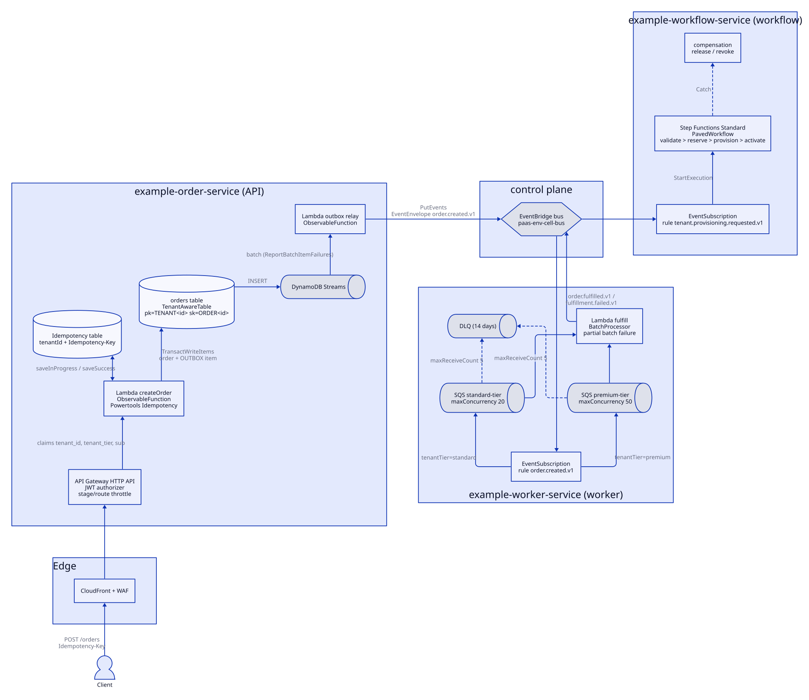

D2ソース：[`diagrams/request-flow.d2`](diagrams/request-flow.d2)。以下は同じ図のMermaid版。

```mermaid
flowchart LR
  subgraph Edge["エッジ"]
    CF[CloudFront + WAF]
  end

  subgraph OrderSvc["example-order-service（API）"]
    APIGW[API Gateway HTTP API<br/>JWT authorizer<br/>tier別throttle]
    OrderFn[Lambda: createOrder<br/>ObservableFunction<br/>Powertools Idempotency]
    IdemTbl[(Idempotency table<br/>tenantId + Idempotency-Key)]
    OrderTbl[(orders table<br/>TenantAwareTable<br/>pk=TENANT#id sk=ORDER#id)]
    Streams[DynamoDB Streams]
    Relay[Lambda: outbox relay<br/>ObservableFunction]
  end

  subgraph Bus["control plane"]
    EB[EventBridge bus<br/>paas-env-cell-bus]
  end

  subgraph WorkerSvc["example-worker-service（worker）"]
    Rule[EventSubscription<br/>rule: order.created.v1]
    QStd[SQS standard-tier<br/>maxConcurrency 20]
    QPrm[SQS premium-tier<br/>maxConcurrency 50]
    DLQ[(DLQ)]
    WorkerFn[Lambda: fulfill<br/>BatchProcessor<br/>partial batch failure]
  end

  subgraph WorkflowSvc["example-workflow-service（workflow）"]
    Rule2[EventSubscription<br/>rule: tenant.provisioning.requested.v1]
    SFN[Step Functions Standard<br/>PavedWorkflow<br/>validate → reserve → provision → activate]
    Comp[compensation<br/>release / revoke]
  end

  Client((Client)) -->|POST /orders<br/>Idempotency-Key| CF
  CF --> APIGW
  APIGW -->|claims: tenant_id, tenant_tier, sub| OrderFn
  OrderFn <-->|saveInProgress / saveSuccess| IdemTbl
  OrderFn -->|TransactWrite<br/>order + OUTBOX item| OrderTbl
  OrderTbl --> Streams
  Streams --> Relay
  Relay -->|PutEvents<br/>EventEnvelope order.created.v1| EB
  EB --> Rule
  Rule -->|tenantTier=standard| QStd
  Rule -->|tenantTier=premium| QPrm
  QStd --> WorkerFn
  QPrm --> WorkerFn
  QStd -.maxReceiveCount 5.-> DLQ
  QPrm -.maxReceiveCount 5.-> DLQ
  WorkerFn -->|order.fulfilled.v1 /<br/>fulfillment.failed.v1| EB
  EB --> Rule2
  Rule2 --> SFN
  SFN -.Catch.-> Comp
```

### 各段階の責務

| 段階                 | 責務                                                                                                                                                                                                    | 指針書の規則  |
| -------------------- | ------------------------------------------------------------------------------------------------------------------------------------------------------------------------------------------------------- | ------------- |
| CloudFront + WAF     | TLS、AWS Managed Rules（Core rule set、Known bad inputs、Amazon IP reputation list）、rate-based rule（tenant / tier別の制限）、security headers。HTTP APIはWAFを直接関連付けられないためCloudFront経由 | 13章          |
| API Gateway HTTP API | JWT検証（`iss` / `aud` / `exp` / `scope`）、routing、stage / route単位throttle（per-client throttleはREST APIのみ）、access log。X-Ray segmentは生成しない                                              | 6章           |
| createOrder Lambda   | `ExecutionContext` 生成、zod validation、scope認可、冪等性、業務ロジック、`TransactWriteItems`                                                                                                          | 5, 6, 9, 16章 |
| Idempotency table    | tenantId + Idempotency-Key で24時間保持（Powertools既定の1時間を延長。例示値）                                                                                                                          | 6, 14章       |
| orders table         | `TENANT#` 接頭辞、SSE-KMS、PITR、Streams（24時間保持、item単位順序）                                                                                                                                    | 5, 9章        |
| outbox relay         | Streams `INSERT` の `OUTBOX#` itemを `EventEnvelope` へ変換して `PutEvents`（1 request合計1 MB未満、最大10 entry）。at-least-once                                                                       | 7, 9章        |
| EventBridge bus      | サービス間イベント配信。順序保証なし・at-least-once。resource policyで発行元限定                                                                                                                        | 7章           |
| EventSubscription    | `detail-type` / `source` / `detail.tenantTier` でrule。target SQS、rule DLQ（配信retryは既定24時間・185回）                                                                                             | 7章           |
| tier別SQS            | 負荷平準化、backpressure、`maxConcurrency` 差（2〜1,000、reserved以下）。visibility timeout = Lambda timeout × 6 + batching window                                                                      | 5, 10, 11章   |
| fulfill Lambda       | `EventEnvelope` 検証、`ExecutionContext` 復元、`id` で冪等、partial batch failure（`ReportBatchItemFailures`）                                                                                          | 7, 12章       |
| DLQ                  | `maxReceiveCount` 5（AWS推奨の下限）、14日保持（SQS最大）、alarm、[redrive runbook](../runbooks/dlq-redrive.md)                                                                                         | 7, 12章       |
| Step Functions       | Saga、retry / backoff / timeout、Catch → compensation、`correlationId` 入力                                                                                                                             | 8章           |

### 同期経路のlatency予算（`POST /orders` p99 800ms、例示値）

```mermaid
gantt
  title p99 予算配賦（ms、累積）
  dateFormat X
  axisFormat %s
  section edge
  CloudFront/WAF (20)        : 0, 20
  section gateway
  API GW + authorizer (30)   : 20, 50
  section lambda
  init (150, cold時)         : 50, 200
  business logic (50)        : 200, 250
  idempotency 2x DDB (40)    : 250, 290
  TransactWrite (60)         : 290, 350
  section margin
  network/serialization/burst margin (450) : 350, 800
```

---

## 2. アカウント / セル トポロジ

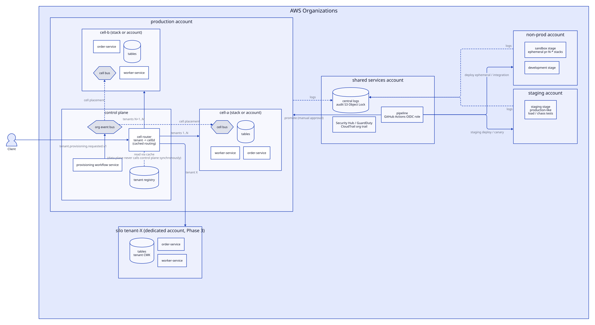

D2ソース：[`diagrams/account-cell-topology.d2`](diagrams/account-cell-topology.d2)（Phase 1〜3を1枚に収めている）。以下はPhase別のMermaid版。

### Phase 1（テンプレートv0.1の初期形）

環境別アカウント、リージョン内pool、単一cell。

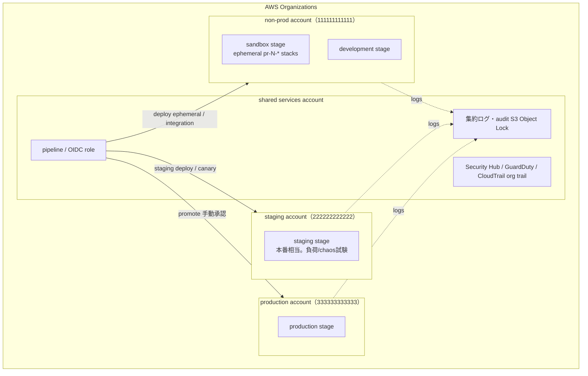

| 環境                  | アカウント                | データ        | 本番deploy                 |
| --------------------- | ------------------------- | ------------- | -------------------------- |
| sandbox / development | non-prod共用（分離可）    | 合成のみ      | —                          |
| staging               | 専用（production とは別） | 匿名化 / 合成 | canary検証                 |
| production            | **専用必須**              | 実データ      | pipelineからのみ、手動承認 |

### Phase 2（cell分割）

tenantをcellへ固定配置し、cell別stackまたはアカウントでblast radiusとquotaを分離する。

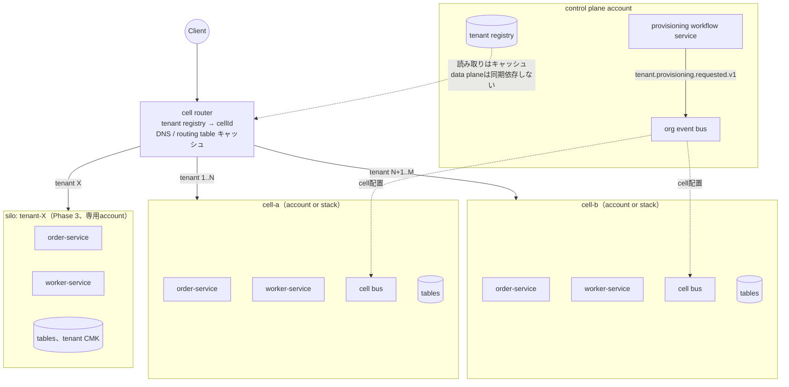

cellの原則（指針書3章、12章）：

- cellは状態を共有しない。共有するのはrouting情報（tenant → cell）のみ。
- cell routerは control plane 障害時も既存の配置をキャッシュで維持する（static stability）。
- cell間のtenant migrationは [指針書9章](../microservice-guidelines.md#9-データ設計) の手順に従う。
- 各cellはLambda concurrency、API Gateway throttle、DynamoDB容量を独立に持つ。

### アカウント分割の前提（指針書11章）

| 前提            | 内容                                                                                                                                                 |
| --------------- | ---------------------------------------------------------------------------------------------------------------------------------------------------- |
| account factory | AWS Control Tower Account Factoryでアカウントを自動払い出し                                                                                          |
| 集中観測        | CloudWatch cross-account observability（monitoring accountにmetrics / logs / traces / SLOを集約。Organizations連携で新規アカウントを自動onboarding） |
| 集中デプロイ    | pipelineからmulti-account deploy（CDK bootstrapのdeployment roleをGitHub Actions OIDCに信頼）                                                        |
| 標準タグ        | `service` / `environment` / `cellId` / `costCenter` / `ownerTeam`（cost allocation tagとして有効化）                                                 |

アカウント追加をquota迂回のみの目的で行わない。Lambdaの同時実行quotaは既定1,000で数万まで増枠可能であり、新規アカウントは縮小quotaから始まる。

---

## 3. 相関ID伝播

`correlationId` は業務フロー全体で1つ。`causationId` は親子関係を示す。X-Ray `traceId` は技術的経路で、samplingされる（既定：毎秒1件 + 残りの5%）。API Gateway HTTP APIはX-Ray tracingに非対応のため、trace rootはLambdaのactive tracingで生成される。

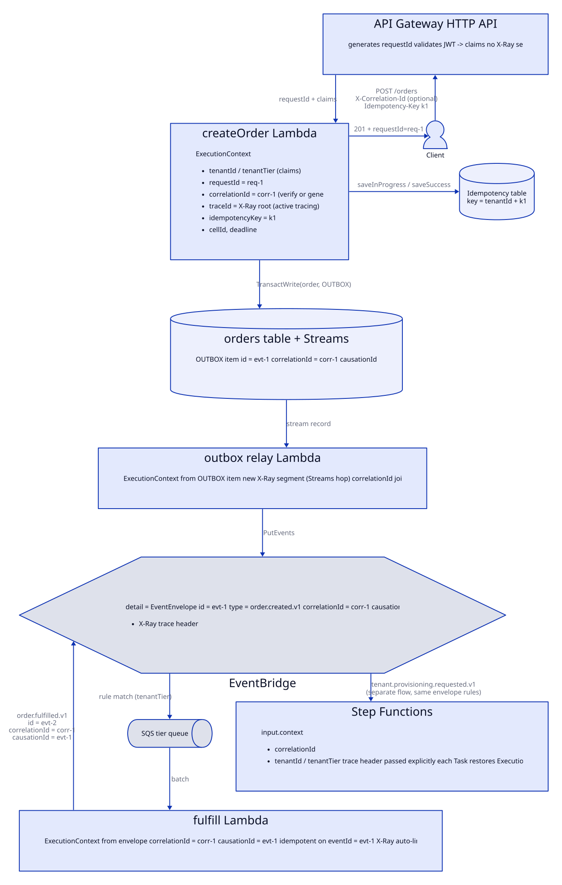

D2ソース：[`diagrams/correlation-propagation.d2`](diagrams/correlation-propagation.d2)。以下はsequence形式のMermaid版。

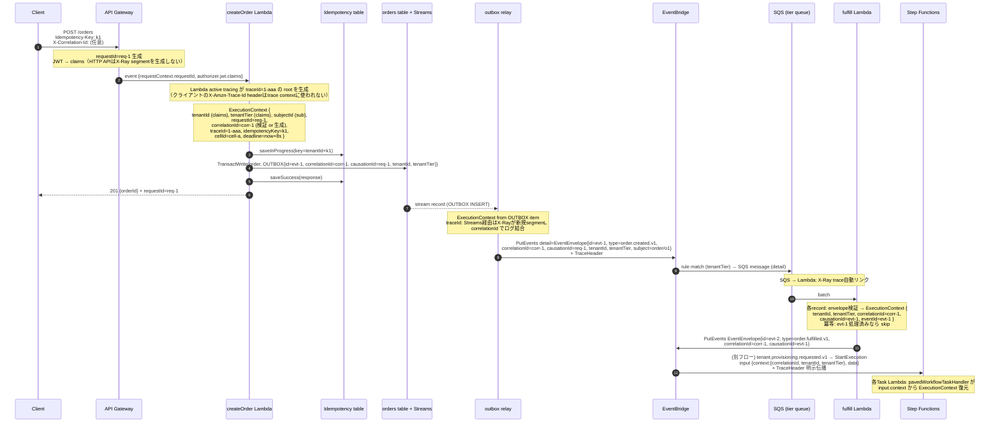

### 識別子の所在

| 識別子           | 生成                                                                              | 保存先                                                                    | 検索手段                                                               |
| ---------------- | --------------------------------------------------------------------------------- | ------------------------------------------------------------------------- | ---------------------------------------------------------------------- |
| `requestId`      | API Gateway                                                                       | access log、Lambda log、エラーレスポンス、`causationId`（最初のイベント） | Logs Insights `filter requestId = "..."`                               |
| `correlationId`  | API入口（検証 or 生成）                                                           | 全Lambda log、`EventEnvelope`、Step Functions入力、audit log              | Logs Insights `filter correlationId = "..."` を全log groupに対して実行 |
| `traceId`        | X-Ray（Lambda active tracingがroot。REST APIを採用した場合のみAPI Gatewayがroot） | X-Ray、Lambda log（`xray_trace_id`）                                      | X-Ray console / `aws xray get-trace-summaries`                         |
| `eventId`        | 発行側（outbox itemのULID）                                                       | `EventEnvelope.id`、consumer冪等記録、log                                 | Logs Insights `filter eventId = "..."`                                 |
| `causationId`    | 発行側（親の `requestId` または `eventId`）                                       | `EventEnvelope`、log                                                      | 因果連鎖の再構築                                                       |
| `idempotencyKey` | クライアント                                                                      | Idempotency table（tenantId + key）、log                                  | —                                                                      |

### trace と correlation の使い分け

| 用途                                                     | 手段                              | 理由                                                                                                    |
| -------------------------------------------------------- | --------------------------------- | ------------------------------------------------------------------------------------------------------- |
| 経路の可視化、latency分解、依存グラフ                    | X-Ray（sampled）                  | 構造化されたsegment / subsegment。sampling判断はparent-basedでroot serviceの判断が下流へ引き継がれる    |
| 特定リクエストの全件追跡（障害調査、サポート問い合わせ） | `correlationId` によるログ検索    | samplingに依存しない。EventBridge archive replayではtrace headerが保持されないが `correlationId` は有効 |
| 監査（誰が何をしたか）                                   | audit log（`correlationId` 付き） | 保持期間・アクセス権が別（S3 Object Lock compliance mode）                                              |

---

## 4. CDK構成

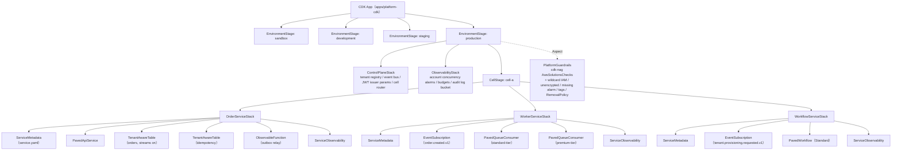

stack間連携は命名規則とSSM parameter（service discovery）で行い、CloudFormation exportと他stackのConstruct直接参照を禁止する（指針書17章）。CloudFormationは、他stackがimportしているexportの変更とexport元stackの削除を、すべてのimportを外すまで拒否する。

---

## 5. パッケージ依存

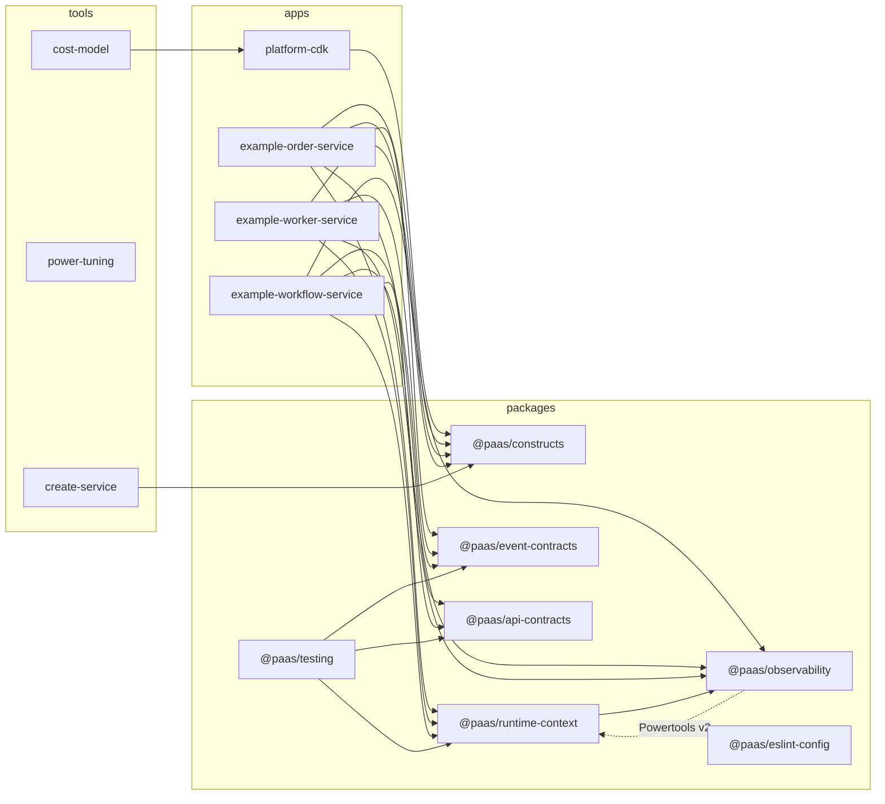

| パッケージ              | 提供物                                                                                                                                                                                                                           |
| ----------------------- | -------------------------------------------------------------------------------------------------------------------------------------------------------------------------------------------------------------------------------- |
| `@paas/runtime-context` | `ExecutionContext`、`AsyncLocalStorage` によるrequest-scoped context、`correlationId` 生成 / 検証、deadline budget、`createClientConfig()`（SDK timeout）、`pavedHttpHandler` / `pavedQueueHandler` / `pavedWorkflowTaskHandler` |
| `@paas/observability`   | Powertools Logger / Tracer / Metrics preset、PII redaction、field allowlist、audit logger                                                                                                                                        |
| `@paas/event-contracts` | `EventEnvelope` zod schema、イベントregistry、version互換性チェック                                                                                                                                                              |
| `@paas/api-contracts`   | `schemas/openapi/` からの生成型・client、標準エラー形 `{error:{code,message,requestId,retryable}}`                                                                                                                               |
| `@paas/constructs`      | `ObservableFunction`、`TenantAwareTable`、`PavedApiService`、`PavedQueueConsumer`、`PavedWorkflow`、`EventSubscription`、`ServiceObservability`、`ServiceMetadata`、`PlatformGuardrails`                                         |
| `@paas/testing`         | fixture（JWT、EventEnvelope）、tenant-isolation helper、ephemeral環境helper                                                                                                                                                      |
| `@paas/eslint-config`   | 依存方向、`no-console`、`no-explicit-any`、`no-default-export`、`no-process-env`                                                                                                                                                 |

サービスの `src/domain/` は `@paas/*` にもAWS SDKにも依存しない（指針書16章。AWS Prescriptive Guidanceのhexagonal architectureに従い、Lambda handlerをprimary adapter、DynamoDB clientをsecondary adapterとして扱う）。

---

## 6. サービス境界

サービス間で許される依存（公開契約のみ）と禁止される依存（他サービスのデータストアへの直接アクセス、共通パッケージへの業務ロジック）を1枚にまとめた図。

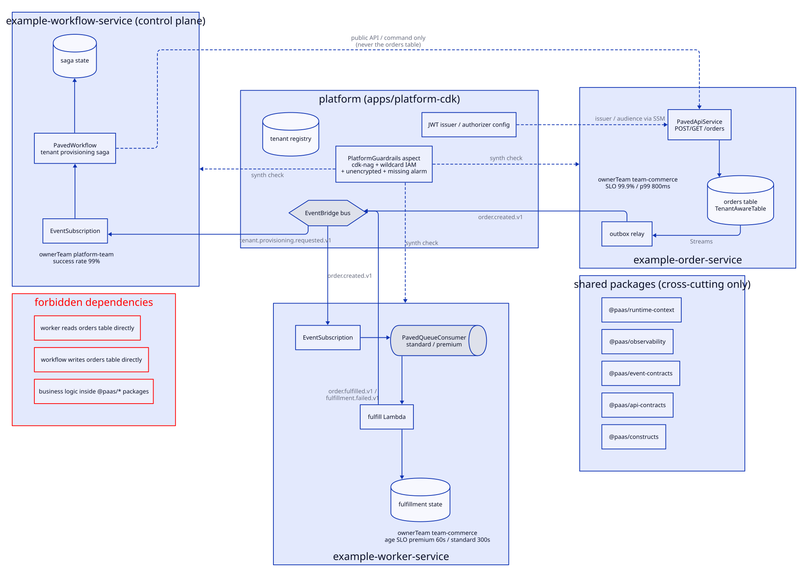

D2ソース：[`diagrams/service-boundaries.d2`](diagrams/service-boundaries.d2)。

| 依存                                                                   | 可否 | 根拠                                                               |
| ---------------------------------------------------------------------- | ---- | ------------------------------------------------------------------ |
| worker → `order.created.v1`（EventBridge経由）                         | 可   | 指針書7章、AWS Decision Guide（EventBridgeによるルーティング）     |
| workflow → order-service 公開API / command                             | 可   | 指針書8章（Sagaは公開契約のみを使う）                              |
| workflow → orders table 直接更新                                       | 不可 | 指針書4章 / 9章（database-per-service、AWS Prescriptive Guidance） |
| worker → orders table 直接読み取り                                     | 不可 | 同上                                                               |
| `@paas/*` に業務ロジック                                               | 不可 | 指針書2章 P6 / 16章（AWS SaaS Lens：共通ライブラリは横断関心のみ） |
| service stack → 他service stackのConstruct参照 / CloudFormation export | 不可 | 指針書17章（export lock）                                          |

---

## 出典

本書の数値・製品挙動は、以下の一次情報を2026-10-17に確認したものに基づく。番号は指針書の References / エビデンス台帳に対応する。

| 本書の記述                                                                             | 出典（指針書References番号）                              |
| -------------------------------------------------------------------------------------- | --------------------------------------------------------- |
| HTTP APIはX-Ray / WAF直接付与 / per-client throttle非対応                              | API Gateway「Choose between REST APIs and HTTP APIs」[77] |
| JWT authorizerの検証項目                                                               | API Gateway HTTP API JWT authorizer[79]                   |
| X-Ray既定sampling（1/s + 5%）、parent-based                                            | X-Ray sampling rules[75]                                  |
| EventBridge archive replayでtrace header非保持                                         | EventBridge X-Ray統合[43]                                 |
| EventBridge順序保証なし・at-least-once                                                 | AWS Decision Guide[57]                                    |
| EventBridge rule retry 24時間・185回                                                   | EventBridge retry policy[69]                              |
| PutEvents 1 MB / 10 entry                                                              | EventBridge PutEvents[71]                                 |
| SQS保持14日、`maxReceiveCount` 5、visibility timeout 6倍                               | SQS quotas[60]、Lambda SQS configure[61]                  |
| SQS `maxConcurrency` 2〜1,000                                                          | Lambda SQS scaling[62]                                    |
| Streams 24時間、item単位順序                                                           | DynamoDB Streams[64]                                      |
| Powertools Idempotency既定1時間                                                        | Powertools Idempotency[87]                                |
| Lambda quota 1,000、新規アカウント縮小quota                                            | Lambda quotas[42]                                         |
| CloudFormation export lock                                                             | CloudFormation stack exports[95]                          |
| Control Tower Account Factory、cross-account observability、CDK bootstrap、GitHub OIDC | [134][135][136][137]                                      |
| WAF managed rule groups名                                                              | AWS WAF[121]                                              |
| hexagonal architecture                                                                 | AWS Prescriptive Guidance[98]                             |
| S3 Object Lock compliance mode                                                         | S3 Object Lock[109]                                       |
| D2 layout engine選択                                                                   | D2 layouts[143]                                           |
| latency予算、throttle値、`maxConcurrency` 値、TTL 24時間                               | 例示値（出典なし。Workload Profileと負荷試験で決める）    |
