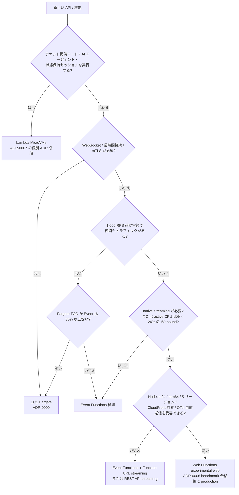

# API 層コンピュート選定: Lambda Event Functions / Web Functions / MicroVMs / ECS Fargate

- Status: proposed
- Date: 2026-10-17
- Owner: platform-team
- Related: [ADR-0005](../adr/ADR-0005-api-gateway-http-vs-rest-api.md), [ADR-0006](../adr/ADR-0006-lambda-event-functions-vs-web-functions.md), [ADR-0007](../adr/ADR-0007-lambda-microvm-usage-policy.md), ADR-0009（ECS/Fargate 評価、起票予定）
- 調査日: 2026-10-17（すべての出典は同日にアクセス）

## 1. 結論 (TL;DR)

- **既定は API Gateway HTTP API + Lambda Event Functions（arm64, Node.js 22, esbuild zip）。** 成熟した CDK L2、Powertools、alias / weighted routing、1 リクエスト 1 環境の障害隔離を優先する。
- **Lambda Web Functions は `runtimeProfile: 'experimental-web'` として sandbox / staging 限定で採用候補。** 「I/O 待ちが長く active CPU 比率が低い API」「native streaming が必要な API（LLM 応答、SSE）」「Hono / Fastify をそのまま動かしたい API」で、ADR-0006 の benchmark に合格したものだけ production へ進める。
- **Web Functions を今すぐ標準にしない理由**: 2026-10-12 公開直後で Node.js 24 / arm64 / 5 リージョンのみ、環境サイズ 2 vCPU / 2 GB 固定、CDK L2 未リリース（PR #39210 open）、X-Ray の Lambda セグメント非生成、WebSocket 非対応、custom domain は CloudFront 前置が必須、費用は active CPU 比率が約 24%（Event 512 MB 比）を超えると Event Functions より高くなる。[^1][^4][^6][^10][^18][^15]
- **Lambda MicroVMs は通常 API に使用禁止。** テナント提供コード、AI エージェント sandbox、状態保持型の対話セッションのみ ADR-0007 の条件で許可する。
- **ECS/Fargate は持続的に高負荷（目安 1,000 RPS 超が常態）または WebSocket / 長時間接続が必須の場合の比較基準。** ゼロスケールできず、中規模トラフィックの多くの API では固定費と運用負荷が不利。

## 2. 前提

| 項目           | 値                                                                                                         |
| -------------- | ---------------------------------------------------------------------------------------------------------- |
| ワークロード   | B2B マルチテナント PaaS の同期 REST API（pool モデル、ADR-0004）                                           |
| トラフィック   | サービスあたり 50〜500 RPS（中規模）。夜間・週末はほぼゼロ、営業時間に burst                               |
| レイテンシ目標 | p99 300〜800 ms（API Gateway 込み、cold start を含む）                                                     |
| ランタイム     | Node.js 22（Event Functions）。Web Functions は現時点で Node.js 24 のみ                                    |
| IaC            | AWS CDK v2（aws-cdk-lib 2.273.0 時点）、pnpm monorepo、Turborepo                                           |
| 観測性         | Powertools for AWS Lambda (TypeScript) 2.36.0、構造化 JSON ログ、`correlationId` / `tenantId` を全行に付与 |
| 経路           | `CloudFront/WAF → API Gateway → Lambda → service-owned datastore`（ADR-0005）                              |
| 料金リージョン | US East (N. Virginia)、arm64 を基準。東京は別途係数が必要                                                  |

## 3. 選択肢の概要

### 3.1 Lambda Event Functions（従来の Lambda）

- 2026-10-12 に既存 Lambda 関数は「Lambda Event Functions」に改称された。コード変更・再デプロイは不要。[^1]
- 1 invocation = 1 リクエスト。実行環境は同時に 1 リクエストしか処理しない。[^2]
- 主要制限: memory 128 MB〜10,240 MB（1,769 MB で 1 vCPU 相当）、timeout 最大 900 秒、同期 payload 6 MB（streaming 応答は 200 MB）、zip 50 MB / 展開 250 MB、同時実行既定 1,000、関数ごとの scale-out 1,000 環境 / 10 秒。[^14]
- 料金（us-east-1）: $0.20 / 100 万リクエスト、duration $0.0000166667 / GB-s（x86）、$0.0000133334 / GB-s（arm64）。無料枠 100 万リクエスト + 40 万 GB-s / 月。[^15]
- 全リージョン、全マネージドランタイム、container image、Provisioned Concurrency、SnapStart、Function URL（streaming 対応）が利用可能。[^14][^15]

### 3.2 Lambda Web Functions（2026-10-12 公開）

- Node.js HTTP サーバ（Express、Hono、Fastify、Next.js など）が `AWS_LAMBDA_HTTP_ENDPOINT` の host:port で listen し、Lambda が HTTPS endpoint を払い出す。アダプタ不要。[^3][^6]
- 1 実行環境が複数リクエストを同時処理（`maxConcurrencyPerEnvironment` 既定 64、範囲 1〜128、Lambda が動的に実効上限を調整）。ゼロまでスケール。[^4]
- 公開時点の制約: ランタイム `nodejs24.x` のみ、arm64 のみ、zip のみ、実行環境は 2 vCPU / 2 GB 固定、request timeout 既定 30 秒（3〜900 秒）、init は 10 秒以内に listen 必須、リージョンは N. Virginia / Ohio / Oregon / Tokyo / Ireland の 5 つ。[^1][^6][^14]
- Endpoint: HomeRegion / MultiRegion / PerRegion の 3 種。`IamAuth` または `ApplicationManaged`。custom domain は直接付けられず CloudFront を前置する。[^7][^8]
- 料金（us-east-1, arm64）: $0.30 / 100 万リクエスト、active vCPU $0.0000276944 / vCPU-s、memory $0.0000036667 / GB-s（環境存続中、**実消費量**で課金）。[^15]
- GA / preview の明記は公式ページにも AWS News Blog にもなく、「available today」とだけ書かれている（確認日 2026-10-17）。[^1][^v1]

### 3.3 Lambda MicroVMs（2026-06-22 公開）

- Firecracker ベースの VM 級隔離 sandbox。Dockerfile からイメージを作り `run-microvm` で起動。memory / disk 状態を保持したまま suspend / resume でき、最大寿命 8 時間（28,800 秒、running + suspended 合計）。[^20][^22][^23]
- 1 MicroVM = 1 専用 HTTPS endpoint。endpoint 間のロードバランシングはなく、全リクエストに JWE 認証トークン必須。HTTP/2、WebSocket、gRPC、SSE 対応。[^23]
- 制限: アカウント合計 memory 400 GB（us-east-1 等は 1,024 GB、4 倍まで burst）、同時接続 8（1 vCPU）〜128（16 vCPU）/ MicroVM、`RunMicrovm` 5 TPS。arm64 のみ。[^14]
- 料金（us-east-1, arm64）: vCPU $0.0000276944 / vCPU-s、memory $0.0000036667 / GB-s、snapshot write $0.0038 / GB、read $0.00155 / GB、image storage $0.08 / GB-月。suspend 中は compute 課金なし。[^15][^21]

### 3.4 ECS on AWS Fargate（非サーバレス基準）

- 常駐コンテナ。ゼロスケール不可、最低 2 task（Multi-AZ）+ ALB が必要。
- 料金（us-east-1, Linux/arm64）: $0.0000089944 / vCPU-s（≒ $0.03238 / vCPU-h）、$0.0000009889 / GB-s（≒ $0.00356 / GB-h）。x86 は $0.04048 / vCPU-h、$0.004446 / GB-h。[^24]
- ALB: $0.0225 / 時 + $0.008 / LCU-時。[^25]

## 4. 評価マトリクス

◎ 優位 / ○ 実用可 / △ 制約あり / × 不適

| 軸                     | Event Functions                                                                     | Web Functions                                                                                                                                                       | MicroVMs                                                                                           | ECS Fargate                                                        |
| ---------------------- | ----------------------------------------------------------------------------------- | ------------------------------------------------------------------------------------------------------------------------------------------------------------------- | -------------------------------------------------------------------------------------------------- | ------------------------------------------------------------------ |
| 性能                   | ○ cold start は PC / SnapStart で管理、warm は安定                                  | ○ 1 環境で 64 並列、headroom 自動確保、native streaming。cold start 実測 ≈ +0.5 s[^33]                                                                              | △ 起動は snapshot で高速だが 1 VM 1 endpoint で API 向きでない                                     | ◎ cold start なし、WebSocket 可。scale-out は分単位                |
| 費用                   | ◎ 中規模まで最安、無料枠あり                                                        | △ active CPU 比率 < 24%（Event 512 MB 比）でないと高い、request 単価 1.5 倍                                                                                         | × 時間課金 + snapshot。短い API では最も高い                                                       | △ 低負荷で固定費、1,000 RPS 常態なら最安                           |
| 維持費                 | ◎ ランタイム自動 patch、runtime management control、成熟した quota                  | ○ 自動 patch（固定不可）、quota は新規アカウントで縮小、新サービス固有の運用知見不足                                                                                | △ image build / snapshot / idle policy の運用が増える                                              | × OS / base image patch、capacity、ALB、deploy pipeline を自前運用 |
| 実現容易性             | ◎ CDK L2 `NodejsFunction`、HTTP API L2、authorizer、Powertools が揃う               | △ CDK は L1 のみ（L2 は PR open）、API Gateway 統合は公式ドキュメントに記載なし（front door として挙がるのは CloudFront OAC のみ[^8]）、SAM は zip packaging 非対応 | △ CDK は L1 `CfnMicrovmImage` のみ（aws-cdk-lib 2.273.0）、L2 なし[^v5]、API 仕様が API 向けでない | ○ CDK `ApplicationLoadBalancedFargateService` は成熟               |
| ローカルデバッグ容易性 | ○ `sam local` / Lambda RIE / LocalStack、ただし event 形式の mock が要る            | ◎ `node server.js` そのまま。LocalStack 2026.10.0 が emulate                                                                                                        | △ Docker で同等コンテナを動かすのみ                                                                | ◎ `docker compose` で本番同等                                      |
| スケーラビリティ       | ◎ 1,000 環境 / 10 秒、同時実行 1,000（引上可）、reserved concurrency でテナント隔離 | ○ 2,000 vCPU = 1,000 環境 / リージョン、endpoint 10,000 RPS、`rateLimit` / `maxEnvironments`。noisy neighbour は環境内で発生                                        | × アカウント memory 400 GB、RunMicrovm 5 TPS                                                       | ○ Service Auto Scaling、数分の遅れ                                 |
| ドメイン管理容易性     | ◎ API Gateway custom domain、mTLS、WAF、per-tenant subdomain が標準                 | △ custom domain は CloudFront + OAC 必須、mTLS 不可、PrivateLink 不可                                                                                               | × 1 VM 1 URL、JWE 認証固定                                                                         | ○ ALB + ACM、mTLS は ALB で可                                      |
| ロギング共通化容易性   | ◎ Powertools Logger / Tracer / Metrics、X-Ray、Application Signals が標準           | △ Lambda セグメント非生成（OTel 自前送信）、Extensions API なし、Powertools は非公式サポート、AsyncLocalStorage 必須                                                | △ CloudWatch Logs のみ。アプリ側で全部                                                             | ○ ADOT sidecar / OTel SDK で標準的だが Powertools 対象外           |

## 5. 軸ごとの詳細

### 5.1 性能

- **cold start**: Event Functions は環境作成 + init を毎回のスケール時に払う。Node.js 22 / arm64 / esbuild bundle の公開ベンチマークは品質が不揃いで、本テンプレートは自前計測を正とする（公式ドキュメントは cold start を定性的に説明するのみで p50/p99 の値は公開していない。確認日 2026-10-17[^v2]）。Provisioned Concurrency と SnapStart（Node.js は対象外、Java / Python / .NET のみ）で管理する。[^14][^15]
- Web Functions は「既存環境の空き（headroom）を Lambda が先読みで確保する」ため、小さな負荷増は cold start を踏まない。第三者計測では依存なしアプリで init 253 ms（CPU 130 ms）、cold リクエストは warm より約 0.5 秒遅い。[^4][^33] 新しい Web Function は動的同時実行上限が保守的に始まり負荷試験の 2 回目以降で安定するため、benchmark は複数回走らせる。[^4]
- **warm レイテンシ**: Event Functions は 1 環境 1 リクエストなので CPU 競合がない。Web Functions は Node.js の単一イベントループを最大 64 リクエストが共有するため、同期 CPU 処理（大きな JSON parse、暗号処理）が同環境の全リクエストを遅延させる。公式は CPU bound なら `maxConcurrencyPerEnvironment` を下げ、I/O bound なら上げるよう案内している。[^4][^6]
- **streaming**: Event Functions は Function URL か REST API（2025-11-19 から response streaming 対応）経由でのみ streaming 可能。HTTP API は非対応。[^27] Web Functions は追加設定なしで SSE / chunked streaming が動く（WebSocket は非対応、HTTP/1.1 のみ）。[^3][^9][^33] MicroVMs は WebSocket / HTTP/2 / gRPC まで対応。[^23]
- **concurrency per environment**: Event 1、Web 1〜128（既定 64、実効値は Lambda が動的決定）、MicroVM は 8〜128 接続（vCPU 数依存）、Fargate は無制限（アプリ依存）。[^4][^14]
- **p99 目標との関係**: 目標 300〜800 ms に対し、Event Functions は cold start を含めても esbuild bundle + arm64 で収まる見込みだが、Web Functions は同環境内の CPU 競合で p99 が崩れる可能性があるため benchmark の「warm p99 が Event 版以下」を必須条件にしている（ADR-0006）。

### 5.2 費用

- **課金モデルの違い**: Event は request + 設定 memory × wall-clock duration。Web は request（1.5 倍）+ active vCPU 秒 + 実消費 memory × 環境存続時間（リクエスト間の idle も含む）。MicroVM は baseline vCPU / memory × 稼働時間 + snapshot。Fargate は task サイズ × 時間。[^15][^24]
- **損益分岐点**: 同じ duration を仮定すると、Web の CPU 課金が Event の duration 課金を下回る条件は `active CPU 比率 r < 0.4815 × Event 設定 memory(GB)`。Event 512 MB なら r < 24%、1,024 MB なら r < 48%、1,769 MB（1 vCPU）なら r < 85%。これに Web の request 割増（$0.10 / 100 万）と環境 memory 課金が上乗せされる。ADR-0006 の「active ratio < 40% なら Web 有利」は 1 GB 設定を前提とした値であり、512 MB API には当てはまらない。
- **公式例（Web Functions）**: I/O 重視 API 1,000 万 req / 月、200 ms、CPU 50 ms、memory 300 MB で $19.61 / 月。SSR 1,500 万 req、150 ms、CPU 40 ms で $25.78 / 月。いずれも 1 環境常時稼働の仮定。[^15]
- **idle cost**: Event は 0（Provisioned Concurrency を除く）。Web は環境が残る間 memory 課金が続き、第三者計測では idle 約 5 分で環境が回収された（公式ドキュメントは「underutilized な環境を drain して削除し、無トラフィック時は 0 まで縮退する」とのみ記載し、idle timeout の値は公開していない。確認日 2026-10-17[^v2][^v3]）。[^33] MicroVM は suspend 中 compute 0 だが snapshot storage が残る。[^21] Fargate は常時固定費。
- **front door**: HTTP API $1.00 / 100 万（3 億超は $0.90）、REST API $3.50 / 100 万。Web Functions は API Gateway を経由しないが custom domain / WAF のために CloudFront が必要で、CloudFront の料金プラン（flat-rate / pay-as-you-go）に依存する。[^26][^19]
- **無料枠**: Event は 100 万 req + 40 万 GB-s / 月。Web Functions の無料枠は料金ページに記載がなく（計算例も「exclude the free tier」と断っている）、AWS Price List API の ap-northeast-1 にも Web Functions の free tier SKU は存在しない（確認日 2026-10-17）。[^15][^v4]
- 具体的な 3 シナリオは第 6 節。

### 5.3 維持費

- **ランタイム**: Event Functions は runtime management control で patch version 固定・段階適用が可能。Web Functions は自動 patch 固定で pin 不可。`nodejs24.x` の deprecation サイクルは Event と同じ。[^6] Node.js 22 を標準にしている本テンプレートでは、Web Functions 採用時に Node.js 24 への引き上げが必須となる（Event 側とのバージョン乖離を許容するかを決める）。
- **quota**: Event の同時実行は Service Quotas で数万まで引き上げ可能。Web Functions は新規アカウントで vCPU / RPS quota が縮小され（第三者計測で 200 vCPU = 100 環境、10,000 RPS）、`GetWebAccountSettings` で確認してから設計する。[^14][^33]
- **on-call の観点**: Event は 1 リクエスト 1 環境なので OOM / 例外が他リクエストへ波及しない。Web は 1 環境のクラッシュで最大 64 リクエストが巻き添えになり、SIGTERM 後 1 秒で強制終了されるため graceful shutdown の猶予も短い。[^5] MicroVM は image build、snapshot、idle policy、8 時間上限 kill、JWE token 配布の運用が加わる。Fargate は base image の CVE 対応、ECS agent / platform version 更新、ALB / target group 監視が常時必要。
- **Extensions**: Web Functions は Lambda Extensions API がなく（登録 / telemetry endpoint が 404）、外部 APM の extension 型エージェントが使えない。telemetry はプロセス内から送る。[^33]
- **デプロイ**: Web Functions は revision が immutable で設定を継承せず、S3 object version を削除すると revision が壊れる。CloudFormation で revision を差し替えると旧 revision が削除され、`revisionWeights` による canary を CloudFormation から運転しにくい。[^33][^34]

### 5.4 実現容易性

- **CDK**: Event Functions は `aws-lambda-nodejs.NodejsFunction`、`aws-apigatewayv2.HttpApi`、`HttpLambdaIntegration`、JWT / Lambda authorizer が L2 で揃う。Web Functions は CloudFormation 型 `AWS::Lambda::WebFunction` / `WebFunctionRevision` / `WebFunctionEndpoint` が存在し、aws-cdk-lib 2.273.0 に L1（`CfnWebFunction` 等）が入っているが、L2 `WebFunction` / `WebFunctionCode` / `NetworkConnector` は PR #39210（2026-10-13 起票、2026-10-16 時点で requested changes）で未リリース。`WebFunctionOrigin` 相当の CloudFront origin L2 も未提供。[^17][^18][^35] MicroVM は CloudFormation `AWS::Lambda::MicrovmImage` と aws-cdk-lib 2.273.0 の L1 `CfnMicrovmImage` があり、L2 はない（確認日 2026-10-17）。[^v5]
- **API Gateway 統合**: Event Functions は proxy integration が標準。Web Functions の endpoint を API Gateway から呼ぶ公式手順は見つからず、`IamAuth` endpoint への SigV4 署名を API Gateway が行う統合は公式ドキュメントに記載がない（endpoint access control が挙げる front door は CloudFront OAC のみ。確認日 2026-10-17）。`ApplicationManaged` endpoint なら HTTP proxy integration で到達できるはずだが endpoint が公開のままになる。[^8]
- **authorizer**: Event は HTTP API JWT authorizer / Lambda authorizer（ADR-0005）。Web は `IamAuth`（SigV4 / CloudFront OAC）か `ApplicationManaged`（アプリ内で JWT 検証）の 2 択で、API Gateway 側の tenant context enrich は使えない。[^8]
- **フレームワーク**: Event で Hono を使うには `hono/aws-lambda` アダプタ、Fastify は `@fastify/aws-lambda` 等が必要。Web は `app.listen(port, host)` のみで動き、Next.js standalone も `AWS_LAMBDA_HTTP_ENDPOINT` を環境変数に写すだけ。[^6]
- **SAM**: Web Functions は CloudFormation 経由で定義できるが、SAM CLI 1.168.0 は Web Function コードの packaging に非対応（zip を S3 に手動 put して VersionId を渡す）。[^34][^33]
- **CLI**: `aws lambda-web deploy --name my-app --code ./my-app` で 1 分未満のデプロイ。AWS CLI 2.37.13 以降が必要。[^2][^16][^33]

### 5.5 ローカルデバッグ容易性

- **Event Functions**: `sam local invoke` / `sam local start-api` / `sam local start-lambda`（Docker 必須）で API Gateway event をエミュレートする。CDK 利用時は `sam local start-api -t cdk.out/<Stack>.template.json`。LocalStack も対応。Hono 経由なら `hono/aws-lambda` を外して `@hono/node-server` で素の HTTP サーバとして動かす二重入口が必要。[^37]
- **Web Functions**: アプリは標準 HTTP サーバなので `AWS_LAMBDA_HTTP_ENDPOINT=127.0.0.1:3000 node index.js` で Lambda と同じ起動経路を再現できる。公式は「同時リクエストをローカルで流し、global state / 共有 cache / event loop block を検出せよ」と明記。native 依存は `docker run --platform linux/arm64 node:24 npm ci --omit=dev` で arm64 用にビルドする。[^13] LocalStack 2026.10.0 が Web Functions（revision、endpoint、IamAuth、streaming、throttling、CloudFormation）を emulate し、hot reload 対応。[^32]
- **MicroVMs**: Dockerfile ベースなので `docker run` で同等コンテナを動かせるが、suspend / resume、lifecycle hook（`/run`、`/suspend`、`/resume`）、JWE 認証の挙動はローカルで再現できない。[^23]
- **Fargate**: `docker compose` で本番同等。最も素直。

### 5.6 スケーラビリティ

- **Event Functions**: 関数ごとに 1,000 環境 / 10 秒で scale-out、アカウント同時実行 1,000（数万まで引上可）。reserved concurrency でサービスごとの上限を固定し、pool テナントの noisy neighbour は API Gateway usage plan（REST）または tenant-aware throttling で抑える。[^14]
- **Web Functions**: 3 つの設定が独立に効く。`maxConcurrencyPerEnvironment`（revision、1〜128、既定 64）、`maxEnvironments`（endpoint、2〜10,000、既定なし）、`rateLimit`（endpoint、100〜10,000 RPS、0 で遮断）。アカウント quota は 2,000 vCPU（= 1,000 環境）/ リージョン、100,000 RPS / アカウント、10,000 RPS / endpoint。上限到達時は HTTP 429 を即時返却しキューしない（新環境 init 中のみ待機）。[^4] 第三者計測では `maxEnvironments` を小さく設定すると burst で 429 が出たが、未設定なら over-provision され 429 は出なかった。[^33]
- **noisy neighbour（Web）**: 1 環境を最大 64 リクエストが共有するため、あるテナントの重い同期処理が同環境内の他テナントの p99 を直撃する。pool モデルでは `maxConcurrencyPerEnvironment` を 16〜32 に下げるか、CPU 重い endpoint を別 Web Function に分離する必要がある。[^6]
- **MicroVMs**: 1 VM 1 endpoint でロードバランシングなし、`RunMicrovm` 5 TPS、アカウント memory 400 GB。API のスケール単位としては不適で、セッション単位の sandbox 専用。[^14][^23]
- **Fargate**: Service Auto Scaling は分単位の遅れ。burst には余剰 task を常駐させる必要がある。

### 5.7 ドメイン管理容易性

- **Event Functions + API Gateway**: custom domain、ACM、mTLS（REST / HTTP API 両対応）、WAF（REST は直接、HTTP API は CloudFront 経由）、per-tenant subdomain は API mapping で実現。すべて CDK L2。[^26]
- **Web Functions**: endpoint ドメインは `{domain-id}.{shard-id}.lambda-web.{region}.on.aws`（MultiRegion は `{domain-id}.lambda-web.global.on.aws`）固定で、custom domain を直接付けられない。CloudFront（2026-10-12 から Web Function origin と OAC 対応、追加料金なし）を前置し、OAC は origin type `lambda`、signing behavior `always-amz-auth`、endpoint は `IamAuth`、resource policy で `cloudfront.amazonaws.com` + `aws:SourceArn` を許可する。[^7][^8][^19] WAF も CloudFront 側。mTLS と PrivateLink は非対応。[^14][^34] per-tenant subdomain は CloudFront の alternate domain name + Host 検査をアプリ側で行う。
- **Lambda Function URL（Event）**: 同じく custom domain 直付け不可で CloudFront + OAC が必要（2024-04 から）。本テンプレートの標準経路は API Gateway なので Function URL は streaming 用途に限定する。
- **MicroVMs**: 1 VM 1 URL、JWE トークン必須。custom domain の概念がなく、PaaS の公開 API 経由で間接的に使う。[^23]
- **Fargate**: ALB + ACM + Route 53 で標準的。mTLS は ALB の trust store で可能。

### 5.8 ロギング共通化容易性

- **Event Functions**: Powertools Logger（`injectLambdaContext`、`correlationIdPath`、`appendKeys`）、Tracer（X-Ray）、Metrics（EMF）が公式サポート。Application Signals は console / CDK から layer を付与するだけで有効化できる（Node.js 18 / 20 / 22）。[^28][^31]
- **Web Functions**: Lambda は `console.*` 出力を JSON log event に包み、`requestId`、`endpointName`、`region` を自動付与する。log group は `/aws/lambda/web/{function}` と `.local` の 2 系統で、既定 retention は無期限。`platform.requestComplete` は DEBUG レベルでしか出ないため、リクエスト単位の REPORT 相当はアプリ側で出す。[^12] `X-Amzn-Trace-Id` は透過されるだけで Lambda セグメントは生成されず、X-Ray へは ADOT / OTel SDK で自前送信する。Monitoring ページは X-Ray について「Lambda service segment を生成しない」とのみ述べ、Application Signals への言及はない（確認日 2026-10-17）。[^10]
- **Powertools の状態**: Powertools TypeScript は 2.29.0（2025-11-21）で Logger / Metrics に AsyncLocalStorage を導入し、2.34.0〜2.36.0（2026-07〜10）で Lambda Managed Instances 並列実行向けに lambda context、log buffer、sampling、Tracer segment を invocation ごとに分離した。[^29] ただし Web Functions には Lambda handler も `context` も存在せず、`injectLambdaContext` が前提とする invocation 境界がない。公式ドキュメントは「Web framework / 非 Lambda 環境は非公式サポート」と明記しており、Web Functions 向けの案内は 2026-10-17 時点で存在しない（Powertools トップページの Tenets、Idempotency、Tracer の各ページで確認）。[^v6]AsyncLocalStorage ベースの context 管理 feature request #4030 は on-hold。[^28][^30]
- **MicroVMs**: CloudWatch Logs への出力のみ。request-scoped context は完全にアプリ側。[^22]
- **Fargate**: ADOT sidecar / FireLens で標準的だが Powertools は対象外。

## 6. 費用試算

### 6.1 前提

| 項目            | 値                                                                                                   |
| --------------- | ---------------------------------------------------------------------------------------------------- |
| 期間            | 30 日 = 2,592,000 秒、720 時間                                                                       |
| リクエスト数    | 10 RPS → 25.92 M、100 RPS → 259.2 M、1,000 RPS → 2,592 M / 月                                        |
| 平均 duration   | 120 ms（全選択肢で同じと仮定。実際は Event 512 MB は 0.29 vCPU 相当なので CPU 処理は遅い）           |
| Event memory    | 512 MB、arm64。無料枠は無視                                                                          |
| active CPU 比率 | 30% → 36 ms vCPU-s / リクエスト                                                                      |
| Web 環境        | 実消費 memory 0.4 GB / 環境。Node.js 単一スレッドのため実効 1 vCPU / 環境、利用率 60% で環境数を決定 |
| Fargate         | arm64、利用率 50% 目標、最低 2 task、ALB 1 台                                                        |
| 除外            | データ転送、CloudWatch Logs、CloudFront、無料枠                                                      |

### 6.2 計算式

```
Event   = req × $0.20/M + req × 0.120 s × 0.5 GB × $0.0000133334
Web     = req × $0.30/M + req × 0.036 s × $0.0000276944
          + envs × 0.4 GB × 2,592,000 s × $0.0000036667
Fargate = tasks × 720 h × (vCPU × $0.03238 + GB × $0.00356)
          + 720 h × $0.0225 + LCU × 720 h × $0.008
envs(Web) = ceil(RPS × 0.036 s / 0.6) ただし最低 1
```

価格出典: Lambda 料金ページ[^15]、Fargate 料金ページ[^24]、ELB 料金ページ[^25]。

### 6.3 結果（月額, USD）

| 項目                                      | 10 RPS              | 100 RPS           | 1,000 RPS          |
| ----------------------------------------- | ------------------- | ----------------- | ------------------ |
| Event requests                            | 5.18                | 51.84             | 518.40             |
| Event duration (GB-s)                     | 20.74               | 207.36            | 2,073.60           |
| **Event 合計**                            | **25.92**           | **259.20**        | **2,592.00**       |
| Web requests                              | 7.78                | 77.76             | 777.60             |
| Web active vCPU                           | 25.84               | 258.42            | 2,584.22           |
| Web memory（環境数）                      | 3.80（1）           | 22.81（6）        | 171.07（45）       |
| **Web 合計**                              | **37.42**           | **358.99**        | **3,532.89**       |
| Fargate task 構成                         | 2 × 0.5 vCPU / 1 GB | 4 × 2 vCPU / 4 GB | 18 × 4 vCPU / 8 GB |
| Fargate compute                           | 28.44               | 227.52            | 2,047.68           |
| ALB（時間 + LCU 概算）                    | 21.96（1 LCU）      | 39.24（4 LCU）    | 246.60（40 LCU）   |
| **Fargate 合計**                          | **50.40**           | **266.76**        | **2,294.28**       |
| 参考: HTTP API（Event 経路の front door） | 25.92               | 259.20            | 2,362.80           |

### 6.4 読み方

- **active CPU 30% / 512 MB では Web Functions が全シナリオで Event より 35〜45% 高い。** 第 5.2 節の損益分岐（r < 24%）を超えているため。CPU 比率 10% の I/O bound API に置き換えると Web の vCPU 課金は 1/3 になり、100 RPS で Web ≈ $186 vs Event $259 と逆転する。したがって Web 採用判断の第一指標は `EnvironmentCPUTime / EnvironmentActiveTime` と Event 版の duration から算出する active CPU 比率である。
- **Event memory を 1,024 MB にすると duration 課金が 2 倍（100 RPS で $466）になり、Web の方が安くなる。** Power Tuning で memory を決めてから比較しないと結論が逆転する。
- **Fargate は 1,000 RPS 常態で最安**だが、10 RPS でも $50 の固定費が消えず、夜間ゼロの B2B トラフィックでは不利。ALB LCU は概算であり、接続数と転送量で ±50% 動く。
- Event 経路では HTTP API の request 課金が Lambda compute と同額程度になる点に注意（REST API なら 3.5 倍）。Web 経路は API Gateway の代わりに CloudFront 課金が乗る。

## 7. 判断フロー



- **MicroVM**: テナント任意コード、AI エージェント sandbox、REPL / notebook のような状態保持セッション、VM 級隔離の契約要求。これ以外は禁止。
- **Fargate**: WebSocket、gRPC、mTLS 直受け、常時高負荷。固定費と運用負荷を TCO で正当化できる場合のみ。
- **Web Functions**: streaming が主目的、または active CPU 比率が低く Event の duration 課金が無駄な API。制約（ランタイム、リージョン、CDK L1、X-Ray、custom domain）を受容し、benchmark 合格が条件。
- **Event Functions**: 上記に当てはまらないすべて。迷ったらこれ。

## 8. 本テンプレートでの扱い

| プロファイル    | `runtimeProfile`          | 既定 construct                                               | 許可 Stage                                                   | 根拠               |
| --------------- | ------------------------- | ------------------------------------------------------------ | ------------------------------------------------------------ | ------------------ |
| Event Functions | `event-zip-arm64`（既定） | `PavedApiService`（HTTP API + `ObservableFunction`）         | 全 Stage                                                     | ADR-0005、ADR-0006 |
| Web Functions   | `experimental-web`        | `ObservableFunction` の experimental preset + CloudFront OAC | sandbox / staging のみ。production は ADR-0006 `accepted` 後 | ADR-0006           |
| MicroVMs        | `microvm-sandbox`         | 専用 Service Stack、専用 execution role                      | 個別 ADR 必須                                                | ADR-0007           |
| Fargate         | `container-fargate`       | `ApplicationLoadBalancedFargateService`                      | ADR-0009 で定義                                              | ADR-0009           |

- `PlatformGuardrails` は production Stage の `experimental-web` と、通常 API の `microvm-sandbox` を synth 時に拒否する（ADR-0006 / ADR-0007 の Compliance 節）。
- **Web Functions benchmark protocol（ADR-0006 Evidence 節を本書の軸に対応付け）**

| 計測項目                    | 取得方法                                                                                                                            | 合格条件                                       |
| --------------------------- | ----------------------------------------------------------------------------------------------------------------------------------- | ---------------------------------------------- |
| cold / warm p50 / p95 / p99 | k6、50 RPS × 10 分 + 0→200 RPS ramp 2 分、3 回以上（Web は 2 回目以降を採用[^4]）                                                   | warm p99 ≤ Event 版、cold p99 ≤ Event 版 × 1.2 |
| burst 時 throttle           | 0→500 RPS step、`EndpointActiveEnvironmentThrottles` / `AccountActiveVCPUArm64Throttles` / `lambda-web-error-type` ヘッダ[^11][^13] | throttle 率 ≤ Event 版 `Throttles`             |
| cost / request              | Cost Explorer（請求タグ）、月 1,000 万 req に換算                                                                                   | Event 版比 20% 以上削減                        |
| active CPU 比率             | `EnvironmentCPUTime / EnvironmentActiveTime`[^11] と Event 版 duration                                                              | < 0.48 × Event memory(GB) でなければ不採用     |
| artifact size / deploy time | zip サイズ、`cdk deploy` 所要時間                                                                                                   | Event 版 × 1.5 以内                            |
| log / trace 一貫性          | `correlationId` で全 request 検索、OTel span 欠落率                                                                                 | 欠落 0%                                        |
| failure isolation           | 1 リクエストに OOM / 例外注入、同環境の他リクエスト影響                                                                             | 他リクエストのエラー率増加 < 1%                |
| memory pressure             | `EnvironmentMaxMemoryUsage`、heap 1,024 MB 既定[^6]                                                                                 | 2 GB の 70% 以下で安定                         |

- MicroVMs は本書の API 比較で「通常 API に不適」と確定し、ADR-0007 の 4 条件（テナント提供コード、AI エージェント sandbox、状態保持セッション、VM 級隔離要求）に限り許可する。
- Fargate 評価（ADR-0009）は本書の第 6 節を初期値として、1,000 RPS 常態のサービスが現れた時点で起票する。

## 9. ローカル開発・デバッグ手順

### 9.1 Event Functions

```bash
# 1. CDK synth で CloudFormation テンプレートを出す
pnpm --filter example-order-service exec cdk synth

# 2. SAM で API Gateway + Lambda をローカル起動（Docker 必須）
sam local start-api -t cdk.out/ExampleOrderService-sandbox.template.json --warm-containers EAGER

# 3. 単発 invoke（event JSON を渡す）
sam local invoke OrderApiFunction -t cdk.out/....template.json -e events/get-order.json

# 4. ユニット/統合テストは Lambda invoke API 互換エンドポイントへ
sam local start-lambda -t cdk.out/....template.json   # http://127.0.0.1:3001
```

- Hono を使う場合は `src/entrypoints/http/handler.ts`（`hono/aws-lambda`）と `src/entrypoints/http/server.ts`（`@hono/node-server`）の二重入口を置き、ローカルは `node server.js` で高速に回し、event 形式の差異は `sam local` と contract test で検証する。
- VS Code デバッグは `sam local invoke -d 5858` で inspector を開く。

### 9.2 Web Functions

```bash
# 1. 本番と同じ起動経路（AWS_LAMBDA_HTTP_ENDPOINT を明示）
AWS_LAMBDA_HTTP_ENDPOINT=127.0.0.1:3000 node --inspect dist/index.js

# 2. 同時リクエストで global state / event loop block を検出
k6 run --vus 64 --duration 60s tests/performance/event-vs-web/local-smoke.js

# 3. arm64 用 production 依存のビルド（native addon がある場合）
docker run --rm --platform linux/arm64 -v "$PWD":/app -w /app node:24 npm ci --omit=dev

# 4. LocalStack 2026.10.0 で endpoint / IamAuth / throttling を emulate
localstack start
cdklocal deploy ExampleOrderService-web-sandbox   # CloudFormation L1 が通る前提

# 5. sandbox へ直接デプロイして実機確認（1 分未満）
aws lambda-web deploy --name order-web-sandbox --code ./dist --auth-type IamAuth
```

- `aws lambda-web deploy` の既定は `ApplicationManaged`（公開 endpoint）。組織 SCP で `lambda:Request/WebFunctionAuthType = ApplicationManaged` を Deny し、`--auth-type IamAuth` を強制する。[^8]
- 応答ヘッダ `lambda-web-request-id` と `lambda-web-logstream` でリクエストと log stream を突合する。[^9][^12]

### 9.3 MicroVMs

```bash
# 1. Dockerfile ベースのアプリをローカルで起動（hook は手動 POST で模擬）
docker build --platform linux/arm64 -t tenant-sandbox . && docker run -p 8080:8080 tenant-sandbox
curl -X POST localhost:8080/aws/lambda-microvms/runtime/v1/run -d '{"microvmId":"local","runHookPayload":"tenant-a"}'

# 2. 実機（sandbox アカウント）
aws lambda-microvms run-microvm --image-identifier arn:aws:lambda:...:microvm-image:tenant-sandbox \
  --idle-policy '{"autoResumeEnabled":true,"maxIdleDurationSeconds":900,"suspendedDurationSeconds":1800}' \
  --maximum-duration-in-seconds 900
aws lambda-microvms create-microvm-auth-token --microvm-identifier <id> --expiration-in-minutes 30 --allowed-ports '[{"allPorts":{}}]'
```

- suspend / resume とスナップショット挙動はローカルで再現できないため、PoC（ADR-0007 Evidence）は sandbox アカウントで行う。

### 9.4 Fargate

```bash
docker compose up --build     # app + 依存サービス
```

## 10. ロギング共通化の実装指針

### 10.1 共通要件

- 全ログ行に `requestId`、`correlationId`、`tenantId`、`service`、`runtimeProfile`、`revision/version` を JSON で付与する。
- `@paas/observability` が runtime profile ごとの preset を提供し、`@paas/testing` の contract test が「同時 64 リクエストでキーが混線しない」ことを検証する。

### 10.2 Event Functions

- Powertools Logger を global に 1 つ生成し、`injectLambdaContext({ correlationIdPath: 'headers."x-correlation-id"', resetKeys: true })` を Middy で適用。`tenantId` は authorizer context から `appendKeys` で付与。1 環境 1 リクエストなので global 可変状態でも混線しない。[^28]
- Tracer は X-Ray active tracing、Metrics は EMF。Application Signals は `ObservableFunction` の `applicationSignals: true` で layer と `AWS_LAMBDA_EXEC_WRAPPER=/opt/otel-instrument` を付与する。[^31]

### 10.3 Web Functions

- **壊れるもの**: Logger の `appendKeys` / `setCorrelationId` / `addContext` はインスタンスの可変状態に書くため、1 プロセスで 64 リクエストが交錯すると A の `tenantId` が B のログに出る。`injectLambdaContext` は handler と `context` を前提とし Web Functions では呼ばれない。log buffer と sampling も invocation 単位の設計。[^28][^29]
- **対策**: Node.js `AsyncLocalStorage` に request-scoped context を置き、ログ出力時に読む。

```ts
// packages/observability/src/web/request-context.ts
import { AsyncLocalStorage } from 'node:async_hooks';
export const requestContext = new AsyncLocalStorage<{
  requestId: string;
  correlationId: string;
  tenantId?: string;
}>();

// Hono middleware
app.use('*', async (c, next) => {
  const requestId = c.req.header('lambda-web-request-id') ?? crypto.randomUUID();
  const correlationId = c.req.header('x-correlation-id') ?? requestId;
  await requestContext.run({ requestId, correlationId }, next);
});

// Logger: Powertools Logger を child ではなくフォーマッタで包む
const base = new Logger({
  serviceName: 'order',
  persistentKeys: { runtimeProfile: 'experimental-web' },
});
export const log = {
  info: (msg: string, extra?: object) => base.info(msg, { ...requestContext.getStore(), ...extra }),
  error: (msg: string, extra?: object) =>
    base.error(msg, { ...requestContext.getStore(), ...extra }),
};
```

- `tenantId` は authorizer がないため JWT 検証 middleware で `requestContext.getStore()!.tenantId = ...` と書き込む。
- `console.*` 直書きでも Lambda が `requestId` を自動付与するが、これは Lambda の request id であり `correlationId` / `tenantId` は乗らない。第三者計測では組み込み `http` モジュール経由のときに runtime が AsyncLocalStorage で `requestId` を付けると報告されており、公式ドキュメントは「console 出力の各 log event に `requestId` を付与する」とのみ述べ、http モジュールや framework に依存する条件は記載していない（確認日 2026-10-17）。[^12] 第三者計測[^33]との差異は benchmark で確認する。
- **Tracer**: Lambda セグメントが作られないため `@opentelemetry/sdk-node` + `@opentelemetry/exporter-trace-otlp-*` または ADOT で X-Ray へ直接送る。`X-Amzn-Trace-Id` はクライアント入力として扱い、信頼する trace header は CloudFront が付けるものに限定する。[^10]
- **Metrics**: EMF は使える（`platform.requestComplete` は DEBUG のみ）。リクエスト単位の duration / status をアプリで EMF 出力する。[^11][^12]
- **ログ運用**: `/aws/lambda/web/{fn}` と `.local` の両方に retention を設定（既定は無期限）、`lambda-web-logstream` で stream を特定、SIGTERM で 1 秒以内に buffer flush。[^5][^12]
- **Powertools 公式対応が出るまで**は上記ラッパーを `@paas/observability/web` に閉じ込め、Powertools が Web Functions 対応を公開した時点で差し替える。

### 10.4 MicroVMs / Fargate

- 両方とも通常の長寿命 Node.js サーバとして 10.3 と同じ AsyncLocalStorage パターンを使う。MicroVM は `microvmId` と `runHookPayload` 由来の `tenantId` を永続キーにし、`/suspend` hook で buffer を flush する。[^23]
- Fargate は ADOT sidecar または OTel SDK。Powertools は非対象。

## 11. 参考

[^1]: AWS What's New, "AWS Lambda announces Lambda Web Functions" (2026-10-12). https://aws.amazon.com/about-aws/whats-new/2026/10/aws-lambda-web-functions/ （2026-10-17 アクセス）

[^2]: AWS News Blog, "Announcing AWS Lambda Web Functions". https://aws.amazon.com/blogs/aws/announcing-aws-lambda-web-functions-for-fast-consistent-web-app-performance-anywhere/ （2026-10-17）

[^3]: AWS Lambda Developer Guide, "AWS Lambda Web Functions". https://docs.aws.amazon.com/lambda/latest/dg/web-functions.html （2026-10-17）

[^4]: AWS Lambda Developer Guide, "Scaling behavior for Lambda Web Functions". https://docs.aws.amazon.com/lambda/latest/dg/web-functions-scaling.html （2026-10-17）

[^5]: AWS Lambda Developer Guide, "Execution environment lifecycle" (Web Functions). https://docs.aws.amazon.com/lambda/latest/dg/web-functions-env-lifecycle.html （2026-10-17）

[^6]: AWS Lambda Developer Guide, "Lambda Web Function runtimes". https://docs.aws.amazon.com/lambda/latest/dg/web-functions-runtimes.html （2026-10-17）

[^7]: AWS Lambda Developer Guide, "Lambda Web Function endpoints". https://docs.aws.amazon.com/lambda/latest/dg/web-functions-endpoints.html （2026-10-17）

[^8]: AWS Lambda Developer Guide, "Lambda Web Function endpoint access control". https://docs.aws.amazon.com/lambda/latest/dg/web-functions-endpoint-access-control.html （2026-10-17）

[^9]: AWS Lambda Developer Guide, "HTTP requests and responses" (Web Functions). https://docs.aws.amazon.com/lambda/latest/dg/web-functions-http.html （2026-10-17）

[^10]: AWS Lambda Developer Guide, "Monitoring Lambda Web Functions". https://docs.aws.amazon.com/lambda/latest/dg/web-functions-monitoring.html （2026-10-17）

[^11]: AWS Lambda Developer Guide, "Using CloudWatch metrics with Lambda Web Functions". https://docs.aws.amazon.com/lambda/latest/dg/web-functions-monitoring-metrics.html （2026-10-17）

[^12]: AWS Lambda Developer Guide, "Web Function logs in Amazon CloudWatch Logs". https://docs.aws.amazon.com/lambda/latest/dg/web-functions-logging.html （2026-10-17）

[^13]: AWS Lambda Developer Guide, "Testing Lambda Web Functions". https://docs.aws.amazon.com/lambda/latest/dg/web-functions-testing.html （2026-10-17）

[^14]: AWS Lambda Developer Guide, "Lambda quotas". https://docs.aws.amazon.com/lambda/latest/dg/gettingstarted-limits.html （2026-10-17）

[^15]: AWS Lambda Pricing. https://aws.amazon.com/lambda/pricing/ （2026-10-17。arm64 duration 単価は同ページの Arm 計算例 "31,600,000 × $0.0000133334" から確認）

[^16]: AWS CLI Command Reference, "lambda-web". https://docs.aws.amazon.com/cli/latest/reference/lambda-web/ （2026-10-17）

[^17]: AWS CloudFormation Template Reference, "AWS::Lambda::WebFunction". https://docs.aws.amazon.com/AWSCloudFormation/latest/TemplateReference/aws-resource-lambda-webfunction.html （2026-10-17）

[^18]: aws/aws-cdk PR #39210 "feat(lambda): add WebFunction and NetworkConnector L2 constructs"（open, 2026-10-13 起票）. https://github.com/aws/aws-cdk/pull/39210 、tracking issue #39234. https://github.com/aws/aws-cdk/issues/39234 （2026-10-17）

[^19]: AWS What's New, "Amazon CloudFront now supports AWS Lambda Web Functions as an origin" (2026-10-12). https://aws.amazon.com/about-aws/whats-new/2026/10/cloudfront-lambda-web-functions-origin/ （2026-10-17）

[^20]: AWS What's New, "AWS introduces Lambda MicroVMs" (2026-06-22). https://aws.amazon.com/about-aws/whats-new/2026/06/aws-lambda-microvms/ （2026-10-17）

[^21]: AWS Lambda MicroVMs product page. https://aws.amazon.com/lambda/lambda-microvms/ （2026-10-17）

[^22]: AWS Lambda Developer Guide, "AWS Lambda MicroVMs". https://docs.aws.amazon.com/lambda/latest/dg/lambda-microvms-guide.html （2026-10-17）

[^23]: AWS Lambda Developer Guide, "Running and using MicroVMs". https://docs.aws.amazon.com/lambda/latest/dg/microvms-launching.html （2026-10-17）

[^24]: AWS Fargate Pricing. https://aws.amazon.com/fargate/pricing/ （2026-10-17）

[^25]: Elastic Load Balancing Pricing. https://aws.amazon.com/elasticloadbalancing/pricing/ （2026-10-17）

[^26]: Amazon API Gateway Pricing. https://aws.amazon.com/api-gateway/pricing/ （2026-10-17）

[^27]: AWS What's New, "Amazon API Gateway now supports response streaming for REST APIs" (2025-11-19). https://aws.amazon.com/about-aws/whats-new/2025/11/api-gateway-response-streaming-rest-apis （2026-10-17）

[^28]: Powertools for AWS Lambda (TypeScript), "Logger". https://docs.aws.amazon.com/powertools/typescript/latest/features/logger/ （2026-10-17）

[^29]: Powertools for AWS Lambda (TypeScript), "Changelog"（2.36.0, 2026-10-06）. https://docs.aws.amazon.com/powertools/typescript/latest/changelog/ （2026-10-17）

[^30]: aws-powertools/powertools-lambda-typescript issue #4030 "Feature request: Context management thru AsyncLocalStorage?"（open, on-hold）. https://github.com/aws-powertools/powertools-lambda-typescript/issues/4030 （2026-10-17）

[^31]: AWS Lambda Developer Guide, "Monitor application performance with Amazon CloudWatch Application Signals". https://docs.aws.amazon.com/lambda/latest/dg/monitoring-application-signals.html （2026-10-17）

[^32]: LocalStack Blog, "AWS Lambda Web Functions Are Here. Test Them Locally with LocalStack." https://blog.localstack.cloud/aws-lambda-web-functions-are-here/ （2026-10-17）

[^33]: Aidan Steele, "Some notes on Lambda Web Functions" (2026-10-12、第三者計測). https://awsteele.com/blog/2026/10/12/some-notes-on-lambda-web-functions.html （2026-10-17）

[^34]: AWS Builder Center, "AWS Lambda Web Functions: Bring Your HTTP Server, Leave the Handler Behind"（第三者）. https://builder.aws.com/content/3KgdjNoXaCVsE5cpXwlOXiGModm/aws-lambda-web-functions-bring-your-http-server-leave-the-handler-behind （2026-10-17）

[^35]: Classmethod, "I tried out VPC connectivity for Lambda Web Functions"（aws-cdk-lib 2.273.0 の L1 挙動、第三者）. https://dev.classmethod.jp/en/articles/lambda-web-functions-vpc-network-connector/ （2026-10-17）

[^36]: AWS Lambda Developer Guide, "Node.js runtime for Lambda Managed Instances"（AsyncLocalStorage 推奨の根拠）. https://docs.aws.amazon.com/lambda/latest/dg/lambda-managed-instances-nodejs-runtime.html （2026-10-17）

[^37]: AWS SAM Developer Guide, "Introduction to testing with sam local start-lambda". https://docs.aws.amazon.com/serverless-application-model/latest/developerguide/using-sam-cli-local-start-lambda.html （2026-10-17）

[^v1]: AWS News Blog, "Announcing AWS Lambda Web Functions for fast, consistent web app performance anywhere" (2026-10-12). https://aws.amazon.com/blogs/aws/announcing-aws-lambda-web-functions-for-fast-consistent-web-app-performance-anywhere/ （2026-10-17。「available today in US East (N. Virginia), US East (Ohio), US West (Oregon), Asia Pacific (Tokyo), Europe (Ireland)」。preview / GA の語はなし）

[^v2]: AWS Lambda Developer Guide, "Execution environment lifecycle" (Web Functions). https://docs.aws.amazon.com/lambda/latest/dg/web-functions-env-lifecycle.html （2026-10-17。cold start の定性的説明のみ。idle 時間の値なし）

[^v3]: AWS Lambda Developer Guide, "Scaling behavior for Lambda Web Functions". https://docs.aws.amazon.com/lambda/latest/dg/web-functions-scaling.html （2026-10-17。「When traffic decreases, Lambda drains underutilized environments and removes them.」「When there is no traffic, Lambda removes all environments.」時間値なし）

[^v4]: AWS Price List Bulk API, `AWSLambda` ap-northeast-1. https://pricing.us-east-1.amazonaws.com/offers/v1.0/aws/AWSLambda/current/ap-northeast-1/index.json （2026-10-17。`APN1-Lambda-Web-Request-ARM` $0.0000003 / request、`APN1-Lambda-Web-vCPU-Second-ARM` $0.0000322421 / vCPU-s、`APN1-Lambda-Web-Memory-GB-Second-ARM` $0.0000042688 / GB-s。free tier SKU は Event Functions の `Global-Request` / `Global-Lambda-GB-Second` のみ）

[^v5]: AWS CloudFormation Template Reference, "AWS::Lambda::MicrovmImage". https://docs.aws.amazon.com/AWSCloudFormation/latest/TemplateReference/aws-resource-lambda-microvmimage.html （2026-10-17）。aws-cdk-lib 2.273.0 の `aws-lambda/lib/lambda.generated.d.ts` に `CfnMicrovmImage` / `CfnWebFunction` / `CfnWebFunctionRevision` / `CfnWebFunctionEndpoint` / `CfnNetworkConnector` が存在することをローカルの node_modules で確認

[^v6]: Powertools for AWS Lambda (TypeScript), トップページ Tenets. https://docs.aws.amazon.com/powertools/typescript/latest/ （2026-10-17。「AWS Lambda only. ... Utilities might work with web frameworks and non-Lambda environments, though they are not officially supported.」）
