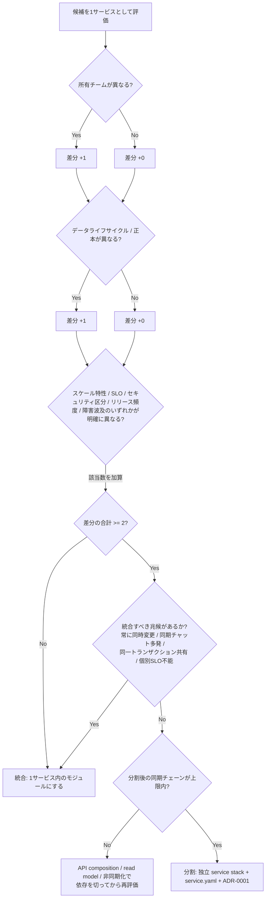
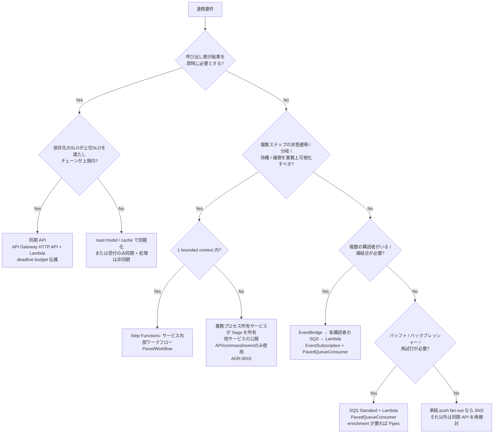
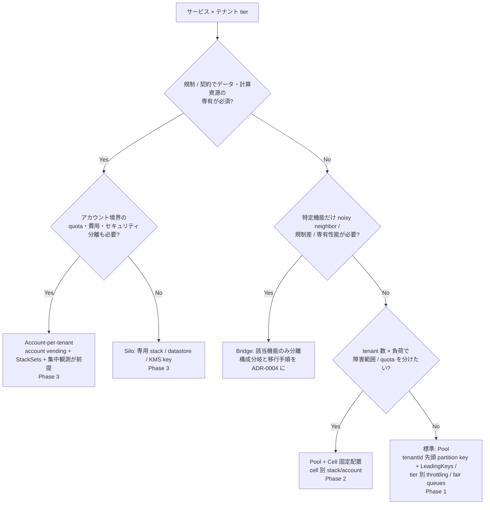
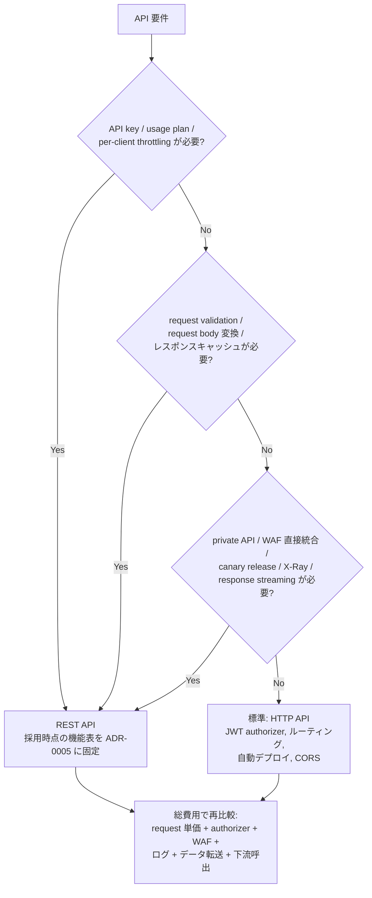
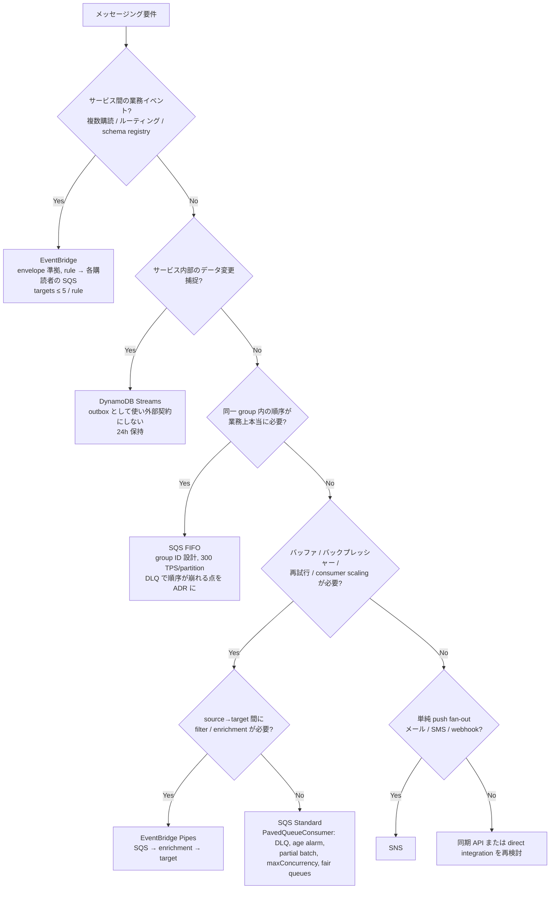
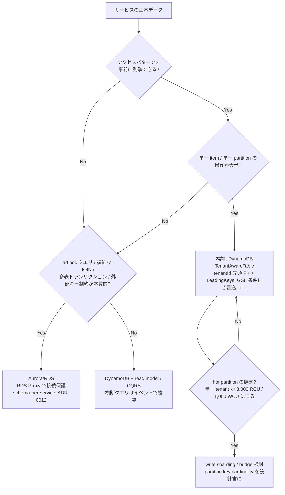
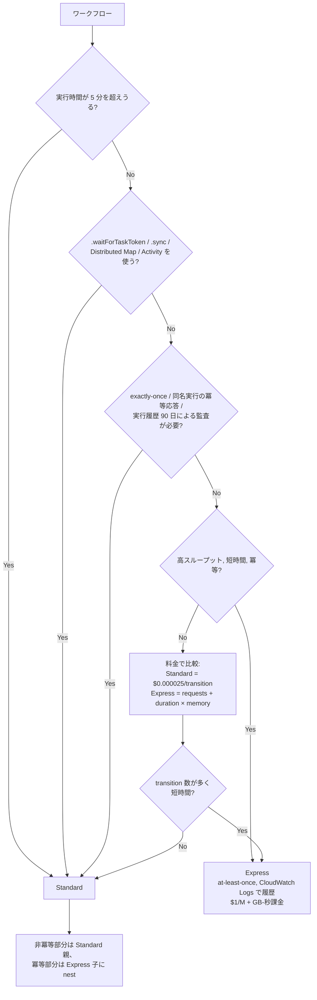

# 決定木集

指針（`docs/architecture/guidelines-outline.md`）の判断基準を、Mermaid フローチャートと順序付き箇条書きの両形式で示す。各決定木の末端は「標準」か「例外（ADR 番号）」に到達する。
使い方：`architecture-decision-questionnaire.md` の回答を入力にして辿る。結論は `service.yaml` と ADR に転記する。
根拠：各決定木の末尾に **分岐ごとの出典** を置く。`E-NN` は `docs/review/evidence-register.md` を参照。出典で裏付けられない数値閾値は「既定値（例示値）」とし、`docs/decision/template-defaults.md` の `TD-NN` を併記する。

---

## DT-1 サービスを分割するか統合するか（指針 §4、ADR-0001）



順序付き手順：

1. 6軸（業務能力、データ正本、変更頻度、スケール/隔離、セキュリティ境界、認知負荷）で候補を評価する。
2. 所有チーム、データライフサイクル、スケール、セキュリティ区分、SLO、リリース頻度、障害波及のうち、明確に異なる軸を数える。
3. 2軸未満なら統合。2軸以上なら次へ。
4. 統合兆候（常に同時変更、同期チャット多発、同一トランザクション共有、個別 SLO 不能）があれば統合。
5. 分割後の同期チェーンが上限を超えるなら、依存を切ってから再評価。
6. 分割する場合、`service.yaml` と ADR-0001 を作成し、他サービスの DB 直接アクセスがないことを確認。

分岐の出典：

- 業務能力・データ正本で分ける：E-64（Organized around Business Capabilities、Decentralized Data Management）、E-79
- 認知負荷：E-66
- 独立デプロイ可能でなければ microservice ではない（統合兆候）：E-63
- 「2 軸以上」「3 ホップ」の数値：既定値（例示値）。調整: docs/decision/template-defaults.md#既定値レジスタ（TD-01、TD-02。ADR-0001 改訂時に見直す）。方向性は E-50、E-56
- 1 サービスの実体は複数 Lambda の stack：E-74

## DT-2 同期 API か、非同期か、ワークフローか（指針 §2、§6、§7、§8、ADR-0010/0011）



順序付き手順：

1. 即時応答が業務上必要か。必要なら同期。ただし依存先 SLO とホップ上限を満たすこと。満たせなければ read model か「受付同期・処理非同期」。
2. 同期不要で、状態遷移・分岐・待機・補償が業務上の概念なら Step Functions。bounded context 内に置く。跨ぐ Saga は業務プロセス所有サービスが所有する。
3. ワークフロー不要なら、購読者が複数または疎結合が必要なら EventBridge。
4. 1対1でバッファ・再試行が必要なら SQS Standard。point-to-point で enrichment が要るなら Pipes。
5. 単純 push fan-out は SNS。該当しなければ同期 API に戻る。
6. 非同期を選んだら、consumer 冪等性、DLQ、message age SLO、envelope 準拠を必須とする。

分岐の出典：

- 同期チェーンと deadline：E-56、E-50、E-03
- Saga は Step Functions で orchestration、参加者は冪等：E-49
- 多対多は event bus、point-to-point は Pipes：E-14
- EventBridge rule の target は 5 まで、各購読者は SQS で受ける：E-11、E-17
- SQS の consumer 要件（partial batch、DLQ、age）：E-18、E-19、E-54
- consumer 冪等性は at-least-once の前提：E-32、E-48

## DT-3 処理ランタイム（指針 §8 決定木、ADR-0006/0007/0008/0009）

```mermaid
flowchart TD
    A[処理単位] --> B{AWSサービス統合だけで完結?}
    B -->|Yes| C[Step Functions native integration /<br/>EventBridge Pipes / API Gateway direct integration<br/>Lambda を作らない]
    B -->|No| D{15分以内・stateless・イベント単位?}
    D -->|Yes| E{native dependency 展開後 250MB 超 または<br/>既存 OCI build が必須?}
    E -->|No| F[標準: zip Lambda Event Function<br/>esbuild, arm64, Node.js 22]
    E -->|Yes| G[Lambda container image (10GB) を比較<br/>size / cold start / supply chain<br/>ADR-0008]
    F --> F2{複数同時HTTP / streaming /<br/>Node.js framework 互換が価値?}
    F2 -->|Yes| F3[Web Functions を experimental で<br/>同一負荷ベンチマーク → ADR-0006]
    F2 -->|No| F
    D -->|No| H{継続高CPU / 長時間 / daemon /<br/>特殊network / 高稼働率?}
    H -->|Yes| I[ECS/Fargate<br/>実行時間・稼働率・CPU・memory・network を実測<br/>ADR-0009]
    H -->|No| J{VM級隔離 / 状態保持 / 対話セッション /<br/>テナント任意コード?}
    J -->|Yes| K[Lambda MicroVMs (最大8時間)<br/>sandbox/agent/tenant code 専用<br/>通常APIは禁止 ADR-0007]
    J -->|No| L{大量並列バッチ?}
    L -->|Yes| M[Step Functions Distributed Map /<br/>AWS Batch / Fargate を<br/>処理時間と単価で比較]
    L -->|No| N[15分以内に分割できないか再設計<br/>→ D へ戻る]
```

順序付き手順：

1. AWS サービス統合だけで完結するなら direct integration / Pipes。wrapper Lambda を作らない。
2. 15 分以内・stateless・イベント単位なら zip Lambda（esbuild、arm64、Node.js 22）が標準。
3. 展開後 250 MB 超の native 依存、または既存 OCI build が必須なら container image（10 GB）を比較。デプロイ形式の違いであり timeout や同時実行モデルは変わらない。
4. Web Functions は「複数同時 HTTP・streaming・framework 互換」に価値がある API だけ、experimental として Event Functions と同一負荷で比較。
5. 継続高 CPU・長時間・daemon・特殊 network・高稼働率なら ECS/Fargate。Lambda との break-even を実測。
6. VM 級隔離・状態保持・対話セッション・テナント任意コードなら MicroVMs。それ以外では禁止。
7. 大量並列バッチは Distributed Map（子実行 10,000 並列）/ Batch / Fargate を処理時間と単価で比較。

分岐の出典：

- Lambda timeout 900 秒、zip 250 MB、container 10 GB、MicroVMs 8 時間：E-01、E-90、E-86
- direct integration / Pipes：E-14、E-50
- esbuild と `nodeModules`：E-37
- arm64 の価格性能と比較手順：E-29、E-30、E-83
- Web Functions の位置づけ（2026-10 公開、active CPU 課金）：E-85
- Distributed Map 10,000 並列：E-21
- Lambda 単価（Fargate 比較の入力）：E-31

## DT-4 テナント分離モデル（指針 §5、ADR-0004）



順序付き手順：

1. 規制・契約で専有が必須なら silo。quota・費用・セキュリティもアカウントで分けるなら account-per-tenant（account factory と集中観測が前提）。
2. 特定機能だけ分離が必要なら bridge。構成分岐と移行手順を ADR-0004 に残す。
3. 障害範囲や quota を tenant 群で分けたいなら pool + cell（Phase 2）。
4. それ以外は pool（Phase 1）。partition key 先頭 `tenantId`、IAM `LeadingKeys`、tier 別 throttling、必要なら SQS fair queues を必須とする。
5. サービスごとに選ぶ。PaaS 全体で一律にしない。

分岐の出典：

- silo / pool / bridge の定義と microservice 単位の選択：E-45
- account-per-tenant の前提（account factory、集中展開）：E-75
- cell は状態を共有しない：E-78
- pool の越境防止（`LeadingKeys`、`Scan` 不可）：E-08
- noisy neighbor 対策（fair queues、partition 上限）：E-20、E-06
- 越境の重大性：E-47

## DT-5 API Gateway HTTP API か REST API か（指針 §6、ADR-0005）



順序付き手順：

1. API key / usage plan / per-client throttling で顧客別クォータを管理するなら REST API。
2. Gateway 側での request validation・body 変換・キャッシュが必要なら REST API。
3. private API、WAF 直接統合、canary release、X-Ray、response streaming が必要なら REST API。
4. それ以外は HTTP API を標準とする（JWT authorizer と自動デプロイは HTTP API のみ）。
5. どちらでも、単価だけでなく authorizer・WAF・ログ・データ転送・下流呼出を含めた総費用で比較し、採用時点の機能表を ADR-0005 に固定する。
6. integration timeout は REST API が 29 秒（Regional / private のみ増枠可で throttle quota とのトレードオフ、edge-optimized は不可）、HTTP API は 30 秒で増枠不可（E-03、E-95）。

分岐の出典：

- 機能差の全項目：E-04
- 料金差：E-93
- REST API timeout と増枠：E-03
- アカウント throttle は API 種別を跨いで共有：E-02

## DT-6 SQS Standard / FIFO / SNS / EventBridge / Pipes（指針 §7、ADR-0011）



順序付き手順：

1. サービス間の業務イベント（複数購読・ルーティング）は EventBridge。各購読者は自前の SQS で受ける。rule あたり target は 5 まで。
2. サービス内部のデータ変更捕捉は DynamoDB Streams。outbox として使い、外部契約にしない。24 時間保持。
3. 順序が業務上本当に必要なら SQS FIFO。group ID と 300 TPS/partition、DLQ で順序が崩れる点を ADR に残す。
4. バッファ・バックプレッシャー・再試行が必要なら SQS Standard。filter / enrichment が要るなら Pipes。
5. 単純 push fan-out は SNS。
6. どれにも該当しなければ同期 API か direct integration を再検討する。

分岐の出典：

- EventBridge の役割と quota：E-11、E-12
- Streams の保持と順序：E-09、E-48
- FIFO の throughput と DLQ 注意：E-15、E-19
- Pipes の用途：E-14
- Standard の consumer 要件と fair queues：E-16、E-17、E-18、E-20
- メッセージ年齢の監視：E-54

## DT-7 DynamoDB か Aurora/RDS か（指針 §9、ADR-0012）



順序付き手順：

1. アクセスパターンを事前に列挙でき、単一 item / 単一 partition 操作が大半なら DynamoDB（`TenantAwareTable`）。
2. ad hoc クエリ、複雑な JOIN、多表トランザクション、外部キー制約が本質的なら Aurora/RDS。RDS Proxy で接続を保護し、schema-per-service を守る。
3. 横断クエリが必要でも関係モデルが本質でないなら DynamoDB + read model / CQRS。
4. DynamoDB を選んだら、partition key cardinality、hot partition（1 partition 3,000 RCU / 1,000 WCU）、on-demand の 2 倍則、GSI（20 まで）、条件付き書き込み、TTL を設計書に明記する。tenant skew が大きければ write sharding か bridge を検討。

分岐の出典：

- partition 上限と write sharding：E-06
- on-demand の burst 特性：E-07
- GSI 上限、テーブル quota：E-05
- `LeadingKeys` と `Scan` 不可：E-08
- RDS Proxy：E-69
- database-per-service と CQRS / API composition：E-62、E-80

## DT-8 Step Functions Standard か Express か（指針 §8、§15、ADR-0010）



順序付き手順：

1. 5 分を超えうる → Standard（最大 1 年）。
2. `.waitForTaskToken`、`.sync`、Distributed Map、Activity を使う → Standard（Express 非対応）。
3. exactly-once、同名実行の冪等応答、実行履歴（90 日）による監査が必要 → Standard。
4. 高スループット・短時間・冪等 → Express（at-least-once、Logs で履歴、Logs 課金が追加）。
5. それ以外は料金で比較。transition が多く短時間なら Express、そうでなければ Standard。
6. 混在する場合は Standard の親に Express の子を nest する。
7. いずれでも、Task の `TimeoutSeconds`、Lambda 一時エラーの `Retry`、補償、実行 alarm、trace 伝播を `PavedWorkflow` で付与する。

分岐の出典：

- 実行時間・履歴・redrive の quota：E-21
- 実行セマンティクスと非対応パターン：E-22
- 料金：E-23
- nest と timeout のベストプラクティス：E-24
- trace header 伝播：E-87

---

## 決定木の結論を記録する場所

| 決定木 | `service.yaml`                                       | ADR                     |
| ------ | ---------------------------------------------------- | ----------------------- |
| DT-1   | `serviceId`, `domain`, `ownerTeam`                   | ADR-0001                |
| DT-2   | `syncContracts`, `publishedEvents`, `consumedEvents` | ADR-0010/0011           |
| DT-3   | `runtimeProfile`                                     | ADR-0006/0007/0008/0009 |
| DT-4   | `tenantIsolationModel`, `awsAccounts`                | ADR-0003/0004           |
| DT-5   | `syncContracts`（Gateway 種別）                      | ADR-0005                |
| DT-6   | `publishedEvents`, `consumedEvents`                  | ADR-0011/0013           |
| DT-7   | `dataClassification`（datastore 種別）               | ADR-0012                |
| DT-8   | `runtimeProfile`（workflow 種別）                    | ADR-0010                |
