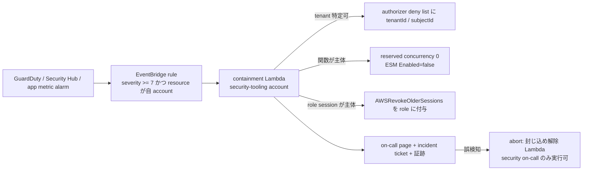

# 第21章 破壊と再生・侵入耐性（Chaos / Resilience / Intrusion Containment, Detection, Traceability）

| 項目     | 内容                                                                                                                                                                                                                                                                                                                                                                                                                                 |
| -------- | ------------------------------------------------------------------------------------------------------------------------------------------------------------------------------------------------------------------------------------------------------------------------------------------------------------------------------------------------------------------------------------------------------------------------------------ |
| 位置づけ | [設計指針書](microservice-guidelines.md) の第21章。第12章（信頼性）、第13章（セキュリティ）、第14章（トレーサビリティ）、第19章（運用）を前提に、**壊して確かめる（chaos）**、**侵入されても範囲を限定する（containment）**、**侵入に気づく（detection）**、**何が起きたかを後から証明する（traceability）** を一つの章にまとめる                                                                                                    |
| 版       | v0.1（2026-10-18）。出典の確認日はすべて 2026-10-18                                                                                                                                                                                                                                                                                                                                                                                  |
| 関連     | [runbooks/security-incident.md](runbooks/security-incident.md)、[threat-models/order-service.md](threat-models/order-service.md)、[ADR-0003](adr/ADR-0003-multi-account-topology.md)、[ADR-0004](adr/ADR-0004-tenant-isolation-models.md)、[ADR-0007](adr/ADR-0007-lambda-microvm-usage-policy.md)、[ADR-0015](adr/ADR-0015-trace-and-correlation.md)、[ADR-0020](adr/ADR-0020-deployment-strategy.md)、起票候補 ADR-0025 / ADR-0026 |

本章の規範語は RFC 2119 に従う。出典のない数値は「既定値（例示値）: …（調整: TD-NN）」「計測で確定: …（M-NN）」「公式ドキュメントに記載なし（確認日、URL）」のいずれかで書く（正本は [テンプレート既定値レジスタ](decision/template-defaults.md)）。

---

## 21.1 目的と前提

### 目的

- **破壊と再生**：障害を staging で意図的に起こし、steady state が保たれること、alarm が鳴ること、runbook どおりに再生できることを定期的に証明する。
- **影響範囲の限定**：1 つの資格情報・1 つの関数・1 つのテナント・1 つの cell が侵害されても、他テナント・他サービス・他アカウントへ波及しない構造にする。
- **侵入検出**：AWS のマネージド検出（GuardDuty / Security Hub / Inspector / Access Analyzer / Config）とアプリ層の検出（tenant 越境試行、authorizer 失敗率、冪等キー衝突、cursor 偽装）を一つの通知経路に集める。
- **侵入トレーサビリティ**：`correlationId` / `tenantId` / `subjectId` を持つアプリログと、CloudTrail の `userIdentity` を突合し、改ざん不能な保管先に残す。

**根拠 / 準拠**：Principles of Chaos Engineering[^1]、Netflix Chaos Monkey[^2]、AWS Well-Architected REL12-BP04 / REL12-BP05[^4][^5]、AWS FIS[^6][^7][^8]、AWS Resilience Hub[^9][^10]、AWS Security Reference Architecture（SRA）[^58][^59]、Well-Architected SEC04-BP01 / SEC10[^60][^61]、AWS Security Incident Response Guide[^62]、NIST SP 800-61 Rev. 3[^64]、NIST CSF 2.0[^65]、MITRE ATT&CK（IaaS matrix, v20）[^66]、OWASP Top 10 for LLM Applications 2025[^67]、OWASP Agentic AI Threats and Mitigations[^68]、CISA ほか「AI Data Security」[^69]、Anthropic / CrowdStrike / Google Threat Intelligence Group / Microsoft の 2025〜2026 年脅威レポート[^70][^71][^72][^73][^74]、Google SRE Book[^75][^76]。

### この PaaS の脅威モデル（前提）

第13章の STRIDE（サービス単位）に対し、本章はプラットフォーム全体の「攻撃者像」を固定する。

| 前提                | 内容                                                                                                                                                                                                                                                                                                                                                                                                                                                                                                                                                                                                                                                                                                                                                                                                                                                                                                                                                 |
| ------------------- | ---------------------------------------------------------------------------------------------------------------------------------------------------------------------------------------------------------------------------------------------------------------------------------------------------------------------------------------------------------------------------------------------------------------------------------------------------------------------------------------------------------------------------------------------------------------------------------------------------------------------------------------------------------------------------------------------------------------------------------------------------------------------------------------------------------------------------------------------------------------------------------------------------------------------------------------------------- |
| マルチテナント      | pool を標準とし（ADR-0004）、1 テナントの侵害が同じテーブル・同じ関数・同じ同時実行予算を共有する他テナントへ波及しうる。越境は「重大で回復不能になりうる事象」（SaaS Lens、E-47）                                                                                                                                                                                                                                                                                                                                                                                                                                                                                                                                                                                                                                                                                                                                                                   |
| 侵入経路            | (a) 盗まれた・漏えいした資格情報での「ログイン」、(b) 公開 endpoint への injection / credential stuffing、(c) 依存パッケージや Lambda layer のサプライチェーン、(d) テナントが持ち込むコード・AI エージェントへの prompt injection                                                                                                                                                                                                                                                                                                                                                                                                                                                                                                                                                                                                                                                                                                                   |
| AI 支援型攻撃の特徴 | **速度と自動化**：Anthropic は 2025-11 に、Claude Code を agentic に操作して約 30 組織へ侵入を試み、偵察・exploit 作成・資格情報収集・持ち出しの 80〜90% を AI が実行した国家支援キャンペーンを公表した（「thousands of requests, often multiple per second」）[^70]。CrowdStrike 2026 Global Threat Report は eCrime の平均 breakout time 29 分（最速 27 秒）、検知の 82% が malware-free、AI を使う攻撃の 89% 増を報告した[^71]。**資格情報悪用が主経路**：同レポートは「break in ではなく log in」を指摘し、Microsoft Digital Defense Report 2025 も identity 攻撃の増加を主題にしている[^74]。**guardrail 回避**：Google Threat Intelligence Group は CTF や学術研究を装う prompt で安全機構を回避する手口と、実行時に LLM を呼ぶ malware（PROMPTFLUX / PROMPTSTEAL）を 2025-11 に報告した[^73]。2025-01 の同報告では「新規能力ではなく生産性向上」と評価していたが[^72]、11 月には「novel AI-enabled malware in active operations」へ更新された |
| 設計上の帰結        | 人手の封じ込めは攻撃速度に追いつかない。**検出から封じ込めまでを自動化し、誤検知時に人が止められる**設計（21.7）を標準にする。全アクセスは短命資格情報、全データ経路は tenant 文脈で絞り、全操作はトレース可能にする                                                                                                                                                                                                                                                                                                                                                                                                                                                                                                                                                                                                                                                                                                                                 |

---

## 21.2 破壊と再生（Chaos Engineering）

### 原則

Principles of Chaos Engineering は chaos engineering を「本番の乱れた条件に耐える能力への確信を得るために、システムで実験する規律」と定義し、(1) steady state の仮説、(2) 実世界の事象の再現、(3) 本番での実験、(4) 継続的な自動実行、(5) blast radius の最小化を挙げる[^1]。Netflix Chaos Monkey は本番でインスタンスを無作為に停止し、インスタンス障害に耐えるサービスを作らせる[^2]。AWS Well-Architected REL12-BP04 は「production またはそれに近い環境で定期的に chaos 実験を行う」ことを求め、FIS の stop condition（CloudWatch alarm）を guardrail とし、仮説のテンプレートとして「If {{fault}} occurs, the {{workload}} will {{mitigating controls}} to maintain {{metric impact}}」を示す[^4]。REL12-BP05 は game day を「production 相当の環境で、人・プロセス・技術の応答を試す定期行事」と定義する[^5]。Google SRE は「proactive approach to disaster and emergency testing」を取り、テストで起きた障害から「rollback 手順を事前に試す」「手順を周知する」教訓を得ている[^75]。

本テンプレートは次を標準とする。

- 実験は **staging を既定** とし（ADR-0003 の `staging` アカウントは chaos test 用途）、production では canary（CodeDeploy）と synthetic traffic に限定して段階導入する。REL12-BP04 も「まず非本番で、次に本番で」を推奨する[^4]。
- 実験は FIS experiment template と `tests/resiliency/` のコードで **code 化** し、CI と月次 game day の両方で実行する（REL12-BP04 の「experiments as code」）[^4]。
- 各実験は steady state、仮説、blast radius、abort 条件（stop condition）、再生手順、記録先を **MUST** 持つ。

### AWS FIS の serverless 対応（公式確認 2026-10-18）

| 対象                               | FIS の対応                                                                                                                                                                                                                                                                                                                                                                                                                                                                                                                                                                                                                                                                                             |
| ---------------------------------- | ------------------------------------------------------------------------------------------------------------------------------------------------------------------------------------------------------------------------------------------------------------------------------------------------------------------------------------------------------------------------------------------------------------------------------------------------------------------------------------------------------------------------------------------------------------------------------------------------------------------------------------------------------------------------------------------------------ |
| Lambda（Event Functions）          | `aws:lambda:invocation-add-delay`（`startupDelayMilliseconds` 0〜900,000、既定 1,000）、`aws:lambda:invocation-error`（`preventExecution` で関数を実行せずに失敗を返せる）、`aws:lambda:invocation-http-integration-response`（`statusCode` / `contentTypeHeader` を差し替え、API Gateway / ALB / VPC Lattice 統合向け）。いずれも `invocationPercentage`（1〜100）で割合を絞れる[^6]。**FIS managed extension を layer として関数に付け、`AWS_LAMBDA_EXEC_WRAPPER=/opt/aws-fis/bootstrap` と S3 の設定場所 `AWS_FIS_CONFIGURATION_LOCATION` を設定する**。extension は設定を最大 60 秒間隔でポーリングするため fault 反映に最大 60 秒の ramp-up がある。response streaming を使う関数では使えない[^7] |
| Lambda（Web Functions / MicroVMs） | 公式ドキュメントに記載なし（確認日 2026-10-18、https://docs.aws.amazon.com/fis/latest/userguide/fis-actions-reference.html ）。Lambda action の resource type は `aws:lambda:function` のみ[^6]                                                                                                                                                                                                                                                                                                                                                                                                                                                                                                        |
| DynamoDB                           | `aws:dynamodb:global-table-pause-replication` のみ（global table のレプリケーション停止）[^6]。**テーブル単位の throttle / latency / error 注入 action は公式ドキュメントに記載なし**（同上）。API 層の `aws:fis:inject-api-throttle-error` / `inject-api-internal-error` / `inject-api-unavailable-error` も対象 `service` は `ec2` と `kinesis` のみ[^6]                                                                                                                                                                                                                                                                                                                                             |
| SQS / EventBridge                  | **公式ドキュメントに記載なし**（確認日 2026-10-18、同 URL）。action 一覧に `aws:sqs:*` / `aws:events:*` は存在しない[^6]                                                                                                                                                                                                                                                                                                                                                                                                                                                                                                                                                                               |
| ネットワーク                       | `aws:network:disrupt-connectivity`、`aws:network:disrupt-vpc-endpoint`、cross-region 経路の遮断[^6]。VPC Lambda / NetworkConnector 経由の経路に使える                                                                                                                                                                                                                                                                                                                                                                                                                                                                                                                                                  |
| stop condition                     | CloudWatch alarm を stop condition に指定でき、発火すると実験は停止し再開できない[^8]。REL12-BP04 は template あたり最大 5 件と記す[^4]                                                                                                                                                                                                                                                                                                                                                                                                                                                                                                                                                                |
| 補完ツール                         | Gremlin Failure Flags は AWS Lambda を公式サポート対象に含み、sidecar proxy または SDK でアプリ層の fault（特定顧客向けエラー、二重配信、API の予期しない応答など）を注入する。実験が動いていない間はアプリに影響しない[^3]                                                                                                                                                                                                                                                                                                                                                                                                                                                                            |

**設計上の帰結**：SQS / EventBridge / DynamoDB テーブルへの障害注入は FIS では作れないため、本テンプレートは **アプリ側の simulation hook** と **IAM / 設定変更による擬似障害**（下表）で代替する。これは「custom script は状態把握・ログ・rollback を備える場合のみ」という REL12-BP04 の条件[^4]を満たすよう、hook を `@paas/testing` の fixture と runbook で管理する。

### 本テンプレートの simulation hook（コードで確認 2026-10-18）

| hook                                       | 所在                                                    | 挙動                                                                                                                |
| ------------------------------------------ | ------------------------------------------------------- | ------------------------------------------------------------------------------------------------------------------- |
| sku `POISON-*`                             | `apps/example-worker-service/src/domain/fulfillment.ts` | 恒久失敗（`PermanentFulfillmentError('POISON_MESSAGE')`）。retry せず failed-event 経路へ                           |
| sku `FLAKY-ONCE`                           | 同上                                                    | 初回のみ一時失敗、2 回目以降成功（retry と冪等性の検証）                                                            |
| `cellId = cell-flaky`                      | `apps/example-workflow-service/src/tasks/provision.ts`  | 70% の確率で一時失敗（state machine の backoff + jitter retry を検証）                                              |
| `cellId = cell-full`                       | 同上                                                    | 恒久失敗（補償トランザクションを検証）                                                                              |
| `tests/resiliency/fault-injection.test.ts` | `tests/resiliency/`                                     | AWS 不要。poison message で retry storm が起きないこと、下流 publish 失敗が batch item failure として返ることを検証 |
| `TenantIsolationViolationAttempt`          | `packages/observability/src/metrics.ts`                 | metric 名のみ定義。**発行箇所は未実装**（2026-10-18 時点）。21.4 で発行箇所を規定する                               |

### game day シナリオ表

値は例示値。仮説の書式は REL12-BP04 のテンプレート[^4]に従う。

| #   | シナリオ                                  | 注入手段                                                                                                                         | steady state / 仮説                                                                                   | blast radius             | abort 条件（stop condition）                 | 再生手順                                                                                                                                 |
| --- | ----------------------------------------- | -------------------------------------------------------------------------------------------------------------------------------- | ----------------------------------------------------------------------------------------------------- | ------------------------ | -------------------------------------------- | ---------------------------------------------------------------------------------------------------------------------------------------- |
| G1  | API 依存先の遅延                          | FIS `aws:lambda:invocation-add-delay`（order API、`invocationPercentage` 10%、1,500 ms）[^6]                                     | p99 ≤ SLO + 遅延分、`DeadlineExceeded` が増えても 5xx 率 < 1%、retry 増幅なし（SDK 3 回以内）         | staging の 1 サービス    | availability burn rate fast alarm（第19章）  | 実験終了で自動復旧。残留なし                                                                                                             |
| G2  | API 障害 → canary rollback                | FIS `aws:lambda:invocation-http-integration-response`（statusCode 500、20%）を canary version に適用[^6]                         | CodeDeploy alarm が発火し自動 rollback（TD-25）、全体成功率 ≥ 99%                                     | canary 10% トラフィック  | rollback 完了 or 5 分経過                    | CodeDeploy が前 version へ traffic を戻す[^11]。`deploymentVersion` で確認                                                               |
| G3  | poison message                            | sku `POISON-*` を含む `order.created.v1` を投入                                                                                  | 5 回受信後 DLQ、alarm、他メッセージの処理継続、retry storm なし                                       | worker 1 queue           | DLQ > 100 or age alarm                       | [dlq-redrive](runbooks/dlq-redrive.md)。poison は退避、再 redrive しない                                                                 |
| G4  | 一時障害と再生                            | sku `FLAKY-ONCE`、`cellId = cell-flaky`                                                                                          | 冪等再実行で 1 回だけ副作用、補償なしで成功                                                           | worker / workflow 1 実行 | 二重履行検出（`IdempotentReplayCount` 異常） | 不要                                                                                                                                     |
| G5  | 配信停止 → 蓄積 → replay                  | EventBridge rule を一時 disable（擬似障害）                                                                                      | API 継続、outbox 蓄積、rule 再有効化後に全件配信。archive から replay しても冪等性で二重処理なし      | 1 bus                    | outbox 未発行 > 1,000 件 or 30 分            | rule 再有効化。欠落分は EventBridge archive の replay（最大 10 同時、`replay-name` 付与、投入から 10 分待つ）[^12]                       |
| G6  | consumer 停止                             | event source mapping `Enabled=false`[^16] または reserved concurrency 0[^15]                                                     | queue に蓄積、age alarm 発火、再開後に backlog 消化が SLO 内                                          | worker 1 関数            | age > 3× SLO                                 | `Enabled=true` / reserved concurrency 復元。消化速度は `maxConcurrency` で制御                                                           |
| G7  | データ破壊 → PITR 復元                    | staging で `DeleteItem` 大量実行（擬似）                                                                                         | PITR で任意秒へ復元できる（RPO ≤ 5 分、`LatestRestorableDateTime` は通常 5 分前）[^13]                | staging 1 テーブル       | なし（staging 専用）                         | `restore-table-to-point-in-time` は **新テーブルに復元**するため、alias / 環境変数の切替と IAM・alarm・TTL・PITR 設定の再適用が必要[^13] |
| G8  | control plane 停止                        | tenant registry の Lambda を reserved concurrency 0[^15]                                                                         | data plane は JWT claims の tier で処理継続（第12章 static stability）                                | staging control plane    | API 5xx > 1%                                 | 復元                                                                                                                                     |
| G9  | 侵入シミュレーション（security game day） | GuardDuty sample findings（Lambda Protection / AttackSequence）生成[^40]、staging で漏えい想定の access key を発行して検知を待つ | 検知 → 自動封じ込め（21.7）→ runbook（security-incident）が時間内に完走する。TTD / TTC を記録（M-26） | staging の 1 テナント    | 封じ込めが他テナントへ波及した時点           | 封じ込めの解除手順（runbook §6）                                                                                                         |

### 再生（recovery）の標準手段

| 手段                       | 公式仕様（確認日 2026-10-18）                                                                                                                                                                                                      | 本テンプレートでの使い方                                                             |
| -------------------------- | ---------------------------------------------------------------------------------------------------------------------------------------------------------------------------------------------------------------------------------- | ------------------------------------------------------------------------------------ |
| 再デプロイ / rollback      | CodeDeploy は deploy 失敗時または指定 alarm 発火時に「最後の正常 revision」を新しい deployment として再デプロイする[^11]                                                                                                           | ADR-0020 の canary + alarm。手動 rollback は前 version の再デプロイ                  |
| DLQ redrive                | `StartMessageMoveTask`（指針 References 114）                                                                                                                                                                                      | [runbooks/dlq-redrive.md](runbooks/dlq-redrive.md)                                   |
| EventBridge archive replay | archive は既定で無期限保持、event pattern で絞れる。replay は元の bus のみ、同時 10 件 / account / region、1 分単位で時刻順に再送、`replay-name` フィールドが付く。投入から archive 到着まで遅延があるため 10 分待つ[^12]          | consumer は `replay-name` を見て重複排除（ADR-0014）                                 |
| DynamoDB PITR              | 回復期間 1〜35 日、任意秒へ復元、**常に新テーブルへ復元**、`LatestRestorableDateTime` は通常 5 分前。PITR 有効なテーブルを削除すると system backup が 35 日保持される[^13]                                                         | RPO（TD-29）の根拠。復元後の設定再適用を runbook に含める                            |
| Resilience Hub             | resiliency policy に disruption type（application / cloud infrastructure / AZ / Region）ごとの RTO / RPO 目標を置き、評価で「Policy met / breached」と resilience score を得る。FIS 実験と SOP を推奨し、drift を検出する[^9][^10] | `service.yaml` の `rto` / `rpo` を policy に転記し、四半期レビューで評価を再実行する |

### 必須ルール

- 各サービスは G1〜G6 相当の実験を **MUST** 持ち、staging で月次 **SHOULD** 実行し、結果（時刻、条件、dashboard、観測）を **MUST** 記録する（REL12-BP04「Capture and store experiment results」[^4]）。
- 実験は stop condition（CloudWatch alarm）を **MUST** 持つ。production で行う実験は `invocationPercentage` ≤ 10% かつ canary に限定 **MUST**（既定値（例示値）: 10%。調整: TD-33）。
- FIS Lambda extension は **staging の `ObservableFunction` にのみ** 付与し、production では付与しない **SHOULD**（extension の poll による latency と課金の影響は計測で確定: M-25）。
- 再生手順（rollback、redrive、replay、PITR 復元）は runbook に **MUST** 書き、game day で **SHOULD** 実際に実行する（「文書化しただけで試さない」は REL12-BP05 のアンチパターン[^5]）。

---

## 21.3 影響範囲の限定（Containment）

### 既存の層と MITRE ATT&CK の対応

MITRE ATT&CK IaaS matrix（v20）は Initial Access、Execution（Serverless Execution を含む）、Persistence、Privilege Escalation、Stealth、Defense Impairment（Disable or Modify Cloud Logs など）、Credential Access、Discovery、Lateral Movement、Collection（Data from Cloud Storage）、Exfiltration（Transfer Data to Cloud Account）、Impact（Data Destruction、Resource Hijacking）の 12 tactic を持つ[^66]。本テンプレートの既存の層を tactic に対応付ける。

| 既存の層（章 / ADR）                                                                | 抑止する tactic / technique                                                       | 限定される範囲                                                                                 |
| ----------------------------------------------------------------------------------- | --------------------------------------------------------------------------------- | ---------------------------------------------------------------------------------------------- |
| JWT authorizer + `ExecutionContext.tenantId`（第5・6・13章）                        | Initial Access: Valid Accounts、Lateral Movement: Use Alternate Auth Material     | 1 テナントの token で他テナントへ到達できない                                                  |
| repository adapter の `pk = TENANT#` 強制、`Scan` 禁止、`LeadingKeys`（ADR-0004）   | Collection: Data from Information Repositories、Exfiltration                      | 1 関数のバグ・侵害で読めるのは自テナント partition のみ                                        |
| per-function execution role + permissions boundary + `PlatformGuardrails`（第13章） | Privilege Escalation、Discovery: Cloud Infrastructure Discovery                   | 1 関数の role で届く resource は自サービスのテーブル・queue のみ                               |
| cell / account 分割（ADR-0003、ADR-0004）                                           | Lateral Movement: Cloud Services、Impact                                          | 1 cell / 1 account の侵害が他 cell へ広がらない                                                |
| reserved concurrency / `maxConcurrency`（ADR-0017）                                 | Impact: Resource Hijacking、Endpoint DoS                                          | 1 関数の暴走が account 全体の同時実行を食いつぶさない                                          |
| SCP（ADR-0003）                                                                     | Defense Impairment: Disable or Modify Cloud Logs、Modify Cloud Resource Hierarchy | production での stateful resource 削除や CloudTrail 停止を member account 内の誰も実行できない |
| audit log（別 log group、S3 Object Lock compliance mode、指針 References 109）      | Defense Impairment、Stealth                                                       | 監査証跡の削除・改変ができない                                                                 |

### 追加すべき層

| 層                                       | 公式仕様（確認日 2026-10-18）                                                                                                                                                                                                                                                                                                                                                                                                                                                                                                                                                                                                    | 本テンプレートの標準                                                                                                                                                                                                                                                                                                                                                                         |
| ---------------------------------------- | -------------------------------------------------------------------------------------------------------------------------------------------------------------------------------------------------------------------------------------------------------------------------------------------------------------------------------------------------------------------------------------------------------------------------------------------------------------------------------------------------------------------------------------------------------------------------------------------------------------------------------- | -------------------------------------------------------------------------------------------------------------------------------------------------------------------------------------------------------------------------------------------------------------------------------------------------------------------------------------------------------------------------------------------- |
| Resource Control Policy（RCP）           | Organizations の RCP は member account の **resource 側**の最大権限を定め、組織外 principal からのアクセスを中央で遮断する。S3 / SQS / KMS / STS / Secrets Manager / DynamoDB / EventBridge / CloudWatch Logs などが対象。**Lambda は対象サービス一覧に含まれない**。service-linked role と management account には適用されない[^21]                                                                                                                                                                                                                                                                                             | `aws:PrincipalOrgID` で組織外 principal からの S3 / SQS / KMS / Secrets Manager / DynamoDB アクセスを root OU で Deny（Exfiltration: Transfer Data to Cloud Account への対抗）。Lambda の resource policy は `aws:SourceArn` 限定（第13章）で補う                                                                                                                                            |
| IAM Access Analyzer                      | external access（S3、IAM role、KMS key、Lambda function / layer、SQS、Secrets Manager、SNS、DynamoDB table / stream などの resource policy）、internal access、unused access（未使用 role / key / password / permission）、custom policy checks（新規権限付与の検査）[^23]                                                                                                                                                                                                                                                                                                                                                       | 組織 zone of trust の external access analyzer を Security Tooling account に置く。CI の policy stage で `check-no-new-access` を実行し、四半期で unused access を棚卸しする                                                                                                                                                                                                                 |
| 短命資格情報                             | `aws login`（AWS CLI 2.32.0 以上、2025-11-19 公開）はコンソール資格情報からブラウザ認証で一時資格情報を得て、CLI が 15 分ごとに refresh し、**セッションは principal の session duration（最大 12 時間）まで**。長期 access key を端末に置かない[^27]。IAM Identity Center の permission set session は既定 1 時間、1〜12 時間[^25]。role の既存セッションは `aws:TokenIssueTime` 条件の Deny（`AWSRevokeOlderSessions`）で約 30 秒後から無効化できる[^24]。Identity Center の user は SCP の Deny + assignment 削除 + active session 削除で止め、**Deny を 12 時間以上残す**[^26]                                               | 開発者は `aws login` または Identity Center（permission set session 1 時間）のみ **MUST**。IAM user の長期 access key は **MUST NOT**（`PlatformGuardrails` / Config rule で検出）。失効手順は runbook §4                                                                                                                                                                                    |
| Lambda 実行環境の隔離境界                | Lambda は関数を「secure and isolated execution environment」で実行し、環境は Init / Invoke / Shutdown のライフサイクルを持つ[^17]。AWS Logical Separation whitepaper（historical reference 注記あり）は、Lambda が Firecracker micro-VM 上で動き「each function executes in a sandbox that is contained in the micro-VM」、cgroups / namespaces / seccomp で隔離し、「securely isolating the micro-VM to a customer account」と記す[^18]                                                                                                                                                                                         | 関数間・アカウント間の隔離は AWS の責任範囲（shared responsibility）。**テナント間の隔離は Lambda には存在しない**ため、tenant 文脈（ADR-0004）と、テナント提供コードは MicroVM（ADR-0007）で担う                                                                                                                                                                                            |
| VPC egress 制御                          | Lambda MicroVMs は **既定で public internet への egress を持つ**。VPC egress は customer-managed Network Connector（`AWS::Lambda::NetworkConnector`）で VPC 経由にし、security group / NACL が適用される。管理 API は `com.amazonaws.<region>.lambda`、MicroVM 接続は `com.amazonaws.<region>.lambda-microvm` の interface endpoint（PrivateLink）で閉域化できる[^19]                                                                                                                                                                                                                                                            | テナントコードを動かす MicroVM は Network Connector で VPC egress に固定し、NAT なし subnet + VPC endpoint（DynamoDB は gateway endpoint policy）で宛先を列挙する。**ADR-0007 の「outbound は既定で遮断」は公式仕様と異なる（既定は public）ため、ADR-0007 改訂が必要**                                                                                                                      |
| KMS key policy                           | 全 KMS key は **厳密に 1 つの key policy** を持ち、key policy が許可しない限り IAM policy で許可できない。key policy は Regional[^28]                                                                                                                                                                                                                                                                                                                                                                                                                                                                                            | tenant 別 CMK（第13章 `restricted` premium / silo）は key policy で `kms:ViaService` と呼び出し role を列挙し、鍵の無効化で cryptographic erasure（テナント単位の封じ込め）ができるようにする                                                                                                                                                                                                |
| secrets の tenant 別分離                 | Secrets Manager の identity-based policy は secret 名のパス prefix（例 `TestEnv/*`）で範囲を切れる[^29]                                                                                                                                                                                                                                                                                                                                                                                                                                                                                                                          | silo / premium テナントの外部 API key は `tenant/<tenantId>/...` のパスに置き、role ごとにパス prefix で許可する。pool テナントの秘密は tenant 文脈付きで envelope encryption                                                                                                                                                                                                                |
| per-tenant rate limit と WAF Bot Control | WAF rate-based rule は評価 window 60 / 120 / 300 / 600 秒、limit の下限 10、集約 key に header / cookie / query arg / URI path / JA3 / JA4 / ASN / label namespace などを組み合わせられる。制限は近似で、検出に通常 30 秒未満の遅延がある[^30][^31][^32][^33]。Bot Control は common（自己申告 bot、高信頼 signature）と targeted（browser interrogation、fingerprint、ML 行動分析、challenge / CAPTCHA）の 2 段階で、AI crawler / agent 向けに Web Bot Authentication（rule group v4.0 以上）と 402 を返す Monetize action を持つ[^34]。Shield Standard は追加費用なしで L3 / L4 を、Shield Advanced は L7 と SRT を加える[^35] | CloudFront の web ACL（第13章）に (1) tenant 識別 header（authorizer 前なので **信頼しない前提**、集約 key としてのみ使う）× IP の rate-based rule、(2) Bot Control common、(3) ログイン / 冪等キー発行 route に targeted を適用する。制限値は既定値（例示値）: テナント当たり 5 分 3,000 req（調整: TD-19 と同じ ADR-0016 改訂）。credential stuffing 対策として IdP 側の rate limit と併用 |
| アプリ認可の外部化                       | Amazon Verified Permissions は Cedar（v4.7）で fine-grained authorization を外部化し、Cognito / API Gateway と統合、Express middleware を提供する。マルチテナント PDP の prescriptive guidance がある[^36]                                                                                                                                                                                                                                                                                                                                                                                                                       | 現行の `scope` claim 照合（第13章）で足りない「テナント内ロール × リソース」認可が必要になった時点で ADR を起票して採用判断（Phase 3 以降）                                                                                                                                                                                                                                                  |
| サプライチェーン                         | Lambda code signing は AWS Signer の profile で署名した zip / container image のみデプロイを許可し（`Enforce`）、integrity / expiry / mismatch / revocation を検査する。Web Functions / MicroVMs には使えない[^20]。Inspector Lambda standard scanning（依存脆弱性）と code scanning（コード脆弱性）は 90 日以内に invoke / 更新された `$LATEST` を対象にし、CMK 暗号化関数は対象外[^56]。Inspector code security（SAST / SCA / IaC、GitHub / GitLab 統合）は 2025-06-17 に GA[^57]                                                                                                                                              | pipeline role のみ署名できる signing profile を作り、production 関数の code signing config を `Enforce` にする（ADR-0020 改訂で追加）。CI は Inspector code security または `pnpm audit` 相当で高以上を止める（第13章）                                                                                                                                                                      |

### 必須ルール

- production OU には **MUST** SCP（ADR-0003）と RCP（`aws:PrincipalOrgID` 条件）を適用し、CloudTrail / Config / GuardDuty の停止を member account から **MUST NOT** 可能にする。
- 人の AWS アクセスは短命資格情報（`aws login` または Identity Center）に **MUST** 限定する。IAM user の長期 access key は **MUST NOT**。
- テナント提供コード・AI エージェントのツール実行は MicroVM（ADR-0007）に **MUST** 置き、Network Connector で egress を VPC に **MUST** 固定し、宛先を列挙する。
- 1 テナントを **他テナントへ影響なく遮断できる** 手段（authorizer の tenant deny list、WAF の集約 key、tenant 別 KMS key の無効化）を **MUST** 用意し、runbook に **MUST** 書く。

---

## 21.4 侵入検出（Detection）

### マネージド検出（公式仕様の要点、確認日 2026-10-18）

| サービス                            | 検出範囲                                                                                                                                                                                                                                                                                                                                                                                     | 本テンプレートでの有効化                                                                                                                                                                                      |
| ----------------------------------- | -------------------------------------------------------------------------------------------------------------------------------------------------------------------------------------------------------------------------------------------------------------------------------------------------------------------------------------------------------------------------------------------- | ------------------------------------------------------------------------------------------------------------------------------------------------------------------------------------------------------------- |
| GuardDuty Lambda Protection         | Lambda network activity logs（**VPC を使わない関数も含む**）を監視し、C&C 通信（`Backdoor:Lambda/C&CActivity.B`）、暗号通貨（`CryptoCurrency:Lambda/BitcoinTool.B`）、黒穴 / drop point（`Trojan:Lambda/*`）、Tor（`UnauthorizedAccess:Lambda/TorClient` / `TorRelay`）、カスタム threat list を検出する。Lambda@Edge は対象外。課金は処理したログ量[^37][^38]                               | 全アカウントで有効（delegated admin は Security Tooling account）。finding は 21.7 の自動封じ込め対象                                                                                                         |
| GuardDuty Extended Threat Detection | GuardDuty 有効時に追加費用なしで既定有効。CloudTrail 等の weak signal と finding を 24 時間の rolling window で相関し、`AttackSequence:IAM/CompromisedCredentials`、`AttackSequence:S3/CompromisedData`、EKS / ECS / EC2 の attack sequence を **Critical** で出す。suppression rule で archive された finding は相関に使われない[^40]                                                       | 本テンプレートの主経路（資格情報悪用 → S3 / DynamoDB 持ち出し）はこの finding で捕捉する。suppression rule を乱用しない                                                                                       |
| GuardDuty Malware Protection for S3 | 選択した bucket に新規アップロードされた object をスキャンし、結果を EventBridge / CloudWatch / object tag に出す。GuardDuty 無しでも単独で使える（その場合 finding は出ない）[^41]                                                                                                                                                                                                          | テナントがファイルを持ち込む bucket（export / import、DLQ quarantine）に適用                                                                                                                                  |
| GuardDuty AI Protection             | Bedrock / Bedrock AgentCore / SageMaker AI の CloudTrail data events を service-linked channel で収集し、`Impact:IAMUser/AnomalousModelInvocation`、`CostHarvesting`、`PromptInjection.Direct`（**Bedrock Guardrails が必須**）を検出する。Lambda Protection は Bedrock agent の C&C / cryptomining を補完する[^42]                                                                          | AI エージェント機能（ADR-0007 の用途 2）を持つ account で有効化。Bedrock Guardrails は Organizations の Bedrock policy で強制                                                                                 |
| CloudTrail data events              | DynamoDB table（`GetItem` / `Query` / `Scan` / `PutItem` / `BatchWriteItem` / `TransactWriteItems` など item-level 全操作）、DynamoDB Streams（`GetRecords`）、Lambda `Invoke`、S3 object、SQS queue、SNS、EventBridge、Step Functions が対象。**既定では記録されず追加課金**。advanced event selector で `eventName` / `readOnly` / `resources.ARN` / `userIdentity.arn` を絞れる[^44][^45] | production の `TenantAwareTable` と audit bucket で **書き込み系** data events を有効化（例示値。読み取り系は量と費用を計測で確定: M-27）。`Scan` は IAM で禁止済みなので data event の `Scan` 出現自体が異常 |
| CloudTrail network activity events  | VPC endpoint 経由の API 呼び出しを記録し、`VpceAccessDenied` を捕捉できる。DynamoDB / Lambda / S3 / SQS / SNS / KMS / STS / Secrets Manager / EventBridge が対象。追加課金[^48]                                                                                                                                                                                                              | VPC egress を使う MicroVM / VPC Lambda の account で `VpceAccessDenied` のみ記録                                                                                                                              |
| Security Hub CSPM                   | FSBP / CIS / PCI / NIST の control を AWS Config 経由で継続評価し、GuardDuty / Inspector / Macie の finding を ASFF で集約する。automation rule（admin account あたり最大 100）で severity 変更・suppress、EventBridge へ連携[^51][^53]                                                                                                                                                      | Security Tooling account に集約し、P1 相当（Critical / High）を 21.7 の経路へ                                                                                                                                 |
| Security Hub（exposure findings）   | 2025 年の re:Inforce で旧 Security Hub は「Security Hub CSPM」に改称され、新 Security Hub は GuardDuty / Inspector / CSPM / Macie の signal を相関した exposure finding、network reachability、attack path / blast radius の可視化を提供する。Lambda 関数に付く IAM role の unused permission は contextual trait として表示される[^52]                                                      | attack-surface の継続スキャン（21.7）に使う。週次レビュー対象                                                                                                                                                 |
| Amazon Detective                    | CloudTrail / VPC Flow / GuardDuty finding から behavior graph を作り、最大 1 年の履歴で finding group と IAM entity の investigation（IoC）を提供する[^54]                                                                                                                                                                                                                                   | Security Tooling account で有効化。runbook §3 の調査経路                                                                                                                                                      |
| AWS Config                          | resource の configuration item と履歴、Config rule、conformance pack、remediation、aggregator。「ある時点で誰にどの IAM policy が付いていたか」を遡れる[^55]                                                                                                                                                                                                                                 | 全アカウントで recorder 有効、Log Archive account に配信。CloudTrail / GuardDuty / logging 無効化を検出する rule を conformance pack に含める                                                                 |
| Amazon Inspector                    | Lambda standard scanning + code scanning（21.3 参照）[^56]、code security（SAST / SCA / IaC）[^57]                                                                                                                                                                                                                                                                                           | 全 account で Lambda scanning 有効。finding は Security Hub へ                                                                                                                                                |

### アプリ層の検出（本テンプレート固有）

`@paas/observability` の `StandardMetrics` と `auditLogger` を検出源にする。dimension は `service` / `operation` / `tenantTier` / `cellId` のみ（第14章）で、`tenantId` は EMF の metadata とログに残す。

| 検出                           | 発行箇所（規定）                                                                                                                                                                                                                                                                                                   | 条件（既定値（例示値）、調整: TD-30）                | 対応                                                       |
| ------------------------------ | ------------------------------------------------------------------------------------------------------------------------------------------------------------------------------------------------------------------------------------------------------------------------------------------------------------------ | ---------------------------------------------------- | ---------------------------------------------------------- |
| tenant 越境試行                | `TenantIsolationViolationAttempt`：repository adapter が `ConditionExpression` 失敗（`pk` 不一致）を検出したとき、cursor の HMAC 検証失敗、`EventEnvelope.tenantId` と context の不一致。**現状は metric 名のみ定義で発行箇所なし。`@paas/runtime-context` の adapter と `PavedApiService` middleware に実装する** | 1 件でも P2、同一 `subjectId` から 5 分に 10 件で P1 | 当該 `subjectId` / token を authorizer で deny、runbook §4 |
| authorizer 失敗率              | API Gateway access log（`$context.authorizer.error`、`$context.status = 401/403`）の metric filter                                                                                                                                                                                                                 | 5 分の 401 + 403 が通常の 10 倍 or 1,000 件          | credential stuffing を疑い WAF rate-based を強化           |
| 冪等キー衝突                   | Powertools Idempotency の `IdempotencyValidationError`（payload 不一致）を `IdempotentReplayCount` とは別に `IdempotencyKeyConflict` として発行（新設）                                                                                                                                                            | 同一 tenant で 5 分に 20 件                          | 保存済みレスポンス悪用（T-4）を疑う                        |
| cursor 偽装                    | HMAC 検証失敗（上記 metric の `reason=cursor`）                                                                                                                                                                                                                                                                    | 1 件で P2                                            | 同上                                                       |
| 異常な `Scan` / 他テーブル参照 | CloudTrail data event の `eventName=Scan` または `resources.ARN` が自サービス以外                                                                                                                                                                                                                                  | 1 件で P1                                            | role の権限逸脱 or 侵害。role session 失効                 |
| 監査証跡の停止                 | Config rule（CloudTrail / GuardDuty / Config recorder の無効化）、CloudTrail `StopLogging` の EventBridge rule                                                                                                                                                                                                     | 1 件で P1                                            | SCP で禁止済みのはずなので、management account 侵害を疑う  |

### 検出から対応までの SLO（既定値（例示値）、調整: TD-30）

| 段階               | 目標                                                                                                                         | 計測                                       |
| ------------------ | ---------------------------------------------------------------------------------------------------------------------------- | ------------------------------------------ |
| 検知（TTD）        | GuardDuty finding は生成後 5 分以内に EventBridge へ（新規 finding は near real-time、更新は既定 6 時間 → 15 分に変更）[^43] | finding `createdAt` → EventBridge 受信時刻 |
| 一次判定（triage） | P1 は 15 分以内に on-call が判定                                                                                             | page 時刻 → ticket 更新時刻                |
| 封じ込め（TTC）    | tenant / principal 単位の遮断を 30 分以内、自動封じ込め（21.7）は 5 分以内                                                   | 遮断 API 呼び出し時刻（CloudTrail）        |
| 根絶・復旧         | 24 時間以内に既知の侵害経路を閉じ、SLI 回復                                                                                  | post-incident に記録                       |

AWS Security Incident Response（2024-12-01 GA）は GuardDuty と Security Hub 経由の finding を自動 triage し（99% 超をフィルタ）、24 時間 365 日で AWS CIRT へつなぐ有償サービスである[^63]。自前 SOC が無い組織は本サービスを TTD / triage の受け皿として検討する。

### 必須ルール

- GuardDuty（Lambda Protection、S3 Protection、Extended Threat Detection）、Security Hub CSPM、Config、Inspector Lambda scanning、IAM Access Analyzer を全 account で **MUST** 有効化し、delegated administrator を Security Tooling account に **MUST** 置く（SRA[^58]）。
- production の `TenantAwareTable` では CloudTrail data events（少なくとも書き込み系）を **MUST** 記録する。
- `TenantIsolationViolationAttempt` を repository adapter / cursor 検証 / consumer の tenant 照合で **MUST** 発行し、alarm を **MUST** 持つ。
- suppression rule と automation rule の追加は security-team の承認を **MUST** 経る（Extended Threat Detection の相関から外れるため[^40]）。

---

## 21.5 侵入トレーサビリティ（Traceability / Forensics）

### 設計

第14章の識別子（`requestId` / `traceId` / `correlationId` / `eventId` / `causationId` / `tenantId` / `subjectId`）を全ログ・全イベント・audit log に持つ。これに CloudTrail の `userIdentity` を突合することで、「どのテナントのどのユーザーの操作が、どの Lambda role のどのセッションで、どの AWS API を呼んだか」を一本の線にする。

CloudTrail `userIdentity` は `type`（`IAMUser` / `AssumedRole` / `IdentityCenterUser` / `AWSService` など）、`principalId`（AssumedRole では `role-id:session-name`）、`arn`、`accessKeyId`、`sessionContext.sessionIssuer`（元の role）、`sessionContext.attributes.creationDate` / `mfaAuthenticated`、`sourceIdentity`（STS で設定した元のユーザー ID）、`signInSessionArn`、`inScopeOf`（Lambda などサービス内から呼ばれたときの `sourceArn` / `credentialsIssuedTo`）を持つ[^50]。

本テンプレートの突合キーは次のとおり。

| 層                       | キー                                                                                                                                | 設定箇所                                                                                          |
| ------------------------ | ----------------------------------------------------------------------------------------------------------------------------------- | ------------------------------------------------------------------------------------------------- |
| アプリログ / audit log   | `requestId`、`correlationId`、`tenantId`、`subjectId`、`operation`、`deploymentVersion`                                             | `@paas/observability`（Powertools Logger、`auditLogger`）                                         |
| Lambda 実行の CloudTrail | `userIdentity.sessionContext.sessionIssuer.arn` = 関数の execution role、`userIdentity.inScopeOf.sourceArn` = 関数 ARN、`eventTime` | 自動。関数 role は関数単位なので role ARN から関数とサービスが一意に定まる（第13章）              |
| 人の操作の CloudTrail    | `userIdentity.type = IdentityCenterUser` の `onBehalfOf.userId`、または `sessionContext.sourceIdentity`、`signInSessionArn`         | Identity Center 経由を必須化（21.3）。role chaining では `sourceIdentity` を STS に **MUST** 設定 |
| イベント経路             | `EventEnvelope.id` / `correlationId` / `causationId`、SQS の `MessageId`、EventBridge の `replay-name`                              | ADR-0013 / ADR-0015                                                                               |

### クエリ例

**CloudWatch Logs Insights（アプリログ → 影響テナント・操作の特定）**

```
fields @timestamp, service, operation, tenantId, subjectId, correlationId, requestId, level
| filter correlationId = "<correlationId>" or subjectId = "<subjectId>"
| sort @timestamp asc
| limit 500
```

**CloudTrail（S3 trail を Athena で検索：ある role session が触った DynamoDB item 操作）**

```sql
SELECT eventtime, eventname, useridentity.principalid, useridentity.sessioncontext.sessionissuer.arn,
       useridentity.sessioncontext.sourceidentity, requestparameters, sourceipaddress
FROM cloudtrail_logs
WHERE eventsource = 'dynamodb.amazonaws.com'
  AND useridentity.sessioncontext.sessionissuer.arn = 'arn:aws:iam::<account>:role/<serviceId>-api-<env>'
  AND eventtime BETWEEN '<start>' AND '<end>'
ORDER BY eventtime;
```

**CloudTrail Lake（既存 event data store がある場合のみ）**

```sql
SELECT eventTime, eventName, userIdentity.arn, userIdentity.sessionContext.sourceIdentity,
       requestParameters, errorCode
FROM <event-data-store-id>
WHERE eventSource = 'dynamodb.amazonaws.com'
  AND eventName = 'Scan'
  AND eventTime > '2026-10-01 00:00:00'
```

**重要（確認日 2026-10-18）**：CloudTrail Lake は **2026-05-31 以降、新規顧客に開放されない**。既存の event data store は継続利用できるが、重要バグ修正とセキュリティ更新のみとなる。AWS は CloudWatch（CloudWatch pipelines、OCSF 変換、Logs Insights / SQL / PPL）への移行を推奨し、Lake からの import 手順を提供している[^46][^47]。本テンプレートは **CloudTrail trail → S3（Log Archive account）→ Athena** を正本とし、CloudWatch pipelines による集中分析を ADR-0022（observability pipeline）の論点に加える。

### 改ざん防止と保管

| 対策                                     | 公式仕様（確認日 2026-10-18）                                                                                                                                                                                                                                                                                                                                   | 標準                                                                                                                                                   |
| ---------------------------------------- | --------------------------------------------------------------------------------------------------------------------------------------------------------------------------------------------------------------------------------------------------------------------------------------------------------------------------------------------------------------- | ------------------------------------------------------------------------------------------------------------------------------------------------------ |
| CloudTrail log file integrity validation | 配信した各ログの SHA-256 hash を 1 時間ごとの digest file にまとめ、SHA-256 with RSA で署名する。digest は前 digest の署名を連鎖的に含む。`validate-logs` で改変・削除を検出できる[^49]                                                                                                                                                                         | 組織 trail で **MUST** 有効化。runbook §3 で `aws cloudtrail validate-logs` を実行して証跡に添える                                                     |
| S3 Object Lock（compliance mode）        | 保持期間中は root を含め誰も上書き・削除できない（指針 References 109）                                                                                                                                                                                                                                                                                         | Log Archive の CloudTrail bucket と audit log bucket に **MUST** 適用                                                                                  |
| 別アカウントへの集約（SRA）              | SRA は Security OU に **Log Archive account**（immutable storage、自動化された制御されたアクセスのみ）と **Security Tooling account**（GuardDuty / Security Hub / Detective の delegated admin）を置き、CloudTrail organization trail、VPC Flow、CloudFront / WAF / Route 53 ログを集約する。Log Archive は「storage sink」であり分析はそこで行わない[^58][^59] | ADR-0003 のアカウント構成に `log-archive` と `security-tooling` を追加する（ADR-0003 改訂）。shared-services の monitoring account とは分ける          |
| 保持期間                                 | Well-Architected SEC04-BP01 は「3 か月〜1 年を即時検索可能、最長 7 年保持」が一般的とし、「誰でもログにアクセスできる」をアンチパターンとする[^60]。Detective の履歴は最大 1 年[^54]。GuardDuty finding の保持は 90 日（EventBridge / S3 export で延長）[^43]                                                                                                   | 既定値（例示値）: CloudTrail と audit log は即時検索 1 年 + アーカイブ 7 年、アプリログは TD-15、GuardDuty finding は S3 export で 1 年（調整: TD-31） |

### chain-of-custody の最低要件

NIST SP 800-61 Rev. 3（2025-04、Rev. 2 を supersede）は incident response を CSF 2.0 の Community Profile として整理する[^64]。CSF 2.0 の Respond 機能は「調査中に実施した行為を記録し、その記録の integrity と provenance を保つ」（RS.AN-06）、「incident data と metadata を収集し、integrity と provenance を保つ」（RS.AN-07）を求める[^65]。本テンプレートの最低要件は次のとおり。

1. 証拠（ログ、DLQ メッセージ、退避 object、スナップショット）は **取得者・取得時刻・取得元 ARN・SHA-256** を incident ticket に記録する。
2. 証拠は Log Archive account の Object Lock bucket にコピーし、元の場所では削除しない（DLQ 退避は [dlq-redrive](runbooks/dlq-redrive.md) §4.2 と同じ手順）。
3. 封じ込め操作（role session 失効、reserved concurrency 変更、WAF 更新）は **必ず CloudTrail に残る API で行い**、コンソールの手作業でも `signInSessionArn` が残るよう Identity Center 経由で行う。
4. 調査中に見た内容・判断は incident state document（Google SRE「Managing Incidents」の live incident state document[^76]）に時刻付きで書き、post-incident で保全する。

### 必須ルール

- 全ログ・全イベント・audit log は `correlationId` と `tenantId` を **MUST** 持つ（第14章）。人の AWS 操作は Identity Center または `sourceIdentity` 付き AssumeRole を **MUST** 経由する。
- 組織 trail は log file validation を **MUST** 有効化し、Log Archive account の Object Lock bucket へ **MUST** 配信する。
- 証拠の取得・移動・削除は上記 chain-of-custody の 4 要件を **MUST** 満たす。

---

## 21.6 インシデント対応 runbook との接続

セキュリティインシデントの runbook は [runbooks/security-incident.md](runbooks/security-incident.md) に置く。構成は第19章の runbook 共通構成（症状 → dashboard / alarm → 診断 → 復旧 → エスカレーション → post-incident）に、AWS Security Incident Response Guide の「Preparation / Operations（detection, analysis, containment, eradication, recovery）/ Post-incident activity」[^62]と NIST SP 800-61 Rev. 3[^64]の構造を重ねる。

| 段階     | runbook の節 | 本テンプレートの具体手段                                                                                                                                                                                                                                                                                                            |
| -------- | ------------ | ----------------------------------------------------------------------------------------------------------------------------------------------------------------------------------------------------------------------------------------------------------------------------------------------------------------------------------- |
| 準備     | §0           | Well-Architected SEC10-BP01〜BP07（要員、計画、forensic 能力、playbook、事前のアクセス、事前のツール、simulation）[^61]。break-glass role、forensic bucket、FIS / sample finding による演習                                                                                                                                         |
| 検知     | §1〜§2       | 21.4 の経路。GuardDuty / Security Hub / アプリ metric → EventBridge → on-call                                                                                                                                                                                                                                                       |
| 分析     | §3           | 21.5 のクエリ。Detective の finding group と IAM investigation                                                                                                                                                                                                                                                                      |
| 封じ込め | §4           | tenant 単位：authorizer deny list、WAF rule、tenant 別 KMS key 無効化。principal 単位：`AWSRevokeOlderSessions`、Identity Center の session 削除 + SCP Deny 12 時間[^24][^26]。関数単位：reserved concurrency 0[^15]、event source mapping `Enabled=false`[^16]、trigger 削除[^39]。鍵：access key 無効化、Secrets Manager rotation |
| 根絶     | §5           | 侵害された code / layer / 依存の除去（GuardDuty の推奨手順：関数 version 特定 → code / layer / Inspector finding 確認 → CloudTrail で更新者を確認 → trigger 無効化 → 修正[^39]）、資格情報の全交換                                                                                                                                  |
| 復旧     | §6           | 21.2 の再生手段（再デプロイ、redrive、replay、PITR）。遮断の解除は影響テナントの確認後                                                                                                                                                                                                                                              |
| 事後     | §7           | blameless post-incident（第19章）、TTD / TTC / TTR の記録、検出ルールと game day シナリオの更新                                                                                                                                                                                                                                     |

---

## 21.7 AI 時代の追加策

### prompt injection と agent への対策

OWASP Top 10 for LLM Applications 2025 は LLM01 Prompt Injection、LLM02 Sensitive Information Disclosure、LLM03 Supply Chain、LLM06 Excessive Agency、LLM10 Unbounded Consumption などを挙げる[^67]。OWASP Agentic Security Initiative の「Agentic AI – Threats and Mitigations」（2025-02-17）は agent 特有の脅威（記憶の汚染、ツール誤用、権限の侵害など）を threat-model ベースで整理する[^68]。CISA / NSA / FBI ほかの「AI Data Security」（2025-05-22）は学習・運用データのライフサイクル全体での保護を求める[^69]。

| 脅威（OWASP）                        | 本テンプレートの対策                                                                                                                                                                                                                                                                                                           |
| ------------------------------------ | ------------------------------------------------------------------------------------------------------------------------------------------------------------------------------------------------------------------------------------------------------------------------------------------------------------------------------ |
| LLM01 Prompt Injection / goal hijack | agent のツール実行は MicroVM sandbox（ADR-0007）で、tenant 単位のセッション、Network Connector で egress を列挙、入出力は `EventEnvelope` と同じ envelope で記録する。Bedrock を使う場合は Bedrock Guardrails の prompt attack を組織ポリシーで強制し、GuardDuty AI Protection の `PromptInjection.Direct` を検出源にする[^42] |
| LLM06 Excessive Agency / tool misuse | agent 用 execution role は **読み取り専用 + 明示的に列挙した書き込み API** のみ。書き込みは agent から直接行わず、サービスの公開 API（authorizer 通過、`Idempotency-Key` 必須）経由にして、通常の tenant 認可と audit log を通す。IAM Access Analyzer の unused access で agent role の過剰権限を四半期で削る[^23]             |
| LLM02 / data exfiltration            | agent が読める DynamoDB は `LeadingKeys` 条件 + `Scan` 禁止。egress は VPC endpoint policy で自アカウントの bucket / table に限定。RCP で組織外 principal への S3 / SQS / KMS アクセスを Deny[^21]                                                                                                                             |
| LLM03 Supply Chain                   | Lambda code signing `Enforce`、Inspector code security / Lambda scanning[^20][^56][^57]。MicroVM image は専用 ECR + 署名                                                                                                                                                                                                       |
| LLM10 Unbounded Consumption          | MicroVM の最大実行時間（TD-05）、idle policy、`RunMicrovm` 5 TPS quota（ADR-0007）、Bedrock の cost harvesting 検出[^42]、WAF rate-based rule                                                                                                                                                                                  |

### 自動封じ込め（speed matching）

攻撃が機械速度で進む（21.1）ため、検出から封じ込めまでを EventBridge → Lambda で自動化し、誤検知時に人が止められるようにする。GuardDuty finding は EventBridge に near real-time で配信され、severity などの属性で rule を絞れる[^43]。Security Hub の automation rule も EventBridge へ連携できる[^53]。



設計規則：

- 自動封じ込めの対象は **既定値（例示値）: GuardDuty severity ≥ 7（High / Critical）または `AttackSequence:*`、かつ影響範囲が 1 テナント or 1 関数 or 1 role に特定できるもの**（調整: TD-32）。特定できない（複数テナントに及ぶ、control plane が対象）場合は人手判定に回す。
- 封じ込め Lambda は Security Tooling account に置き、各 workload account の **封じ込め専用 role**（`PutFunctionConcurrency`、`UpdateEventSourceMapping`、`PutRolePolicy`（`AWSRevokeOlderSessions` のみ）、authorizer deny list の `PutItem`）だけを assume できる。削除系 API は持たない。
- **abort**：誤検知時は security on-call が `containment-release` Lambda を手動実行し、解除も CloudTrail に残す。自動封じ込めが 1 時間に N 回（既定値（例示値）: 3 回、TD-32）を超えたら自動実行を停止し人手に切り替える（封じ込め自体を DoS に使われないため）。
- 封じ込めの反映時間（WAF rule 伝播、reserved concurrency 0 の効き始め、deny list のキャッシュ）は計測で確定（M-28）。

### attack-surface の継続スキャン

| 対象                       | 手段                                                                                                                                      | 周期                      |
| -------------------------- | ----------------------------------------------------------------------------------------------------------------------------------------- | ------------------------- |
| 公開 endpoint / 到達性     | Security Hub exposure findings（network reachability、attack path）[^52]、`PlatformGuardrails`（Function URL `NONE`、CORS `*`）           | 継続（週次レビュー）      |
| resource policy の外部公開 | IAM Access Analyzer external access（Lambda / SQS / KMS / Secrets Manager / DynamoDB stream を含む）[^23]                                 | 継続（30 分以内に再評価） |
| 未使用権限                 | IAM Access Analyzer unused access、exposure finding の contextual trait[^23][^52]                                                         | 四半期                    |
| コード / 依存 / IaC        | Inspector Lambda scanning + code security[^56][^57]、cdk-nag（第17章）                                                                    | PR ごと + 新 CVE 登録時   |
| 設定ドリフト               | AWS Config conformance pack、Resilience Hub drift detection[^55][^10]                                                                     | 継続                      |
| 攻撃者視点の演習           | security game day（G9）、Anthropic / GTIG が報告した手口（CTF 装いの prompt、資格情報収集、自動偵察）を red team シナリオに反映[^70][^73] | 四半期                    |

---

## 21.8 検証方法（チェックリスト）と関連 ADR

### 検証方法

**破壊と再生**

- [ ] `tests/resiliency/` に G1〜G6 相当の試験があり、staging で月次実行の記録（日時、条件、観測、dashboard）が残っている。
- [ ] FIS experiment template が IaC（`apps/platform-cdk`）で管理され、stop condition に CloudWatch alarm が設定されている。
- [ ] production での実験が canary + `invocationPercentage` ≤ 10% に限定されている（TD-33）。
- [ ] EventBridge archive の replay、DLQ redrive、PITR 復元（新テーブルへの復元と設定再適用）を game day で 1 回以上実施した記録がある。
- [ ] `service.yaml` の `rto` / `rpo` が Resilience Hub の policy と一致し、最新評価が「Policy met」である。

**影響範囲の限定**

- [ ] production OU に SCP と RCP（`aws:PrincipalOrgID`）が適用され、CloudTrail / Config / GuardDuty の無効化が Deny されている（policy test）。
- [ ] IAM user の長期 access key が 0 件（Access Analyzer unused access / Config rule）。開発者アクセスは `aws login` または Identity Center（permission set session ≤ 1 時間）のみ。
- [ ] テナント提供コードと agent のツール実行が MicroVM にあり、Network Connector で VPC egress に固定されている。ADR-0007 の egress 既定値が公式仕様（既定 public）に合わせて改訂されている。
- [ ] 1 テナントを遮断する手段（authorizer deny list、WAF 集約 key、tenant 別 KMS key 無効化）が実装され、staging で遮断 → 他テナント無影響を試験した。
- [ ] production 関数の code signing config が `Enforce`。

**侵入検出**

- [ ] GuardDuty（Lambda Protection、S3 Protection、Extended Threat Detection）、Security Hub CSPM、Config、Inspector Lambda scanning、Access Analyzer が全 account で有効で、delegated admin が Security Tooling account。
- [ ] production `TenantAwareTable` の CloudTrail data events（書き込み系）が有効。`eventName=Scan` の alarm がある。
- [ ] `TenantIsolationViolationAttempt` が repository adapter、cursor 検証、consumer の tenant 照合で発行され、alarm が P1 / P2 に振り分けられている（unit test）。
- [ ] GuardDuty finding の EventBridge 配信頻度（更新 finding）が 15 分に設定されている。
- [ ] TTD / triage / TTC の SLO（TD-30）が定義され、直近の game day（G9）で計測されている（M-26）。

**トレーサビリティ**

- [ ] 任意の `correlationId` から、アプリログ → audit log → CloudTrail（role session / `inScopeOf.sourceArn`）→ イベント（`eventId` / `causationId`）を 1 時間以内に辿れる（runbook §3 の手順で演習）。
- [ ] 組織 trail の log file validation が有効で、`validate-logs` が成功する。
- [ ] CloudTrail / audit log の bucket が Log Archive account にあり Object Lock compliance mode。保持期間が TD-31 と一致。
- [ ] 人の AWS 操作に `IdentityCenterUser` または `sourceIdentity` が付いている（CloudTrail を抽出して確認）。

**AI 時代の追加策**

- [ ] 自動封じ込め Lambda が存在し、対象条件（TD-32）、abort 手段、実行上限が実装されている。誤検知演習で解除まで完走した記録がある。
- [ ] agent 用 role の権限が列挙済みで、unused access の棚卸し記録がある。
- [ ] Bedrock を使う account で Guardrails の prompt attack が組織ポリシーで強制され、GuardDuty AI Protection が有効。

### 関連 ADR（起票候補）

| ADR                                 | 内容                                                                                                                                                                                                                                                                                                                                                                      | Status   |
| ----------------------------------- | ------------------------------------------------------------------------------------------------------------------------------------------------------------------------------------------------------------------------------------------------------------------------------------------------------------------------------------------------------------------------- | -------- |
| ADR-0025 Chaos & resilience testing | FIS Lambda extension の適用範囲（staging のみ）、game day シナリオ G1〜G9 の正本、production 実験の条件（TD-33）、Resilience Hub policy、Gremlin 等の採用可否、SQS / EventBridge の擬似障害手法                                                                                                                                                                           | proposed |
| ADR-0026 Detection & response       | GuardDuty / Security Hub / Detective / Config / Inspector / Access Analyzer の有効化範囲と delegated admin、CloudTrail data events の対象（M-27）、Log Archive / Security Tooling account（ADR-0003 改訂と連動）、自動封じ込めの条件と abort（TD-32）、TTD / TTC SLO（TD-30）、保持期間（TD-31）、CloudTrail Lake 非採用と CloudWatch pipelines の評価（ADR-0022 と連動） | proposed |

既存 ADR への影響：ADR-0003（log-archive / security-tooling account の追加）、ADR-0007（MicroVM egress 既定値の訂正）、ADR-0020（code signing `Enforce`）、ADR-0022（CloudTrail 集約先）。

---

## 参考（確認日はすべて 2026-10-18）

1. [Principles of Chaos Engineering](https://principlesofchaos.org/) - Netflix 発の原則。定義と advanced principles（steady state 仮説、実世界の事象、本番での実験、継続的自動化、blast radius 最小化）。
2. [Chaos Monkey](https://netflix.github.io/chaosmonkey/) - Netflix。本番インスタンスの無作為停止。Spinnaker 経由で挙動を設定。
3. [Failure Flags overview - Gremlin Docs](https://www.gremlin.com/docs/failure-flags-overview) - Gremlin。AWS Lambda を公式サポート。sidecar proxy / SDK、実験停止中はアプリに影響なし。
4. [REL12-BP04 Test resiliency using chaos engineering - AWS Well-Architected](https://docs.aws.amazon.com/wellarchitected/latest/reliability-pillar/rel_testing_resiliency_failure_injection_resiliency.html) - AWS。仮説テンプレート、stop condition（最大 5）、まず非本番、experiments as code、結果の保存。
5. [REL12-BP05 Conduct game days regularly - AWS Well-Architected](https://docs.aws.amazon.com/wellarchitected/latest/reliability-pillar/rel_testing_resiliency_game_days_resiliency.html) - AWS。game day の定義、アンチパターン（文書化のみで演習しない）。
6. [AWS FIS Actions reference](https://docs.aws.amazon.com/fis/latest/userguide/fis-actions-reference.html) - AWS。`aws:lambda:invocation-add-delay` / `invocation-error` / `invocation-http-integration-response`、`aws:dynamodb:global-table-pause-replication`、`aws:fis:inject-api-*`（ec2 / kinesis のみ）、`aws:network:*`。SQS / EventBridge の action なし。
7. [Use the AWS FIS aws:lambda:function actions](https://docs.aws.amazon.com/fis/latest/userguide/use-lambda-actions.html) - AWS。managed extension（layer）、S3 設定場所、`AWS_LAMBDA_EXEC_WRAPPER`、poll 60 秒、response streaming 非対応、`invocationPercentage`。
8. [Stop conditions for AWS FIS](https://docs.aws.amazon.com/fis/latest/userguide/stop-conditions.html) - AWS。CloudWatch alarm で停止、再開不可。
9. [What is AWS Resilience Hub?](https://docs.aws.amazon.com/resilience-hub/latest/userguide/what-is.html) - AWS。resilience 目標の定義・評価・FIS 実験。
10. [AWS Resilience Hub concepts](https://docs.aws.amazon.com/resilience-hub/latest/userguide/concepts-terms.html) - AWS。RTO / RPO、disruption type、Policy met / breached、resilience score、drift、SOP。
11. [Redeploy and roll back a deployment with CodeDeploy](https://docs.aws.amazon.com/codedeploy/latest/userguide/deployments-rollback-and-redeploy.html) - AWS。失敗時 / alarm 発火時の自動 rollback は新 deployment として前 revision を再デプロイ。
12. [Archiving and replaying events in Amazon EventBridge](https://docs.aws.amazon.com/eventbridge/latest/userguide/eb-archive.html) - AWS。既定無期限、元 bus へ replay、同時 10、`replay-name`、1 分単位、10 分待機推奨、replay は 90 日で削除。
13. [Enable point-in-time recovery in DynamoDB](https://docs.aws.amazon.com/amazondynamodb/latest/developerguide/PointInTimeRecovery_Howitworks.html) - AWS。回復期間 1〜35 日、新テーブルへ復元、`LatestRestorableDateTime` は通常 5 分前、削除時の system backup 35 日。
14. （予約：SQS `StartMessageMoveTask` は指針 References 114）
15. [Configuring reserved concurrency for an Event Function](https://docs.aws.amazon.com/lambda/latest/dg/configuration-concurrency.html) - AWS。「To intentionally throttle an Event Function, set its reserved concurrency to 0.」unreserved 100 の確保。
16. [UpdateEventSourceMapping - AWS Lambda API](https://docs.aws.amazon.com/lambda/latest/api/API_UpdateEventSourceMapping.html) - AWS。`Enabled=false` で polling と invocation を一時停止。State `Disabling` → `Disabled`。
17. [Understanding the Lambda execution environment lifecycle](https://docs.aws.amazon.com/lambda/latest/dg/lambda-runtime-environment.html) - AWS。「secure and isolated runtime environment」、Init / Invoke / Shutdown、`/tmp` の残留。
18. [Serverless and Containers - Logical Separation on AWS](https://docs.aws.amazon.com/whitepapers/latest/logical-separation/serverless-and-containers.html) - AWS Whitepaper（historical reference only の注記あり）。Firecracker micro-VM、sandbox（cgroups / namespaces / seccomp）、micro-VM を customer account に隔離。
19. [Networking - AWS Lambda MicroVMs](https://docs.aws.amazon.com/lambda/latest/dg/microvms-networking.html) - AWS。既定で public internet egress、customer-managed VPC egress Network Connector、security group / NACL 適用、`lambda-microvm` interface endpoint、JWE auth token。
20. [Using code signing to verify code integrity with Lambda](https://docs.aws.amazon.com/lambda/latest/dg/configuration-codesigning.html) - AWS。Signer profile、integrity / expiry / mismatch / revocation、`Warn` / `Enforce`、zip と container image、Web Functions / MicroVMs 非対応。
21. [Resource control policies (RCPs) - AWS Organizations](https://docs.aws.amazon.com/organizations/latest/userguide/orgs_manage_policies_rcps.html) - AWS。対象サービス一覧（S3 / SQS / KMS / STS / Secrets Manager / DynamoDB / EventBridge / CloudWatch Logs 等。Lambda は含まれない）、権限は付与しない、management account と service-linked role に非適用。
22. （予約：SCP は ADR-0003 脚注 94）
23. [Using AWS Identity and Access Management Access Analyzer](https://docs.aws.amazon.com/IAM/latest/UserGuide/what-is-access-analyzer.html) - AWS。external / internal / unused access analyzer、policy validation、custom policy checks、policy generation。対象 resource に Lambda / SQS / KMS / Secrets Manager / DynamoDB。
24. [Revoke IAM role temporary security credentials](https://docs.aws.amazon.com/IAM/latest/UserGuide/id_roles_use_revoke-sessions.html) - AWS。`AWSRevokeOlderSessions`（`aws:TokenIssueTime` 条件の Deny）、約 30 秒後から有効、service-linked role は不可。
25. [Set session duration for AWS accounts - IAM Identity Center](https://docs.aws.amazon.com/singlesignon/latest/userguide/howtosessionduration.html) - AWS。permission set session 既定 1 時間、1〜12 時間。
26. [Revoke user access - IAM Identity Center](https://docs.aws.amazon.com/singlesignon/latest/userguide/revoke-user-permissions.html) - AWS。SCP Deny に userId 追加 → assignment 削除 → IdP で無効化 → active session 削除 → user 無効化 → Deny を 12 時間以上維持。
27. [Login for AWS local development using console credentials - AWS CLI](https://docs.aws.amazon.com/cli/latest/userguide/cli-configure-sign-in.html) - AWS。`aws login`、CLI 2.32.0 以上、`SignInLocalDevelopmentAccess`、15 分ごと refresh、最大 12 時間、`aws logout`。公開は [What's New 2025-11-19](https://aws.amazon.com/about-aws/whats-new/2025/11/console-credentials-aws-cli-sdk-authentication/)。
28. [Key policies in AWS KMS](https://docs.aws.amazon.com/kms/latest/developerguide/key-policies.html) - AWS。key policy は厳密に 1 つ、IAM policy は key policy の許可が前提、Regional。
29. [Identity-based policies - AWS Secrets Manager](https://docs.aws.amazon.com/secretsmanager/latest/userguide/auth-and-access_examples.html) - AWS。secret 名のパス prefix（`TestEnv/*`）による範囲指定、`??????` による未作成 secret の許可。
30. [Using rate-based rule statements in AWS WAF](https://docs.aws.amazon.com/waf/latest/developerguide/waf-rule-statement-type-rate-based.html) - AWS。rate-based rule の概要、scope-down、WCU。
31. [Rate-based rule high-level settings](https://docs.aws.amazon.com/waf/latest/developerguide/waf-rule-statement-type-rate-based-high-level-settings.html) - AWS。評価 window 60 / 120 / 300 / 600 秒（既定 300）、limit 下限 10。
32. [Aggregating rate-based rules](https://docs.aws.amazon.com/waf/latest/developerguide/waf-rule-statement-type-rate-based-aggregation-options.html) - AWS。source IP、forwarded IP、ASN、count all、custom keys（header / cookie / query / URI path / JA3 / JA4 / HTTP method / label namespace）。
33. [Rate-based rule caveats](https://docs.aws.amazon.com/waf/latest/developerguide/waf-rule-statement-type-rate-based-caveats.html) - AWS。近似、検出遅延は通常 30 秒未満、設定変更でカウントリセット。
34. [AWS WAF Bot Control](https://docs.aws.amazon.com/waf/latest/developerguide/waf-bot-control.html) - AWS。common / targeted、ML、challenge、Web Bot Authentication（v4.0 以上）、AI traffic monetization（402）。
35. [How AWS Shield and Shield Advanced work](https://docs.aws.amazon.com/waf/latest/developerguide/ddos-overview.html) - AWS。Standard は追加費用なし（L3 / L4）、Advanced は L7。
36. [What is Amazon Verified Permissions?](https://docs.aws.amazon.com/verifiedpermissions/latest/userguide/what-is-avp.html) - AWS。Cedar 4.7、Cognito / API Gateway 統合、Express middleware、マルチテナント PDP ガイダンス。
37. [GuardDuty Lambda Protection](https://docs.aws.amazon.com/guardduty/latest/ug/lambda-protection.html) - AWS。Lambda network activity logs（非 VPC 含む）、Lambda@Edge 対象外、課金はログ量。
38. [Lambda Protection finding types](https://docs.aws.amazon.com/guardduty/latest/ug/lambda-protection-finding-types.html) - AWS。`Backdoor:Lambda/C&CActivity.B` 等 7 種。
39. [Remediating a potentially compromised Lambda function](https://docs.aws.amazon.com/guardduty/latest/ug/remediate-lambda-protection-finding-types.html) - AWS。version 特定、code / layer / Inspector 確認、CloudTrail で更新者確認、trigger 無効化。
40. [GuardDuty Extended Threat Detection](https://docs.aws.amazon.com/guardduty/latest/ug/guardduty-extended-threat-detection.html) - AWS。既定有効・追加費用なし、24 時間 window、`AttackSequence:IAM/CompromisedCredentials` 等、suppression の影響、AI Protection との連携。
41. [GuardDuty Malware Protection for S3](https://docs.aws.amazon.com/guardduty/latest/ug/gdu-malware-protection-s3.html) - AWS。新規アップロード object のスキャン、単独利用可、tag / EventBridge。
42. [GuardDuty AI Protection](https://docs.aws.amazon.com/guardduty/latest/ug/ai-protection.html) - AWS。Bedrock / AgentCore / SageMaker AI の data events、`PromptInjection.Direct` は Bedrock Guardrails 必須、cost harvesting。
43. [Processing GuardDuty findings with Amazon EventBridge](https://docs.aws.amazon.com/guardduty/latest/ug/guardduty_findings_cloudwatch.html) - AWS。新規 finding は near real-time、更新は既定 6 時間（15 分 / 1 時間に変更可）、finding 保持 90 日。
44. [Logging data events - AWS CloudTrail](https://docs.aws.amazon.com/awscloudtrail/latest/userguide/logging-data-events-with-cloudtrail.html) - AWS。DynamoDB table / stream、Lambda、S3、SQS、SNS、EventBridge、Step Functions。既定無効・追加課金、advanced event selector。
45. [Logging DynamoDB operations by using AWS CloudTrail](https://docs.aws.amazon.com/amazondynamodb/latest/developerguide/logging-using-cloudtrail.html) - AWS。data plane events に `GetItem` / `Query` / `Scan` / `PutItem` / `BatchWriteItem` / `TransactWriteItems` 等、Streams の `GetRecords`。
46. [Working with AWS CloudTrail Lake](https://docs.aws.amazon.com/awscloudtrail/latest/userguide/cloudtrail-lake.html) - AWS。SQL（Trino）、保持最大 3,653 日 / 2,557 日、**2026-05-31 以降は新規顧客に非開放**。
47. [CloudTrail Lake availability change](https://docs.aws.amazon.com/awscloudtrail/latest/userguide/cloudtrail-lake-service-availability-change.html) - AWS。CloudWatch（pipelines、OCSF）への移行推奨、import 手順、2023 年以前のデータは移行対象外。
48. [Logging network activity events - AWS CloudTrail](https://docs.aws.amazon.com/awscloudtrail/latest/userguide/logging-network-events-with-cloudtrail.html) - AWS。VPC endpoint 経由の API、`VpceAccessDenied`、対象サービス（DynamoDB / Lambda / S3 / SQS / SNS / KMS / STS / Secrets Manager / EventBridge 等）。
49. [Validating CloudTrail log file integrity](https://docs.aws.amazon.com/awscloudtrail/latest/userguide/cloudtrail-log-file-validation-intro.html) - AWS。SHA-256 + RSA 署名、1 時間ごとの digest、前 digest の署名を連鎖。
50. [CloudTrail userIdentity element](https://docs.aws.amazon.com/awscloudtrail/latest/userguide/cloudtrail-event-reference-user-identity.html) - AWS。`type`、`principalId`、`sessionContext.sessionIssuer`、`sourceIdentity`、`signInSessionArn`、`inScopeOf`、`IdentityCenterUser.onBehalfOf`。
51. [Introduction to AWS Security Hub CSPM](https://docs.aws.amazon.com/securityhub/latest/userguide/what-is-securityhub.html) - AWS。FSBP / CIS / PCI / NIST、ASFF、GuardDuty / Inspector / Macie 集約、Config 必須。
52. [Exposure findings in Security Hub](https://docs.aws.amazon.com/securityhub/latest/userguide/exposure-findings.html) - AWS。signal 相関、network reachability、attack path / blast radius、Lambda role の unused access を contextual trait として表示。
53. [Understanding automation rules in Security Hub CSPM](https://docs.aws.amazon.com/securityhub/latest/userguide/automation-rules.html) - AWS。admin account あたり最大 100、Region 単位。
54. [What is Amazon Detective?](https://docs.aws.amazon.com/detective/latest/userguide/what-is-detective.html) - AWS。最大 1 年の履歴、finding group、IAM investigation、Security Lake 統合。
55. [What Is AWS Config?](https://docs.aws.amazon.com/config/latest/developerguide/WhatIsConfig.html) - AWS。configuration history、rule、conformance pack、remediation、aggregator、過去時点の IAM policy の確認。
56. [Scanning AWS Lambda functions with Amazon Inspector](https://docs.aws.amazon.com/inspector/latest/user/scanning-lambda.html) - AWS。standard / code scanning、90 日以内の invoke / 更新、`$LATEST`、CMK 暗号化関数は非対応。
57. [Amazon Inspector launches code security - AWS What's New 2025-06-17](https://aws.amazon.com/about-aws/whats-new/2025/06/amazon-inspector-code-security-shift-security-development/) - AWS。SAST / SCA / IaC、GitHub / GitLab、CI/CD / scheduled scan、10 Regions。
58. [The AWS Security Reference Architecture](https://docs.aws.amazon.com/prescriptive-guidance/latest/security-reference-architecture/architecture.html) - AWS Prescriptive Guidance。Org Management / Security Tooling / Log Archive / Network / Shared Services / Application account。
59. [Security OU – Log Archive account - AWS SRA](https://docs.aws.amazon.com/prescriptive-guidance/latest/security-reference-architecture/log-archive.html) - AWS。immutable storage、CloudTrail org trail、Object Lock / log file validation、Log Archive は storage sink、CloudWatch Unified Data Experience を一次推奨。
60. [SEC04-BP01 Configure service and application logging - AWS Well-Architected](https://docs.aws.amazon.com/wellarchitected/latest/security-pillar/sec_detect_investigate_events_app_service_logging.html) - AWS。3 か月〜1 年即時検索、最長 7 年、「誰でもアクセス可」はアンチパターン。
61. [Incident response / Preparation - AWS Well-Architected Security Pillar](https://docs.aws.amazon.com/wellarchitected/latest/security-pillar/preparation.html) - AWS。SEC10-BP01〜BP07（要員、計画、forensic、playbook、事前アクセス、事前ツール、simulation）。
62. [Updated whitepaper available: AWS Security Incident Response Guide - AWS Security Blog 2023-01-04](https://aws.amazon.com/blogs/security/updated-whitepaper-available-aws-security-incident-response-guide/) - AWS。Preparation / Operations（detection, analysis, containment, eradication, recovery）/ Post-incident、NIST SP 800-61 Rev. 2 への整合。本体は [AWS Security Incident Response User Guide](https://docs.aws.amazon.com/security-ir/latest/userguide/introduction.html)（本文は 2026-10-18 に取得できず、構成は Blog で確認）。
63. [AWS Security Incident Response - What's New 2024-12-01](https://aws.amazon.com/about-aws/whats-new/2024/12/aws-security-incident-response/) / [製品ページ](https://aws.amazon.com/security-incident-response/) - AWS。GuardDuty / Security Hub finding の自動 triage（99% 超をフィルタ）、24/7 CIRT、proactive response。Organizations 統合と料金は公式ページに記載なし（確認日 2026-10-18）。
64. [NIST SP 800-61 Rev. 3: Incident Response Recommendations and Considerations for Cybersecurity Risk Management: A CSF 2.0 Community Profile](https://csrc.nist.gov/pubs/sp/800/61/r3/final) - NIST。2025-04 最終版、Rev. 2（2012）を supersede。
65. [NIST Releases Version 2.0 of Landmark Cybersecurity Framework](https://www.nist.gov/news-events/news/2024/02/nist-releases-version-20-landmark-cybersecurity-framework) / [CSF 2.0 本文 PDF](https://nvlpubs.nist.gov/nistpubs/CSWP/NIST.CSWP.29.pdf) - NIST。2024-02-26 公開、Govern / Identify / Protect / Detect / Respond / Recover。RS.AN-06 / RS.AN-07（調査記録と incident data の integrity / provenance 保全）。
66. [MITRE ATT&CK Matrix - IaaS](https://attack.mitre.org/matrices/enterprise/cloud/iaas/) - MITRE。v20、12 tactic（Stealth、Defense Impairment を含む）。
67. [OWASP Top 10 for LLM Applications 2025](https://genai.owasp.org/llm-top-10/) - OWASP GenAI Security Project。LLM01 Prompt Injection 〜 LLM10 Unbounded Consumption。
68. [Agentic AI – Threats and Mitigations](https://genai.owasp.org/resource/agentic-ai-threats-and-mitigations/) - OWASP Agentic Security Initiative、2025-02-17。threat-model ベースの agentic 脅威と緩和策。
69. [AI Data Security: Best Practices for Securing Data Used to Train & Operate AI Systems](https://www.cisa.gov/resources-tools/resources/ai-data-security-best-practices-securing-data-used-train-operate-ai-systems) - CISA / NSA / FBI ほか、2025-05-22。
70. [Disrupting the first reported AI-orchestrated cyber espionage campaign](https://www.anthropic.com/news/disrupting-AI-espionage) - Anthropic、2025-11-13（11-14 に速度表現を訂正）。約 30 組織、AI が 80〜90% を実行、guardrail 回避（防御テストを装う）。
71. [CrowdStrike Global Threat Report（2026 年版）](https://www.crowdstrike.com/en-us/global-threat-report/) - CrowdStrike。breakout time 平均 29 分・最速 27 秒、malware-free 82%、AI を使う攻撃 89% 増、cloud-conscious な国家系侵入 266% 増。
72. [Adversarial Misuse of Generative AI](https://cloud.google.com/blog/topics/threat-intelligence/adversarial-misuse-generative-ai) - Google Threat Intelligence Group、2025-01-30。APT / IO の Gemini 利用、「新規能力ではなく生産性向上」。
73. [GTIG AI Threat Tracker: Advances in Threat Actor Usage of AI Tools](https://cloud.google.com/blog/topics/threat-intelligence/threat-actor-usage-of-ai-tools) - Google Threat Intelligence Group、2025-11-06。PROMPTFLUX / PROMPTSTEAL、CTF を装う guardrail 回避、地下市場。
74. [Microsoft Digital Defense Report 2025](https://www.microsoft.com/en-us/corporate-responsibility/cybersecurity/microsoft-digital-defense-report-2025/) - Microsoft。2024-07〜2025-06 のデータ、1 日 100 兆 signal。identity 攻撃の具体値は本章では引用しない（二次情報のみ確認）。
75. [Emergency Response - Google SRE Book](https://sre.google/sre-book/emergency-response/) - Google。「proactive approach to disaster and emergency testing」、test-induced emergency の教訓（rollback を事前に試す、手順の周知）。
76. [Managing Incidents - Google SRE Book](https://sre.google/sre-book/managing-incidents/) - Google。Incident Command / Operational Work / Communication / Planning、live incident state document、handoff、宣言基準。

[^1]: Principles of Chaos Engineering（参考 1）

[^2]: Chaos Monkey（参考 2）

[^3]: Gremlin Failure Flags（参考 3）

[^4]: REL12-BP04（参考 4）

[^5]: REL12-BP05（参考 5）

[^6]: FIS Actions reference（参考 6）

[^7]: FIS Lambda actions（参考 7）

[^8]: FIS stop conditions（参考 8）

[^9]: Resilience Hub what-is（参考 9）

[^10]: Resilience Hub concepts（参考 10）

[^11]: CodeDeploy rollback（参考 11）

[^12]: EventBridge archive / replay（参考 12）

[^13]: DynamoDB PITR（参考 13）

[^15]: Lambda reserved concurrency（参考 15）

[^16]: UpdateEventSourceMapping（参考 16）

[^17]: Lambda execution environment（参考 17）

[^18]: Logical Separation whitepaper（参考 18）

[^19]: Lambda MicroVMs networking（参考 19）

[^20]: Lambda code signing（参考 20）

[^21]: RCP（参考 21）

[^23]: IAM Access Analyzer（参考 23）

[^24]: Revoke IAM role sessions（参考 24）

[^25]: Identity Center session duration（参考 25）

[^26]: Identity Center revoke user access（参考 26）

[^27]: AWS CLI `aws login`（参考 27）

[^28]: KMS key policies（参考 28）

[^29]: Secrets Manager identity-based policies（参考 29）

[^30]: WAF rate-based rule（参考 30）

[^31]: WAF rate-based settings（参考 31）

[^32]: WAF rate-based aggregation（参考 32）

[^33]: WAF rate-based caveats（参考 33）

[^34]: WAF Bot Control（参考 34）

[^35]: AWS Shield（参考 35）

[^36]: Verified Permissions（参考 36）

[^37]: GuardDuty Lambda Protection（参考 37）

[^38]: Lambda Protection finding types（参考 38）

[^39]: Remediating a compromised Lambda function（参考 39）

[^40]: GuardDuty Extended Threat Detection（参考 40）

[^41]: GuardDuty Malware Protection for S3（参考 41）

[^42]: GuardDuty AI Protection（参考 42）

[^43]: GuardDuty findings with EventBridge（参考 43）

[^44]: CloudTrail data events（参考 44）

[^45]: DynamoDB CloudTrail logging（参考 45）

[^46]: CloudTrail Lake（参考 46）

[^47]: CloudTrail Lake availability change（参考 47）

[^48]: CloudTrail network activity events（参考 48）

[^49]: CloudTrail log file validation（参考 49）

[^50]: CloudTrail userIdentity（参考 50）

[^51]: Security Hub CSPM（参考 51）

[^52]: Security Hub exposure findings（参考 52）

[^53]: Security Hub automation rules（参考 53）

[^54]: Amazon Detective（参考 54）

[^55]: AWS Config（参考 55）

[^56]: Inspector Lambda scanning（参考 56）

[^57]: Inspector code security（参考 57）

[^58]: AWS SRA（参考 58）

[^59]: SRA Log Archive account（参考 59）

[^60]: SEC04-BP01（参考 60）

[^61]: SEC10 Preparation（参考 61）

[^62]: AWS Security Incident Response Guide（参考 62）

[^63]: AWS Security Incident Response service（参考 63）

[^64]: NIST SP 800-61 Rev. 3（参考 64）

[^65]: NIST CSF 2.0（参考 65）

[^66]: MITRE ATT&CK IaaS（参考 66）

[^67]: OWASP Top 10 for LLM Applications 2025（参考 67）

[^68]: OWASP Agentic AI Threats and Mitigations（参考 68）

[^69]: CISA AI Data Security（参考 69）

[^70]: Anthropic AI espionage report（参考 70）

[^71]: CrowdStrike Global Threat Report 2026（参考 71）

[^72]: GTIG 2025-01（参考 72）

[^73]: GTIG 2025-11（参考 73）

[^74]: Microsoft Digital Defense Report 2025（参考 74）

[^75]: Google SRE Book Emergency Response（参考 75）

[^76]: Google SRE Book Managing Incidents（参考 76）
