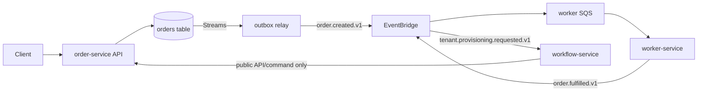
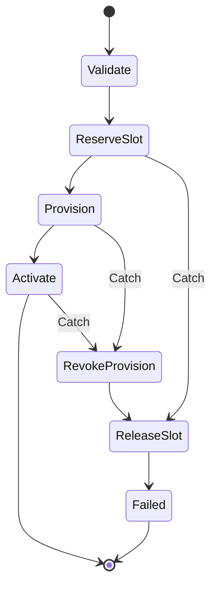
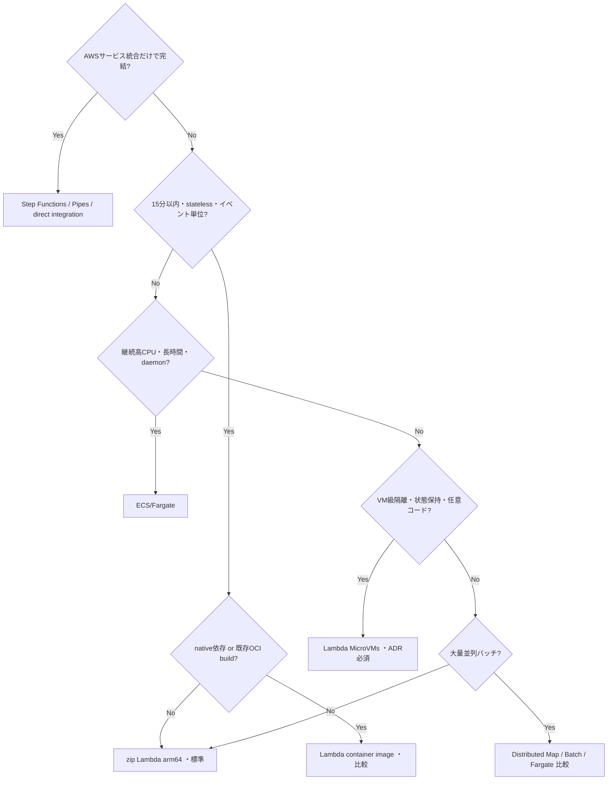
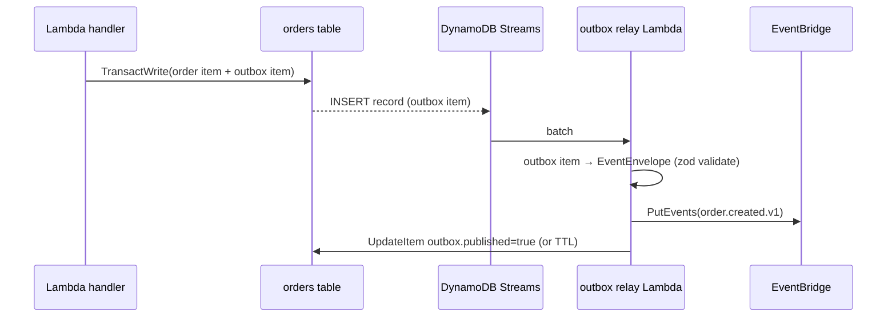
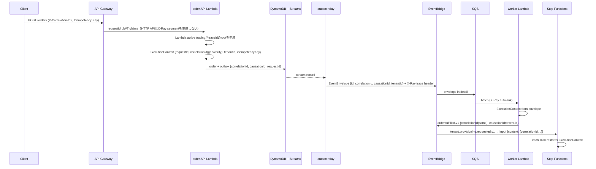
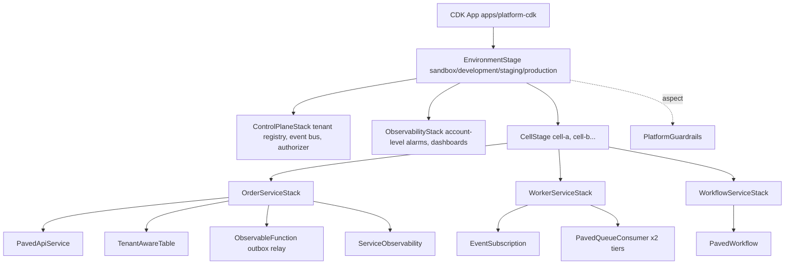

# B2BマルチテナントPaaS向け サーバレス・マイクロサービス設計指針書

| 項目     | 内容                                                                                                                                                                                  |
| -------- | ------------------------------------------------------------------------------------------------------------------------------------------------------------------------------------- |
| 版       | v0.1（テンプレートリポジトリ初版）                                                                                                                                                    |
| 対象     | B2Bマルチテナント・中規模トラフィックのPaaSを、TypeScript / Node.js 22 / AWS CDK v2 / AWSマネージドサービス中心で構築するサービスチームおよびプラットフォームチーム                   |
| 正本     | 本リポジトリ `docs/microservice-guidelines.md`。変更はPull RequestとADRで行う                                                                                                         |
| 関連文書 | [アーキテクチャ概要](architecture/overview.md)、[Workload Profile](architecture/workload-profile.md)、[脅威モデル](threat-models/order-service.md)、[Runbook](runbooks/)、[ADR](adr/) |

---

## 位置づけ

本書は、B2Bマルチテナント・中規模トラフィックのPaaSを、TypeScript、Node.js、AWS CDK、AWSマネージドサービス中心で構築するための「マイクロサービス設計指針書」である。単なる章立てではなく、各章で確定すべき判断基準、標準アーキテクチャ、必須ルール、禁止事項、検証方法、Architecture Decision Record（ADR）候補までを示す。

本書の規範語は RFC 2119 に準じる。[^55]

- **MUST / MUST NOT**：例外ADRなしに逸脱できない。CIまたはCDK synth時の自動検査で強制することを原則とする。
- **SHOULD / SHOULD NOT**：原則として従う。逸脱する場合はPull Requestまたは設計レビューで理由を明記する。
- **MAY**：採用可否をサービスチームが判断してよい。

### エビデンス規約

本書のすべての規範的記述、数値、制限値、価格、「ベストプラクティス」主張は、名前のある出典に追跡可能でなければならない。出典は次のいずれかとする。

- AWS公式文書（Well-Architected Framework / SaaS Lens / Serverless Lens / Builders' Library / Prescriptive Guidance / 各サービスの開発者ガイド・APIリファレンス・quotas / What's New）
- 名前のある企業の公開された実践（Amazon、ProGlove、Evertz、Spotify、Netflix、Google SRE等）
- 規格・仕様（RFC 2119、RFC 6585、RFC 9457、CloudEvents 1.0、OpenAPI 3.1、ULID、DORA、STRIDE等）

表記規則：

- 出典は脚注 `[^n]` で示し、末尾の References と「エビデンス台帳」に URL と確認日を記録する。
- 各章の冒頭に **根拠 / 準拠** 行を置き、その章の規則が依拠する組織・規格を列挙する。
- AWSのquota・価格・製品挙動は、2026-10-17時点のAWS公式文書で確認したものを記載する。値は変更され得るため、採用時に再確認する。
- 出典が見つからない主張は、事実としてではなく明示的な仮定として、次の 3 形式のいずれかで記述する。**「既定値（例示値）: 値 + 設計判断の理由 + 調整: docs/decision/template-defaults.md#既定値レジスタ（TD-NN）」**（組織が調整するテンプレート既定値）、**「計測で確定: 取得方法（M-NN）」**（本テンプレートの試験・ツールで得る値）、**「公式ドキュメントに記載なし（確認日、URL）」**（一次情報を確認した上で記載がない外部事実）。裸のタグだけを置かない。既定値と計測項目の正本は [テンプレート既定値レジスタ](decision/template-defaults.md)。
- 本テンプレート固有の設定値（throttle値、reserved concurrency、TTL、SLO目標、alarm閾値など）は **例示値** であり、出典ではなく [Workload Profile](architecture/workload-profile.md) と負荷試験で各組織が決める。本文中では「（例示値）」と明記する。
- 本テンプレート固有の設計判断（`ExecutionContext` の構造、エラー形、cursor封印方式など）は、外部出典ではなく対応するADRを根拠とする。

結論として、初期の標準形は次のように置く。

- **マイクロサービスの単位**はLambda関数ではなく、単一の業務能力・所有チーム・データ所有権・SLO・独立デプロイ境界を共有する単位とする。
- **同期API**はAPI GatewayとLambda Event Functionsを第一選択とし、Lambda Web Functionsは互換性・同時リクエスト・ストリーミングに価値があるAPIで比較検証する。
- **非同期処理**はEventBridgeでサービス間イベントを配信し、SQSで負荷平準化とバックプレッシャーを作り、Lambdaで処理する。
- **ワークフロー**はStep Functionsを許容する。ただし原則はサービス境界内、または明示的な「業務プロセス所有サービス」に置き、他サービスのデータストアを直接操作しない。
- **処理ランタイム**はzip形式Lambdaを標準とし、Lambdaコンテナイメージ、ECS/Fargate、Lambda MicroVMsを例外プロファイルとして選ぶ。
- **テナント分離**はpoolを標準に、bridge/siloをサービス単位で選択できるようにする。負荷・障害・クォータの隔離にはセル型・マルチアカウントを段階導入する。
- **一貫した性能**は「常にウォームにすること」ではなく、APIごとのp95/p99 SLO、同時実行予算、下流容量、負荷制御、コールドスタート対策を一体で設計する。
- **トレーサビリティ**はサンプリングされる分散トレースだけに依存せず、全リクエスト・イベントに業務相関IDを持たせ、ログ、メトリクス、監査証跡と結合する。

この方針は、AWS SaaS Lensが示す「各マイクロサービスによるデータ所有」「サービスごとにpool/siloを選ぶ」という構造、Amazonの運用知見、実運用事例に整合する。たとえばProGloveの大規模サーバレスSaaSでは、1マイクロサービスを5〜15個のLambda、Step Functions、EventBridge、DynamoDBを束ねたCloudFormationスタックとして運用しており、「1 Lambda＝1マイクロサービス」ではない。[^1][^2][^3]

### 本書の読み方

| 読者                                   | 最初に読む章     | 次に読む章                  |
| -------------------------------------- | ---------------- | --------------------------- |
| 新規サービスを立ち上げるサービスチーム | 1, 3, 4, 16, 20  | 5, 6, 7, 9                  |
| プラットフォームチーム                 | 2, 3, 11, 17, 18 | 10, 12, 14                  |
| セキュリティ / 監査                    | 5, 12, 13, 14    | 9, 19                       |
| オンコール担当                         | 19, 12, 11       | runbooks/                   |
| アーキテクチャレビュー担当             | 2, 4, 8, 20      | 主要な初期判断、優先ADR一覧 |

### 本書とテンプレートリポジトリの対応

本書の規則は、可能な限り以下のコード資産で機械的に強制する。文書だけで統制しない。

| 本書の規則                                | 強制手段                                                                                                                                               |
| ----------------------------------------- | ------------------------------------------------------------------------------------------------------------------------------------------------------ |
| 所有メタデータ必須                        | `@paas/constructs` の `ServiceManifest` が `service.yaml` を読み込み、`ownerTeam` / `onCall` / `slo` / `runbook` が欠落していればCDK synthを失敗させる |
| wildcard IAM / 非暗号化 / alarm欠落の禁止 | `@paas/constructs` の `PlatformGuardrails` aspect（cdk-nag `AwsSolutionsChecks` + 独自チェック）                                                       |
| テナント文脈の伝播                        | `@paas/runtime-context` の `ExecutionContext`（AsyncLocalStorage）                                                                                     |
| 構造化ログ / PII redaction                | `@paas/observability` のPowertools Logger / Tracer / Metrics preset                                                                                    |
| イベント包絡と版管理                      | `@paas/event-contracts` のzod schemaとregistry                                                                                                         |
| API契約                                   | `@paas/api-contracts`（`schemas/openapi/` 正本、生成型、標準エラー形）                                                                                 |
| テナント分離試験                          | `@paas/testing` のtenant-isolation helper と `tests/tenant-isolation/`                                                                                 |
| golden path                               | `tools/create-service`（`pnpm create-service --type api                                                                                                | worker | workflow`） |

---

## 採用する実運用知見

### Amazon/AWS

Amazon Builders' Libraryは、タイムアウト、限定された再試行、指数バックオフ、ジッター、冪等性を分散システムの基本としている。再試行は障害中の下流負荷を増幅し得るため、回数・総時間を制限し、APIを安全に再試行可能にする必要がある。[^4][^5]

またAmazonのマルチテナント非同期システムでは、キュー滞留時間の監視、ワークロード別の同時実行制限、超過トラフィックの退避、上流へのバックプレッシャーなどを組み合わせている。これは「Lambdaが自動スケールするから容量設計不要」という考えを否定し、下流データストアを含むエンドツーエンドの容量制御を要求する。[^6]

本書では、この知見を第10章（性能・容量）、第11章（Lambda同時実行数とクォータ）、第12章（信頼性）の必須ルールに落とし込んでいる。具体的には、retryの「所有者」を呼び出しチェーン内で一箇所に限定すること、SQS consumerの最大同時実行数を下流容量から逆算すること、`ApproximateAgeOfOldestMessage` をSLO化することである。

### ProGlove

ProGloveはサーバレスSaaSを数千AWSアカウント、40マイクロサービス、約100万Lambda規模で運用し、アカウント境界をセキュリティ、所有権、費用、サービスクォータの分離に利用している。本指針では中規模PaaSにそのままaccount-per-tenantを強制せず、まずpool、次にtenant tier/cell単位のアカウント分割、必要テナントのみsiloという段階モデルに落とす。[^3][^7]

ProGloveの事例から採用するのは「アカウントは隔離境界であり、クォータの迂回手段ではない」という原則と、アカウント追加には必ずaccount factoryと集中展開の自動化が伴わなければならないという条件である。中規模PaaSでは数千アカウントを運用する必然性がないため、第5章の「推奨段階」と第11章の「隔離」で段階導入を定める。

### Evertz.io

マルチテナントSaaSのevertz.ioは、Lambda、Step Functions、DynamoDB、EventBridgeを中心とするserverless-firstを採用しつつ、長時間実行や特定ハードウェア要件では別の計算基盤を選んでいる。したがって本指針も「すべてをLambdaに載せる」のではなく、ワークロード特性からランタイムを選ぶ。[^8]

本書の第8章「処理ランタイム決定木」はこの考えを形式化したものである。zip Lambdaを標準としつつ、ECS/Fargate、Lambda container image、Lambda MicroVMsを「例外プロファイル」として明示し、各プロファイルの採用条件をADRに固定する。

### SpotifyとNetflix

Spotifyは標準テンプレートにベストプラクティスを組み込み、新サービス作成時にリポジトリ、デプロイ、所有者情報を自動生成することで開発者負担を下げている。Netflixは、API所有チームと下流呼び出しの耐障害ロジックを分離し、エンドツーエンドトレースを実運用の移行判断に利用している。公開CDKテンプレートでは、この「golden path」と所有情報をコード生成・CIで強制する。[^9][^10]

本テンプレートリポジトリにおける `tools/create-service` と `ServiceManifest` constructは、Spotifyの「作成時点で所有者情報が捕捉される」仕組みを模したものである。Netflixの「トレースを移行判断に使う」実践は、第14章および「モック環境の最小スコープ」のEvent Functions対Web Functions比較プロトコルに反映している。

---

## 指針書の全体構成

| 章                             | 主目的                                                 | 章で確定するもの                                                                                                                                    |
| ------------------------------ | ------------------------------------------------------ | --------------------------------------------------------------------------------------------------------------------------------------------------- |
| 0. 位置づけ / エビデンス規約   | 規範語と出典規則を固定                                 | RFC 2119、出典種別、「既定値（例示値）」「計測で確定」の表記                                                                                        |
| 1. 目的と適用範囲              | 指針の対象と非対象を固定                               | PaaS特性、規模、リージョン、RTO/RPO、対象チーム                                                                                                     |
| 2. 設計原則                    | 判断の優先順位を統一                                   | serverless-first、managed-first、独立性、単純性、計測可能性                                                                                         |
| 3. 用語と責任境界              | 「サービス」「関数」「プラットフォーム」の混同を防ぐ   | 境界モデル、RACI、所有メタデータ                                                                                                                    |
| 4. サービス分割                | 過剰分割と分散モノリスを防ぐ                           | bounded context、分割・統合判定、依存ルール                                                                                                         |
| 5. マルチテナンシー            | 分離・負荷・費用の方針を統一                           | tenant context、pool/bridge/silo、セル設計                                                                                                          |
| 6. API設計                     | 同期インターフェースを標準化                           | API Gateway種別、契約、認証認可、冪等性、エラー                                                                                                     |
| 7. イベント設計                | 非同期連携を安全にする                                 | イベント包絡、EventBridge/SQS、順序、重複、DLQ                                                                                                      |
| 8. 処理・ワークフロー          | Lambda/Step Functions/コンテナを選定                   | compute decision tree、ワークフロー境界                                                                                                             |
| 9. データ設計                  | データ所有権と整合性を確立                             | database-per-service、CQRS、Saga、移行、暗号化                                                                                                      |
| 10. 性能・容量                 | 一貫した性能を設計可能にする                           | SLO、同時実行予算、負荷試験、過負荷制御                                                                                                             |
| 11. Lambda同時実行数とクォータ | クォータを計測・削減・保護・隔離の順で扱う             | 同時実行メトリクス、reserved budget、quota申請、cell分割                                                                                            |
| 12. 信頼性                     | 障害を局所化し復旧可能にする                           | timeout/retry、DLQ、re-drive、セル、DR                                                                                                              |
| 13. セキュリティ               | テナント越境を構造的に防ぐ                             | IAM、ABAC、秘密、監査、脅威モデル                                                                                                                   |
| 14. リクエストトレーサビリティ | 1リクエストを端から追えるようにする                    | trace/correlation、構造化ログ、メトリクス、監査ログ                                                                                                 |
| 15. コスト                     | 単価でなく業務単位原価を管理                           | cost model、tenant attribution、予算、最適化ループ                                                                                                  |
| 16. 開発標準                   | 実装工数とばらつきを減らす                             | TypeScript規約、共通SDK、ローカル開発、テスト                                                                                                       |
| 17. CDK/IaC                    | 再現可能な構築単位を定義                               | construct境界、stack構成、環境分離、policy-as-code                                                                                                  |
| 18. CI/CD                      | 安全かつ小さくリリース                                 | quality gates、canary、rollback、schema compatibility                                                                                               |
| 19. 運用                       | 誰が何を運用するか確定                                 | runbook、on-call、SLOレビュー、インシデント管理                                                                                                     |
| 20. 例外とADR                  | 例外を管理可能にする                                   | ADR、適合性チェック、例外期限、技術標準更新                                                                                                         |
| 21. 破壊と再生・侵入耐性       | 壊して確かめ、侵入されても範囲を限定し、検出・追跡する | chaos / game day、containment、detection、traceability、自動封じ込め。本文は [第21章（別ファイル）](microservice-guidelines-resilience-security.md) |

各章は共通の構成で記述する。

- **目的**：その章が何を確定させ、何を防ぐか。
- **標準**：初期標準形。迷ったときの既定値。
- **必須ルール**：MUST / SHOULD / MUST NOT で表現した規則と、その理由（Why）。
- **判断基準**：標準から外れるべきか、どちらを選ぶべきかを決めるための問い。
- **禁止事項**：アンチパターンと、それが引き起こす具体的な問題。
- **検証方法**：ルールが守られていることを機械的・手動で確認する方法（受入チェック）。
- **関連ADR**：その章の判断を記録するADR。

---

## 1. 目的と適用範囲

### 目的

本章は、指針が「何に対して」「どこまで」適用されるかを固定し、以降の章の議論が前提を共有できるようにする。対象外を明示することで、指針を万能のアーキテクチャ標準として拡大解釈することを防ぐ。

**根拠 / 準拠**：AWS Well-Architected Framework Operational Excellence Pillar（所有者の特定）[^11]、AWS SaaS Lens（サービス単位のテナント分離判断）[^2]、DORA（ソフトウェアデリバリー指標）[^56]、RFC 2119（規範語）[^55]、AWS Lambda quotas（新規アカウントの縮小quota）[^42]。

### 標準

#### 背景

- **事業形態**：B2B PaaS。顧客は法人テナントであり、テナント単位の契約、tier、SLA、データ分離要件が存在する。
- **テナント特性**：マルチテナント。テナント数は数十〜数千のオーダーを想定し、テナント間の負荷偏り（tenant skew）が大きい。
- **トラフィック**：中規模。全体で数十〜数百RPS、ピーク時に数倍のburstが発生する水準を基準とし、具体値は [Workload Profile](architecture/workload-profile.md) に記録する。
- **技術基盤**：TypeScript、Node.js 22、AWS CDK v2、pnpm monorepo、Powertools for AWS Lambda TypeScript v2、vitest、esbuild、arm64 zip Lambda。
- **クラウド**：AWSマネージドサービス中心。単一プライマリリージョンから開始し、multi-regionは事業要件とデータ整合性要件が確定した場合のみ拡張する。

#### 目標

| 目標             | 本書での具体化                                                   |
| ---------------- | ---------------------------------------------------------------- |
| 責任境界の明確化 | 第3章の用語定義、RACI、所有メタデータ                            |
| 低い開発工数     | 第16章の開発標準、第17章のpaved-road Construct、`create-service` |
| 一貫した性能     | 第10章のSLO-first、性能予算、第11章の同時実行ガバナンス          |
| テナント分離     | 第5章の分離モデル、第13章のテナント分離試験                      |
| 追跡可能性       | 第14章の識別子体系と相関envelope                                 |
| 原価可視化       | 第15章のcost modelとtenant attribution                           |

#### 非目標

次の事項は本書の目標ではない。これらを目標と誤解した設計は、レビューで差し戻す。

- **全サービスの極小分割**：「小さいほど良い」は本書の立場ではない。第4章の分割判定を満たさない分割は行わない。
- **全処理のLambda化**：Lambdaは標準であって唯一ではない。第8章の決定木に従ってランタイムを選ぶ。
- **強整合性の全面保証**：サービス境界をまたぐ処理は結果整合性を前提とし、整合性期待値をAPI契約に明記する（第9章）。
- **無制限スケール**：すべての層に容量上限と負荷制御を置く。「自動スケールするので上限不要」という設計は採用しない（第10章、第11章）。

#### 対象環境

| 環境          | 用途                                                  | AWSアカウント                                        | データ                       |
| ------------- | ----------------------------------------------------- | ---------------------------------------------------- | ---------------------------- |
| `sandbox`     | 開発者個人・ephemeral環境。PR単位のdeploy ephemeral先 | non-prod共用                                         | 合成データのみ               |
| `development` | チーム統合環境。mainブランチの最新                    | non-prod共用（sandboxと分離可）                      | 合成データのみ               |
| `staging`     | 本番相当構成。負荷試験、chaos試験、canary前検証       | **production とは別アカウント**。可能ならstaging専用 | 匿名化データまたは合成データ |
| `production`  | 本番                                                  | **専用アカウント必須**                               | 実データ                     |

`apps/platform-cdk` の `EnvironmentStage` は、上記4環境を `sandbox` / `development` / `staging` / `production` の識別子で表現する。productionアカウントへのデプロイはpipelineからのみ行い、開発者端末からの `cdk deploy` を禁止する。

#### 品質属性の優先順位

判断が衝突したとき、次の順序を基本とする。サービスごとの差分はADR化する。

1. セキュリティとデータ保全
2. 可用性
3. 運用可能性
4. 開発速度
5. 性能
6. コスト

**Why**：B2B PaaSではテナント越境や データ喪失が契約違反・事業停止に直結する一方、性能やコストは段階的に改善できる。優先順位を明示することで「速くするためにテナントチェックを省く」「安くするためにPITRを切る」といった判断を構造的に排除する。

#### 成功指標

本指針とテンプレートの効果は、次の指標で四半期ごとに測定する。デリバリー指標はDORAが定義する5指標（change lead time、deployment frequency、failed deployment recovery time、change fail rate、deployment rework rate）をそのまま採用する。DORAは従来の「MTTR」を failed deployment recovery time に置き換えている。[^56]

| 指標                            | 定義（DORA準拠）                                       | 初期目標（例示値）        |
| ------------------------------- | ------------------------------------------------------ | ------------------------- |
| Change lead time                | コミットから本番稼働までの時間の中央値                 | 1営業日以内               |
| Deployment frequency            | サービスあたり本番デプロイ回数/週                      | 週複数回                  |
| Failed deployment recovery time | 即時介入を要するデプロイ失敗からの復旧時間の中央値     | 1時間以内                 |
| Change fail rate                | rollbackまたはhotfixなど即時介入を要したデプロイの割合 | 15%未満                   |
| Deployment rework rate          | 本番インシデント起因の計画外デプロイの割合             | 10%未満                   |
| SLO達成率                       | 各サービスのSLO達成window割合（第10章）                | 99%以上のwindowで達成     |
| テナント当たり原価              | 第15章のcost modelに基づく月次単位原価                 | 前四半期比で改善          |
| テンプレート逸脱率              | 例外ADRを持つサービス数 / 全サービス数（第20章）       | 20%未満、期限切れ例外ゼロ |

初期目標の数値は本テンプレートの例示値であり、DORAの出典に由来しない。各組織が自身のベースライン計測から決める。

### 必須ルール

- 各サービスは、適用範囲（環境、リージョン、対象テナントtier）を `service.yaml` に **MUST** 記載する。
- productionは専用AWSアカウントに **MUST** 配置する。non-prod環境とアカウントを共有してはならない。
- 新規サービスは、本書の非目標に該当する設計意図（極小分割、全Lambda化、強整合性の全面保証、無制限スケール）を **MUST NOT** 設計書に含める。
- 品質属性の優先順位を変える場合は **MUST** ADRを起票する。
- 成功指標は四半期ごとに **SHOULD** 計測し、プラットフォームチームが集計する。

### 判断基準

- このサービスは本書の適用範囲か：テナント業務リクエストまたはテナント管理を扱い、AWS上でTypeScript/Node.jsで実装されるなら適用範囲である。
- 社内ツール、データ分析基盤、ML推論基盤は、本書を参考とするが必須ではない。参考適用の範囲をREADMEに書く。
- 他言語ランタイム（Python、Go等）を使う場合、第16章の言語固有部分を除き適用する。

### 禁止事項

- productionアカウントでsandbox/development相当の実験を行うこと。
- 「中規模」という前提を超える想定（数万RPS、数万テナント）を本書の標準構成のまま適用すること。その場合は第5章Phase 2以降と第11章を先に実施する。
- 成功指標を計測せずに「テンプレートの効果がある」と主張すること。

### 検証方法

- [ ] `service.yaml` の `awsAccounts` と `regions` が環境ごとに記載され、productionが専用アカウントIDを指している。
- [ ] `apps/platform-cdk` の `EnvironmentStage` 定義でproductionのアカウントIDがnon-prodと異なることをunit testで検証している。
- [ ] [Workload Profile](architecture/workload-profile.md) が記入済みであり、想定RPS・テナント数・burst・payload・SLO・データ分類が明記されている。
- [ ] 四半期レビューで成功指標が報告されている。

### 関連ADR

- [ADR-0001 Microservice boundary definition](adr/ADR-0001-microservice-boundary-definition.md)
- [ADR-0003 Multi-account topology](adr/ADR-0003-multi-account-topology.md)

---

## 2. 設計原則

### 目的

本章は、以降のすべての判断の優先順位を統一する。原則同士が衝突したとき、どちらを優先するかを明らかにし、個別判断の根拠として引用できるようにする。

**根拠 / 準拠**：AWS Well-Architected Framework（マネージドサービス優先）[^11]、AWS SaaS Lens（テナント文脈の共通ライブラリ化）[^12][^13]、AWS Lambda best practices（Power Tuningによるmemory決定、負荷試験によるtimeout決定）[^83]、Evertz.io（serverless-first, not serverless-only）[^8]、Spotify Backstage（golden path）[^9]。

### 標準

#### 原則一覧

| #   | 原則                                        | 一言での意味                                        |
| --- | ------------------------------------------- | --------------------------------------------------- |
| P1  | Managed-first                               | 差別化にならない運用はAWSマネージドサービスへ寄せる |
| P2  | Serverless-first, not serverless-only       | Lambdaは既定値だが、ワークロード特性で判断する      |
| P3  | One owner, one contract, one data authority | 単一所有者、公開契約、正本データ                    |
| P4  | Independent where valuable                  | 価値のない独立性は作らない                          |
| P5  | Async by reason, not fashion                | 理由のある箇所だけ非同期化する                      |
| P6  | Paved road                                  | 横断関心を共通Construct/ライブラリで自動付与する    |
| P7  | Evidence over defaults                      | 容量パラメータは実測で決める                        |

#### P1: Managed-first

差別化にならない運用はAWSマネージドサービスへ寄せる。AWS Well-Architectedも、可能な限りマネージドサービスを使用して運用負担を減らすことを推奨している。[^11]

**Why**：中規模PaaSのチーム規模では、自前運用のミドルウェア（メッセージブローカー、DB、ワークフローエンジン）が最大の運用負債になる。マネージドサービスの制約を受け入れる方が、総所有コストが低い。

**適用例**：EventBridge / SQS / Step Functions / DynamoDB / Secrets Manager / CloudWatch Application Signalsを標準とし、Kafka自前運用、Redis自前運用、独自ワークフローエンジンは例外ADRを要する。

#### P2: Serverless-first, not serverless-only

Lambdaへの適合性ではなく、実行時間、CPU、メモリ、状態、隔離、レイテンシ、単価で判断する。

**Why**：Lambdaは短時間・イベント単位・burst吸収に強く、常時高稼働・長時間・大容量メモリでは単価と制約が不利になる。「Lambdaで動くか」ではなく「Lambdaが最良か」を問う。

**適用例**：第8章の処理ランタイム決定木。

#### P3: One owner, one contract, one data authority

各サービスに単一の運用所有者、公開契約、正本データを定める。

**Why**：所有者が複数または不明なサービスは、障害時に誰も一次対応せず、変更時に誰も契約互換性を保証しない。正本データが複数あると整合性問題が常態化する。

**適用例**：第3章の所有メタデータ必須化、第9章のdatabase-per-service。

#### P4: Independent where valuable

独立デプロイ・独立スケール・障害隔離に価値がない分割は行わない。

**Why**：分割は契約管理、分散トランザクション、観測、デプロイ調整の費用を発生させる。費用を上回る価値（独立リリース、独立スケール、障害隔離、セキュリティ境界）がない分割は分散モノリスを生む。

**適用例**：第4章の分割判定（2軸以上の明確な差）。

#### P5: Async by reason, not fashion

遅延許容、バッファ、ファンアウト、独立障害が必要な箇所だけ非同期化する。

**Why**：非同期化は結果整合性、重複配信、順序問題、DLQ運用を持ち込む。即時応答が必要で遅延許容がない処理を非同期にすると、クライアント側でポーリングや整合性待ちが必要になり、複雑さが移動するだけである。

**適用例**：第7章の役割分担、第11章の「平準化」。

#### P6: Paved road

セキュリティ、テナント文脈、ログ、トレース、アラームを共通Construct/ライブラリで自動付与する。AWS SaaS Lensも、テナント文脈を共通ライブラリへ隠蔽し、開発者が日常コードで意識する量を減らす方針を示している。[^12][^13]

**Why**：文書で「ログにtenantIdを入れること」と定めても守られない。`ObservableFunction` と `@paas/observability` が自動付与すれば、守らない方が難しくなる。

**適用例**：第16章、第17章のL3 Construct群と `@paas/*` パッケージ。

#### P7: Evidence over defaults

メモリ、タイムアウト、同時実行数、Provisioned Concurrencyは負荷試験結果で決める。

**Why**：Lambdaはmemory量に比例してCPUを割り当て（1,769 MBで1 vCPU相当）[^42]、AWS自身がmemory決定にPower Tuningを、timeout決定に負荷試験を推奨している[^83]。Provisioned Concurrencyは設定した量と期間に対して課金される固定費であり[^51][^82]、必要なaliasと時間帯に限定しなければ無駄になる。

**適用例**：第10章の性能予算、`tools/power-tuning`、第15章の最適化順序。

#### 原則の優先順位

原則が衝突する場合、次の順序で判断する。

1. P3（所有・契約・データ正本）：境界の明確さを最優先する。
2. P6（Paved road）：横断関心は共通化する。
3. P1（Managed-first）とP2（Serverless-first）：運用負担を最小化する。
4. P4（Independent where valuable）とP5（Async by reason）：分割・非同期化は価値があるときのみ。
5. P7（Evidence over defaults）：数値は実測で決める。

### 必須ルール

- 設計書・ADRは、採用した判断がどの原則に基づくかを **MUST** 明記する。
- 原則P3に反する構成（複数所有者、複数正本、非公開契約での連携）は **MUST NOT** 採用する。
- 新しいAWSプリミティブ（Lambda Web Functions、Lambda MicroVMs等）の採用は、P2とP7に従い **MUST** ベンチマーク結果をADRに添付する。
- 共通ライブラリ（`@paas/*`）に業務ロジックを **MUST NOT** 置く。P6の対象は横断関心のみである。

### 判断基準

- その判断はP1〜P7のどれに基づくか。どの原則にも基づかない判断は、再考するか例外ADRを起票する。
- 原則が衝突しているか。衝突している場合、上記の優先順位で判断し、ADRに衝突と解決を記録する。

### 禁止事項

- 「Lambdaだから自動スケールする」「マネージドだから設計不要」という理由で容量・障害設計を省略すること（P7違反）。
- 「流行だから」「他社がそうしているから」という理由で非同期化・分割すること（P4、P5違反）。
- 共通ライブラリを「便利だから」という理由で業務ロジックの置き場にすること（P6の誤用）。

### 検証方法

- [ ] ADRテンプレートに「根拠とする原則」欄があり、すべてのADRで記入されている。
- [ ] 設計レビューチェックリストにP1〜P7の確認項目が含まれている。
- [ ] `@paas/*` パッケージのlintルールで、domain層相当のimportが禁止されている。

### 関連ADR

- すべてのADR（根拠とする原則の記載）
- [ADR-0019 CDK construct boundaries](adr/ADR-0019-cdk-construct-boundaries.md)

---

## 3. 用語と責任境界

### 目的

「サービス」「関数」「プラットフォーム」「ワークフロー」の混同を防ぎ、誰が何を所有し運用するかを確定する。所有者不明のサービスをデプロイ不可にする。

**根拠 / 準拠**：AWS Well-Architected Operational Excellence Pillar（所有者の特定）[^11]、AWS cell-based architecture FAQ（cellは状態を共有しない）[^14]、Builders' Library static stability（control plane / data plane の分離）[^99]、Backstage catalog descriptor format（`catalog-info.yaml`）[^118]、GitHub CODEOWNERS[^119]、Amazon two-pizza teams（小さなチームによるend-to-end所有）[^102]、ProGlove（1 service = 1 CloudFormation stack）[^3]。

### 標準

#### 定義

| 用語              | 定義                                                                                                          | 本テンプレートでの実体                                           |
| ----------------- | ------------------------------------------------------------------------------------------------------------- | ---------------------------------------------------------------- |
| **Platform**      | 認証、tenant registry、アカウント/セル管理、監査、可観測性、CI/CD、共通CDK Constructを提供する基盤            | `apps/platform-cdk`、`packages/*`、`.github/workflows`           |
| **Microservice**  | 単一業務能力を所有し、API/イベント契約、データ、SLO、ランブック、デプロイ単位をまとめたもの                   | `apps/example-order-service` 等。1 service = 1 CDK service stack |
| **Function**      | サービス内部の計算・イベント処理単位。マイクロサービスと同義ではない                                          | `ObservableFunction` で生成されるLambda関数                      |
| **Workflow**      | 複数ステップの状態遷移と補償を所有するサービス内部資源、または独立した業務プロセスサービス                    | `PavedWorkflow` で生成されるStep Functions state machine         |
| **Cell**          | ルーティング、計算、状態を可能な範囲で自己完結させた障害隔離単位。セルは状態を共有しないことが原則である[^14] | `apps/platform-cdk` の cell stage。`ExecutionContext.cellId`     |
| **Control plane** | tenant onboarding、設定、配置、運用管理                                                                       | tenant registry、provisioning workflow service                   |
| **Data plane**    | テナントの通常業務リクエストとイベント処理                                                                    | order service、worker service                                    |

#### 用語の使い分け

- 「サービスをデプロイする」とは、1つのservice stackをデプロイすることを意味する。Lambda関数単体の更新は「関数をデプロイする」と呼ぶ。
- 「サービスの所有者」は `service.yaml` の `ownerTeam` である。関数単位の所有者は定義しない。
- 「プラットフォームの障害」とは、`apps/platform-cdk` が所有するリソース（authorizer、event bus、tenant registry、cell router、CI/CD）の障害である。

#### 必須所有メタデータ

各サービスの `service.yaml` またはBackstage互換 `catalog-info.yaml`（`apiVersion: backstage.io/v1alpha1`、`kind: Component`、`spec.owner` 必須）[^118]に以下を必須化する。

| フィールド             | 型       | 説明                                                                                    |
| ---------------------- | -------- | --------------------------------------------------------------------------------------- |
| `serviceId`            | string   | 一意なサービス識別子（kebab-case）。ログ・メトリクス・タグの `service` と一致           |
| `domain`               | string   | 所属bounded context / 業務ドメイン                                                      |
| `ownerTeam`            | string   | 所有チーム。CODEOWNERSと一致                                                            |
| `onCall`               | string   | オンコールローテーション識別子またはエスカレーション先                                  |
| `repository`           | string   | リポジトリURLとパス                                                                     |
| `dataClassification`   | enum     | `public` / `internal` / `confidential` / `restricted`                                   |
| `tenantIsolationModel` | enum     | `pool` / `bridge` / `silo` / `account-per-tenant`                                       |
| `syncContracts`        | string[] | 提供するOpenAPI契約のパス                                                               |
| `publishedEvents`      | string[] | 発行するイベント型（例：`order.created.v1`）                                            |
| `consumedEvents`       | string[] | 購読するイベント型                                                                      |
| `slo`                  | object   | availability、latency p95/p99、window                                                   |
| `rto` / `rpo`          | duration | 復旧目標時間 / 復旧目標時点                                                             |
| `costCenter`           | string   | 原価配賦先                                                                              |
| `runtimeProfile`       | enum     | `zip-lambda` / `container-lambda` / `web-function-experimental` / `fargate` / `microvm` |
| `awsAccounts`          | map      | 環境ごとのアカウントID                                                                  |
| `regions`              | string[] | 配備リージョン                                                                          |
| `runbook`              | string   | Runbookのパス                                                                           |
| `dashboard`            | string   | ダッシュボードURL または名前                                                            |
| `threatModel`          | string   | 脅威モデル文書のパス                                                                    |
| `adrs`                 | string[] | 関連ADRのパス                                                                           |

AWS Operational Excellence Pillarは、アプリケーション、ワークロード、プラットフォーム、インフラ、手順ごとに所有者を特定することを求めている。所有者不明のサービスはデプロイ不可とする。[^11]

`@paas/constructs` の `ServiceManifest` は `service.yaml` を読み込み、`ownerTeam` / `onCall` / `slo` / `runbook` が欠落している場合にCDK synthを失敗させる。その他のフィールドは警告とし、v0.2以降で段階的に必須化する。

`service.yaml` の例（`apps/example-order-service/service.yaml`）：

```yaml
serviceId: order-service
domain: commerce
ownerTeam: team-commerce
onCall: pagerduty:commerce-primary
repository: https://github.com/example/microservice-template/tree/main/apps/example-order-service
dataClassification: confidential
tenantIsolationModel: pool
syncContracts:
  - schemas/openapi/order-service.yaml
publishedEvents:
  - order.created.v1
consumedEvents: []
slo:
  availability: 99.9
  latencyP95Ms: 300
  latencyP99Ms: 800
  window: 30d
rto: 1h
rpo: 5m
costCenter: cc-commerce
runtimeProfile: zip-lambda
awsAccounts:
  sandbox: '111111111111'
  development: '111111111111'
  staging: '222222222222'
  production: '333333333333'
regions:
  - ap-northeast-1
runbook: docs/runbooks/order-service.md
dashboard: order-service-production
threatModel: docs/threat-models/order-service.md
adrs:
  - docs/adr/ADR-0001-microservice-boundary-definition.md
  - docs/adr/ADR-0014-idempotency-and-retry.md
```

#### RACIの基準

| 対象                      | サービスチーム | プラットフォームチーム | セキュリティ/運用 |
| ------------------------- | -------------- | ---------------------- | ----------------- |
| 業務契約・データ          | A/R            | C                      | C                 |
| Lambda/Step Functions実装 | A/R            | C                      | I                 |
| 共通CDK Construct         | C              | A/R                    | C                 |
| テナント文脈SDK           | C              | A/R                    | C                 |
| サービスSLO・ランブック   | A/R            | C                      | C                 |
| 組織共通ポリシー          | C              | R                      | A                 |
| インシデント一次対応      | A/R            | C                      | C                 |
| 共通基盤障害              | C              | A/R                    | C                 |

A = Accountable（説明責任）、R = Responsible（実行責任）、C = Consulted（相談先）、I = Informed（報告先）。

RACIの含意：

- サービスチームは自サービスの契約、データ、SLO、Runbook、一次対応に説明責任を持つ。プラットフォームチームに「直してもらう」姿勢は認めない。
- プラットフォームチームは共通Construct、SDK、共通基盤の障害に説明責任を持つ。サービスチームの業務ロジックには介入しない。
- セキュリティ/運用は組織共通ポリシー（IAM boundary、暗号化、監査要件）の説明責任を持ち、実装はプラットフォームチームが行う。

### 必須ルール

- 各サービスは `service.yaml` を **MUST** 持ち、`ServiceManifest` がsynthに失敗するフィールド（`ownerTeam` / `onCall` / `slo` / `runbook`）を **MUST** 記入する。
- `ownerTeam` は `.github/CODEOWNERS` の該当パスの所有者と **MUST** 一致する。
- `serviceId` はログ、メトリクスdimension、標準タグ `service` と **MUST** 一致する。`ObservableFunction` はこの値を環境変数 `POWERTOOLS_SERVICE_NAME` へ自動設定する。
- 用語「サービス」をLambda関数単体の意味で **MUST NOT** 使用する。設計書・Runbook・ADRで混同があればレビューで修正する。
- RACIで A を持つチームが不在のサービスは **MUST NOT** デプロイする。
- Control planeとData planeは **SHOULD** 別のservice stackとし、Phase 2以降では別アカウントまたは別cellへ分離する。

### 判断基準

- このリソースは誰が所有するか：`service.yaml` の `ownerTeam` で答えられなければ、所有者を決めるまで実装を進めない。
- この処理はcontrol planeかdata planeか：tenant onboarding、tier変更、設定変更、cell配置はcontrol plane。テナントの業務リクエストはdata plane。
- この障害は誰が一次対応するか：service stack内のリソースならサービスチーム、`apps/platform-cdk` が所有するリソースならプラットフォームチーム。

### 禁止事項

- `ownerTeam: platform` を「とりあえず」設定すること。プラットフォームチームが所有するのは共通基盤だけである。
- 複数チームを `ownerTeam` に列挙すること。共同所有は無所有である。
- `onCall` にチーム名ではなく個人名を書くこと。
- Lambda関数単位で異なるチームが所有するservice stackを作ること（P3違反）。

### 検証方法

- [ ] `pnpm synth` が `ownerTeam` 欠落の `service.yaml` で失敗することをunit testで確認している。
- [ ] CIで `service.yaml` の `ownerTeam` と CODEOWNERS の整合性を検査している。
- [ ] CIで `service.yaml` の `publishedEvents` / `consumedEvents` が `@paas/event-contracts` のregistryに存在することを検査している。
- [ ] CIで `runbook` / `threatModel` / `adrs` のパスが実在することを検査している。
- [ ] service catalog（Backstage等）に全サービスが登録され、所有者が表示される。

### 関連ADR

- [ADR-0001 Microservice boundary definition](adr/ADR-0001-microservice-boundary-definition.md)
- [ADR-0002 Repository strategy](adr/ADR-0002-repository-strategy.md)
- [ADR-0003 Multi-account topology](adr/ADR-0003-multi-account-topology.md)

---

## 4. サービス分割

### 目的

過剰分割（nanoservice）と分散モノリスの両方を防ぐ。分割・統合の判定基準を明示し、「なんとなく分ける」「なんとなくまとめる」を排除する。

**根拠 / 準拠**：AWS Prescriptive Guidance「Decomposing monoliths into microservices」（bounded context）[^16]、同「Enabling data persistence in microservices」およびdatabase-per-service pattern[^17][^18]、AWS Well-Architected Reliability Pillar（hard dependencyの可用性は積で計算）[^106]、Michael Nygard「The Entity Service Antipattern」[^104]、Amazon two-pizza teams[^102]。

### 標準

#### 分割軸

サービス候補は次の6軸で評価する。

1. **業務能力とbounded context**：そのサービスが所有する業務上の概念・用語・ルールが一貫しているか。
2. **データの正本所有者**：そのサービスが書き込み権限を持つデータが、他サービスと重ならないか。
3. **変更頻度と独立リリースの必要性**：他サービスと同期せずにリリースする必要があるか。
4. **スケール、レイテンシ、可用性、隔離要件**：他サービスと異なる容量・性能・可用性プロファイルを持つか。
5. **セキュリティ・コンプライアンス境界**：異なるデータ分類、監査要件、アクセス制御を要するか。
6. **単一チームが理解・運用できる認知負荷**：1つのtwo-pizza team（Amazonが「ピザ2枚で足りる」規模と表現するチーム[^102]）が全体を理解し、オンコールできる規模か。既定値（例示値）: 10名以下。Amazonの表現に人数の公式定義はなく、1チームで週次オンコールローテーション（4〜6名）と兼務を成立させる規模として置いた設計判断であり、本書は外部出典から人数を導かない。調整: docs/decision/template-defaults.md#既定値レジスタ（TD-08、組織の編成方針が決まったときに見直す）。

マイクロサービスは技術層ではなく業務上のbounded contextで分け、明確な契約を介して連携する。[^15][^16]

#### 分割判定

以下のうち2つ以上に明確な差がある場合、分割候補とする。

| 判定項目             | 「明確な差」の例                                      |
| -------------------- | ----------------------------------------------------- |
| 所有チーム           | 異なるチームが業務ルールを決めている                  |
| データライフサイクル | 保持期間、削除要件、バックアップ要件が異なる          |
| スケール特性         | 一方はRPS比例、他方はバッチ的。または10倍以上の負荷差 |
| セキュリティ区分     | `dataClassification` が異なる。異なる規制対象         |
| 可用性/SLO           | 一方は99.9%、他方は99%で十分                          |
| リリース頻度         | 一方は日次、他方は月次                                |
| 障害波及範囲         | 一方の障害が他方のユーザーに影響してはならない        |

逆に、次のいずれかに該当する場合は統合を優先する。

- 常に同時変更される（1つの機能変更が両方のサービスのPRを必要とする）。
- 同期チャット（synchronous chatty call）が多い（1リクエストで相互に3回以上呼び合う）。
- 同じトランザクションとデータを共有する（両方が同じテーブルに書く、または原子的更新が必要）。
- 個別SLOを定義できない（一方のSLOが他方のSLOと常に同一）。

#### 本テンプレートの例

| サービス                   | bounded context                           | データ正本              | 分割根拠                                                                                |
| -------------------------- | ----------------------------------------- | ----------------------- | --------------------------------------------------------------------------------------- |
| `example-order-service`    | 注文受付                                  | orders table            | スケール（同期API、RPS比例）、SLO（99.9%、p99 800ms）                                   |
| `example-worker-service`   | 注文履行                                  | fulfillment state       | スケール（非同期バッチ的、tier別concurrency）、障害波及（履行遅延が注文受付を止めない） |
| `example-workflow-service` | テナントプロビジョニング（control plane） | provisioning saga state | セキュリティ区分（control plane）、リリース頻度（低）、データライフサイクル（長期監査） |

#### 依存ルール



- 矢印は「公開契約を介した依存」のみ。データストアへの矢印はそのデータストアを所有するサービスからのみ出る。
- 同期呼び出しチェーン（Client → A → B → C）は3ホップ以内。

### 必須ルール

- 他サービスのDB、DynamoDBテーブル、S3プレフィックスを直接読むことを **MUST NOT** 行う。
  - **Why**：直接読み取りはスキーマを暗黙の契約にし、所有サービスがスキーマを変更できなくなる。`TenantAwareTable` は所有service stack内のIAM principalのみにアクセスを許可し、`PlatformGuardrails` はservice stack外のprincipalからのテーブルARN参照を拒否する。
- 共有DBを恒久標準に **MUST NOT** する。移行期はサービスごとのschema/tableとIAM分離を **MUST** 行い、期限付き例外ADRを **MUST** 起票する。
- 同期呼び出しチェーンは原則3ホップ以内とする（**SHOULD**）。超過はAPI composition、read model、非同期化を検討する。
  - **Why**：AWS Well-Architected Reliability Pillarは、hard dependencyを持つシステムの可用性は依存先の可用性の積になると定義している[^106]。3ホップで各99.9%なら合成可用性は約99.7%に落ちる。
- 共通ライブラリに業務ロジックを **MUST NOT** 置く。共通化対象は観測、認証認可、tenant context、エラー、契約生成など横断関心に限定する。
- 「1エンドポイント＝1リポジトリ」「1関数＝1サービス」を標準に **MUST NOT** しない。
- 新規サービスの提案は、上記6軸の評価と分割判定の結果を **MUST** ADR-0001形式で記録する。
- サービス間の同期依存は `service.yaml` の `syncContracts`（提供側）と、消費側の `dependencies` に **SHOULD** 記載し、dependency mapを生成可能にする。

Database-per-serviceは疎結合と独立スケールをもたらす一方、サービス横断クエリ・トランザクションを複雑にするため、API composition、CQRS、イベント、Sagaを併用する。[^17][^18]

### 判断基準

新規サービスまたは分割を検討するときの問い：

1. 分割判定の7項目のうち、明確な差があるのはいくつか。2つ未満なら統合する。
2. 分割後、両サービスはそれぞれ独立にデプロイ・rollbackできるか。できないなら分割の価値がない。
3. 分割後、サービス間の同期呼び出しは何ホップになるか。3を超えるならread modelまたは非同期化を先に設計する。
4. 分割後、どちらのサービスがデータ正本を持つか。両方が同じデータに書くなら分割できない。
5. 分割後、各サービスを1チームがオンコールできるか。できないならチーム編成を先に決める。

既存サービスの統合を検討するときの問い：

1. 過去3ヶ月のPRで、両サービスを同時に変更したPRの割合は50%を超えるか。
2. 両サービス間の同期呼び出しは1リクエストあたり3回を超えるか。
3. 両サービスのSLO・オンコール・所有チームは同一か。

### 禁止事項

| アンチパターン                                                                          | 問題                                                                                                                                                                                                                       |
| --------------------------------------------------------------------------------------- | -------------------------------------------------------------------------------------------------------------------------------------------------------------------------------------------------------------------------- |
| **Nanoservice**：CRUDの各操作を別サービスにする                                         | 契約・デプロイ・観測のオーバーヘッドが業務価値を上回る。1チームが数十サービスを運用できない                                                                                                                                |
| **分散モノリス**：分割したが常に同時変更・同時デプロイが必要                            | 分割のコストだけ払い、独立性の価値を得ていない                                                                                                                                                                             |
| **Shared database integration**：複数サービスが同じテーブルを読み書き                   | スキーマ変更不能、テナント分離の責任が曖昧、障害波及                                                                                                                                                                       |
| **Chatty synchronous chain**：A→B→C→Dの同期呼び出し                                     | latency・可用性の乗算劣化。1つのslow dependencyが全体を止める                                                                                                                                                              |
| **Entity service**：「Customer service」「Product service」のようにエンティティで分ける | 業務プロセスが複数サービスをまたぎ、すべての機能が分散トランザクションになる。Nygardはこれをアンチパターンとして、ほぼ全リクエストが複数のentity serviceを必要とし、運用的・意味的な結合と高負荷を招くと指摘している[^104] |
| **共通ライブラリへの業務ロジック集約**                                                  | ライブラリ更新が全サービスの同時デプロイを要求する。所有者が曖昧                                                                                                                                                           |
| **技術層での分割**：「API層サービス」「DB層サービス」                                   | bounded contextではなく技術で分けており、すべての変更が全層に及ぶ                                                                                                                                                          |

### 検証方法

- [ ] 各サービスのADR-0001形式の境界定義が存在し、6軸評価と分割判定結果が記載されている。
- [ ] `PlatformGuardrails` が、service stack外のprincipalから `TenantAwareTable` へのIAM grantを検出して失敗する（unit test: `tests/policy/`）。
- [ ] CIで生成されるdependency mapに、3ホップを超える同期チェーンがない。あれば警告を出す。
- [ ] `@paas/*` パッケージのeslint設定で `domain/` 相当のディレクトリ作成と業務ロジックimportが禁止されている。
- [ ] 四半期のarchitecture reviewで、同時変更率が高いサービスペアを抽出し、統合候補として検討している。

### 関連ADR

- [ADR-0001 Microservice boundary definition](adr/ADR-0001-microservice-boundary-definition.md)
- [ADR-0011 Service communication](adr/ADR-0011-service-communication.md)
- [ADR-0012 Data ownership](adr/ADR-0012-data-ownership.md)

---

## 5. マルチテナンシー

### 目的

テナント分離、負荷隔離、費用配賦の方針をPaaS全体で統一する。テナント文脈を「信頼できる経路」からのみ生成し、クライアント入力に依存した分離を構造的に排除する。

**根拠 / 準拠**：AWS SaaS Lens（pool/bridge/silo、サービス単位の分離判断、テナント文脈の共通ライブラリ化）[^1][^2][^12][^13]、API Gateway JWT authorizer（claimsの検証とLambdaへの受け渡し）[^79]、DynamoDB fine-grained access control（`dynamodb:LeadingKeys`）[^67]、AWS cell-based architecture FAQ[^14]、ProGlove（account-per-tenantとaccount factory）[^3][^7]、AWS Control Tower Account Factory[^134]、CloudWatch cross-account observability[^135]、API Gateway HTTP API vs REST API（per-client throttleはREST APIのみ）[^77]。

### 標準

#### テナント文脈

認証済みJWTまたは信頼できるauthorizer contextから次を生成し、各処理の `ExecutionContext` へ格納する。

```ts
// @paas/runtime-context
interface ExecutionContext {
  tenantId: string;
  tenantTier: string;
  subjectId?: string;
  requestId: string;
  correlationId: string;
  traceId?: string;
  idempotencyKey?: string;
  cellId: string;
  deadline: Deadline; // 残り予算（ms）と absolute epoch を保持
}
```

`@paas/runtime-context` は `AsyncLocalStorage` で `ExecutionContext` をrequest-scopedに保持し、`getContext()` で安全に取得できる。`deadline` は入口で設定したtimeout budgetを下流呼び出しへ伝播するための構造である（第6章、第12章）。

テナント文脈の生成経路：

| 入口                 | 生成元                                                                                                                                                                                                              | 生成責任                                                |
| -------------------- | ------------------------------------------------------------------------------------------------------------------------------------------------------------------------------------------------------------------- | ------------------------------------------------------- |
| API Gateway HTTP API | JWT authorizerの検証済みclaims（`tenant_id`、`tenant_tier`、`sub`）。authorizerは署名、`iss`、`aud`、`exp`、`nbf`、`iat`、`scope` を検証し、claimsを `requestContext.authorizer.jwt.claims` としてLambdaへ渡す[^79] | `PavedApiService` のmiddleware                          |
| SQS / EventBridge    | `EventEnvelope` の `tenantId` / `tenantTier` / `correlationId`                                                                                                                                                      | `PavedQueueConsumer` / `EventSubscription` のmiddleware |
| Step Functions       | state machine入力の `context` オブジェクト                                                                                                                                                                          | `PavedWorkflow` の入力schema                            |
| スケジュール起動     | 固定のsystem tenantまたはtenant registryからの列挙                                                                                                                                                                  | サービス側で明示生成                                    |

クライアントが自由入力した `tenantId` をデータアクセスに使用してはならない。tenant contextの解決、IAM scope、ログ付与、メトリクス付与は共通SDKへ隠蔽する。AWS SaaS Lensも、token manager、isolation manager、logging/metrics wrapperをサービス内の再利用コードとして実装し、それ自体を別ネットワークサービスに分解して余分な遅延を増やさないよう説明している。[^12]

**Why（共通SDKがネットワークサービスではなくライブラリである理由）**：テナント文脈の解決を別サービスにすると、全リクエストに1ホップ追加され、そのサービスの障害がdata plane全体を止める。ライブラリ化すればレイテンシは増えず、障害ドメインも広がらない。

#### 分離モデル

| モデル             | 標準用途                         | 長所                                   | 注意点                                       |
| ------------------ | -------------------------------- | -------------------------------------- | -------------------------------------------- |
| Pool               | 通常テナント                     | 低コスト、運用集約                     | partition key、IAM、noisy neighbor対策が必須 |
| Bridge             | 高負荷/規制差がある一部機能      | 選択的な分離                           | 構成分岐と移行手順が必要                     |
| Silo               | 規制、専有性能、個別鍵、障害隔離 | 強い境界                               | 配備数と更新コストが増える                   |
| Account-per-tenant | 最上位tierまたは強い委譲         | クォータ・費用・セキュリティ境界が明確 | account vending、StackSets、集中観測が必要   |

サービスごとに分離モデルを選び、PaaS全体で一律にしない。AWS SaaS Lensも、multi-tenant負荷、tier、分離要件をサービス単位で判断すべきとしている。[^2]

各モデルの実装形：

- **Pool**：単一の `TenantAwareTable`。partition keyは `TENANT#<tenantId>` 接頭辞。Lambda execution roleに `dynamodb:LeadingKeys` 条件（`ForAllValues` 修飾子が必須。`Scan` はleading keyに関係なく全itemを返すため許可しない）[^67]を付与するか、repository adapterがすべてのクエリに `tenantId` 条件を強制する。noisy neighbor対策のrate limitは、HTTP APIがper-client throttle / usage planを提供しない[^77]ため、CloudFront + WAF rate-based rule、tier別route分離、またはREST API usage planのいずれかで実現する（ADR-0005）。
- **Bridge**：poolを基本としつつ、特定機能（例：大容量export、規制対象データ）だけを tenant tier別の専用queue/table/functionに分岐する。本テンプレートの `example-worker-service` は、standard-tier / premium-tier のqueueを分け、`maxConcurrency` を変えることでbridge的な負荷分離を示す。
- **Silo**：service stackをテナント単位にインスタンス化する。`apps/platform-cdk` のcell stageに `siloTenants` を列挙し、各テナントに専用stackを配置する。KMS keyもテナント専用。
- **Account-per-tenant**：siloをさらにAWSアカウント境界で分離する。account factory、StackSets、集中観測（cross-account CloudWatch）が前提であり、Phase 3まで採用しない。

#### 推奨段階

| Phase   | 内容                                                                                         | 前提条件                                         |
| ------- | -------------------------------------------------------------------------------------------- | ------------------------------------------------ |
| Phase 1 | 環境別アカウント、リージョン内pool、DynamoDBの `tenantId` 先頭キー、API tier別スロットリング | テンプレートv0.1                                 |
| Phase 2 | 複数cellへtenantを固定配置し、cell別アカウントまたはstackで障害範囲とクォータを分離          | tenant registry、cell router、cell migration手順 |
| Phase 3 | 規制・大口テナントのみsilo/account-per-tenant                                                | account factory、集中観測、silo向けCI/CD         |

**Why（Phase順の理由）**：poolは最も安価で運用が集約されるが、noisy neighborと障害波及が課題になる。cellはそれを「テナント集合」単位で隔離し、siloは「テナント」単位で隔離する。隔離粒度を細かくするほど配備数・更新コスト・観測の複雑さが増えるため、必要なテナントだけ段階的に細かくする。

#### テナント tier

`tenantTier` は、スロットリング、同時実行配分、queue分離、Provisioned Concurrency配分、cost attributionの基準となる。初期値は `standard` / `premium` の2段階とし、tier追加はtenant registryの設定変更とCDK contextで行う。

| tier       | rate limit（例示値）                                       | worker queue（例示値）                 | Provisioned Concurrency       | silo候補         |
| ---------- | ---------------------------------------------------------- | -------------------------------------- | ----------------------------- | ---------------- |
| `standard` | 50 RPS / burst 100（WAF rate-based ruleまたはtier別route） | standard-tier queue、maxConcurrency 20 | なし                          | なし             |
| `premium`  | 200 RPS / burst 400（同上）                                | premium-tier queue、maxConcurrency 50  | latency-sensitive APIのみ検証 | 規制要件があれば |

上表の数値はすべて例示値であり、[Workload Profile](architecture/workload-profile.md) と負荷試験で決める。SQS event sourceの `maxConcurrency` は2〜1,000の範囲で、関数のreserved concurrency以下に設定する[^62]。

### 必須ルール

- データアクセスに使用する `tenantId` は、authorizer検証済みclaimsまたは `EventEnvelope` の `tenantId` から **MUST** 取得する。HTTP body、query string、path parameter、未検証header由来の `tenantId` を **MUST NOT** データアクセスに使う。
- すべてのpoolテーブルは `TenantAwareTable` で **MUST** 作成し、partition keyの先頭を `TENANT#<tenantId>` と **MUST** する。
- repository adapterは `ExecutionContext.tenantId` をすべてのquery / put / update / delete の条件に **MUST** 含める。`@paas/testing` のtenant-isolation helperで交差アクセスが拒否されることを **MUST** テストする。
- `service.yaml` の `tenantIsolationModel` を **MUST** 記載し、モデル変更時はADR-0004形式で **MUST** 記録する。
- tier別のrate limitを **SHOULD** 設定する。HTTP APIではstage / route単位のthrottleのみ可能でper-client throttleは不可[^77][^78]のため、WAF rate-based rule、tier別route、またはREST API usage planのいずれかをADR-0005で選ぶ。
- ログ・メトリクス・トレースへの `tenantId` / `tenantTier` 付与は `@paas/observability` に **MUST** 委ね、handler内で手動付与しない。
- イベントの `tenantId` は、発行元が `ExecutionContext` から **MUST** 設定し、consumerは `EventEnvelope.tenantId` を信頼する。ただしconsumerは、発行元が信頼済みevent bus（同一組織のEventBridge bus）であることをIAM resource policyで **MUST** 保証する。
- siloまたはaccount-per-tenantへ昇格する場合、tenant migration手順（第9章）を **MUST** 先に用意する。

### 判断基準

分離モデルを選ぶときの問い：

1. そのサービスが扱うデータの `dataClassification` は何か。`restricted` なら少なくともbridge（専用KMS key）を検討する。
2. 特定テナントの負荷が全体の20%を超えるか。超えるならそのテナントをbridge（専用queue/concurrency）またはcellで隔離する。
3. 契約上、専有環境・専用鍵・監査分離が求められているか。求められているならsilo。
4. テナントが自身のAWSアカウントへのデプロイ（委譲）を求めているか。求めているならaccount-per-tenant。
5. 上記に該当しなければpool。

### 禁止事項

| アンチパターン                                                | 問題                                                                                                                           |
| ------------------------------------------------------------- | ------------------------------------------------------------------------------------------------------------------------------ |
| request bodyの `tenantId` でデータアクセス                    | 任意テナントのデータを読み書きできる。本PaaSで最も重大な脆弱性                                                                 |
| テナントごとにDynamoDBテーブルを作る「table-per-tenant pool」 | テーブル数のクォータに達し、IAM policyが肥大化し、運用が破綻する。siloにするならstack単位                                      |
| 全サービス一律silo                                            | 配備数が「サービス数×テナント数」になり、更新コストが運用能力を超える                                                          |
| tenant contextを別のネットワークサービスで解決                | 全リクエストに1ホップとSPOFを追加する                                                                                          |
| `tenantId` をCloudWatch Metricsの無制限dimensionにする        | CloudWatchはdimensionの組み合わせごとに別メトリクスとして課金する[^101]ため、高cardinalityで費用が爆発する。第14章の規則に従う |
| アカウント分割をクォータ迂回だけの目的で行う                  | 隔離境界と運用自動化がないアカウントは管理不能になる（第11章）                                                                 |

### 検証方法

- [ ] `tests/tenant-isolation/` に、tenant Aのtokenでtenant Bのリソースを取得・更新・削除する試験があり、すべて403または404で拒否される。
- [ ] `tests/tenant-isolation/` に、改ざんした `tenantId` を含むbody / query / headerを送る試験があり、authorizer由来の `tenantId` が優先される。
- [ ] `tests/tenant-isolation/` に、`EventEnvelope.tenantId` を改ざんしたイベントを信頼済みbus外から投入する試験があり、IAM resource policyで拒否される。
- [ ] `TenantAwareTable` のunit testで、partition key設計が `TENANT#` 接頭辞を強制することを確認している。
- [ ] `PlatformGuardrails` が、`TenantAwareTable` を使わないDynamoDBテーブル（`dynamodb.Table` 直接利用）を検出して警告または失敗する。
- [ ] `service.yaml` の `tenantIsolationModel` が全サービスで記載されている。

### 関連ADR

- [ADR-0003 Multi-account topology](adr/ADR-0003-multi-account-topology.md)
- [ADR-0004 Tenant isolation models](adr/ADR-0004-tenant-isolation-models.md)
- [ADR-0017 Lambda concurrency governance](adr/ADR-0017-lambda-concurrency-governance.md)

---

## 6. API設計

### 目的

同期インターフェースを標準化する。API Gatewayの種別、契約の正本、認証認可の分担、冪等性、エラー形、pagination、timeout伝播を統一し、サービスごとの差異を減らす。

**根拠 / 準拠**：API Gateway「Choose between REST APIs and HTTP APIs」[^77]、API Gateway quotas（HTTP APIのintegration timeout上限30秒、account throttle）[^76][^142]、HTTP API throttling（stage / route単位）[^78]、HTTP API JWT authorizer[^79]、API Gateway pricing[^19][^20]、Lambda quotas（Web Functions / MicroVMsの制限値）[^42]、Lambda Web Functions / MicroVMs発表[^21][^22][^23]、Powertools Idempotency[^25][^87]、Builders' Library「Timeouts, retries, and backoff with jitter」[^5]、OpenAPI 3.1[^113]、RFC 9457 Problem Details[^111]、RFC 6585（429 Too Many Requests）[^112]、ULID仕様[^108]、Lambda resource-based policy（`aws:SourceArn`）[^81]。

### 標準

#### API層の標準

標準経路は `CloudFront/WAF → API Gateway → Lambda → service-owned datastore` とする。API Gatewayは認証、ルーティング、スロットリング、契約境界を担い、業務認可はサービス側がtenant contextとresource ownershipを用いて実施する。

| 層                          | 責務                                                                                                                          | 責務でないこと                                                           |
| --------------------------- | ----------------------------------------------------------------------------------------------------------------------------- | ------------------------------------------------------------------------ |
| CloudFront / WAF            | TLS終端、geo/IP制限、rate-based rule（tenant / tier別の制限はここで実現）、bot対策、共通security header[^122]                 | 業務ロジック、認証                                                       |
| API Gateway                 | JWT検証（authorizer）[^79]、ルーティング、stage / route単位throttle[^78]、request validation（REST APIのみ[^77]）、access log | 業務認可、データアクセス、per-client throttle（HTTP APIでは非対応[^77]） |
| Lambda（`PavedApiService`） | tenant context生成、業務認可（resource ownership）、業務ロジック、冪等性、エラー整形                                          | TLS、rate limit                                                          |
| datastore                   | データ保全、条件付き書き込み                                                                                                  | 業務ロジック                                                             |

API GatewayのREST APIとHTTP APIは、機能要件と総費用で選ぶ。HTTP APIは薄いJWT APIの標準候補、REST APIはusage plan、API key、詳細な変換・検証、キャッシュなどが必要な場合の候補とし、採用時点のAWS機能表をADRへ固定する。料金体系はHTTP APIの方が低いが、単価だけでなくauthorizer、WAF、ログ、データ転送、下流呼び出しを含めて比較する。[^19][^20]

AWSの比較表[^77]に基づく本テンプレートでの整理（2026-10-17確認）：

| 要件                                          | HTTP API                                                        | REST API                                                                |
| --------------------------------------------- | --------------------------------------------------------------- | ----------------------------------------------------------------------- |
| JWT authorizer（Cognito / OIDC）              | ネイティブ                                                      | Lambda authorizerでJWT検証、またはCognito authorizer                    |
| throttle                                      | stage / route単位のみ。per-client（API key / usage plan）は不可 | per-client throttle、usage plan、API key                                |
| request body validation / body transformation | 不可（parameter mappingのみ）                                   | モデル検証、mapping template                                            |
| caching                                       | 不可                                                            | API cache                                                               |
| AWS WAF 直接関連付け                          | 不可（CloudFront経由で適用）                                    | 可                                                                      |
| X-Ray tracing（API Gateway segment）          | 不可（trace rootはLambda active tracingで生成。第14章）         | 可                                                                      |
| canary release deployment（stage単位）        | 不可（Lambda alias weighted routingで代替。第18章）             | 可                                                                      |
| private API（VPC endpoint）                   | 不可                                                            | 可                                                                      |
| automatic deployment                          | 可                                                              | 不可                                                                    |
| 単価                                          | 低い[^19][^20]                                                  | 高い                                                                    |
| 本テンプレートの位置づけ                      | **標準**（`example-order-service`）                             | usage plan / cache / private API / Gateway層のX-Ray segmentが必要な場合 |

#### Lambda選択表

| 選択肢                 | 推奨判断                                                                      | 本PaaSでの位置づけ                                   |
| ---------------------- | ----------------------------------------------------------------------------- | ---------------------------------------------------- |
| Lambda Event Functions | 短時間、1リクエスト1 invocation、イベント連携、細かなIAM/スケール境界         | **同期APIと非同期処理の標準**                        |
| Lambda Web Functions   | Node.js HTTPサーバ互換、1環境で複数同時HTTP、streaming、framework portability | **API層の検証候補**                                  |
| Lambda MicroVMs        | VM級隔離、状態を持つ対話セッション、任意コード、最大8時間                     | **通常APIには不採用。sandbox/agent/tenant code専用** |
| Lambda container image | 大きな依存、native binary、既存Docker build                                   | **Lambdaの包装方式。別の実行基盤ではない**           |
| ECS/Fargate            | 長時間、継続高負荷、常駐server、柔軟なCPU/メモリ/ネットワーク                 | **例外的な処理層**                                   |

Lambda Web FunctionsはNode.js HTTPサーバを直接実行し、単一環境で複数リクエストを処理し、ゼロまでスケールできる。一方、2026年10月公開直後で、ランタイムやリージョン等の選択肢がEvent Functionsより狭いため、初期テンプレートでは `experimental` プロファイルとし、Event Functionsと同一負荷でp50/p95/p99、コールドスタート、費用、障害隔離、デプロイ時間を比較する。[^21][^22]

Lambda MicroVMsはFirecrackerによるVM級隔離、メモリ・ディスク状態の保持、最大8時間（28,800秒）の実行を狙う別プリミティブであり、通常の短いREST APIを置き換えるものではない。テナント提供コード、AIエージェントsandbox、対話型開発環境など、隔離とセッション状態に価値がある機能だけでADRを起票する。[^23][^24][^42]

Lambda quotas（2026-10-17確認）[^42]に記載されたWeb Functionsの主要制限値は、ADR-0006のベンチマーク設計で考慮する：execution environmentあたり2 vCPU / 2 GB memory、environmentあたり同時リクエスト既定64（1〜128）、request timeout既定30秒（3〜900秒）、endpointあたりtraffic分割できるrevisionは最大2、Node.jsランタイムのみ[^22]。

**Why（Event Functionsを標準とする理由）**：1リクエスト1 invocationのモデルは、障害隔離（1リクエストのメモリリークが他に波及しない）、IAM境界（関数単位の最小権限）、スケール境界（関数単位のreserved concurrency）が明確であり、本書の第11章・第12章・第13章の規則と整合する。Web Functionsは複数リクエストを1環境で処理するため、これらの境界がプロセス内に移り、別の設計が必要になる。

#### API契約

- OpenAPI 3.1[^113]を正本とし、型、validation、SDK、contract testを生成する。正本は `schemas/openapi/<serviceId>.yaml`。`@paas/api-contracts` が生成型とclientを提供する。
- 破壊的変更は新version、またはconsumer移行期間を設ける。
- HTTP status、安定した `error.code`、`requestId`、再試行可能性を返す。
- 書き込みAPIは `Idempotency-Key` を受け、tenant、operation、keyの組で重複を防ぐ。Powertools for AWS Lambda TypeScriptは入力の一部を冪等キーとして安全な再試行を実装できる。[^25][^26]
- deadline/timeout budgetを入口から下流へ伝播する。
- paginationはcursor方式を標準とし、無制限一覧取得を禁止する。

#### 標準エラー形

`@paas/api-contracts` が定義する標準エラー形。この形はテンプレート固有の設計判断（ADR-0005に記録）であり、IETFの標準であるRFC 9457 Problem Details（`application/problem+json`、`type` / `status` / `title` / `detail` / `instance`）[^111]を代替案としてADRで比較する。429の意味はRFC 6585[^112]に従う。

```json
{
  "error": {
    "code": "ORDER_NOT_FOUND",
    "message": "Order was not found in this tenant.",
    "requestId": "req-01HXXXXXXXXXXXXXXXXXXXXXXX",
    "retryable": false
  }
}
```

| フィールド  | 規則                                                                                                              |
| ----------- | ----------------------------------------------------------------------------------------------------------------- |
| `code`      | `UPPER_SNAKE_CASE`。サービスごとにOpenAPIの `x-error-codes` に列挙。安定しており、versionをまたいで意味を変えない |
| `message`   | 人間向け。PII・内部実装詳細（テーブル名、スタックトレース）を含めない                                             |
| `requestId` | `ExecutionContext.requestId`。サポート問い合わせとログ検索の起点                                                  |
| `retryable` | クライアントが同一リクエストを再送して成功し得るか。`true` は 429 / 503 / 一時的下流障害のみ                      |

HTTP statusと `code` の対応：

| HTTP | 用途                                                      | `retryable`             |
| ---- | --------------------------------------------------------- | ----------------------- |
| 400  | validation失敗、不正なcursor                              | false                   |
| 401  | 認証失敗（authorizerが返す）                              | false                   |
| 403  | 認可失敗（tenant越境、権限不足）。存在の秘匿が必要なら404 | false                   |
| 404  | リソース不在（テナント内）                                | false                   |
| 409  | 状態競合、`Idempotency-Key` 再利用で異なるpayload         | false                   |
| 422  | 業務ルール違反                                            | false                   |
| 429  | tenant / API throttle超過                                 | true                    |
| 500  | 予期しない内部エラー                                      | false（原因不明のため） |
| 503  | 下流障害、load shedding                                   | true                    |
| 504  | deadline超過                                              | true（冪等操作のみ）    |

#### 冪等性

`example-order-service` の実装形：

- `POST /orders` は `Idempotency-Key` headerを必須とする（AWSのブログ例では `X-Idempotency-Key` header[^25]。header名はテンプレート固有の判断）。
- Powertools Idempotencyの `IdempotencyConfig` で、`eventKeyJmesPath` を `[requestContext.authorizer.jwt.claims.tenant_id, headers."idempotency-key"]` 相当に設定し、**tenantId + Idempotency-Key** を冪等キーにする。`throwOnNoIdempotencyKey: true` でkey欠落を拒否する[^87]。
- 永続化先はDynamoDB（`TenantAwareTable` とは別の冪等テーブル）。`expiresAfterSeconds` はPowertools既定の3,600秒[^87]ではなく86,400秒（24時間、例示値）に延長する。Powertoolsは記録内のtimestampで期限を判定し、DynamoDB TTLは期限後48時間以内に削除されるクリーンアップ手段である[^87]。
- 同一キー・同一payloadの再送は、保存済みレスポンスをそのまま返す（200/201）。
- 同一キー・異なるpayloadは `payloadValidationJmesPath` の検証で `IdempotencyValidationError` となり[^87]、409 `IDEMPOTENCY_KEY_PAYLOAD_MISMATCH` に変換する。
- 処理中（in-progress）の同一キーは `IdempotencyAlreadyInProgressError`[^87]となり、409 `IDEMPOTENCY_IN_PROGRESS`（`retryable: true`）に変換する。

**Why（tenantIdをキーに含める理由）**：異なるテナントが偶然または故意に同じ `Idempotency-Key` を送った場合、tenantIdを含めなければ他テナントの保存済みレスポンスが返り、テナント越境になる。脅威モデル（[threat-models/order-service.md](threat-models/order-service.md)）参照。

#### deadline伝播

- API入口で、API Gatewayのintegration timeout（HTTP APIは最大30秒で増枠不可[^142]）とLambda timeoutから、業務処理に使える予算（例示値：Lambda timeout 10秒、入口予算 8秒）を `ExecutionContext.deadline` に設定する。deadline伝播の考え方はBuilders' Libraryのtimeout / retryの原則[^5]に従う。
- 下流呼び出し（DynamoDB、他サービスAPI、外部API）は `deadline.remainingMs()` からrequest timeoutを算出し、残り予算が閾値未満なら呼び出さずに504を返す。
- 他サービスAPIを呼ぶときは、残り予算を `X-Deadline-Budget-Ms` headerで伝え、受信側はそれを自身の `deadline` の上限とする。

#### pagination

- 一覧APIはcursor方式（`?cursor=<opaque>&limit=<n>`）とし、`limit` の上限（既定100、最大1000）をOpenAPIで定義する。
- cursorはDynamoDBの `LastEvaluatedKey` をbase64url + HMACで封印し、テナントをまたぐcursor再利用を拒否する（封印方式はテンプレート固有の設計判断。ADR-0005に記録）。
- offset方式と無制限一覧は禁止する。

### 必須ルール

- 同期APIは `PavedApiService` で **MUST** 構築する。生の `apigatewayv2.HttpApi` + `lambda.Function` の組み合わせを **MUST NOT** 直接使用する。
- OpenAPIを `schemas/openapi/` に **MUST** 置き、`@paas/api-contracts` の生成物と乖離がないことをCIで **MUST** 検証する。
- 業務認可（resource ownership）はLambda側で **MUST** 実施する。authorizer通過を認可完了と **MUST NOT** みなす。
- 書き込みAPI（POST / PUT / PATCH / DELETE のうち副作用を持つもの）は `Idempotency-Key` を **MUST** 受け付け、tenantId + operation + key で重複を **MUST** 防ぐ。
- エラーレスポンスは標準エラー形を **MUST** 使用し、`requestId` を **MUST** 含める。
- 破壊的変更（必須フィールド追加、フィールド削除、型変更、`error.code` の意味変更）は新バージョン（`/v2/`）または移行期間を **MUST** 設ける。CIのOpenAPI diffで破壊的変更を **MUST** 検出する。
- deadline budgetを `ExecutionContext.deadline` に **MUST** 設定し、下流呼び出しのtimeoutを **SHOULD** そこから算出する。
- 一覧APIはcursor方式を **MUST** 使い、`limit` 上限を **MUST** 定義する。
- Lambda Web Functionsは `runtimeProfile: web-function-experimental` として **MAY** 採用するが、本番data planeへの採用はADR-0006のベンチマーク結果を **MUST** 添付する。
- Lambda MicroVMsは通常APIに **MUST NOT** 使用する。
- API Gatewayのaccess logは **MUST** 有効化し（AWSは全stageでCloudWatch Logsへのaccess logを推奨[^141]）、`$context.requestId` / `tenantId`（authorizer claimsから）/ `correlationId` を **MUST** 含める。

### 判断基準

| 問い（出典：AWS比較表[^77]）                              | HTTP API                              | REST API |
| --------------------------------------------------------- | ------------------------------------- | -------- |
| usage plan / API keyによるテナント別quotaが必要か         | いいえ                                | はい     |
| request body の schema validation をGateway層で行いたいか | いいえ（Lambda側でzod）               | はい     |
| response cacheが必要か                                    | いいえ                                | はい     |
| private API（VPC内のみ）か                                | いいえ                                | はい     |
| API Gateway層のX-Ray segmentが必要か                      | いいえ（Lambda active tracingで十分） | はい     |
| AWS WAFをAPI Gatewayに直接関連付ける必要があるか          | いいえ（CloudFront経由で可）          | はい     |
| 上記すべて「いいえ」                                      | **採用**                              | —        |

Event Functions vs Web Functions（ADR-0006のベンチマークプロトコル）：

| 計測項目                            | 判断                                                    |
| ----------------------------------- | ------------------------------------------------------- |
| cold / warm p50 / p95 / p99         | Web Functionsが同等以上でなければ不採用                 |
| burst時のscale-outとthrottle        | Web Functionsの環境数制御がSLOを満たすか                |
| request当たり費用                   | active CPU比が低いI/O待ち中心APIでは必ずしも安くない    |
| CPU active ratio                    | 本番相当traceから計測                                   |
| deployment artifact size / time     | golden pathの15分以内を維持できるか                     |
| trace / logの一貫性                 | Powertools presetが同じ形で動くか                       |
| failure isolation / memory pressure | 1リクエストの異常が同一環境の他リクエストに波及しないか |

### 禁止事項

| アンチパターン                                               | 問題                                                                            |
| ------------------------------------------------------------ | ------------------------------------------------------------------------------- |
| authorizer通過＝認可完了とみなす                             | テナント内の他ユーザーのリソースや、他テナントのリソースにアクセスできる        |
| `Idempotency-Key` をtenantIdなしで保存                       | テナント越境レスポンス                                                          |
| 冪等キーをサーバ側で生成（bodyのhash）                       | 同一内容の正当な2回目の操作（同じ商品を2回注文）が拒否される                    |
| エラーmessageにスタックトレース・テーブル名を含める          | 内部構造の漏洩                                                                  |
| offset pagination、無制限一覧                                | hot partitionと大量読み取り。テナント skewで一部テナントが全体を遅くする        |
| timeoutをLambda timeoutと同値に設定                          | 下流timeout = Lambda timeoutでは、Lambdaが先に死に、レスポンスを返せない        |
| REST APIとHTTP APIをサービス内で混在                         | 運用・監視・費用の二重化                                                        |
| 1 API = 1 Lambda関数を機械的に適用、または全APIを1関数に集約 | 前者は関数数爆発、後者はIAM・concurrency境界喪失。routeの業務的まとまりで決める |

### 検証方法

- [ ] `pnpm contract` で OpenAPI → 生成型の整合性テストと、provider contract test（実handlerがOpenAPI responseに適合）が通る。
- [ ] CIのOpenAPI diffが、必須フィールド追加・削除・型変更をbreaking changeとして検出し、新バージョンなしの場合に失敗する。
- [ ] 同一 `Idempotency-Key` で10並行リクエストを送り、DynamoDBに1件のみ書かれ、EventBridgeに1件のみイベントが発行されることをintegration testで確認している。
- [ ] 異なるテナントが同一 `Idempotency-Key` を送ったとき、互いのレスポンスが返らないことをtenant-isolation testで確認している。
- [ ] 標準エラー形のzod schemaに対して、全エラーレスポンスが適合することをunit testで確認している。
- [ ] 下流をわざと遅延させたresiliency testで、504が返り、`deadline` 超過がログに記録される。
- [ ] API Gateway access logに `requestId` / `tenantId` / `correlationId` が出力されている。

### 関連ADR

- [ADR-0005 API Gateway HTTP vs REST API](adr/ADR-0005-api-gateway-http-vs-rest-api.md)
- [ADR-0006 Event Functions vs Web Functions](adr/ADR-0006-lambda-event-functions-vs-web-functions.md)
- [ADR-0007 Lambda MicroVM usage policy](adr/ADR-0007-lambda-microvm-usage-policy.md)
- [ADR-0014 Idempotency and retry](adr/ADR-0014-idempotency-and-retry.md)

---

## 7. イベント設計

### 目的

非同期連携を安全にする。イベント包絡、EventBridge / SQS / SNS / DynamoDB Streamsの役割分担、順序、重複、DLQの扱いを統一し、「イベントを投げたら終わり」という設計を排除する。

**根拠 / 準拠**：AWS Decision Guide「Amazon SQS, Amazon SNS, or Amazon EventBridge?」[^57]、CloudEvents 1.0仕様[^110]、EventBridge retry policy / DLQ[^69][^70]、EventBridge PutEvents（entryサイズ）[^71]、EventBridge quotas[^68]、SQS message quotas[^60]、Lambda SQS event source設定（visibility timeout、`maxReceiveCount`）[^61]、Lambda SQS error handling（partial batch response）[^139]、Lambda SQS scaling（`maxConcurrency`）[^62]、Builders' Library「Avoiding insurmountable queue backlogs」[^6]、AWS Prescriptive Guidance transactional outbox[^96]、Enterprise Integration Patterns Claim Check[^97]、EventBridge X-Ray統合[^43]。

### 標準

#### 役割分担

| サービス             | 役割                                                   | 本テンプレートでの利用                                     |
| -------------------- | ------------------------------------------------------ | ---------------------------------------------------------- |
| **EventBridge**      | サービス間の業務イベント、複数購読、疎結合ルーティング | `order.created.v1` 等の配信。`EventSubscription` construct |
| **SQS Standard**     | バッファ、バックプレッシャー、再試行、consumer scaling | `PavedQueueConsumer`。EventBridge rule → SQS → Lambda      |
| **SQS FIFO**         | 業務上、本当に同一group内の順序が必要な場合だけ        | 既定では未使用                                             |
| **SNS**              | 単純なpush fan-outが適切な場合                         | 既定では未使用（EventBridgeで代替）                        |
| **DynamoDB Streams** | サービス内部のデータ変更捕捉。外部公開契約に直接しない | `example-order-service` のoutbox relay                     |

**Why（EventBridge rule → SQS → Lambdaの3段構成を標準とする理由）**：AWSのDecision Guideは、EventBridgeを「ルールに基づくイベントルーティング」、SQSを「バッファリングとconsumer側の処理速度制御」と位置づけ、EventBridgeは順序保証なし・at-least-once配信である[^57]。EventBridgeからLambdaを直接呼ぶと、burst時にconsumer側のconcurrencyを制御できず、下流（DynamoDB、外部API）を保護できない。SQSを挟むことで、`maxConcurrency`[^62]、batch size、visibility timeout、DLQ、redriveをconsumer側が所有できる。EventBridgeのretry（既定24時間・最大185回、指数backoff + jitter）とDLQ[^69][^70]もあるが、それは「SQSへの配信失敗」に対するものであり、業務処理の失敗はSQSのDLQで扱う。

#### イベント包絡

`@paas/event-contracts` が定義するCloudEvents 1.0準拠の `EventEnvelope`。CloudEvents 1.0はcontext attributeとして `id` / `source` / `specversion` / `type` を必須、`datacontenttype` / `dataschema` / `subject` / `time` を任意とし、拡張属性は標準属性と同じ命名規則・型体系に従えば任意に追加できる[^110]。本テンプレートの `tenantId` / `tenantTier` / `correlationId` / `causationId` はこの拡張属性である。

```json
{
  "specversion": "1.0",
  "id": "event-id",
  "type": "order.created.v1",
  "source": "order-service",
  "time": "2026-10-17T00:00:00Z",
  "tenantId": "tenant-id",
  "tenantTier": "standard",
  "correlationId": "business-flow-id",
  "causationId": "parent-command-or-event-id",
  "subject": "order/order-id",
  "datacontenttype": "application/json",
  "data": {}
}
```

| フィールド                | 規則                                                                                                                                                                  |
| ------------------------- | --------------------------------------------------------------------------------------------------------------------------------------------------------------------- |
| `specversion`             | 固定 `"1.0"`（CloudEvents必須属性[^110]）                                                                                                                             |
| `id`                      | ULID[^108]またはUUIDv7。consumer冪等性の鍵。再送しても同じ値（CloudEvents必須属性[^110]）                                                                             |
| `type`                    | `<aggregate>.<pastTenseVerb>.v<N>`。例：`order.created.v1`、`order.fulfilled.v1`、`fulfillment.failed.v1`、`tenant.provisioning.requested.v1`。registryに登録済みのみ |
| `source`                  | 発行サービスの `serviceId`                                                                                                                                            |
| `time`                    | 事実が発生したUTC時刻（ISO 8601）                                                                                                                                     |
| `tenantId` / `tenantTier` | `ExecutionContext` から設定。consumerの `ExecutionContext` 生成元                                                                                                     |
| `correlationId`           | 業務フロー全体で共有。入口で生成され、同期・非同期・再実行をまたぐ                                                                                                    |
| `causationId`             | このイベントを引き起こしたcommand（requestId）またはevent（id）                                                                                                       |
| `subject`                 | `<aggregateType>/<aggregateId>`。EventBridge ruleの絞り込みとログ検索に使う                                                                                           |
| `datacontenttype`         | `application/json` 固定                                                                                                                                               |
| `data`                    | イベント型ごとのzod schema。PII・秘密・巨大payload禁止                                                                                                                |

EventBridgeへの投入時は、EventBridgeの `detail-type` に `type`、`source` に `source`、`detail` にenvelope全体を設定する。consumerは `detail` からenvelopeを復元し、zod schemaで検証してから `ExecutionContext` を生成する。

#### イベントの版管理

`@paas/event-contracts` のregistryで、`type` ごとにschemaと互換性規則を管理する。

| 変更種別                                 | 扱い                                                                        |
| ---------------------------------------- | --------------------------------------------------------------------------- |
| optionalフィールド追加                   | 後方互換。同一versionで可                                                   |
| フィールド削除、必須化、型変更、意味変更 | 破壊的変更。新version（`.v2`）を発行し、`v1` はconsumer移行完了まで並行発行 |
| `type` の改名                            | 破壊的変更。新typeを発行し、旧typeは期限付きで並行発行                      |

consumerは未知のフィールドを無視し（zodの `.passthrough()` または `.strip()`）、未知のversionを拒否してDLQへ送る。

#### DLQとredrive

DLQは終着点ではなく、所有者、alarm、診断、redrive手順、最大保持期間を必須化する。

| 項目               | 標準値                                                                                                                                  | 出典   |
| ------------------ | --------------------------------------------------------------------------------------------------------------------------------------- | ------ |
| 所有者             | `service.yaml` の `ownerTeam`                                                                                                           | 第3章  |
| `maxReceiveCount`  | 5（AWSがLambda consumer向けに推奨する下限。Lambda側ではretryしない）                                                                    | [^61]  |
| DLQ alarm          | `ApproximateNumberOfMessagesVisible > 0` を5分継続で警告、`> 100` または60分継続で重大（閾値は例示値）                                  | —      |
| DLQ保持期間        | 14日（SQSの最大保持期間。既定は4日）                                                                                                    | [^60]  |
| redrive手順        | [runbooks/dlq-redrive.md](runbooks/dlq-redrive.md)。SQSの `StartMessageMoveTask`（DLQ → 元queue、最大500 msg/s、queueあたり同時1 task） | [^114] |
| poison message隔離 | 同一メッセージが2回目のDLQ到達でredrive対象から除外し、S3へ退避（テンプレート固有の運用判断）                                           | —      |

queue depthだけでなく `ApproximateAgeOfOldestMessage` 相当の滞留時間をSLO化する。Amazonも非同期システムの遅延把握にメッセージ年齢を重視している。[^6]

| tier     | age SLO（例示値）                    | age alarm（例示値）                    |
| -------- | ------------------------------------ | -------------------------------------- |
| premium  | 95%のメッセージが60秒以内に処理開始  | `ApproximateAgeOfOldestMessage > 120s` |
| standard | 95%のメッセージが300秒以内に処理開始 | `ApproximateAgeOfOldestMessage > 600s` |

AWSもpartial batch responseが正しく機能しているかの確認指標として `ApproximateAgeOfOldestMessage` の急増と `NumberOfMessagesDeleted` の低下を挙げている。[^139]

### 必須ルール

- イベントは過去形の事実と **MUST** し、commandと混同しない。`order.create`（命令）は発行してはならず、`order.created.v1`（事実）を発行する。
  - **Why**：イベントは「起きたこと」であり、consumerが何をするかを発行元が指示しない。commandを混ぜると発行元がconsumerの実装に依存する。
- consumer冪等性は `EventEnvelope.id` で **MUST** 確保する。consumerは処理済み `id` を記録（Powertools Idempotencyまたはinbox table）し、重複配信を無害化する。
- PII・秘密・巨大payloadをイベントへ **MUST NOT** 載せる。サイズ上限は経路上で最も厳しい値に合わせる：Step Functionsのstate / task入出力は256 KiB[^73]、EventBridge `PutEvents` はrequest合計1 MB未満[^71]、SQSメッセージは最大1 MiB[^60]。本テンプレートは実務上の上限を64 KB（例示値）とし、超える場合はS3 object referenceを渡す（claim-check pattern[^97]。AWSもPutEventsのサイズ超過時にS3へ置いてObject URLを渡すことを推奨している[^71]）。
- `data` のzod schemaを `@paas/event-contracts` のregistryに **MUST** 登録し、`service.yaml` の `publishedEvents` / `consumedEvents` と **MUST** 一致させる。
- schema registryと互換性テストをCIへ **MUST** 入れる。破壊的変更は新versionで **MUST** 発行する。
- DLQは `PavedQueueConsumer` が **MUST** 自動生成し、所有者、alarm、redrive手順、保持期間を **MUST** 持つ。
- すべてのqueue consumerは `ApproximateAgeOfOldestMessage` のalarmを **MUST** 持ち、tier別のage SLOを **SHOULD** 定義する。
- consumerはpartial batch failure（event source mappingの `FunctionResponseTypes` に `ReportBatchItemFailures` を設定し、`batchItemFailures` を返す）を **MUST** 実装し、batch全体の再処理を避ける[^139]。Powertools Batch Processing（`BatchProcessor` + `processPartialResponse`）がこのロジックを実装する[^88]。
- DynamoDB Streamsを他サービスが直接購読することを **MUST NOT** 行う。outbox relayがenvelopeへ変換してEventBridgeへ発行する。
- EventBridge event busのresource policyで、発行元principalを同一組織のservice stackに **MUST** 限定する。
- イベントの `correlationId` / `causationId` は発行側が `ExecutionContext` から **MUST** 設定する。
- SQS FIFOは、業務上同一group内の順序が本当に必要であることをADRで **MUST** 示したうえで採用する。

### 判断基準

| 問い                                                          | 選択                                                                                                                                               |
| ------------------------------------------------------------- | -------------------------------------------------------------------------------------------------------------------------------------------------- |
| 複数サービスが購読するか、将来購読する可能性があるか          | EventBridge                                                                                                                                        |
| 1 consumerで、負荷平準化・retry・DLQが必要か                  | EventBridge rule → SQS → Lambda（標準）                                                                                                            |
| 同一aggregate内での順序保証が業務上必須か（例：残高の加減算） | SQS FIFO（`MessageGroupId` = aggregateId）。EventBridgeは順序を保証しない[^57]ため、FIFOが必要な経路はEventBridgeを経由させない設計も含めてADR必須 |
| 1 messageが64 KBを超えるか                                    | S3 referenceを渡す（claim-check[^97]）                                                                                                             |
| サービス内部の状態変更を捕捉してイベント化したいか            | DynamoDB Streams → outbox relay → EventBridge                                                                                                      |
| 即時応答が必要か                                              | 同期API（第6章）。非同期にしない                                                                                                                   |

### 禁止事項

| アンチパターン                                                 | 問題                                                                                                                  |
| -------------------------------------------------------------- | --------------------------------------------------------------------------------------------------------------------- |
| イベントにcommandを混ぜる（`order.create`）                    | 発行元がconsumerの振る舞いに依存。疎結合が崩れる                                                                      |
| イベントに全エンティティをdumpする（fat event）                | スキーマ変更が全consumerに波及。PII漏洩リスク                                                                         |
| 逆にIDだけのイベント（thin event）で全consumerがAPIを呼び返す  | 発行元APIへの負荷集中。発行元障害でconsumerが止まる。業務上必要な最小の事実を含める                                   |
| DLQを作って放置                                                | DLQ到達が「処理されなかった業務」であることを誰も知らない                                                             |
| `maxReceiveCount` を大きくして「とにかく再試行」               | poison messageがqueueを占有し、正常メッセージのageが伸びる。AWS推奨の下限5[^61]を基準にし、業務上の根拠なく増やさない |
| `maxReceiveCount` を1〜2にする                                 | throttle起因の一時失敗でもDLQへ送られる。AWSは「Lambdaが再試行できる余地」として5以上を推奨している[^61]              |
| Lambda内でretryし、さらにSQSでもretry                          | retryの多層化。障害時に下流負荷が増幅される（第12章）                                                                 |
| DynamoDB Streamsを他サービスから直接購読                       | 内部スキーマが公開契約になる                                                                                          |
| EventBridge → Lambda直結でconsumer concurrency制御なし         | burst時に下流を保護できない                                                                                           |
| イベント発行をDB書き込みと別トランザクションで行い、失敗を無視 | DBは更新されたがイベントが出ない（dual-write問題）。outboxを使う                                                      |

### 検証方法

- [ ] `@paas/event-contracts` のregistry testで、全 `type` にschemaが登録され、`service.yaml` の `publishedEvents` / `consumedEvents` と整合する。
- [ ] CIの互換性テストで、既存versionのschemaに対する破壊的変更（必須化・削除・型変更）を検出して失敗する。
- [ ] consumerに同一 `id` のイベントを2回配信し、副作用が1回だけ発生することをintegration testで確認している。
- [ ] consumerに `data` がschema不適合のイベントを配信し、DLQへ送られ、alarmが発火することをresiliency testで確認している。
- [ ] partial batch failureのテストで、batch内の1件失敗が他の正常件の再処理を引き起こさない。
- [ ] `PavedQueueConsumer` のunit testで、DLQ、age alarm、redrive policy（`maxReceiveCount` 5）が生成されている。
- [ ] `PlatformGuardrails` が、DLQなしのSQS event source、age alarmなしのqueueを検出して失敗する。
- [ ] event bus resource policyがservice stack外principalからの `PutEvents` を拒否することをpolicy testで確認している。

### 関連ADR

- [ADR-0011 Service communication](adr/ADR-0011-service-communication.md)
- [ADR-0013 Event envelope/versioning](adr/ADR-0013-event-envelope-and-versioning.md)
- [ADR-0014 Idempotency and retry](adr/ADR-0014-idempotency-and-retry.md)
- [ADR-0015 Trace and correlation](adr/ADR-0015-trace-and-correlation.md)

---

## 8. 処理・ワークフロー

### 目的

Lambda、Step Functions、コンテナ、MicroVMのうちどれを処理ランタイムとして選ぶかを決定木で確定する。Step Functionsの許容範囲と境界を明示し、「Lambdaでオーケストレーション」「wrapper Lambdaの乱造」を防ぐ。

**根拠 / 準拠**：AWS「From AWS Lambda orchestration to AWS Step Functions」[^27]、AWS「Operating Lambda: Anti-patterns」[^28]、AWS saga orchestration pattern[^29]、Step Functions「Choosing workflow type」（Standard / Expressの実行モデル・上限）[^72]、Step Functions service quotas[^73]、Lambda quotas（timeout 15分、zip 250 MB、container image 10 GB、MicroVM 8時間）[^42]、Lambda container image[^30][^31]、Lambda runtimes（`nodejs22.x` のサポート期限）[^84]、Serverless Applications Lens（arm64推奨）[^36][^37]、Evertz.io[^8]。

### 標準

#### Step Functionsの許容方針

Step Functionsは**許容するのではなく、明示的オーケストレーションの標準候補**とする。ただし次を満たすことを条件にする。

- 状態遷移、分岐、待機、再試行、補償が業務上可視化すべき概念である。
- Lambdaを単なるオーケストレータとして使わない。
- native service integrationで済む処理にwrapper Lambdaを作らない。
- state machineは原則1 bounded context内に置く。
- 複数サービスをまたぐSagaは「業務プロセス所有サービス」が所有し、各サービスの公開API/command/eventだけを使う。
- workflowから他サービスのDBを直接更新しない。
- 実行履歴に載せてよいデータ分類を定め、秘密・不要なPIIを渡さない。
- Standard/Expressは実行時間、exactly-once相当の実行モデル要件、監査、スループット、料金で選ぶ。

AWSは、複雑なエラー・再試行ロジックをStep Functionsへ移し、Lambdaには業務ロジックを残すことでカスタムコードを減らすことを推奨している。分散トランザクションには、Step FunctionsでSagaと補償処理を実装できる。[^27][^28][^29]

本テンプレートの `example-workflow-service` は、テナントプロビジョニングSagaをStep Functions Standardで実装する。



| 要素             | 実装                                                                                                                                                                                |
| ---------------- | ----------------------------------------------------------------------------------------------------------------------------------------------------------------------------------- |
| trigger          | `tenant.provisioning.requested.v1`（EventBridge → Step Functions直接統合）                                                                                                          |
| 入力             | `EventEnvelope` 全体。`correlationId` / `tenantId` を state machine の `context` に保持                                                                                             |
| 各stepのretry    | `PavedWorkflow` のpreset：transient error（`States.TaskFailed` の一部、`Lambda.ServiceException`、`Lambda.TooManyRequestsException`）に対し、backoff 2秒、rate 2.0、最大3回、jitter |
| 各stepのtimeout  | `TimeoutSeconds` を必ず設定（既定60秒）。`HeartbeatSeconds` は長時間stepのみ                                                                                                        |
| 補償             | `Catch` で `ReleaseSlot` / `RevokeProvision` へ遷移。補償step自体も冪等でretry可能                                                                                                  |
| Standard選択理由 | 長時間（分単位）、監査要件（実行履歴90日）、exactly-once実行モデル（同名の実行中workflowに対してidempotentな応答を返す）[^72]                                                       |

#### Standard vs Express

AWS公式の比較[^72][^73]（2026-10-17確認）：

| 観点                                                         | Standard                                                                      | Express                                                         |
| ------------------------------------------------------------ | ----------------------------------------------------------------------------- | --------------------------------------------------------------- |
| 最大実行時間                                                 | 1年                                                                           | 5分                                                             |
| 実行モデル                                                   | exactly-once                                                                  | 非同期Express: at-least-once / 同期Express: at-most-once        |
| 実行履歴                                                     | APIで取得可能、90日（quota申請で30日に短縮可）。1実行あたり25,000イベント上限 | Step Functionsは保持しない。CloudWatch Logsへのlogging必須      |
| 料金                                                         | state transition単位                                                          | 実行回数、実行時間、memory                                      |
| 入出力サイズ                                                 | 256 KiB                                                                       | 256 KiB                                                         |
| Distributed Map / Activities / `.sync` / `.waitForTaskToken` | 対応                                                                          | 非対応                                                          |
| 用途                                                         | Saga、長時間、監査、非冪等操作の調整                                          | 高頻度・短時間の冪等なデータ変換、同期API内オーケストレーション |

#### 処理ランタイム決定木

1. **AWSサービス統合だけで完結するか**：完結するならStep Functions / EventBridge Pipes / API Gateway direct integration。Lambdaを書かない。
2. **15分以内、stateless、イベント単位か**：zip Lambda（標準）。
3. **大規模native dependencyまたは既存OCI buildが必要か**：Lambda container imageを比較。
4. **継続高CPU、長時間、daemon、特殊network、予測可能な高稼働率か**：ECS/Fargate。
5. **VM級隔離、状態保持、対話セッション、テナント任意コードか**：Lambda MicroVMs。
6. **バッチで大量並列か**：Step Functions Distributed Map、AWS Batch、ECS/Fargateを処理時間と単価で比較。



LambdaコンテナイメージとzipはLambdaのデプロイ形式の違いであり、実行上限や同時実行モデルを変えない。zipは展開後250 MB（layer含む）、コンテナイメージは非圧縮で最大10 GBまで扱える[^42]一方、単純な関数はzipが扱いやすく、イメージサイズとlayer構造を含め実測すべきである。[^30][^31]

#### runtimeProfileと採用条件

| `runtimeProfile`            | 採用条件                                                            | 必要なADR                                      |
| --------------------------- | ------------------------------------------------------------------- | ---------------------------------------------- |
| `zip-lambda`                | 既定                                                                | 不要                                           |
| `container-lambda`          | zip展開後250 MB制限[^42]超過、native binary、既存Dockerfile資産     | ADR-0008（起動時間・イメージサイズの実測添付） |
| `web-function-experimental` | API層の比較検証                                                     | ADR-0006                                       |
| `fargate`                   | 常時高稼働、Lambda timeout上限15分[^42]超、daemon、特殊network      | ADR-0009（稼働率・単価break-even添付）         |
| `microvm`                   | テナント任意コード、agent sandbox、対話セッション（最大8時間[^42]） | ADR-0007                                       |

### 必須ルール

- Step Functions state machineは `PavedWorkflow` で **MUST** 構築する。logging（ALL + include execution data はデータ分類に応じて制限）、tracing、timeout、retry presetを自動付与する。
- 各Task stateは `TimeoutSeconds` を **MUST** 設定する。
- state machineは1 bounded context内に **MUST** 置く。複数サービスをまたぐSagaは業務プロセス所有サービス（本テンプレートでは `example-workflow-service`）が **MUST** 所有し、他サービスの公開API / command / eventのみを **MUST** 使う。
- workflowから他サービスのDynamoDBテーブルを **MUST NOT** 直接更新する。`PlatformGuardrails` は、workflow service stackのroleに他サービスのテーブルARNへの `dynamodb:*` が付与されていれば失敗する。
- 補償処理（compensation）を持つstepは、補償も冪等に **MUST** 実装する。
- Lambdaを単なるオーケストレータ（他Lambdaを順次呼ぶだけ）として **MUST NOT** 使う。
- native service integration（DynamoDB PutItem、SQS SendMessage、EventBridge PutEvents等）で済む処理にwrapper Lambdaを **MUST NOT** 作る。
- 実行履歴に載せるデータは `dataClassification` が `confidential` 以下に **MUST** 制限する。`restricted` データはS3 referenceで渡す。
- `correlationId` をstate machine入力に **MUST** 含め、各Task Lambdaは `PavedWorkflow` のmiddlewareで `ExecutionContext` を復元する。
- ランタイムは上記決定木で **MUST** 選び、`zip-lambda` 以外は `service.yaml` の `runtimeProfile` と対応ADRを **MUST** 持つ。
- zip Lambdaはesbuild bundle、arm64、Node.js 22（`nodejs22.x`、deprecation予定2027-04-30。`nodejs24.x` も利用可能[^84]）を **MUST** 標準とする。x86_64はnative依存がある場合のみ例外ADRで許可する。ランタイムの更新時期は第20章の四半期conformance reviewで確認する。

### 判断基準

Step Functionsを採用するかの問い：

1. 状態遷移・分岐・待機・補償を運用者が実行履歴で見る必要があるか。あればStep Functions。
2. 処理は単一Lambdaで15分以内に完結し、失敗時の挙動が「全体をretry」で十分か。十分ならLambda単体。
3. 複数サービスの副作用を伴い、途中失敗時に補償が必要か。必要ならStep Functions Saga。
4. 実行時間が5分以内で、at-least-onceで問題ないか。問題なければExpress。それ以外はStandard。

Lambda vs Fargateの問い（ADR-0009）：

1. 1 invocationがLambdaのtimeout上限15分[^42]を超えるか。
2. 月間稼働率がbreak-evenを超えるか（Lambda GB-秒単価[^51] × 稼働時間とFargate vCPU/GB時間単価のbreak-evenを `tools/cost-model` で計算。既定値（例示値）: 一次スクリーニングは月間平均稼働率40%（ADR-0009の条件表）で、最終判断は `pnpm cost-model` のbreak-evenと運用負担評価による。調整: docs/decision/template-defaults.md#既定値レジスタ（TD-07）。計測で確定: break-even稼働率はFargate単価を `tools/cost-model/src/prices.ts` に追加して試算する（M-07、現在は未計測））。
3. 常駐プロセス（WebSocket server、長期接続、in-memory cache warm）が必要か。
4. 10GB超のメモリ、特殊なnetwork（固定IP、ENI多数）が必要か。
5. いずれか「はい」ならFargateを比較。すべて「いいえ」ならLambda。

### 禁止事項

| アンチパターン                                              | 問題                                                                 |
| ----------------------------------------------------------- | -------------------------------------------------------------------- |
| Lambda orchestrator（Lambda AがLambda B、Cを同期invoke）    | Aの実行時間 = B + C。Aのtimeoutと費用が肥大化。retry多層化           |
| wrapper Lambda（DynamoDB PutItemするだけのLambda）          | 不要なコード、不要なcold start、不要なIAM。SDK integrationを使う     |
| 複数bounded contextをまたぐ巨大state machine                | 所有者不明、変更が全チームに波及                                     |
| workflowから他サービスのDBを直接更新                        | データ所有権違反。所有サービスのスキーマ変更を阻害                   |
| 補償なしのSaga                                              | 途中失敗で中途半端な状態が残る                                       |
| 実行履歴にPII・秘密を含める                                 | Step Functions実行履歴は長期保持され、アクセス制御が通常ログと異なる |
| `TimeoutSeconds` なしのTask                                 | 下流が応答しないと実行が1年間hang                                    |
| 「Lambdaで動くから」でFargateを検討しない                   | 常時高稼働ワークロードでは単価が数倍になる                           |
| 「コンテナの方がportableだから」で全関数をcontainer imageに | 起動時間・イメージ管理・supply chainの負担が増える。必要な関数だけ   |

### 検証方法

- [ ] `PavedWorkflow` のunit testで、全Task stateに `TimeoutSeconds` とretry presetが設定されている。
- [ ] `PlatformGuardrails` が、`TimeoutSeconds` なしのTask、logging/tracingなしのstate machineを検出して失敗する。
- [ ] `example-workflow-service` のintegration testで、`Provision` stepを意図的に失敗させ、`RevokeProvision` → `ReleaseSlot` が実行され、最終状態が `Failed` になる。
- [ ] 補償stepを2回実行しても副作用が1回分であることをunit testで確認している。
- [ ] state machine実行履歴に `correlationId` が含まれ、CloudWatch Logs Insightsで `correlationId` 検索により実行を特定できる。
- [ ] `service.yaml` の `runtimeProfile` が `zip-lambda` 以外のサービスは、対応ADRが `adrs` に列挙されている。
- [ ] `ObservableFunction` の既定が `arm64` / Node.js 22 / esbuild bundle であることをunit testで確認している。

### 関連ADR

- [ADR-0007 Lambda MicroVM usage policy](adr/ADR-0007-lambda-microvm-usage-policy.md)
- [ADR-0008 zip vs Lambda container image](adr/ADR-0008-zip-vs-lambda-container-image.md)
- [ADR-0009 Lambda vs ECS/Fargate](adr/ADR-0009-lambda-vs-ecs-fargate.md)
- [ADR-0010 Step Functions policy](adr/ADR-0010-step-functions-policy.md)

---

## 9. データ設計

### 目的

データ所有権と整合性を確立する。database-per-serviceを標準とし、サービス横断参照、分散トランザクション、イベント発行の不整合、移行・backfill・reconciliationを設計対象として明示する。

**根拠 / 準拠**：AWS Prescriptive Guidance「Enabling data persistence in microservices」およびdatabase-per-service pattern[^17][^18][^32]、AWS Prescriptive Guidance transactional outbox（DynamoDB Streamsによる実装）[^96]、DynamoDB quotas[^63]、DynamoDB partition key design（partition上限3,000 RCU / 1,000 WCU、write sharding）[^66]、DynamoDB on-demand capacity（前回ピークの2倍まで即時対応）[^65]、DynamoDB Streams（24時間保持、item単位の順序）[^64]、DynamoDB `TransactWriteItems`（最大100 action、4 MB、原子性）[^117]、Lambda DynamoDB Streams event source parameters[^85][^86]、Lambda × RDS（RDS Proxy推奨）[^138]、Martin Fowler「ParallelChange」（expand / migrate / contract）[^105]、S3 Object Lock[^109]、DynamoDB fine-grained access control（`Scan` はleading keyで制限できない）[^67]。

### 標準

#### 原則

- サービスがデータを所有し、他サービスはAPI/イベント経由で参照する。
- DynamoDBはアクセスパターン、partition key cardinality、hot partition、GSI、条件付き書き込み、TTLを設計書に明記する。
- Aurora/RDSは複雑な関係・制約・トランザクションが本質的な場合に選び、接続数をRDS Proxy等で保護する。
- S3はobject ownership、prefix、retention、versioning、malware scan、presigned URLを定義する。
- サービス横断参照はread model/CQRSを使い、実行時の多段同期joinを避ける。
- distributed transactionはSagaと補償を使い、整合性期待値をAPI契約に含める。
- outbox/inboxまたはDynamoDB Streamsを使い、DB更新とイベント発行の不整合を制御する。
- tenant migration、cell migration、schema migration、backfill、reconciliationを設計対象に含める。

AWSのdatabase-per-service指針でも、各データストアは外部サービスから直接アクセスせず、集約結果にはAPI composition、CQRS、event sourcing等を併用する。[^32][^17]

#### データストア選択

| データストア                   | 標準用途                                         | 採用条件                           | 保護手段                                                                                        |
| ------------------------------ | ------------------------------------------------ | ---------------------------------- | ----------------------------------------------------------------------------------------------- |
| DynamoDB（`TenantAwareTable`） | 既定。key-valueおよび既知のアクセスパターン      | アクセスパターンが事前に列挙できる | on-demand capacity（初期）、PITR、KMS、deletion protection                                      |
| Aurora Serverless v2 / RDS     | 複雑な関係、制約、複数表トランザクションが本質的 | ADR-0012で根拠を示す               | RDS Proxy（AWSは本番およびLambdaからの頻繁な短時間接続に推奨[^138]）、IAM auth、最小権限DB user |
| S3                             | 大容量object、export、claim-check payload        | —                                  | bucket policy、SSE-KMS、versioning、lifecycle、Object Lock（監査用）                            |
| OpenSearch / Athena            | 検索・分析read model                             | 検索要件が明確                     | CQRS projectionとして扱い、正本にしない                                                         |
| ElastiCache                    | 低レイテンシcache                                | p99要件がDynamoDBで満たせない実測  | 正本にしない。cache missで正本から再構築                                                        |

#### DynamoDB設計書の必須項目

各 `TenantAwareTable` について、設計書（`apps/<service>/docs/data-model.md`）に以下を記載する。

| 項目                      | 内容                                                                                                                                                                                                                                                                                                                  |
| ------------------------- | --------------------------------------------------------------------------------------------------------------------------------------------------------------------------------------------------------------------------------------------------------------------------------------------------------------------- |
| アクセスパターン一覧      | 操作名、key条件、期待件数、頻度、latency要件                                                                                                                                                                                                                                                                          |
| key設計                   | `pk = TENANT#<tenantId>`、`sk = <ENTITY>#<id>` の規則。例：`sk = ORDER#<orderId>`                                                                                                                                                                                                                                     |
| partition key cardinality | tenant数と、tenant内のitem数の見積り。hot tenantの想定                                                                                                                                                                                                                                                                |
| hot partition対策         | DynamoDBの1 partitionは最大3,000 read unit/秒・1,000 write unit/秒[^66]。大口tenantがこれに近づく場合のwrite sharding（`pk = TENANT#<tenantId>#<shard>`）[^66]の要否。hot keyの特定にはCloudWatch Contributor Insights for DynamoDB（最もアクセス・throttleされたkeyを表示。`TenantAwareTable` が有効化）[^127]を使う |
| GSI                       | 名称、key、projection、用途。GSIはtenant越境クエリを作らないよう `pk` に `tenantId` を含める                                                                                                                                                                                                                          |
| 条件付き書き込み          | 冪等性・楽観ロック（`version` 属性）・存在チェックの条件式                                                                                                                                                                                                                                                            |
| TTL                       | 有効期限を持つitemの属性名と計算規則                                                                                                                                                                                                                                                                                  |
| item size                 | 想定最大サイズ。itemは400 KBを超えられない[^117]。大きい属性のS3退避                                                                                                                                                                                                                                                  |
| Streams                   | 有効化の要否とoutbox用途。記録は24時間保持され、item（primary key）単位で変更順序が保証される[^64]                                                                                                                                                                                                                    |

`example-order-service` の例：

| 操作                           | key条件                                                                           |
| ------------------------------ | --------------------------------------------------------------------------------- |
| 注文作成                       | `PutItem pk=TENANT#t1, sk=ORDER#o1, ConditionExpression attribute_not_exists(pk)` |
| 注文取得                       | `GetItem pk=TENANT#t1, sk=ORDER#o1`                                               |
| テナント内注文一覧（新しい順） | `Query pk=TENANT#t1, sk begins_with ORDER#, ScanIndexForward=false, Limit=n`      |
| 状態更新                       | `UpdateItem ... ConditionExpression version = :expected`                          |

#### outbox（DynamoDB Streams relay）

`example-order-service` のイベント発行経路：



- 業務itemとoutbox itemを同一 `TransactWriteItems`（最大100 action、合計4 MB、all-or-nothing[^117]）で書く。これによりDB更新とイベント記録が原子的になる。AWS Prescriptive Guidanceはこのdual-write問題の解法として、outbox tableまたはDynamoDB Streamsによるchange data captureを示している[^96]。
- outbox relayはStreamsの `INSERT` のうち `sk begins_with OUTBOX#` のみを処理し、envelopeへ変換してEventBridgeへ発行する。
- relay自身は at-least-once であるため、`EventEnvelope.id` にoutbox itemのIDを使い、consumer側の冪等性で重複を吸収する。
- 発行済みoutbox itemはTTLで削除する。
- Streamsのretention（24時間[^64]）内にrelayが処理できない場合に備え、event source mappingの `MaximumRetryAttempts`（既定-1 = 無限）、`BisectBatchOnFunctionError`、`DestinationConfig`（`OnFailure` にSQS DLQ）、`FunctionResponseTypes: ReportBatchItemFailures` を `ObservableFunction` のStreams presetで設定する[^86]。Lambdaのevent source mappingはat-least-onceであり重複が起こり得るため、AWSは冪等な関数を強く推奨している[^85]。

#### 整合性期待値

| 経路                               | 整合性                                          | API契約での表現                                                            |
| ---------------------------------- | ----------------------------------------------- | -------------------------------------------------------------------------- |
| 同一サービス内の単一itemの読み書き | 強整合（`ConsistentRead: true` を必要時に指定） | —                                                                          |
| 同一サービス内のGSI経由            | 結果整合                                        | 一覧APIのOpenAPI descriptionに「最大数秒の遅延」を明記                     |
| outbox → EventBridge → consumer    | 結果整合（通常数秒、障害時は分単位）            | イベント契約のdescriptionに期待遅延を明記                                  |
| Saga（workflow）                   | 結果整合、補償あり                              | API responseで `status: pending` を返し、完了をイベントまたはpollingで通知 |

#### 移行・backfill・reconciliation

| 対象                                    | 設計項目                                                                                                                                                                             |
| --------------------------------------- | ------------------------------------------------------------------------------------------------------------------------------------------------------------------------------------ |
| schema migration                        | expand / migrate / contract の3段階（Fowlerの「ParallelChange」[^105]）。旧新両方を読めるreaderを先にデプロイし、writerを切り替え、最後に旧形式を削除                                |
| tenant migration（pool → silo、cell間） | tenant registryの状態遷移（`active` → `migrating` → `active`）、書き込み凍結期間、データコピー、検証、切り替え、rollback                                                             |
| cell migration                          | tenant migrationの集合。cell routerの更新を最後に行う                                                                                                                                |
| backfill                                | 新GSI / 新read modelの初期投入。Step Functions Distributed Map（既定で最大10,000並列child execution。`MaxConcurrency` で下流容量に合わせる）[^140]でtenant単位に並列化し、進捗を記録 |
| reconciliation                          | 正本とread model / 他サービスの派生データを定期比較し、差分をイベント再発行で修復。日次で実行し、差分件数をメトリクス化                                                              |

### 必須ルール

- すべてのDynamoDBテーブルは `TenantAwareTable` で **MUST** 作成する。自動付与：`pk` 接頭辞規則、SSE-KMS、PITR、deletion protection（staging / production）、環境別removal policy、標準タグ。
- poolテーブルのpartition keyは `TENANT#<tenantId>` で **MUST** 始まる。GSIのpartition keyにも `tenantId` を **MUST** 含める。
- 他サービスのテーブル・バケット・DBへの直接アクセスを **MUST NOT** 行う（第4章）。
- DB更新とイベント発行は、outbox（`TransactWriteItems` + Streams relay）で **MUST** 原子化する。handler内でDB更新後に直接 `PutEvents` することを **MUST NOT** 行う。
  - **Why**：DB更新成功後の `PutEvents` 失敗（またはその逆）で、注文は存在するがイベントが出ない、あるいはイベントは出たが注文がない状態が生じる。
- 条件付き書き込みで、作成時の重複防止（`attribute_not_exists`）と更新時の楽観ロック（`version`）を **MUST** 使う。
- 一覧取得は `Limit` を **MUST** 指定し、`Scan` を本番data planeで **MUST NOT** 使う。`Scan` はleading keyに関わらず全itemを返すため、`dynamodb:LeadingKeys` によるテナント制限も効かない[^67]。
- Aurora/RDSを採用する場合はRDS Proxyを **MUST** 使い[^138]、Lambda同時実行数と接続数上限の関係をADR-0012に **MUST** 記載する。
- S3バケットは `BlockPublicAccess` 全有効、SSE-KMS、versioning、lifecycleを **MUST** 設定する。presigned URLの有効期限は15分以内を **SHOULD** 標準とする。
- schema migrationはexpand / migrate / contractで **MUST** 後方互換を保つ（第18章）。
- 派生データ（read model、他サービスへの投影）にはreconciliation手順を **SHOULD** 用意する。
- production環境のstatefulリソースは `RemovalPolicy.RETAIN` と deletion protection を **MUST** 設定する。`PlatformGuardrails` が検査する。

### 判断基準

- DynamoDBかAurora/RDSか：アクセスパターンを列挙できるか。できればDynamoDB。「後で任意のクエリが必要になるかもしれない」はRDS採用の根拠にならない。分析用途は別途read model（Athena / OpenSearch）を作る。
- single-tableか複数tableか：同一サービス内で複数エンティティを同じアクセスパターンで取る必要があればsingle-table。独立したライフサイクル・容量要件なら別table。いずれも `TenantAwareTable`。
- on-demandかprovisionedか：初期はon-demand（AWSの既定かつ推奨[^65]）。on-demandは前回ピークの2倍までは即時に吸収するが、30分以内に2倍を超えるとthrottleされ得るため、burst前のpre-warmingまたは30分以上かけた段階的増加を推奨している[^65]。月次cost reviewで安定した利用があればprovisioned + auto scalingを比較。
- Streamsかoutbox tableか：本テンプレートはStreamsをoutbox搬送路として使う。Streamsの24時間retentionが不十分な場合（長期停止を許容する必要がある場合）は専用outbox tableのpollingを検討する。

### 禁止事項

| アンチパターン                                  | 問題                                                                 |
| ----------------------------------------------- | -------------------------------------------------------------------- |
| dual-write（DB更新 + 直接PutEvents）            | 不整合の恒常化                                                       |
| 他サービスのテーブルをread-onlyで「参照だけ」   | スキーマが暗黙契約化。所有サービスの変更を阻害                       |
| `Scan` による一覧                               | テナント越境のリスクと、容量消費の集中                               |
| `tenantId` を含まないGSI                        | GSI経由のテナント越境クエリ                                          |
| 「とりあえずRDS」                               | Lambda同時実行と接続数の衝突、VPC Lambdaのcold start、運用負担       |
| PITRなし、deletion protectionなしの本番テーブル | 誤削除・誤更新からの復旧不能                                         |
| 400 KB近いitem                                  | 書き込み容量消費、制限超過（item上限400 KB[^117]）。大きい属性はS3へ |
| migration手順なしのスキーマ変更                 | 旧形式itemの読み取り失敗で本番障害                                   |

### 検証方法

- [ ] `TenantAwareTable` のunit testで、PITR、SSE-KMS、deletion protection（staging / production）、`RemovalPolicy.RETAIN`（production）が設定されている。
- [ ] `PlatformGuardrails` が、`TenantAwareTable` 以外のDynamoDBテーブル、PITRなし、暗号化なし、`RemovalPolicy.DESTROY` の本番statefulリソースを検出して失敗する。
- [ ] `example-order-service` のintegration testで、注文作成が `TransactWriteItems` で業務itemとoutbox itemを書き、EventBridgeに `order.created.v1` が到達する。
- [ ] outbox relayを停止した状態で注文を作成し、relay再開後にイベントが発行されることをresiliency testで確認している。
- [ ] 同一 `orderId` の二重作成が `ConditionalCheckFailedException` で拒否される。
- [ ] データモデル設計書（`data-model.md`）が各サービスに存在し、アクセスパターン一覧と key設計が記載されている。
- [ ] `cdk destroy` のdry-run（または `cdk diff` の削除検出）で、production statefulリソースが削除対象にならないことをpolicy testで確認している。

### 関連ADR

- [ADR-0012 Data ownership](adr/ADR-0012-data-ownership.md)
- [ADR-0013 Event envelope/versioning](adr/ADR-0013-event-envelope-and-versioning.md)
- [ADR-0004 Tenant isolation models](adr/ADR-0004-tenant-isolation-models.md)

---

## 10. 性能・容量

### 目的

一貫した性能を「設計可能」にする。SLOを先に定め、性能予算を各層に配賦し、同時実行予算・下流容量・負荷制御・コールドスタート対策を一体で設計する。「常にウォームにする」ではなく、計測と上限で性能を保証する。

**根拠 / 準拠**：CloudWatch Application Signals（Lambda SLO）[^33][^34]、AWS Well-Architected DevOps Guidance O.SI.5（percentileによるSLO）[^35]、Google SRE Workbook「Alerting on SLOs」（multiwindow, multi-burn-rate）[^91]、Lambda「Understanding Lambda function scaling」（同時実行の計算式、scaling rate、RPS上限）[^39]、Lambda provisioned concurrency（reserved以下、+10% buffer、Application Auto Scaling）[^82]、Lambda best practices（Power Tuning、負荷試験、reserved concurrencyによる下流保護）[^83]、Lambda SQS scaling / configure（`maxConcurrency` 2〜1,000、visibility timeout 6倍）[^61][^62]、Lambda quotas（memory 128〜10,240 MB、1,769 MB = 1 vCPU）[^42]、Serverless Applications Lens（arm64）[^36][^37]、AWS Graviton2 Lambda発表（duration料金20%減）[^116]、Builders' Library「Resilience lessons from the lunch rush」（load shedding）[^38]、Builders' Library「Avoiding insurmountable queue backlogs」[^6]。

### 標準

#### SLO-first

すべての同期APIに、成功率、p50/p95/p99 latency、対象window、除外条件を定める。平均値ではなくpercentileを用いることが推奨される。CloudWatch Application SignalsはLambdaのrequest volume、availability、latency、fault、errorを収集し、SLOを設定できる。[^33][^34][^35]

SLO定義の必須要素（`service.yaml` の `slo` と `ServiceObservability` のSLO設定に対応）：

| 要素              | 例（`example-order-service`）                                                                                                                                                                                                           |
| ----------------- | --------------------------------------------------------------------------------------------------------------------------------------------------------------------------------------------------------------------------------------- |
| SLI: availability | 5xx以外の応答 / 全応答（429は除外、503はload sheddingとして除外しない）                                                                                                                                                                 |
| SLI: latency      | API Gateway計測のサーバ側latency。p95 300ms、p99 800ms                                                                                                                                                                                  |
| window            | 30日rolling                                                                                                                                                                                                                             |
| 除外条件          | 計画メンテナンス（事前告知）、クライアント起因4xx                                                                                                                                                                                       |
| error budget      | availability 99.9% → 30日あたり約43分                                                                                                                                                                                                   |
| burn rate alarm   | Google SRE Workbookが99.9% SLO向けに推奨する構成[^91]：page = 1時間window × 14.4倍（短window 5分、budget 2%消費）、page = 6時間window × 6倍（短window 30分、budget 5%消費）、ticket = 3日window × 1倍（短window 6時間、budget 10%消費） |

SLO目標値（99.9%、p95 300 ms、p99 800 ms）は本テンプレートの例示値であり、各サービスは [Workload Profile](architecture/workload-profile.md) と負荷試験で決める。

非同期処理のSLO：

| SLI            | 例（`example-worker-service`）                                                 |
| -------------- | ------------------------------------------------------------------------------ |
| 処理開始遅延   | `ApproximateAgeOfOldestMessage` p95（premium 60秒、standard 300秒）            |
| 処理成功率     | DLQ到達件数 / 受信件数が0.1%未満                                               |
| end-to-end遅延 | `order.created.v1` の `time` から `order.fulfilled.v1` の `time` まで。p95 5分 |

#### 性能予算

入口APIのp99目標を、API Gateway、authorizer、Lambda init、business logic、datastore、downstream、networkへ配賦する。同期依存先のSLOが上位SLOを満たせない場合、cache/read model/async化を選ぶ。

`POST /orders` p99 800 ms の配賦例（すべて例示値。各層の実測で置き換える）：

| 層                                             | 予算  | 備考                                                                                |
| ---------------------------------------------- | ----- | ----------------------------------------------------------------------------------- |
| CloudFront / WAF                               | 20ms  | リージョン内                                                                        |
| API Gateway + JWT authorizer                   | 30ms  | JWT検証はキャッシュされる                                                           |
| Lambda init（cold start、p99のうちcold割合分） | 150ms | arm64、esbuild bundle、SDK v3 tree-shakingで実測。Provisioned Concurrency検討の閾値 |
| Lambda business logic                          | 50ms  | zod validation、domain logic                                                        |
| Idempotency（DynamoDB 2回）                    | 40ms  | Powertoolsの `saveInProgress` + `saveSuccess`                                       |
| datastore（`TransactWriteItems`）              | 60ms  | p99                                                                                 |
| downstream（なし）                             | 0ms   | 同期依存を持たない設計                                                              |
| network / serialization / margin               | 450ms | 残り。burst時のqueueing margin                                                      |

予算超過が見込まれる層があれば、その層の最適化（memory、bundle size、index設計）または構造変更（cache、read model、非同期化）をADR-0016に記録する。

#### 同時実行予算

Lambda必要同時実行数の基礎見積りは次とする。

\[
Concurrency \approx RequestsPerSecond \times AverageDurationSeconds
\]

この式はAWSのLambda scaling文書が示す `Concurrency = (average requests per second) × (average request duration in seconds)` そのものである[^39]。ただし容量試験では平均だけでなく、p95/p99 duration、burst、retry、tenant skew、downstream limitを含める。

さらにAWSは、同時実行とは別に **RPS上限 = 同時実行quota × 10** を課す[^39]。平均durationが100 ms未満の関数では、同時実行に余裕があってもRPS上限でthrottleされ得るため、両方を見積もる。

実務上の見積り手順：

1. Workload Profileから、API別のピークRPSとburst倍率を取る。
2. 負荷試験からp95 durationを取る（平均ではなく）。
3. `concurrency = peakRPS × burst × p95Duration × (1 + retryRatio)` を算出する。
4. 算出値の合計がアカウントquota（第11章）の70%を超えるなら、quota増枠申請またはcell分割を先に行う。
5. 重要APIにreserved concurrencyを配分し、残りをworkerに配分する。

`example-order-service` の例（例示値）：ピーク50 RPS、burst 3倍、p95 duration 0.4秒、retry 10% → 約66。reserved concurrency 100を設定し、worker burstから保護する。reserved concurrencyは下限と上限の両方として働き、他関数がその分を使えなくなる[^39]。

#### 一貫性能の手段

- latency-sensitiveな少数APIだけProvisioned Concurrencyを検証する。
- reserved concurrencyで重要機能を保護し、同時に下流DBを守る上限として使う。
- API Gateway/tenant tierでrate limitし、過負荷時は早く429/503を返す。
- 非同期処理はSQS event sourceの最大同時実行数、batch size、visibility timeoutを設定する。
- memoryはCPU・networkにも影響するため、Lambda Power Tuningと実トラフィック相当データで決める。
- arm64を標準候補にし、native依存がある場合だけx86へ戻す。AWSはGravitonへの変更を負荷試験で検証するよう推奨している。[^36][^37]
- コールドスタートだけでなく、warm p99、downstream saturation、goodputを測る。
- overload testでtipping pointを超え、load shedding後もgoodputが維持されることを確認する。Amazonも過負荷時の一貫したgoodputのためload sheddingとrate limitingを組み合わせている。[^38]

| 手段                    | 適用先                                                                                                                                                                                                                                                                                       | 設定根拠                                                                                                                                                                    |
| ----------------------- | -------------------------------------------------------------------------------------------------------------------------------------------------------------------------------------------------------------------------------------------------------------------------------------------- | --------------------------------------------------------------------------------------------------------------------------------------------------------------------------- |
| Provisioned Concurrency | p99のcold start寄与がSLOを脅かす少数API。alias / version単位（`$LATEST` 不可）、ピーク時間帯のみ（Application Auto Scalingのscheduled scaling：予測可能な負荷変動に合わせて時刻指定で容量を増減[^132]）。値は実測ピークの+10%をAWSが推奨[^82]。reserved concurrencyを超えて設定できない[^82] | 負荷試験でcold start率とp99を計測し、ADR-0016に添付                                                                                                                         |
| reserved concurrency    | critical API（注文作成）、下流容量制限を持つconsumer。AWSも下流リソース保護の手段として挙げる[^83]                                                                                                                                                                                           | 同時実行予算                                                                                                                                                                |
| API Gateway throttle    | stage全体とroute別[^78]（tenant / tier別はWAF rate-based rule。第6章）                                                                                                                                                                                                                       | Workload Profileのtier別RPS                                                                                                                                                 |
| SQS `maxConcurrency`    | worker consumer（tier別queue）。2〜1,000。関数のreserved concurrency以下にする[^62]                                                                                                                                                                                                          | 下流（外部API、DynamoDB）の容量                                                                                                                                             |
| memory                  | 全関数。128〜10,240 MB、CPUはmemoryに比例（1,769 MB = 1 vCPU）[^42]                                                                                                                                                                                                                          | `tools/power-tuning` の結果（cost × durationの最小点）。AWSもPower Tuningを推奨[^83]                                                                                        |
| cold start削減          | 全関数                                                                                                                                                                                                                                                                                       | esbuild bundle、`@aws-sdk/*` の個別import、top-level初期化の最小化（AWSはSDK client初期化をhandler外で行い実行環境を再利用することを推奨[^83]）、arm64                      |
| load shedding           | API入口                                                                                                                                                                                                                                                                                      | `ExecutionContext.deadline` 残り予算が閾値未満なら503。SQS consumer側はage閾値超過で低優先queueをskip。Amazonもrate limitingとload sheddingの組み合わせでgoodputを保つ[^38] |

#### 負荷試験プロトコル

`tests/performance/` に以下を用意し、staging環境で実行する。

合格基準の倍率（1.5倍、80%など）は例示値であり、組織のSLOに合わせて決める。

| 試験        | 目的                                           | 合格基準（例示値）                                              |
| ----------- | ---------------------------------------------- | --------------------------------------------------------------- |
| baseline    | 定常負荷（ピークRPS）でのp50/p95/p99、エラー率 | SLO達成                                                         |
| burst       | 10秒で0→ピーク×3倍                             | throttle発生時も critical APIのSLO達成、worker ageがSLO内に回復 |
| soak        | ピーク×0.7で2時間                              | メモリリーク・duration劣化なし                                  |
| overload    | ピーク×5倍（tipping point超過）                | 429/503が早期に返り、goodput（成功RPS）がピークの80%以上を維持  |
| tenant skew | 1テナントが全負荷の50%                         | 他テナントのp99がbaseline比1.5倍以内                            |
| cold start  | Provisioned Concurrencyなしで低頻度呼び出し    | cold start p99がSLO予算内                                       |

### 必須ルール

- すべての同期APIは `service.yaml` に availability と latency p95/p99 のSLOを **MUST** 定義し、`ServiceObservability` がApplication SignalsのSLOとburn rate alarmを **MUST** 生成する。
- すべてのqueue consumerは age SLO を **SHOULD** 定義し、age alarmを **MUST** 持つ。
- 性能予算の配賦表をサービス設計書に **SHOULD** 記載する。
- memory設定は `tools/power-tuning` の結果に基づいて **MUST** 決め、結果を `apps/<service>/docs/power-tuning.md` に **SHOULD** 記録する。既定値（128MB）のまま本番デプロイすることを **MUST NOT** 行う。
- critical API（`service.yaml` で `critical: true`）はreserved concurrencyを **MUST** 設定する。
- Provisioned Concurrencyは負荷試験結果（cold start率、p99寄与）をADR-0016に **MUST** 添付したうえで採用する。
- API Gatewayはstage全体のthrottleと、tier別のthrottleを **MUST** 設定する。
- SQS event sourceは `maxConcurrency`、`batchSize`、`maximumBatchingWindow`、visibility timeout（AWS推奨：Lambda timeout × 6以上 + `MaximumBatchingWindowInSeconds`[^61]）を **MUST** 明示する。`PavedQueueConsumer` が既定値を持つが、下流容量に基づいて **SHOULD** 上書きする。
- Provisioned Concurrencyは `$LATEST` ではなくalias / versionに **MUST** 設定し、event sourceがそのaliasを指していることを **MUST** 確認する[^82]。
- 本番リリース前に baseline / burst / overload の負荷試験を staging で **MUST** 実行し、結果をpipelineのartifactとして **SHOULD** 保存する。
- arm64を **MUST** 標準とし、x86_64は例外ADRを要する。AWSはGraviton2（arm64）でduration料金が x86比20%低く、最大34%の価格性能向上があると発表している（2021-09-29時点の発表[^116]。現行単価は料金ページ[^51]で確認する）。

### 判断基準

- Provisioned Concurrencyを使うべきか：cold start率 × cold start duration がp99予算を超えているか。超えていなければ使わない。超えていても、先にbundle size・init処理の削減を試す。
- reserved concurrencyの値：同時実行予算の算出値 × 1.5を上限に、他関数への影響（unreserved poolの減少）を確認する。
- memory：power-tuningの「cost × duration」最小点。ただしp99 latency要件が厳しい場合は「duration最小点」寄りに倒す。
- cacheを入れるべきか：datastore層の予算超過が実測され、データの鮮度要件（秒単位の遅延許容）が確認できた場合のみ。
- 非同期化すべきか：downstream層の予算超過が実測され、クライアントが即時応答を必要としない場合のみ（第2章P5）。

### 禁止事項

| アンチパターン                                               | 問題                                                              |
| ------------------------------------------------------------ | ----------------------------------------------------------------- |
| 平均latencyでSLOを定義                                       | p99の劣化（tail latency）がテナント体験を悪化させても検知できない |
| 全関数にProvisioned Concurrency                              | 固定費の爆発。SLOに寄与しない                                     |
| 「自動スケールするから」でthrottle・reserved concurrencyなし | worker burstがcritical APIの同時実行を奪う。下流DBが飽和する      |
| memory既定値のまま本番                                       | CPU不足でdurationが伸び、費用もp99も悪化                          |
| 負荷試験なしの本番リリース                                   | tipping pointが不明。初回のburstで障害                            |
| overload時にqueueを無限に伸ばす                              | goodputが下がり続け、復旧に時間がかかる。早期に429/503を返す      |
| cold startだけを測る                                         | warm p99、downstream saturation、goodputの劣化を見逃す            |

### 検証方法

- [ ] `ServiceObservability` のunit testで、SLO、burn rate alarm（2 window）、p99 latency alarmが生成されている。
- [ ] `PlatformGuardrails` が、SLO未定義のAPI、age alarmなしのqueue、memory既定値（128MB）の関数、throttle未設定のAPI stageを検出して失敗する。
- [ ] `tests/performance/` のburst testで、worker burst中もcritical API（reserved concurrency設定済み）のp99がSLO内である。
- [ ] overload testで、goodputがピークの80%以上を維持し、429/503のp50応答時間が100ms以内である。
- [ ] `tools/power-tuning` の実行結果が各関数について記録され、memory設定と一致する。
- [ ] tenant skew testで、hot tenant以外のp99がbaseline比1.5倍以内である。

### 関連ADR

- [ADR-0016 SLO and performance budgets](adr/ADR-0016-slo-and-performance-budgets.md)
- [ADR-0017 Lambda concurrency governance](adr/ADR-0017-lambda-concurrency-governance.md)
- [ADR-0006 Event Functions vs Web Functions](adr/ADR-0006-lambda-event-functions-vs-web-functions.md)

---

## 11. Lambda同時実行数とクォータ

### 目的

Lambda同時実行数のクォータを「回避すべき制限」ではなく「計測・削減・保護・平準化・申請・隔離」の順で扱う運用対象として確定する。アカウント追加をクォータ迂回の手段にしない。

**根拠 / 準拠**：Lambda「Understanding Lambda function scaling」（既定1,000、function-levelで予約可能なのは quota − 100、scaling rate、RPS上限）[^39]、Lambda reserved concurrency[^40]、Lambda `ClaimedAccountConcurrency` メトリクス[^41]、Lambda quotas（増枠可能、新規アカウントの縮小quota）[^42]、Service Quotas（quota code `L-B99A9384`）[^126]、Lambda SQS scaling[^62]、Lambda best practices（暴走時はreserved concurrency 0）[^83]、ProGlove（account-per-tenantとaccount factory）[^3]、AWS Control Tower Account Factory[^134]、CloudWatch cross-account observability[^135]、AWS CDK bootstrapping（cross-account deploy）[^136]。

### 標準

#### クォータの基本

デフォルトのリージョン当たり同時実行上限は1,000で、Service Quotasから引き上げ可能である。reserved/provisioned concurrencyは同じアカウント上限を消費し、未予約関数用に100が保持される。[^39][^40]

| 項目                                       | 値（2026-10-17確認）                                                                                                                               | 出典            |
| ------------------------------------------ | -------------------------------------------------------------------------------------------------------------------------------------------------- | --------------- |
| アカウント・リージョン同時実行上限（既定） | 1,000。Service Quotasで数万規模まで増枠可。**新規アカウントは縮小されたquotaから始まり、利用実績に応じてAWSが自動で引き上げる**                    | [^39][^42]      |
| unreserved最低保持                         | 100。function-levelで予約できる合計は `上限 − 100`（既定なら900）                                                                                  | [^39][^40]      |
| 関数のscaling rate                         | 関数ごと・リージョンごとに10秒あたり1,000 execution environment（または10秒あたり10,000 RPS）。未使用分は繰り越されず、超過分は429でthrottleされる | [^39][^42][^59] |
| RPS上限                                    | 同時実行quotaの10倍（既定1,000なら10,000 RPS）。account / function両レベルに適用                                                                   | [^39]           |
| Provisioned Concurrency                    | account quotaを消費。reserved concurrencyを超えて設定できない。alias / version単位                                                                 | [^39][^82]      |
| Service Quotas quota code                  | `L-B99A9384`（Concurrent executions、adjustable）                                                                                                  | [^126]          |

#### 扱いの順序

「制限をどう超えるか」は回避策ではなく次の順序で扱う。

1. **計測**：`ConcurrentExecutions`、`UnreservedConcurrentExecutions`、`ClaimedAccountConcurrency`、`Throttles` を監視する。`ClaimedAccountConcurrency` は予約・プロビジョニングを含む利用可能量の把握に使える。[^41]
2. **削減**：duration短縮、batch化、direct integration、不要なfan-out削減、I/O並列化。
3. **保護**：重要関数へreserved concurrency、非重要処理へ上限、tenant別rate limit。
4. **平準化**：SQSでburstを吸収し、consumer concurrencyを下流容量に合わせる。
5. **申請**：需要予測と負荷試験結果を添えて、リージョンquotaを事前増枠する。上限は数万規模まで引き上げ可能とされる。[^42]
6. **隔離**：prod/non-prod、control/data plane、cell、tenant tierをアカウント分割し、障害・セキュリティ・費用・quotaをまとめて分離する。
7. **地域分散**：事業要件とデータ整合性が許す場合のみmulti-regionへ展開する。
8. **ランタイム変更**：常時高負荷や非常に高い同時実行でLambda単価・quotaが不利ならECS/Fargate等を比較する。

アカウント追加を単なるquota迂回として行わず、明確なcell/tenant isolation境界と運用自動化を伴わせる。ProGloveの事例ではaccount-per-tenantにより各アカウント固有のLambda concurrencyやAPI Gateway throttleも分離しているが、それを支えるaccount factoryと集中展開を構築している。[^3]

#### 各段階の具体策

**1. 計測**

`ServiceObservability` と `apps/platform-cdk` のアカウントレベルdashboardが以下を表示・alarmする。メトリクスの定義はAWSのLambda concurrency monitoring文書[^58]に従う（閾値は例示値。AWSの例でも `ClaimedAccountConcurrency / SERVICE_QUOTA(ConcurrentExecutions)` が70%でalarm）。

| メトリクス                                                                                                                                | 粒度             | alarm                                          |
| ----------------------------------------------------------------------------------------------------------------------------------------- | ---------------- | ---------------------------------------------- |
| `ConcurrentExecutions`（MAX）                                                                                                             | アカウント、関数 | アカウント合計がquotaの70%で警告、85%で重大    |
| `UnreservedConcurrentExecutions`（MAX）                                                                                                   | アカウント       | unreserved poolの80%で警告                     |
| `ClaimedAccountConcurrency`（MAX） = `UnreservedConcurrentExecutions` + 割当済み（reserved合計 + reservedなし関数のprovisioned合計）[^58] | アカウント       | quotaの70%で警告。超えるなら増枠申請の目安     |
| `Throttles`                                                                                                                               | 関数             | critical関数で1件以上、その他で5分間に10件以上 |
| `ProvisionedConcurrencySpilloverInvocations`                                                                                              | alias            | Provisioned Concurrency設定関数で継続発生      |

**2. 削減**

| 施策                                                                                           | 効果                                        |
| ---------------------------------------------------------------------------------------------- | ------------------------------------------- |
| duration短縮（memory最適化、bundle最適化、SDK client再利用）                                   | concurrency = RPS × duration なので直接効く |
| batch化（SQS batchSize増、Streams batchSize増）                                                | invocation数削減                            |
| direct integration（API Gateway → DynamoDB / SQS / EventBridge、EventBridge → Step Functions） | Lambda invocationそのものをなくす           |
| 不要なfan-out削減（1イベントが5関数を起動する設計の見直し）                                    | 乗算的なconcurrency消費を抑える             |
| I/O並列化（`Promise.all`）                                                                     | durationを短縮                              |

**3. 保護**

| 対象                             | 設定                                                          |
| -------------------------------- | ------------------------------------------------------------- |
| critical API（`critical: true`） | reserved concurrency = 同時実行予算 × 1.5                     |
| 非重要batch / worker             | reserved concurrency（上限として）または SQS `maxConcurrency` |
| tenant tier                      | API Gateway tier別throttle、tier別queue                       |

**4. 平準化**

- worker serviceはEventBridge → SQS → Lambdaで、`maxConcurrency` を下流容量から決める。
- tier別queue（standard / premium）で `maxConcurrency` を変え、premiumの処理開始遅延を保証しつつ、standardが全体を奪わないようにする。

**5. 申請**

- 四半期ごとに、Workload Profileの成長予測と負荷試験結果から次四半期の必要同時実行数を算出し、quotaの70%を超える見込みなら増枠申請する。
- 申請は `apps/platform-cdk` のquota管理ドキュメント（または `cdk` の `ServiceQuotas` リソース）に記録する。

**6. 隔離**

| 分割軸                     | 目的                                            | Phase           |
| -------------------------- | ----------------------------------------------- | --------------- |
| prod / non-prod            | セキュリティ、quota、費用                       | Phase 1（必須） |
| control plane / data plane | control plane障害・負荷がdata planeに波及しない | Phase 2         |
| cell                       | blast radius、quota                             | Phase 2         |
| tenant tier / silo         | 大口テナントのquota専有                         | Phase 3         |

アカウント分割の前提条件：account factory（AWS Control Tower Account Factoryによる自動払い出し[^134]）、集中観測（CloudWatch cross-account observability：monitoring accountにmetrics / logs / traces / Application Signals SLOを集約。Organizations連携で新規アカウントを自動onboarding[^135]）、集中デプロイ（CDK bootstrapのdeployment roleを用いたpipelineからのmulti-account deploy[^136]）、標準タグとcost allocation tag[^128]。

**7. 地域分散**：multi-regionは、データレジデンシー要件、RTO/RPO要件、レイテンシ要件のいずれかが事業上確定した場合のみ。quota目的だけでのmulti-regionは行わない。

**8. ランタイム変更**：常時数千同時実行を要するワークロードは、Lambda単価とFargate単価のbreak-evenを `tools/cost-model` で比較し、ADR-0009に記録する。

### 必須ルール

- アカウントレベルの同時実行メトリクス（`ConcurrentExecutions`、`UnreservedConcurrentExecutions`、`ClaimedAccountConcurrency`）のalarmを `apps/platform-cdk` が **MUST** 生成する。
- critical関数はreserved concurrencyを **MUST** 設定する（第10章）。
- reserved concurrencyの合計は、アカウントquotaの `quota - 100 - unreservedに必要な量` を **MUST NOT** 超える。`PlatformGuardrails` がsynth時に合計を検査する。
- 同時実行予算の算出と配分は `apps/platform-cdk/docs/concurrency-budget.md` に **MUST** 記録し、四半期ごとに **SHOULD** 更新する。
- quota増枠申請は、需要予測と負荷試験結果を添えて **MUST** 事前に行い、quotaの85%到達後の緊急申請を常態化しない。
- アカウント追加は、隔離境界（cell / tier / plane）とaccount factory・集中観測・集中デプロイの自動化を **MUST** 伴う。quota迂回のみを目的としたアカウント追加を **MUST NOT** 行う。
- EventBridge → Lambda直結でburstを受ける構成は、consumer concurrencyを制御できないため **SHOULD NOT** 採用し、SQSを挟む。

### 判断基準

- `Throttles` が発生したとき：まず「どの関数が」「どのくらい」「原因はunreserved枯渇かreserved上限か」を切り分ける（[runbooks/lambda-concurrency-throttling.md](runbooks/lambda-concurrency-throttling.md)）。恒常的ならステップ2（削減）→3（保護）→4（平準化）の順で対処し、それでも不足ならステップ5（申請）。
- アカウント分割すべきか：quota不足だけが理由なら分割しない。cell / tier / planeの隔離が事業上必要で、自動化が整っているなら分割する。
- Fargateへ移すべきか：常時高稼働（60%超）かつ同時実行が数千規模で、`tools/cost-model` でbreak-evenを超えている場合。

### 禁止事項

| アンチパターン                                    | 問題                                                               |
| ------------------------------------------------- | ------------------------------------------------------------------ |
| quota到達後の緊急増枠申請の常態化                 | 申請処理待ちの間、本番throttle                                     |
| アカウント追加でquotaを「稼ぐ」                   | 隔離境界・観測・デプロイの自動化なしに管理不能なアカウントが増える |
| reserved concurrencyを全関数に設定                | unreserved poolが枯渇し、設定していない関数がthrottle              |
| reserved concurrencyなしのcritical API            | worker burstや他サービスの暴走でcritical APIがthrottle             |
| `Throttles` alarmなし                             | throttleに気づかず、クライアントが429を見るまで検知できない        |
| Lambda内の無制限fan-out（1イベントで100関数起動） | 同時実行の乗算消費                                                 |

### 検証方法

- [ ] `apps/platform-cdk` のunit testで、アカウントレベル同時実行alarmが生成されている。
- [ ] `PlatformGuardrails` が、reserved concurrency合計の超過、critical関数のreserved concurrency欠落を検出して失敗する。
- [ ] `tests/performance/` のburst testで、worker burst中にcritical APIの `Throttles` が0件である。
- [ ] `concurrency-budget.md` が存在し、関数別の予算と配分、quota現在値、次回見直し日が記載されている。
- [ ] [runbooks/lambda-concurrency-throttling.md](runbooks/lambda-concurrency-throttling.md) が存在し、切り分け手順が記載されている。

### 関連ADR

- [ADR-0017 Lambda concurrency governance](adr/ADR-0017-lambda-concurrency-governance.md)
- [ADR-0003 Multi-account topology](adr/ADR-0003-multi-account-topology.md)
- [ADR-0009 Lambda vs ECS/Fargate](adr/ADR-0009-lambda-vs-ecs-fargate.md)

---

## 12. 信頼性

### 目的

障害を局所化し、復旧可能にする。timeout、retry、冪等性、DLQ、redrive、backpressure、static stability、cell、chaos試験を標準化し、「障害時に下流負荷が増幅する」「poison messageがqueueを占有する」「control plane障害でdata planeが止まる」を防ぐ。

**根拠 / 準拠**：Builders' Library「Timeouts, retries, and backoff with jitter」[^5]、AWS Well-Architected REL05-BP03（retryの制御と制限）[^4]、AWS SDK retry behavior（standard / adaptive mode、max attempts、full jitter、retry quota）[^89]、Builders' Library「Static stability using Availability Zones」[^99]、AWS cell-based architecture FAQ[^14]、Lambda SQS configure / error handling / scaling[^61][^139][^62]、EventBridge retry policy[^69]、Step Functions quotas（open executions、StartExecution token bucket）[^73]、DynamoDB Streams（24時間）[^64]、SQS message quotas（14日）[^60]、AWS FIS actions reference（Lambda fault actions）[^115]、Builders' Library「Avoiding insurmountable queue backlogs」[^6]。

### 標準

#### 原則

- すべてのnetwork callにconnection timeoutとrequest timeoutを設定する。
- retryはtransient errorだけ、指数backoff、full jitter、最大回数/総時間を定義する。
- retryするoperationは冪等にする。
- retryを複数layerで重ねない。原則として呼び出しチェーンの一箇所が所有する。
- async consumerはpartial batch failure、DLQ、redrive、poison message隔離を実装する。
- visibility timeoutは処理時間と再試行戦略から算出する。
- queue backlogに上限とbackpressureを設ける。
- control plane障害中もdata planeの既存tenant処理を継続できるようstatic stabilityを志向する。
- 障害範囲が大きくなったらcellを導入し、routing情報以外の状態共有を避ける。
- chaos/fault injection、dependency timeout、throttle、partial outageをstagingで定期試験する。

#### timeout標準

値はすべて例示値。「すべてのnetwork callにtimeoutを設定する」原則はBuilders' Library[^5]に依拠し、具体値は各サービスの性能予算（第10章）から導く。

| 呼び出し                            | connection timeout | request timeout                                                 | 設定根拠                                 |
| ----------------------------------- | ------------------ | --------------------------------------------------------------- | ---------------------------------------- |
| DynamoDB（SDK v3 `requestHandler`） | 1秒                | 2秒（`deadline` 残り予算の範囲内）                              | p99実測に対する余裕                      |
| 他サービスAPI（同期）               | 1秒                | `deadline.remainingMs() - margin`、最大5秒                      | 性能予算の配賦                           |
| 外部SaaS API                        | 2秒                | 10秒、`deadline` の範囲内                                       | 外部依存はSLO外。非同期化を優先          |
| EventBridge `PutEvents`             | 1秒                | 3秒                                                             | outbox relay内。失敗はStreams retryへ    |
| Lambda timeout（API）               | —                  | 10秒（HTTP APIのintegration timeout上限30秒[^142]より十分短く） | 下流timeoutの合計 + margin               |
| Lambda timeout（worker）            | —                  | 60秒（処理内容に応じ）。Lambda上限は15分[^42]                   | visibility timeout算出の基礎             |
| Step Functions Task                 | —                  | `TimeoutSeconds` 60秒（既定）                                   | hang防止（Standardの実行上限は1年[^73]） |

`@paas/runtime-context` の `deadline` が、これらのtimeoutを残り予算から動的に決める起点となる。

#### retry標準

| 層                         | retryの所有                                                                                                               | 設定                                                                                                                                                                                                                                                                |
| -------------------------- | ------------------------------------------------------------------------------------------------------------------------- | ------------------------------------------------------------------------------------------------------------------------------------------------------------------------------------------------------------------------------------------------------------------- |
| クライアント → API         | クライアント（`retryable: true` のときのみ）                                                                              | 指数backoff、full jitter、最大3回、総時間30秒                                                                                                                                                                                                                       |
| API Lambda → DynamoDB      | AWS SDK v3 **standard mode**（既定。max attempts 3、DynamoDB clientは4。指数backoff + full jitter、retry quota付き）[^89] | SDK既定。handler内で追加retryしない。**adaptive modeは使わない**：AWSは複数テナント・複数リソースを扱うclientにadaptive modeを非推奨としている（1リソースのthrottleがclient全体を遅くする）[^89]。2026年の更新retry挙動は `AWS_NEW_RETRIES_2026=true` でopt-in[^89] |
| API Lambda → 他サービスAPI | API Lambda（1箇所）                                                                                                       | 最大2回、backoff 200ms、full jitter、`deadline` 内（例示値）                                                                                                                                                                                                        |
| EventBridge → SQS          | EventBridge（配信retry 既定24時間・最大185回、指数backoff + jitter、DLQ）[^69]                                            | 既定。業務retryではない                                                                                                                                                                                                                                             |
| SQS → Lambda（worker）     | SQS（`maxReceiveCount: 5`[^61]、visibility timeout）                                                                      | Lambda内でretryしない。失敗はbatch item failureで返す[^139]                                                                                                                                                                                                         |
| Streams → outbox relay     | event source mapping（`MaximumRetryAttempts`、`BisectBatchOnFunctionError`）[^86]                                         | `DestinationConfig.OnFailure` でSQS DLQ                                                                                                                                                                                                                             |
| Step Functions Task        | state machine（`Retry` preset）                                                                                           | Lambda内でretryしない                                                                                                                                                                                                                                               |

**Why（retryを1層に限定する理由）**：クライアント3回 × API Lambda 3回 × SDK 3回 = 最大27回の下流呼び出しになり、障害中の下流を回復不能にする。各経路でretryを所有する層を1つ決め、他の層はretryせずにエラーを返す。

transient errorの定義（retry対象）。AWS SDKの分類[^89]に合わせる：

- HTTP 429、503、504（`retryable: true`）
- AWS SDKがtransientに分類するもの：`RequestTimeout`、`InternalError`、I/O failure、error codeを伴わないHTTP 500/502/503/504（base delay 50 ms）
- AWS SDKがthrottlingに分類するもの：`ThrottlingException`、`TooManyRequestsException`、`ProvisionedThroughputExceededException`、`LimitExceededException` 等（base delay 1,000 ms）
- Step Functions: `Lambda.ServiceException`、`Lambda.TooManyRequestsException`、`States.Timeout`（補償可能な場合のみ）

非retry対象：4xx（429除く）、`AccessDeniedException`、`ValidationException`、`ResourceNotFoundException`、`ConditionalCheckFailedException`、業務ルール違反[^89]。

#### visibility timeoutの算出

```
visibilityTimeout = lambdaTimeout × 6 + MaximumBatchingWindowInSeconds（AWS推奨）
```

AWSは、throttle時にLambdaが再試行できる余地を残すため、visibility timeoutをLambda timeoutの6倍以上（batching windowを使う場合はその分を加算）にし、`maxReceiveCount` を5以上にすることを推奨している[^61]。Lambdaはevent source mapping作成時に「function timeout ≤ visibility timeout」を検証する[^61]。`PavedQueueConsumer` は `lambdaTimeout × 6 + batchingWindow` を既定とし、`maxReceiveCount: 5` と組み合わせて、最大5回の処理機会の後にDLQへ送る。

#### backpressureとbacklog上限

Amazonの非同期システムはqueue滞留時間の監視、ワークロード別の同時実行制限、上流へのbackpressureを組み合わせている[^6]。上限値は例示値。

| 対象                 | 上限（例示値）                                                                                                                                                                                          | 超過時の挙動                                                                                                 |
| -------------------- | ------------------------------------------------------------------------------------------------------------------------------------------------------------------------------------------------------- | ------------------------------------------------------------------------------------------------------------ |
| SQS backlog          | age SLOの3倍（例：standard 15分）                                                                                                                                                                       | age alarm重大。上流（API）のrate limitを強化（Phase 2でcell routerが動的制御）。SQSの保持期間は最大14日[^60] |
| DLQ                  | 100件または60分継続                                                                                                                                                                                     | 重大alarm。[runbooks/dlq-redrive.md](runbooks/dlq-redrive.md)                                                |
| Streams iterator age | 5分                                                                                                                                                                                                     | relay alarm。relayの `ParallelizationFactor`（最大10）[^85]増加またはrelay障害調査。Streams保持は24時間[^64] |
| Step Functions実行数 | Standardのopen executions quotaは1,000,000 / account / region[^73]。実務上の上限はtrigger側の `StartExecution` token bucket（例：大規模3リージョン以外はbucket 800、refill 150/秒）[^73]に合わせてalarm | alarm。trigger側（EventBridge rule）のthrottleとrule DLQ                                                     |

#### static stability

Builders' Libraryは、static stabilityを「依存先が損なわれてもシステム全体が動き続ける設計」と定義し、control planeが損なわれてもdata planeがそれまで処理できていたトラフィックを処理し続けることを原則としている[^99]。

- data planeのLambdaは、起動時にcontrol plane（tenant registry）を同期呼び出ししない。tenant tierはJWT claims（authorizer）または `EventEnvelope.tenantTier` から取得し、tenant registry障害中も既存テナントの処理を継続する。
- 設定値はデプロイ時に環境変数またはSSM Parameter Store（起動時1回読み込み、キャッシュ）で渡し、リクエストごとの設定取得をしない。
- cell routerの障害は、既存テナントの固定配置（DNS / routing tableのキャッシュ）で吸収する。

#### chaos / fault injection試験

`tests/resiliency/` に以下を用意し、stagingで月次実行する。AWS Fault Injection Service（FIS）のLambda向けaction（`aws:lambda:invocation-add-delay`、`aws:lambda:invocation-error`、`aws:lambda:invocation-http-integration-response`）[^115]または手動でfaultを注入する。

| 試験                  | 注入                                                                                                        | 期待                                                                |
| --------------------- | ----------------------------------------------------------------------------------------------------------- | ------------------------------------------------------------------- |
| dependency timeout    | Lambda invocationへの遅延（FIS `aws:lambda:invocation-add-delay`[^115]）またはDynamoDB endpointへの遅延注入 | 504が `deadline` 内に返る。retry増幅なし                            |
| throttle              | Lambda reserved concurrency を一時的に1に                                                                   | 429/503が早期に返る。DLQ増加なし（SQS側はvisibility timeoutで待つ） |
| poison message        | schema不適合メッセージを投入                                                                                | 3回で DLQ到達、alarm、他メッセージの処理継続                        |
| partial outage        | EventBridge → SQS配信を一時停止                                                                             | API継続、outbox蓄積、再開後に全件配信                               |
| control plane outage  | tenant registry停止                                                                                         | data plane継続                                                      |
| workflow compensation | `Provision` step強制失敗                                                                                    | 補償実行、`Failed` 終了、`fulfillment.failed.v1` 相当のイベント     |

### 必須ルール

- すべてのnetwork callは connection timeout と request timeout を **MUST** 設定する。AWS SDK v3 clientは `@paas/runtime-context` の `createClientConfig()` で `requestHandler` のtimeoutを **MUST** 設定する。
- retryはtransient errorに **MUST** 限定し、指数backoff + full jitter、最大回数、総時間を **MUST** 定義する。
- retryするoperationは **MUST** 冪等にする（第6章の `Idempotency-Key`、第7章の `EventEnvelope.id`、第9章の条件付き書き込み）。
- retryは呼び出しチェーンの1層が **MUST** 所有する。上記retry標準表の所有層以外でretryを **MUST NOT** 実装する。
- async consumerは partial batch failure、DLQ、redrive手順、poison message隔離を **MUST** 実装する（`PavedQueueConsumer` が自動付与）。
- visibility timeoutはLambda timeout × 6 + batching window以上に **MUST** 設定し[^61]、`maxReceiveCount` は5以上を **MUST** とする[^61]。
- queue backlog（age）とDLQに上限alarmを **MUST** 設定する。
- data planeはcontrol planeの同期呼び出しなしで既存テナントのリクエストを処理できるよう **SHOULD** 設計する（static stability）。
- resiliency試験を staging で月次 **SHOULD** 実行し、結果を記録する。
- RTO / RPOを `service.yaml` に **MUST** 記載し、PITR、バックアップ、復旧手順をRunbookに **MUST** 含める。

### 判断基準

- このエラーはretryすべきか：transient（429/503/504/throttling/network）ならretry。4xx・validation・条件失敗はretryしない。
- どの層がretryを所有するか：上記表に従う。表にない経路は、「最も下流に近く、冪等性を保証できる層」を1つ選ぶ。
- cellを導入すべきか：1つの障害（deploy失敗、hot tenant、quota枯渇）が全テナントに影響する構成になっており、その影響範囲をテナント集合単位に限定したい場合。Phase 2。
- multi-region DRが必要か：RTO/RPOがリージョン障害を含めて要求されている場合のみ。それ以外はリージョン内のPITRとバックアップで対応する。

### 禁止事項

| アンチパターン                                | 問題                                                |
| --------------------------------------------- | --------------------------------------------------- |
| timeoutなしのnetwork call                     | 下流hangでLambda timeoutまで待ち、concurrencyを浪費 |
| retryの多層化                                 | 障害時に下流負荷が指数的に増幅（retry storm）       |
| 非冪等操作のretry                             | 二重課金、二重注文                                  |
| retry対象に4xxを含める                        | 絶対に成功しない呼び出しを繰り返す                  |
| visibility timeout < Lambda timeout           | 処理中にメッセージが再配信され、二重処理            |
| `maxReceiveCount` 無限またはDLQなし           | poison messageがqueueを占有                         |
| data plane起動時にcontrol planeを同期呼び出し | control plane障害でdata plane全停止                 |
| 「障害試験は本番で」                          | stagingでの定期試験なしに本番障害で初めて挙動を知る |
| backlog無制限                                 | 復旧後もbacklog消化に長時間かかり、SLO違反が継続    |

### 検証方法

- [ ] `@paas/runtime-context` の `createClientConfig()` がtimeoutを設定することをunit testで確認し、生の `new DynamoDBClient({})` をlintで禁止している。
- [ ] `tests/resiliency/` のdependency timeout testで、504が `deadline` 内に返り、DynamoDBへの呼び出し回数がSDK retry分（最大3回）を超えない。
- [ ] poison message testで、5回受信後にDLQへ到達し、alarmが発火し、同一batch内の他メッセージが成功している。
- [ ] partial outage test（EventBridge配信停止）で、API成功率がSLO内、outbox itemが蓄積し、再開後に全件配信される。
- [ ] control plane outage testで、tenant registry停止中もAPIが成功する。
- [ ] workflow compensation testで、補償が実行され `Failed` で終了する。
- [ ] `PavedQueueConsumer` のunit testで、visibility timeout ≥ Lambda timeout × 6 + batching window、`maxReceiveCount` = 5、DLQ、age alarmが生成されている。
- [ ] `service.yaml` の `rto` / `rpo` が記載され、Runbookに復旧手順がある。

### 関連ADR

- [ADR-0014 Idempotency and retry](adr/ADR-0014-idempotency-and-retry.md)
- [ADR-0003 Multi-account topology](adr/ADR-0003-multi-account-topology.md)
- [ADR-0017 Lambda concurrency governance](adr/ADR-0017-lambda-concurrency-governance.md)

---

## 13. セキュリティ

### 目的

テナント越境を構造的に防ぐ。認証と認可の分離、最小権限IAM、partition keyによるテナント強制、監査ログ、KMS粒度、秘密管理、公開endpointの脅威モデル、テナント分離試験を標準化する。

**根拠 / 準拠**：Microsoft STRIDE脅威分類[^107]、AWS SaaS Lens（テナント分離）[^2][^12]、API Gateway JWT authorizer[^79]、DynamoDB fine-grained access control（`dynamodb:LeadingKeys`）[^67]、IAM permissions boundary[^133]、Lambda resource-based policy（`aws:SourceArn`）[^81]、Lambda function URL auth（`NONE` の危険性）[^80]、Lambda best practices（最小権限、Security Hub、GuardDuty）[^83]、cdk-nag AwsSolutions rules（IAM4 / IAM5 / DDB3 / SQS3 / APIG4 / S10）[^100]、Secrets Manager rotation[^103]、Powertools Parameters（cache）[^125]、S3 Object Lock（compliance mode）[^109]、AWS WAF managed rule groups[^121]、CloudFront response headers policy[^122]、API Gateway HTTP API vs REST（WAF直接付与はREST APIのみ）[^77]。

### 標準

#### 原則

- 認証と認可を分離し、認証済みでもtenant/resource単位の認可を必須化する。
- Lambda execution roleはfunction/task単位の最小権限。CDKでwildcard IAMをlintする。
- poolデータは `tenantId` をpartition keyへ含め、条件式とrepository wrapperで強制する。
- 重要操作はapplication audit logへ記録し、通常ログと保存・アクセス権を分ける。
- KMS keyの粒度はdata classとtenant tierで決める。
- Secrets Manager/Parameter Storeを使い、秘密を環境変数やイベントに埋め込まない。
- public endpoint、Function URL、Web Function endpointの認証・WAF・rate limit・egressを脅威モデルで確認する。
- tenant isolation testとして、異なるtenant token、改ざんtenant ID、推測ID、非同期event改ざんをCI/E2Eへ入れる。

#### 認証と認可の分担

| 段階                   | 実施者                       | 内容                                                                                                                                                                                                                                                                                                                           |
| ---------------------- | ---------------------------- | ------------------------------------------------------------------------------------------------------------------------------------------------------------------------------------------------------------------------------------------------------------------------------------------------------------------------------ |
| 認証（authentication） | API Gateway JWT authorizer   | `kid` / 署名（RSA系のみ）、`iss`、`aud` or `client_id`、`exp`、`nbf`、`iat`、`scope` or `scp` を検証し、失敗時は拒否する。公開鍵は最大2時間キャッシュされるため鍵ローテーションには猶予期間を設ける。claims（`tenant_id`、`tenant_tier`、`sub`、`scope`）は `requestContext.authorizer.jwt.claims` としてLambdaへ渡される[^79] |
| tenant context生成     | `PavedApiService` middleware | authorizer claimsから `ExecutionContext` を生成。bodyやqueryの `tenantId` は無視                                                                                                                                                                                                                                               |
| scope / role認可       | `PavedApiService` middleware | `scope` claimとroute要件の照合（例：`orders:write`）                                                                                                                                                                                                                                                                           |
| resource ownership認可 | サービスのapplication層      | 取得したリソースの `tenantId` が `ExecutionContext.tenantId` と一致することを確認。repository adapterがkey条件で強制するため、通常は自動的に満たされる                                                                                                                                                                         |

#### IAM最小権限

| principal          | 許可                                                                                                                                                                                                                   | 禁止                                       |
| ------------------ | ---------------------------------------------------------------------------------------------------------------------------------------------------------------------------------------------------------------------- | ------------------------------------------ |
| API Lambda role    | 自サービスの `TenantAwareTable` への `GetItem` / `PutItem` / `UpdateItem` / `Query`（`dynamodb:LeadingKeys` 条件でtenant制限を検討）、冪等テーブル、KMS `Decrypt` / `Encrypt`（自サービスkey）、X-Ray、CloudWatch Logs | `Scan`、他サービスのテーブル、`*` resource |
| outbox relay role  | Streams read、EventBridge `PutEvents`（自bus、自 `source` 条件）、outbox更新                                                                                                                                           | 他busへの `PutEvents`                      |
| worker Lambda role | 自queueの receive / delete、自テーブル、EventBridge `PutEvents`（自 `source`）                                                                                                                                         | 他queue                                    |
| workflow role      | 各Task Lambdaの `InvokeFunction`、EventBridge `PutEvents`                                                                                                                                                              | 他サービスのテーブル                       |
| pipeline role      | CloudFormation、assets、`cdk deploy` に必要な権限（CDK bootstrap roles）                                                                                                                                               | 開発者端末からの本番deploy                 |

`PlatformGuardrails` は、`Action: "*"`、`Resource: "*"`（例外：X-Ray、CloudWatch Logs put等の既知のwildcard必須API）、他service stackのリソースARNへのgrantを検出してsynthを失敗させる。cdk-nag AwsSolutions rules packのIAM4（AWS managed policyの使用）/ IAM5（根拠のないwildcard権限）ルール[^100]を有効化し、suppressionは `PlatformGuardrails` の許可リストに登録された理由付きのもののみ受け付ける。

permissions boundary（identity-based policyが付与できる最大権限を定めるmanaged policy[^133]）を全Lambda roleに付与し、サービスチームがroleに追加できる権限の上限を組織共通ポリシーで定める。

#### テナント強制

| 層                 | 強制手段                                                                                                                                                                                                                                                                                                                                                                                                                                                                                                                                                                                                                                               |
| ------------------ | ------------------------------------------------------------------------------------------------------------------------------------------------------------------------------------------------------------------------------------------------------------------------------------------------------------------------------------------------------------------------------------------------------------------------------------------------------------------------------------------------------------------------------------------------------------------------------------------------------------------------------------------------------ |
| IAM                | `dynamodb:LeadingKeys` 条件（`ForAllValues:StringEquals` でpartition key値を制限。`Scan` は対象外）[^67]を `TENANT#${aws:PrincipalTag/tenantId}` 相当で使うには、request-scopedなSTS AssumeRole with session tagsを要し、latencyと実装負担が増える（IAM / STSのAPI呼出自体に追加料金はなく[^144]、STSはリージョンエンドポイント利用で遅延を下げられる[^145]。requestごとの一時クレデンシャル生成はAWSのSaaS tenant isolation whitepaperが示すdynamic policy generationの型[^146]だが、遅延の公式数値はないためstaging負荷試験で計測する）。Phase 1ではrepository wrapperによる強制を標準とし、`restricted` データを扱うサービスでPhase 2以降に検討する |
| repository adapter | `@paas/constructs` の `TenantAwareTable` に対応するrepository adapterが、すべての操作で `pk = TENANT#${ctx.tenantId}` を強制し、呼び出し側が `pk` を指定できないAPIを提供する                                                                                                                                                                                                                                                                                                                                                                                                                                                                          |
| 条件式             | 更新・削除は `ConditionExpression` で `pk = :tenantPk` を再確認する                                                                                                                                                                                                                                                                                                                                                                                                                                                                                                                                                                                    |
| cursor             | pagination cursorはHMACで封印し、`tenantId` を含めて検証する                                                                                                                                                                                                                                                                                                                                                                                                                                                                                                                                                                                           |
| イベント           | consumerは `EventEnvelope.tenantId` を信頼するが、event busのresource policyで発行元principalを限定する                                                                                                                                                                                                                                                                                                                                                                                                                                                                                                                                                |

#### 監査ログ

| 対象                                                                                  | 記録先                                                                                                                   | 保持                                 | アクセス権                                            |
| ------------------------------------------------------------------------------------- | ------------------------------------------------------------------------------------------------------------------------ | ------------------------------------ | ----------------------------------------------------- |
| 通常アプリケーションログ                                                              | CloudWatch Logs（`ObservableFunction` のlog group）                                                                      | 30日（non-prod）、90日（production） | サービスチーム、プラットフォームチーム                |
| application audit log（重要操作：作成・更新・削除・権限変更・export・tenant設定変更） | 専用CloudWatch Logs group → S3（Object Lock compliance mode：保持期間中はroot userを含む誰も上書き・削除できない[^109]） | 1年以上（規制要件に応じて）          | セキュリティ/監査チーム。サービスチームは書き込みのみ |
| API Gateway access log                                                                | CloudWatch Logs                                                                                                          | 90日                                 | サービスチーム、セキュリティ                          |
| CloudTrail                                                                            | 組織trail → S3                                                                                                           | 1年以上                              | セキュリティ                                          |

`@paas/observability` は `auditLogger` を提供し、`{ action, tenantId, subjectId, resource, outcome, requestId, correlationId, timestamp }` の固定schemaで記録する。PIIはaudit logでもredactionの対象とし、必要な識別子はhashで記録する。

#### KMS粒度

| data classification         | tier           | KMS key                                                               |
| --------------------------- | -------------- | --------------------------------------------------------------------- |
| `internal` / `confidential` | 全tier         | サービス単位のCMK（`TenantAwareTable` が作成）                        |
| `restricted`                | standard       | サービス単位のCMK + envelope encryption（アプリ層でtenant別data key） |
| `restricted`                | premium / silo | tenant単位のCMK（silo stackが作成）                                   |

#### 秘密管理

- 外部API key、DB credential、署名鍵はSecrets Managerに置き、Lambda起動時にPowertools Parametersで取得・キャッシュする。Powertoolsの既定cacheは5秒[^125]のため、`maxAge` を300秒以上（例示値）に設定して呼び出し回数を抑える。
- 非秘密の設定はSSM Parameter Store（Standard）に置く。
- 環境変数に秘密を **置かない**。環境変数はSecrets ManagerのARN / Parameter名のみ。
- イベント・Step Functions入力・ログに秘密を含めない。
- rotationはSecrets Managerの自動rotation（managed rotation、またはrotation Lambda）[^103]で行い、rotation後のキャッシュ失効（`maxAge`）を考慮する。

#### 公開endpointの脅威モデル

すべての公開endpoint（API Gateway、Function URL、Web Function endpoint、CloudFront distribution）について、脅威モデル（[threat-models/](threat-models/)）で以下を確認する。

| 確認項目   | 標準                                                                                                                                                                        |
| ---------- | --------------------------------------------------------------------------------------------------------------------------------------------------------------------------- |
| 認証       | JWT authorizer必須[^79]。Function URLは `AWS_IAM` auth以外禁止（`NONE` はresource-based policyがpublic accessを許可すると誰でもinvokeできる[^80]）                          |
| WAF        | HTTP APIはWAFを直接関連付けられない[^77]ため、CloudFront経由でAWS Managed Rules（Core rule set (CRS)、Known bad inputs、Amazon IP reputation list）[^121] + rate-based rule |
| rate limit | API Gateway stage / route throttle[^78] + WAF rate-based rule（tenant / tier別）                                                                                            |
| egress     | Lambdaの外部通信先を列挙。VPC Lambdaの場合はegress制御                                                                                                                      |
| CORS       | 許可originを明示列挙。`*` 禁止                                                                                                                                              |
| header     | `Strict-Transport-Security`、`Content-Security-Policy`、`X-Frame-Options` 等をCloudFront response headers policy（managed policyあり）で付与[^122]                          |

#### 脅威モデル

各サービスはSTRIDE形式（Spoofing / Tampering / Repudiation / Information Disclosure / Denial of Service / Elevation of Privilege。MicrosoftのSecurity Development Lifecycleが定義[^107]）の脅威モデルを `docs/threat-models/<serviceId>.md` に持つ。[threat-models/order-service.md](threat-models/order-service.md) をテンプレートとする。脅威モデルは、テナント越境、authorizer信頼、冪等キー悪用、イベント改ざん、権限昇格、情報漏洩、DoSを最低限カバーし、緩和策を `@paas/constructs` のConstructと対応付ける。

### 必須ルール

- 認可はLambda側で **MUST** 実施し、authorizer通過を認可完了と **MUST NOT** みなす。
- Lambda execution roleは関数単位に **MUST** 作成し、`Action: "*"` / `Resource: "*"` を **MUST NOT** 含める（既知の例外はPlatformGuardrailsの許可リスト）。cdk-nag suppressionは理由付きで **MUST** 記録する。
- permissions boundaryを全Lambda roleに **MUST** 付与する。
- poolテーブルへのアクセスはrepository adapterを **MUST** 経由し、`pk` を呼び出し側が指定できる生のSDK呼び出しを **MUST NOT** 行う。
- 重要操作はaudit loggerで **MUST** 記録し、通常ログと別のlog group / 保持期間 / アクセス権を **MUST** 設定する。
- 秘密はSecrets Managerに **MUST** 置き、環境変数・イベント・ログ・Step Functions入力に **MUST NOT** 含める。
- すべてのデータストアはSSE-KMS（CMK）で **MUST** 暗号化し、`restricted` データはdata class / tierに応じたkey粒度を **MUST** 適用する。
- 公開endpointはJWT authorizer（またはIAM auth）、WAF、rate limitを **MUST** 持ち、脅威モデルで **MUST** 確認する。Function URLの `NONE` authは **MUST NOT** 使用する[^80]。Lambdaのresource-based policyはAPI Gatewayのsource ARN（`aws:SourceArn`）で **MUST** 限定する[^81]。
- tenant isolation test（異なるtenant token、改ざんtenant ID、推測ID、非同期event改ざん）を `tests/tenant-isolation/` に **MUST** 置き、CI / E2Eで **MUST** 実行する。
- 各サービスは脅威モデルを **MUST** 持ち、`service.yaml` の `threatModel` に **MUST** 記載する。
- 依存パッケージの脆弱性スキャン（`pnpm audit` 相当）をCIで **MUST** 実行し、高以上の脆弱性でpipelineを **MUST** 止める。
- CORSは許可originを **MUST** 明示し、`*` を **MUST NOT** 使用する。

### 判断基準

- `dynamodb:LeadingKeys` によるIAM層のテナント強制を導入すべきか：`restricted` データを扱い、repository wrapperのバグによる越境リスクを多層防御で下げたい場合。latency（AssumeRole）と同時実行の費用を負荷試験で確認する。
- tenant別KMS keyが必要か：契約上「専用鍵」が求められる、または鍵の削除によるcryptographic erasureが必要な場合。
- audit logに何を記録するか：「後で誰が何をしたか説明する必要がある操作」すべて。読み取りはaccess logで足りることが多い。export・一括削除・権限変更は必ず。

### 禁止事項

| アンチパターン                              | 問題                                                                           |
| ------------------------------------------- | ------------------------------------------------------------------------------ |
| authorizer通過＝認可完了                    | テナント内の他ユーザーのリソース、他テナントのリソースへのアクセス             |
| 全関数共通のexecution role                  | 1関数の侵害で全データストアへアクセス可能                                      |
| `Resource: "*"` のDynamoDB権限              | 他サービスのテーブルへアクセス可能                                             |
| 秘密を環境変数に直接設定                    | CloudFormation template、Lambda console、`GetFunctionConfiguration` で閲覧可能 |
| 秘密をイベント / Step Functions入力に含める | EventBridge archive、実行履歴に長期保存される                                  |
| Function URL `NONE` auth                    | 認証なしの公開endpoint                                                         |
| CORS `*`                                    | 任意originからのブラウザ経由アクセス                                           |
| audit logと通常ログの混在                   | log group削除・保持期間変更で監査証跡が失われる。開発者が監査ログを改変可能    |
| tenant isolation testなし                   | 越境バグを本番で顧客が発見する                                                 |
| cdk-nag suppressionの乱用                   | ガードレールの形骸化                                                           |

### 検証方法

- [ ] `PlatformGuardrails` のunit testで、wildcard IAM、他stackリソースへのgrant、暗号化なしストレージ、`NONE` auth Function URL、CORS `*` を検出して失敗する。
- [ ] `tests/tenant-isolation/`：
  - [ ] tenant Aのtokenで tenant Bの `GET /orders/{id}` → 404、`PATCH` → 404/403、一覧に含まれない。
  - [ ] body / query / headerに改ざん `tenantId` を含めても、authorizer claimsの `tenantId` が使われる。
  - [ ] 推測可能な `orderId`（連番等）で他テナントの注文を取得できない（IDはULID）。
  - [ ] tenant Aの `Idempotency-Key` で tenant Bが同じkeyを送っても、Aのレスポンスが返らない。
  - [ ] 信頼済みbus外のprincipalからの `PutEvents` が拒否される。
  - [ ] tenant Bのcursorを tenant Aが使っても拒否される。
- [ ] audit log groupの保持期間とresource policyが、サービスチームの書き込み専用・セキュリティチームの読み取りになっていることをpolicy testで確認している。
- [ ] 環境変数に秘密らしき値（`SECRET`、`PASSWORD`、`KEY` を含む名前の平文）がないことをsynth後のtemplate検査で確認している。
- [ ] 脅威モデルが各サービスに存在し、`service.yaml` の `threatModel` から参照されている。
- [ ] CIの依存脆弱性スキャンが高以上で失敗する。

### 関連ADR

- [ADR-0004 Tenant isolation models](adr/ADR-0004-tenant-isolation-models.md)
- [ADR-0003 Multi-account topology](adr/ADR-0003-multi-account-topology.md)
- [ADR-0014 Idempotency and retry](adr/ADR-0014-idempotency-and-retry.md)
- [ADR-0019 CDK construct boundaries](adr/ADR-0019-cdk-construct-boundaries.md)

---

## 14. リクエストトレーサビリティ

### 目的

1リクエストを端から端まで追えるようにする。サンプリングされる分散トレースだけに依存せず、全リクエスト・イベントに業務相関IDを持たせ、ログ、メトリクス、監査証跡と結合する。

**根拠 / 準拠**：AWS X-Ray concepts / integrated services / SQS / EventBridge / Lambda / Step Functions統合[^43][^44][^45][^46][^47][^49]、X-Ray sampling rules（既定：毎秒1件 + 5%）[^75]、API Gateway HTTP API vs REST（HTTP APIはX-Ray非対応）[^77]、Powertools for AWS Lambda（Logger / Tracer / Metrics / Idempotency / Batch）[^26][^48][^88][^129][^130][^131]、Lambda best practices（構造化JSONログ、EMF）[^83]、CloudWatch pricing（dimension組み合わせごとの課金）[^101]、CloudEvents 1.0（拡張属性）[^110]、Netflix（end-to-end traceによる移行判断）[^10]、CloudWatch cross-account observability[^135]。

### 標準

#### 識別子

| 識別子                                                            | 意味                                         | 生成者                                                                                                                                                                 | 伝播先                                                                                         |
| ----------------------------------------------------------------- | -------------------------------------------- | ---------------------------------------------------------------------------------------------------------------------------------------------------------------------- | ---------------------------------------------------------------------------------------------- |
| `requestId`                                                       | 各入口リクエスト固有                         | API Gateway（`requestContext.requestId`）またはLambda context                                                                                                          | `ExecutionContext`、ログ、エラーレスポンス                                                     |
| `traceId`                                                         | 分散トレースの技術的な実行経路               | X-Ray。HTTP APIはX-Ray tracingに非対応[^77]のため、本テンプレートではLambdaのactive tracingがtrace rootを生成する（REST APIを採用した場合のみAPI Gatewayがrootになる） | X-Ray trace header、ログ（Powertools Loggerが自動付与）                                        |
| `correlationId`                                                   | 同期・非同期・再実行をまたぐ一つの業務フロー | API入口で生成（クライアント提供 `X-Correlation-Id` は検証のうえ採用可）                                                                                                | `ExecutionContext`、`EventEnvelope`、Step Functions入力、他サービスAPI header、ログ、audit log |
| `eventId`                                                         | イベント重複排除                             | 発行側（`EventEnvelope.id`）                                                                                                                                           | consumerの冪等記録、ログ                                                                       |
| `causationId`                                                     | 当該イベントを起こしたcommand/event          | 発行側（親の `requestId` または `eventId`）                                                                                                                            | `EventEnvelope`、ログ                                                                          |
| `idempotencyKey`                                                  | 同一副作用の重複防止                         | クライアント（`Idempotency-Key` header）                                                                                                                               | `ExecutionContext`、冪等テーブル、ログ                                                         |
| `tenantId`、`cellId`、`service`、`operation`、`deploymentVersion` | 絞り込みdimension                            | `ExecutionContext` / `ObservableFunction` 環境変数                                                                                                                     | ログ、メトリクス、trace annotation                                                             |

X-Rayはtrace IDでサービス間経路を結合し、API Gateway、Lambda、SQS、EventBridge等が異なる水準でcontext propagationを支援する。SQSからLambdaへのtraceは自動リンクでき、EventBridgeもPutEvents時にtrace contextが渡された場合はtargetへ伝播できる。[^43][^44][^45][^46]

ただしX-Rayはサンプリングされ、EventBridge archive replayでは元trace headerが保持されないなどの制約がある。そのため `correlationId`、`eventId`、`causationId` をイベントpayloadの正式なメタデータとして保存し、トレースとは独立して検索可能にする。[^47][^43]

#### 識別子の伝播経路



同一業務フローのすべてのログ・イベント・実行履歴が同じ `correlationId` を持つ。`causationId` を辿ると、イベントの親子関係（因果連鎖）を再構築できる。

#### 標準実装

- Powertools for AWS Lambda TypeScriptのLogger、Tracer、Metrics、Idempotency、Batch Processingを共通presetで使用する。[^48][^26]
- JSON構造化ログのみ許可し、PII maskingとfield allowlistを共通loggerで実装する。
- API入口で相関IDを生成または検証し、外部入力のtrace headerを無条件に信頼しない。
- Step FunctionsをLambda/SDKから開始するときはtrace headerを明示伝播する。API Gateway HTTP APIからの連携では自動化される場合がある。[^49]
- sampled trace、全件access log、業務audit logを別目的として扱う。
- ダッシュボードはservice、operation、tenant tier、cell、deployment versionで絞り込めるようにする。高cardinalityのtenant IDを通常CloudWatch Metrics dimensionへ無制限投入せず、ログ/traceまたは制御された集計基盤で扱う。

`@paas/observability` のpreset：

| 機能                  | 内容                                                                                                                                                                                                                                                                                                                                                                                                                          |
| --------------------- | ----------------------------------------------------------------------------------------------------------------------------------------------------------------------------------------------------------------------------------------------------------------------------------------------------------------------------------------------------------------------------------------------------------------------------- |
| Logger[^130]          | `POWERTOOLS_SERVICE_NAME` = `serviceId`、`LOG_LEVEL` 環境別、`ExecutionContext` の全識別子をcustom log formatter経由で自動付与（AsyncLocalStorageから読むため、同一プロセスで複数リクエストを扱うWeb Functionsでも安全）、PII redaction（email / phone / 氏名らしき属性のmask、`password` / `token` / `secret` を含むkeyの除去。redactionはテンプレート固有実装）、field allowlist（`data` 直下の登録済みフィールドのみ出力） |
| Tracer[^129]          | `captureAWSv3Client` でSDK呼び出しをsubsegment化、`tenantTier` / `cellId` / `operation` / `deploymentVersion` をannotation、`tenantId` / `correlationId` をmetadata（annotationの高cardinality回避）                                                                                                                                                                                                                          |
| Metrics[^131]         | namespace = `PaaS/<serviceId>`、既定dimension = `service` / `environment` / `cellId` / `tenantTier`、`tenantId` はdimensionにしない。EMF（Embedded Metric Format）で非同期出力（AWS推奨[^83]）                                                                                                                                                                                                                                |
| Idempotency[^87]      | DynamoDB persistence layer、`tenantId` + `Idempotency-Key` をキー、`expiresAfterSeconds` 86,400（例示値。Powertools既定は3,600）                                                                                                                                                                                                                                                                                              |
| Batch Processing[^88] | `BatchProcessor` + `processPartialResponse`、各recordで `ExecutionContext` 復元                                                                                                                                                                                                                                                                                                                                               |

ログの必須フィールド：

```json
{
  "level": "INFO",
  "message": "order created",
  "timestamp": "2026-10-17T00:00:00.000Z",
  "service": "order-service",
  "operation": "createOrder",
  "environment": "production",
  "cellId": "cell-a",
  "deploymentVersion": "2026.10.17-abc123",
  "requestId": "req-...",
  "correlationId": "corr-...",
  "traceId": "1-...",
  "tenantId": "tenant-...",
  "tenantTier": "standard",
  "subjectId": "sha256:...",
  "idempotencyKey": "idem-...",
  "eventId": null,
  "causationId": null,
  "xray_trace_id": "1-...",
  "function_name": "...",
  "cold_start": false
}
```

#### 3種類のログの使い分け

| 種類                                            | 目的                                              | sampling                                                                                                                                                                                  | 保持    |
| ----------------------------------------------- | ------------------------------------------------- | ----------------------------------------------------------------------------------------------------------------------------------------------------------------------------------------- | ------- |
| sampled trace（X-Ray）                          | 経路・latency分解・依存関係の可視化               | 既定ルールは「毎秒最初の1件（reservoir）+ 残りの5%（rate）」[^75]。sampling判断はparent-basedで、root serviceの判断が下流に引き継がれる[^75]。本番はSLO alarm発火時に一時的にrateを上げる | 30日    |
| 全件access log（API Gateway、構造化アプリログ） | `correlationId` による全件検索、障害調査、SLI算出 | なし                                                                                                                                                                                      | 90日    |
| 業務audit log                                   | 「誰が何をしたか」の証跡                          | なし                                                                                                                                                                                      | 1年以上 |

#### 高cardinality dimensionの扱い

| 識別子                                                                             | CloudWatch Metrics dimension                                                                      | ログ / trace                                                  |
| ---------------------------------------------------------------------------------- | ------------------------------------------------------------------------------------------------- | ------------------------------------------------------------- |
| `service`、`environment`、`cellId`、`tenantTier`、`operation`、`deploymentVersion` | 可                                                                                                | 可                                                            |
| `tenantId`                                                                         | **不可**（既定）。特定の大口テナント（上限20程度）のみ `tenantId` dimensionの明示的許可リストで可 | 可。CloudWatch Logs Insightsの `stats ... by tenantId` で集計 |
| `requestId`、`correlationId`、`eventId`                                            | 不可                                                                                              | 可                                                            |

**Why**：CloudWatchは「dimensionの一意な組み合わせごとに別のカスタムメトリクス」として数え、メトリクス数に応じて段階料金で課金する[^101]。`tenantId` を無制限に投入するとテナント数×メトリクス数の時系列が生成され、費用が爆発する。tenant別の分析はログ（Logs Insights）またはtrace、あるいは集計基盤（Athena）で行う。

### 必須ルール

- すべてのLambdaは `ObservableFunction` で **MUST** 作成し、`@paas/observability` のLogger / Tracer / Metrics presetを **MUST** 使用する。`console.log` を **MUST NOT** 使用する（lintで禁止）。
- ログはJSON構造化のみ **MUST** 許可し、上記必須フィールドを **MUST** 含める。
- API入口で `correlationId` を **MUST** 生成または検証する。クライアント提供の `X-Correlation-Id` は形式（ULID / UUID）を検証して採用し、不正なら新規生成する。外部からのX-Ray trace header（`X-Amzn-Trace-Id`）を信頼して親traceに **MUST NOT** 結合する。HTTP APIはX-Ray segmentを生成せず[^77]、Lambda active tracingがrootを生成するため、クライアント提供のHTTP headerはtrace contextとして使われない。REST APIへ切り替える場合もこの原則を維持する。
- すべての `EventEnvelope` に `correlationId` / `causationId` / `id` を **MUST** 含め、consumerはそれを `ExecutionContext` へ **MUST** 復元する。
- Step Functionsの入力に `correlationId` / `tenantId` / `tenantTier` を含む `context` オブジェクトを **MUST** 含め、SDK / Lambdaから開始するときはX-Ray trace headerを **MUST** 明示伝播する。
- PII redactionとfield allowlistを `@paas/observability` で **MUST** 適用し、handler内で個別にredactionを実装しない。
- `tenantId` をCloudWatch Metricsのdimensionに **MUST NOT** 投入する（許可リスト例外を除く）。
- 重要操作はaudit loggerで **MUST** 記録する（第13章）。
- `correlationId` による全件検索が、API → Lambda → DynamoDB → EventBridge → SQS → Lambda → Step Functionsの全経路で可能であることを受入基準として **MUST** 満たす。
- ダッシュボードは `ServiceObservability` が **MUST** 生成し、service / operation / tenant tier / cell / deployment versionで **SHOULD** 絞り込める。
- deployment markerをlogs / metrics / tracesに **MUST** 付与する（`deploymentVersion`）。

### 判断基準

- OpenTelemetry（OTel）へ移行すべきか：複数observability backend、ベンダー非依存、より細かいsampling制御が必要な場合。ADR-0015で判断し、Powertools Tracerからの移行計画を記録する。
- trace samplingを上げるべきか：SLO alarm発火時、canary期間中、特定テナントの調査時に一時的に上げる。常時100%は費用対効果が悪い。
- どのフィールドをログに出すか：field allowlistに登録されたもののみ。「デバッグに便利だから」で `data` 全体を出さない。

### 禁止事項

| アンチパターン                        | 問題                                            |
| ------------------------------------- | ----------------------------------------------- |
| `console.log` / 非構造化ログ          | 検索不能、フィールド欠落、PII漏洩               |
| trace IDだけで追跡                    | samplingで欠落、archive replayで途切れる        |
| イベントに `correlationId` を載せない | 非同期経路で業務フローが途切れる                |
| 外部trace headerの無条件信頼          | 攻撃者が任意のtraceに自分のリクエストを紐付ける |
| `tenantId` をmetrics dimensionに      | 費用爆発                                        |
| handler内の手動redaction              | 漏れが生じる。共通loggerで一元化                |
| 全ログをaudit logに流す               | 監査証跡の意味が薄れ、保持費用が増える          |
| ログに `data` 全体をdump              | PII漏洩、ログ費用                               |
| deploymentVersionなし                 | どのバージョンで障害が起きたか特定できない      |

### 検証方法

- [ ] E2E test（`tests/integration/`）で、`POST /orders` から `order.fulfilled.v1` およびprovisioning workflow実行まで、CloudWatch Logs Insightsで `correlationId` 検索により全経路のログが取得できる。
- [ ] 同一E2Eで、X-Ray trace（sampled）がLambda（root）→ EventBridge → SQS → Lambda → Step Functionsの経路を表示する（HTTP APIはsegmentを持たない[^77]）。
- [ ] `@paas/observability` のunit testで、PIIらしき値がmaskされ、`password` / `token` / `secret` キーが除去され、allowlist外フィールドが出力されない。
- [ ] lintで `console.log` が禁止されている。
- [ ] `ObservableFunction` のunit testで、`POWERTOOLS_SERVICE_NAME`、`DEPLOYMENT_VERSION`、`CELL_ID`、tracing activeが設定されている。
- [ ] Metrics presetのunit testで、`tenantId` をdimensionに追加しようとすると例外になる（許可リストを除く）。
- [ ] 不正な `X-Correlation-Id`（形式違反）を送ると新規生成される。
- [ ] EventBridge archive replay後のイベントで、`correlationId` によりログ検索が可能である。

### 関連ADR

- [ADR-0015 Trace and correlation](adr/ADR-0015-trace-and-correlation.md)
- [ADR-0013 Event envelope/versioning](adr/ADR-0013-event-envelope-and-versioning.md)
- [ADR-0014 Idempotency and retry](adr/ADR-0014-idempotency-and-retry.md)

---

## 15. コスト

### 目的

単価ではなく業務単位原価（request当たり、workflow当たり、tenant当たり）を管理する。cost model、tenant attribution、予算、最適化ループを定義し、「安い構成」ではなく「原価が可視化され、改善が回る構成」を標準にする。

**根拠 / 準拠**：AWS Lambda pricing（request / GB-秒 / provisioned concurrency / Web Functions課金）[^51]、API Gateway pricing / cost optimization[^19][^20]、CloudWatch pricing[^101]、AWS Lambda Power Tuning[^50]、AWS Graviton2 Lambda発表（duration料金20%減）[^116]、Serverless Applications Lens（cost and performance optimization）[^36][^37]、AWS Budgets[^123]、AWS Cost Anomaly Detection（Lambda best practicesが推奨）[^83][^124]、cost allocation tags[^128]、Step Functions pricing basis（Standard: state transition / Express: 実行回数・時間・memory）[^72]、Lambda Web Functions発表[^21][^22]。

### 標準

#### 管理単位

- request当たり、workflow当たり、job当たり、tenant/tier当たりの単位原価を定義する。
- API Gateway request、Lambda request/duration/provisioned concurrency、Step Functions transition、EventBridge/SQS request、DynamoDB RCU/WCU/storage、CloudWatch log/traceを含める。
- shared costはtenant activity、request、storage、workflow execution等の合理的driverで配賦する。

| 単位                 | 算出                                                                                    | 対象サービス               |
| -------------------- | --------------------------------------------------------------------------------------- | -------------------------- |
| request当たり        | API Gateway + authorizer + Lambda（request + GB-秒）+ DynamoDB（RCU/WCU）+ ログ + trace | `example-order-service`    |
| event当たり          | EventBridge + SQS + Lambda + DynamoDB                                                   | `example-worker-service`   |
| workflow当たり       | Step Functions transition + Task Lambda + 下流API                                       | `example-workflow-service` |
| tenant当たり（月次） | 上記 × tenantの件数 + storage按分 + shared cost按分                                     | 全サービス                 |
| tier当たり（月次）   | tenant当たりの合計 / tier内tenant数                                                     | 全サービス                 |

#### cost model

`tools/cost-model` は、Workload Profileと各サービスの計測値（invocation数、平均duration、memory、RCU/WCU、log bytes）から、上記単位原価とbreak-even（Lambda vs Fargate、HTTP API vs REST API、on-demand vs provisioned）を算出する。

入力：

```yaml
service: order-service
monthly:
  requests: 50_000_000
  lambda:
    memoryMb: 512
    avgDurationMs: 120
    provisionedConcurrency: 0
  dynamodb:
    wcu: 30_000_000
    rcu: 80_000_000
    storageGb: 50
  logs:
    ingestedGb: 20
  traces:
    sampledRequests: 2_500_000
```

出力：request当たり原価、月次合計、内訳（%）、tenant tier別配賦、break-even表。

#### tenant attribution

| 費用                                             | 配賦driver                                           | 取得元                                                                  |
| ------------------------------------------------ | ---------------------------------------------------- | ----------------------------------------------------------------------- |
| Lambda（request、duration）                      | tenant別invocation数 × 平均duration                  | CloudWatch Logs Insights（`stats count(*), avg(duration) by tenantId`） |
| API Gateway                                      | tenant別request数                                    | access log                                                              |
| DynamoDB                                         | tenant別item数（storage）、tenant別操作数（RCU/WCU） | ログ、またはDynamoDBの `ReturnConsumedCapacity` を集計                  |
| SQS / EventBridge                                | tenant別message数                                    | `EventEnvelope.tenantId` をログ集計                                     |
| Step Functions                                   | tenant別実行数 × 平均transition                      | 実行履歴 / ログ                                                         |
| CloudWatch Logs / X-Ray                          | tenant別ログbytes / trace数                          | ログ集計                                                                |
| shared（authorizer、WAF、NAT、dashboard、CI/CD） | tenant別request数で按分                              | 上記                                                                    |

silo / account-per-tenantテナントは、cost allocation tag（`tenantId`）とアカウント境界で直接計上する。

#### 標準タグ

`@paas/constructs` が全リソースに付与する。AWS Billingでcost allocation tagとして有効化し、Cost Explorer / CURで集計できるようにする[^128]。

| タグ                | 値                                                   |
| ------------------- | ---------------------------------------------------- |
| `service`           | `serviceId`                                          |
| `environment`       | `sandbox` / `development` / `staging` / `production` |
| `ownerTeam`         | `service.yaml` の値                                  |
| `costCenter`        | `service.yaml` の値                                  |
| `cellId`            | cell識別子                                           |
| `tenantId`          | silo stackのみ                                       |
| `deploymentVersion` | pipelineが付与                                       |

#### 予算とalarm

| 対象                                      | 予算                                                                                       | alarm（閾値は例示値）   |
| ----------------------------------------- | ------------------------------------------------------------------------------------------ | ----------------------- |
| アカウント                                | 月次予算（AWS Budgets。実績および予測の両方で通知可能[^123]）                              | 実績80%、予測100%で通知 |
| サービス（`costCenter` × `service` タグ） | 月次予算                                                                                   | 前月比+30%で通知        |
| 異常検知                                  | AWS Cost Anomaly Detection（Cost Explorerのデータを使うため検知まで最大24時間の遅延[^83]） | 日次$100超の異常で通知  |

#### 最適化順序

1. 不要な処理・ログ・トレース・データ転送をなくす。
2. API GatewayからAWSサービスへのdirect integrationを検討する。
3. Lambda durationとmemoryをPower Tuningで実測する。Power Tuningはmemoryと実行時間・費用のtrade-offを比較できる。[^50]
4. arm64対応を検証する。
5. batch sizeとevent filteringを最適化する。
6. Provisioned ConcurrencyはSLO達成に必要なalias・時間帯だけに限定する。
7. Step Functions Standard/Expressを実行特性で比較する。
8. 安定した高稼働ワークロードはECS/Fargate等とのbreak-evenを再評価する。

Lambda Web Functionsはactive CPUと環境存続中memoryで課金され、Event Functionsはrequestと実行時間を基に課金されるため、I/O待ちが長いだけで必ずWeb Functionsが安いとは限らない。API候補ごとに本番相当traceからCPU active ratio、environment utilization、request durationを測定する。[^51][^21]

各ステップの具体策：

| #   | 施策                                                                                                                                     | 典型的な効果                                                                                                                                      |
| --- | ---------------------------------------------------------------------------------------------------------------------------------------- | ------------------------------------------------------------------------------------------------------------------------------------------------- |
| 1   | DEBUGログの本番無効化、ログのfield allowlist、trace sampling既定維持、不要なGSI削除、cross-AZ / cross-region転送の削減                   | ログ・メトリクス費用の割合は組織ごとに実測する（本書は割合を定めない。計測で確定: Cost Explorerの使用タイプ別内訳で実測する。M-22、現在は未計測） |
| 2   | 単純なPutItem / SendMessage / PutEventsをAPI Gateway direct integration（AWS service integration[^77]）またはEventBridge Pipesに置き換え | Lambda invocation削減                                                                                                                             |
| 3   | `tools/power-tuning` で各関数のmemory最適点を決定（AWS推奨[^50][^83]）                                                                   | duration短縮により費用とp99の両方が改善                                                                                                           |
| 4   | arm64（既定）                                                                                                                            | AWS発表ではduration料金がx86比20%低い（2021-09-29時点[^116]。現行単価は[^51]）                                                                    |
| 5   | SQS batchSize、`maximumBatchingWindow`、EventBridge ruleのevent pattern絞り込み、Streams filter                                          | invocation削減                                                                                                                                    |
| 6   | Provisioned Concurrencyのスケジュール化（Application Auto Scaling）                                                                      | 固定費削減                                                                                                                                        |
| 7   | 高頻度・短時間workflowのExpress化                                                                                                        | transition課金からの脱却                                                                                                                          |
| 8   | `tools/cost-model` のbreak-even表                                                                                                        | 常時高稼働ならFargate                                                                                                                             |

### 必須ルール

- 全リソースに標準タグを **MUST** 付与する（`@paas/constructs` が自動付与。`PlatformGuardrails` が欠落を検出）。
- `service.yaml` に `costCenter` を **MUST** 記載する。
- 各サービスはrequest（またはevent / workflow）当たり原価を `tools/cost-model` で **SHOULD** 算出し、月次cost reviewで **SHOULD** 報告する。
- tenant / tier別の原価配賦を四半期ごとに **SHOULD** 算出する（Phase 3でPoCを必須化）。
- AWS Budgetsとanomaly detectionを `apps/platform-cdk` が **MUST** 設定する。
- 最適化は上記順序で **SHOULD** 行い、Provisioned ConcurrencyやFargate移行など固定費・構造変更を伴う施策は、ステップ1〜5を実施した後に **MUST** 検討する。
- Lambda Web Functionsの費用比較は、CPU active ratioとenvironment utilizationの実測を **MUST** 添付する（ADR-0006）。

### 判断基準

- どこから最適化するか：cost explorerでサービス別・リソース種別の内訳を見て、上位3項目に対して最適化順序のステップ1から適用する。
- Provisioned Concurrencyの費用は妥当か：Provisioned Concurrencyは設定量×有効化期間で課金され、5分単位で切り上げられる[^51]。Provisioned Concurrency費用 / 当該APIの月次request数 が、request当たり原価の20%（例示値）を超えるなら見直す。
- Fargateへ移すべきか：`tools/cost-model` のbreak-evenで、月次費用がLambdaを明確に下回るなら候補（既定値（例示値）: 一次スクリーニングは稼働率40%、調整: docs/decision/template-defaults.md#既定値レジスタ（TD-07）。計測で確定: break-evenは `pnpm cost-model` で試算する。M-07、現在は未計測）。ただし運用負担（patching、scaling設定）を加味する。
- on-demandからprovisioned DynamoDBへ移すべきか：月次の消費容量が安定し、provisioned + auto scalingで有意に安くなる場合（閾値は例示値30%）。

### 禁止事項

| アンチパターン                             | 問題                                                                |
| ------------------------------------------ | ------------------------------------------------------------------- |
| 単価だけで比較（「HTTP APIは安い」）       | authorizer、WAF、ログ、データ転送を含めた総費用で逆転することがある |
| 原価不明のまま「コスト削減」               | 効果が測れない。最適化順序を逆から始める                            |
| タグなしリソース                           | 配賦不能。cost allocation tagが機能しない                           |
| 本番でDEBUGログ                            | ログ費用の爆発                                                      |
| 全関数にProvisioned Concurrency            | 固定費                                                              |
| 「サーバレスだから安い」でモニタリングなし | 暴走（無限ループ、retry storm）による費用急増を検知できない         |

### 検証方法

- [ ] `PlatformGuardrails` が標準タグの欠落を検出して失敗する。
- [ ] `tools/cost-model` が各サービスのWorkload Profileから原価を算出でき、出力が `apps/<service>/docs/cost-model.md` に記録されている。
- [ ] `apps/platform-cdk` のunit testで、AWS Budgetsとanomaly detectionが生成されている。
- [ ] 月次cost reviewの記録が存在し、上位費用項目と最適化施策が追跡されている。
- [ ] 本番のLambda `LOG_LEVEL` が `INFO` 以上であることをsynth後template検査で確認している。

### 関連ADR

- [ADR-0018 Cost attribution](adr/ADR-0018-cost-attribution.md)
- [ADR-0006 Event Functions vs Web Functions](adr/ADR-0006-lambda-event-functions-vs-web-functions.md)
- [ADR-0009 Lambda vs ECS/Fargate](adr/ADR-0009-lambda-vs-ecs-fargate.md)

---

## 16. 開発標準

### 目的

実装工数とばらつきを減らす。TypeScript規約、サービス内部構造、共通SDKの使い方、ローカル開発、テスト階層を統一し、どのサービスを開いても同じ構造で読める状態にする。

**根拠 / 準拠**：AWS Prescriptive Guidance「Hexagonal architecture pattern」（ports and adapters、primary / secondary adapter）[^98]、Lambda best practices（SDK clientのhandler外初期化、実行環境の再利用、冪等なコード、構造化JSONログ）[^83]、AWS CDK `NodejsFunction`（esbuild bundling、`minify` / `sourceMap` / `format` の既定）[^120]、Lambda runtimes（`nodejs22.x`）[^84]、Powertools for AWS Lambda TypeScript[^26]、ULID仕様[^108]、Spotify Backstage（golden path）[^9]、AWS SaaS Lens（テナント文脈のライブラリ化）[^12]。

### 標準

#### 技術スタック

| 項目           | 標準                                                                                                                                                                                                         |
| -------------- | ------------------------------------------------------------------------------------------------------------------------------------------------------------------------------------------------------------ |
| 言語           | TypeScript（strict）。`any` 禁止、`unknown` + zod narrowing                                                                                                                                                  |
| ランタイム     | Node.js 22（Lambda `nodejs22.x`、deprecation予定2027-04-30[^84]）                                                                                                                                            |
| パッケージ管理 | pnpm workspace（monorepo）                                                                                                                                                                                   |
| バンドル       | esbuild（CDK `NodejsFunction` 経由[^120]）。`@aws-sdk/*` は外部化せずバンドル（tree-shaking）、`minify: true`（既定false）、`sourceMap: true`（既定false）、`target: node22`、`format: esm`（既定CJS）[^120] |
| テスト         | vitest                                                                                                                                                                                                       |
| lint / format  | eslint（`@paas/eslint-config`）、prettier                                                                                                                                                                    |
| schema         | zod（入力検証、イベント契約、設定検証）                                                                                                                                                                      |
| AWS SDK        | v3、client再利用、`@paas/runtime-context` の `createClientConfig()`                                                                                                                                          |
| 観測           | Powertools for AWS Lambda TypeScript v2（`@paas/observability` preset経由）                                                                                                                                  |
| IaC            | AWS CDK v2（`@paas/constructs` 経由）                                                                                                                                                                        |

#### サービス内部構造

```text
src/
  entrypoints/       # http, event, queue, schedule
  application/       # use cases, commands, queries
  domain/            # entities, policies, domain events
  ports/             # repository/client interfaces
  adapters/          # DynamoDB, SQS, external API
  contracts/         # generated API/event types
  observability/     # service-local telemetry definitions
```

この構造はAWS Prescriptive Guidanceのhexagonal architecture（ports and adapters）に従う。同ガイドはLambda handlerをprimary adapter、DynamoDB clientのような外部サービスのwrapperをsecondary adapterと位置づけ、domain logicをインフラから分離してテスト可能にすることを目的としている[^98]。

| 層               | 責務                                                                                                                                       | 依存してよい層                          | 禁止                                |
| ---------------- | ------------------------------------------------------------------------------------------------------------------------------------------ | --------------------------------------- | ----------------------------------- |
| `entrypoints/`   | Lambda handler（primary adapter[^98]）。イベント形式の変換、`ExecutionContext` 生成（middleware）、application層の呼び出し、レスポンス整形 | `application/`、`contracts/`、`@paas/*` | 業務ロジック、直接のSDK呼び出し     |
| `application/`   | use case（command / query）。トランザクション境界、冪等性、domain呼び出し、portsの利用                                                     | `domain/`、`ports/`                     | `adapters/` への直接依存、AWS SDK   |
| `domain/`        | entity、value object、policy、domain event。純粋TypeScript                                                                                 | なし（標準ライブラリとzodのみ）         | AWS SDK、`@paas/observability`、I/O |
| `ports/`         | repository / client のinterface                                                                                                            | `domain/`                               | 実装                                |
| `adapters/`      | `ports/` の実装（secondary adapter[^98]）。DynamoDB、SQS、EventBridge、外部API                                                             | `ports/`、`domain/`、`@paas/*`、AWS SDK | 業務ロジック                        |
| `contracts/`     | `@paas/api-contracts` / `@paas/event-contracts` からの生成型とサービス固有schema                                                           | —                                       | 手書きの型                          |
| `observability/` | サービス固有のmetric名、log field allowlist、dashboard定義                                                                                 | `@paas/observability`                   | —                                   |

依存方向は `entrypoints → application → domain ← ports ← adapters`。eslintの `import/no-restricted-paths` で強制する。

#### handlerの標準形

```ts
// src/entrypoints/http/create-order.ts
import { pavedHttpHandler } from '@paas/runtime-context/http';
import { CreateOrderRequest } from '../../contracts/api';
import { createOrder } from '../../application/commands/create-order';
import { makeOrderRepository } from '../../adapters/dynamodb/order-repository';

export const handler = pavedHttpHandler({
  operation: 'createOrder',
  requestSchema: CreateOrderRequest,
  requiredScopes: ['orders:write'],
  idempotent: true,
})(async ({ ctx, body }) => {
  const repo = makeOrderRepository(ctx);
  const result = await createOrder({ repo, ctx, input: body });
  return { statusCode: 201, body: result };
});
```

`pavedHttpHandler` が行うこと：`ExecutionContext` 生成（authorizer claims → `tenantId` / `tenantTier` / `subjectId`、`requestId`、`correlationId` 生成/検証、`deadline` 設定）、Logger / Tracer / Metrics注入、zod validation（400）、scope認可（403）、Idempotency（`idempotent: true` のとき `Idempotency-Key` 必須）、標準エラー形への変換、`deadline` 超過時の504。

同様に `pavedQueueHandler`（`BatchProcessor`、各recordの `EventEnvelope` 検証と `ExecutionContext` 復元、partial batch response）、`pavedWorkflowTaskHandler`（state machine入力の `context` から復元）を提供する。

#### 原則

- handler内に業務ロジックを書かない。
- AWS SDK clientは再利用し、adapterで包む。
- tenant contextを引数で明示するかrequest-scoped contextから安全に取得する。
- service間clientはOpenAPI/AsyncAPI等から生成し、手書きHTTP呼び出しを避ける。
- unit testはdomain/application、contract testはprovider/consumer、integration testは実AWS managed serviceで実施する。
- LocalStack等は高速フィードバック用とし、AWS固有挙動の最終保証には使わない。

#### テスト階層

| 階層                 | 対象                                                                                     | 実行環境                        | 実行タイミング       | ツール                                               |
| -------------------- | ---------------------------------------------------------------------------------------- | ------------------------------- | -------------------- | ---------------------------------------------------- |
| unit                 | `domain/`、`application/`（portsをin-memory fakeで差し替え）                             | ローカル                        | 毎コミット、pre-push | vitest、`@paas/testing` のfixture                    |
| contract（provider） | `entrypoints/http` がOpenAPIのresponse schemaに適合                                      | ローカル（handler直接呼び出し） | 毎コミット           | vitest + OpenAPI validator                           |
| contract（consumer） | 生成clientが提供側OpenAPIと整合、イベントconsumerがregistry schemaと整合                 | ローカル                        | 毎コミット           | vitest + `@paas/event-contracts` registry            |
| policy               | CDK synth結果に対するcdk-nag、`PlatformGuardrails`、assertion                            | ローカル                        | 毎コミット           | vitest + `aws-cdk-lib/assertions`                    |
| integration          | 実AWS managed service（DynamoDB、SQS、EventBridge、Step Functions）に対するadapter / E2E | ephemeral環境（sandbox）        | PR                   | vitest + AWS SDK、`@paas/testing` のephemeral helper |
| tenant-isolation     | 第13章の越境試験                                                                         | ephemeral環境                   | PR                   | vitest + 2テナント分のJWT fixture                    |
| resiliency           | 第12章のfault injection                                                                  | staging                         | 月次、重要変更時     | vitest + FIS / 手動fault                             |
| performance          | 第10章の負荷試験                                                                         | staging                         | リリース前、月次     | k6 / artillery + CloudWatch                          |

#### ローカル開発

| 用途                       | 手段                                                              |
| -------------------------- | ----------------------------------------------------------------- |
| unit / contract / policy   | ローカルのvitest。AWS不要                                         |
| handlerの手動実行          | `pnpm dev`（vitestのwatchまたは `sam local` 相当のinvoke script） |
| DynamoDB adapterの高速確認 | DynamoDB Local または LocalStack（**最終保証ではない**）          |
| 実AWS挙動の確認            | `pnpm deploy:sandbox`（開発者個人のephemeral stack、prefix付き）  |

#### コード規約（抜粋）

- `export default` 禁止。named exportのみ。
- 例外は `domain/errors.ts` のドメインエラー型を `throw` し、`pavedHttpHandler` が標準エラー形へ変換する。`entrypoints/` で `try/catch` して個別に整形しない。
- 日時はISO 8601 UTC文字列（`time` / `createdAt`）。`Date` の直接シリアライズに依存しない。
- IDはULID（128 bit、48 bit timestamp + 80 bit randomness、辞書順sortable、URL safe[^108]）。連番禁止。
- 環境変数は `src/config.ts` でzod schemaにより起動時に一括検証し、`process.env` の直接参照を他で禁止する。
- 非同期処理はasync/await。`.then()` chain、callbackを禁止。
- top-levelの初期化（SDK client、config、Powertools）は `entrypoints/` のmodule scopeで1回だけ行う（AWS best practices：SDK clientとDB接続はhandler外で初期化し、実行環境の再利用で性能を上げる[^83]）。

### 必須ルール

- サービスは上記ディレクトリ構造を **MUST** 採用する（`create-service` が生成）。
- 依存方向（`entrypoints → application → domain ← ports ← adapters`）をeslintで **MUST** 強制する。
- handlerは `pavedHttpHandler` / `pavedQueueHandler` / `pavedWorkflowTaskHandler` を **MUST** 使用し、生のhandler関数で `ExecutionContext` を手動生成することを **MUST NOT** 行う。
- handler内に業務ロジックを **MUST NOT** 書く。
- AWS SDK clientは `adapters/` 内でmodule scopeに1回生成して **MUST** 再利用し、`createClientConfig()` を **MUST** 使用する。
- `domain/` はAWS SDK、Powertools、I/Oに **MUST NOT** 依存する。
- service間clientは `@paas/api-contracts` の生成clientを **MUST** 使い、手書きの `fetch` / `axios` 呼び出しを **MUST NOT** 行う。
- 入力はzod schemaで **MUST** 検証する。
- unit testはdomain / applicationに対して **MUST** 存在し、カバレッジ閾値（lines 80%、例示値）を **SHOULD** 満たす。
- contract test（provider / consumer）を **MUST** 持つ。
- integration testは実AWSのephemeral環境で **MUST** 実行する。LocalStackの結果を最終保証に **MUST NOT** 使う。
- `any`、`console.log`、`export default`、`process.env` の直接参照（`config.ts` 以外）をlintで **MUST** 禁止する。
- `create-service` で生成されたテンプレートを削除・改変する場合、`service.yaml` / `README` / 構造を **MUST** 維持する。

### 判断基準

- このロジックはどの層に置くか：AWSに依存しないならdomain、複数のportを調整するならapplication、AWSに依存するならadapter。迷ったらdomainに寄せ、I/Oを引数（port）で受ける。
- in-memory fakeとmockのどちらを使うか：portsのin-memory fake（状態を持つ簡易実装）を優先。SDK clientのmock（`aws-sdk-client-mock`）はadapterのunit testに限定。
- LocalStackを使うべきか：adapterの高速な試行錯誤には有用。ただしIAM、throttling、Streams順序、EventBridgeパターンなどAWS固有挙動は実AWSで確認する。

### 禁止事項

| アンチパターン                          | 問題                                                                  |
| --------------------------------------- | --------------------------------------------------------------------- |
| handler内の業務ロジック（fat handler）  | テスト困難、再利用不能、Lambda以外のentrypoint（workflow task）で重複 |
| handlerごとにSDK clientを `new`         | 接続再利用不能、cold start増、メモリ浪費                              |
| `domain/` からのSDK import              | ドメインロジックがAWSに結合し、unit testにAWS mockが必要になる        |
| 手書きHTTP clientでの他サービス呼び出し | 契約変更に追随できない。timeout / retry / correlationId伝播の漏れ     |
| LocalStackの結果で「動いた」            | IAM、throttle、順序、サイズ制限などの本番挙動が未検証                 |
| `any` 多用、zodなしの入力受け入れ       | 型安全性喪失、不正入力の下流伝播                                      |
| `process.env` の散在                    | 設定の検証漏れ、起動後に未設定が判明                                  |
| テストなしのadapter                     | DynamoDB key設計ミスがE2Eまで発見されない                             |

### 検証方法

- [ ] `@paas/eslint-config` に依存方向ルール、`no-console`、`no-explicit-any`、`no-default-export`、`no-process-env`（`config.ts` 除外）が含まれ、CIの `lint` で実行される。
- [ ] `create-service --type api|worker|workflow` が上記構造を生成し、生成直後に `format → lint → typecheck → unit → contract → synth → policy` が通る。
- [ ] 各サービスの `src/domain/` 配下に `@aws-sdk` / `@aws-lambda-powertools` のimportがないことをlintで検証している。
- [ ] unit testカバレッジが閾値を満たす。
- [ ] contract testがOpenAPI / event registryと整合する。
- [ ] integration testがephemeral環境で実行され、PRのstatus checkになっている。

### 関連ADR

- [ADR-0002 Repository strategy](adr/ADR-0002-repository-strategy.md)
- [ADR-0019 CDK construct boundaries](adr/ADR-0019-cdk-construct-boundaries.md)
- [ADR-0014 Idempotency and retry](adr/ADR-0014-idempotency-and-retry.md)

---

## 17. CDK/IaC

### 目的

再現可能な構築単位を定義する。Construct階層、stack境界、環境分離、stateful resourceの保護、policy-as-codeを標準化し、「業務要件を隠す過剰抽象化」と「生のL2を各自が組み立てるばらつき」の両方を防ぐ。

**根拠 / 準拠**：AWS CDK bootstrapping（deployment roleとcross-account deploy）[^136]、CloudFormation quotas（stackあたり500リソース）[^94]、CloudFormation cross-stack exports（importされているexportは変更・削除不可。`Fn::GetStackOutput` は弱参照）[^95]、cdk-nag AwsSolutions rules pack[^100]、GitHub Actions OIDC（長期secretなしのAWS role assume）[^137]、Lambda provisioned concurrency / function URL / resource-based policy[^82][^80][^81]、ProGlove（1 service = 1 stack）[^3]、Spotify Backstage[^9]。

### 標準

#### Construct階層

- **L1/L2 Construct**：AWS resource表現。
- **Platform L3 Construct**：`PavedApiService`、`PavedQueueConsumer`、`PavedWorkflow`、`TenantAwareTable`、`ObservableFunction`。
- **Service Stack**：1マイクロサービスのAPI、functions、workflow、queues、datastore、alarmsを所有。
- **Cell Stage**：複数service stackを特定cellへ配置。
- **Environment Stage**：account/region、shared control plane、cells、observabilityを構成。



共通Constructが自動付与するものは、暗号化、log retention、tracing、standard tags、alarms、DLQ、IAM boundary、tenant context middleware、deployment strategy、dashboard linkとする。業務要件を隠す過剰抽象化は避け、escape hatchと期限付き例外ADRを用意する。

#### L3 Constructの責務

| Construct                      | 自動付与                                                                                                                                                                                                                                                                                       | 必須props                                                          | escape hatch                                        |
| ------------------------------ | ---------------------------------------------------------------------------------------------------------------------------------------------------------------------------------------------------------------------------------------------------------------------------------------------- | ------------------------------------------------------------------ | --------------------------------------------------- |
| `ObservableFunction`           | arm64、Node.js 22、esbuild bundle、Powertools環境変数（`POWERTOOLS_SERVICE_NAME`、`LOG_LEVEL`、`DEPLOYMENT_VERSION`、`CELL_ID`）、X-Ray active tracing、log group（retention、KMS）、error / throttle / duration alarm、permissions boundary、標準タグ、`createClientConfig` 用timeout環境変数 | `entry`、`operation`、`memorySize`（既定値禁止、power-tuning結果） | `function` プロパティで `NodejsFunction` へアクセス |
| `TenantAwareTable`             | `pk` / `sk` 規則、SSE-KMS（サービスCMK）、PITR、deletion protection（staging / production）、`RemovalPolicy`（環境別）、Streams（outbox用、opt-in）、標準タグ、capacity alarm                                                                                                                  | `tableName` suffix、`gsi[]`（`pk` に `tenantId` 必須）             | `table` プロパティ                                  |
| `PavedApiService`              | HTTP API、JWT authorizer連携（control planeのissuer / audience）、stage throttle、tier別route throttle、access log、CloudFront / WAF連携（production）、`ObservableFunction` 群、alias + weighted routing、SLO alarm、CORS（明示origin）、OpenAPIからroute生成                                 | `openapi`、`routes[]`（operation → entry）、`slo`                  | `httpApi`、`functions`                              |
| `PavedQueueConsumer`           | SQS（SSE-KMS）、DLQ（14日[^60]）、redrive policy（`maxReceiveCount: 5`[^61]）、event source mapping（`maxConcurrency`[^62]、`batchSize`、`ReportBatchItemFailures`[^139]）、visibility timeout（Lambda timeout × 6 + batching window[^61]）、age alarm、DLQ alarm、`ObservableFunction`        | `entry`、`maxConcurrency`、`ageAlarmThreshold`                     | `queue`、`dlq`、`function`                          |
| `EventSubscription`            | EventBridge rule（event pattern: `detail-type` / `source` / `detail.tenantTier`）、target（SQS）、rule DLQ、resource policy                                                                                                                                                                    | `eventTypes[]`、`target`                                           | `rule`                                              |
| `PavedWorkflow`                | Step Functions（Standard / Express）、logging（ALL、execution data はprops）、tracing、Task `TimeoutSeconds` 既定、retry preset、execution failed / timed out alarm、`ObservableFunction` for tasks                                                                                            | `definition`、`type`                                               | `stateMachine`                                      |
| `ServiceObservability`         | Application Signals有効化、SLO（availability / latency）、burn rate alarm、dashboard（service / operation / tier / cell / version絞り込み）、runbook link                                                                                                                                      | `service.yaml` の `slo`                                            | `dashboard`                                         |
| `ServiceManifest`              | `service.yaml` 読み込み・検証、標準タグ値の提供、synth失敗（`ownerTeam` / `onCall` / `slo` / `runbook` 欠落）                                                                                                                                                                                  | `path`                                                             | —                                                   |
| `PlatformGuardrails`（Aspect） | cdk-nag AwsSolutions rules pack（IAM4 / IAM5 / DDB3 / SQS3 / APIG4 / S10 等）[^100]、wildcard IAM、他stackリソースへのgrant、非暗号化ストレージ、alarm欠落、タグ欠落、production statefulの `DESTROY`、Function URL `NONE`[^80]、CORS `*`、memory既定値、SLO欠落                               | —                                                                  | 理由付きsuppression（許可リスト、期限付き）         |

**Why（escape hatchを用意する理由）**：L3が業務要件を隠してしまうと、サービスチームが「L3を使えないので生のL2で組む」か「L3をforkする」かの二択になる。escape hatchで内部リソースにアクセスでき、期限付き例外ADRで逸脱を記録できれば、L3への改善要求として吸収できる。

#### スタック境界

- service stack間の直接resource referenceを避け、SSM parameter、CloudFormation exportの乱用も避ける。
- 契約はendpoint/event schemaとservice discovery情報で連携する。
- stateful resourceはtermination protection、retain/snapshot policyを環境別に設定する。
- bootstrap、pipeline、observability、control plane、data planeを分離する。
- CDK synth時にcdk-nag、IAM wildcard、public exposure、unencrypted storage、missing alarmsを検査する。

| stack                     | 所有             | 内容                                                    | 更新頻度 |
| ------------------------- | ---------------- | ------------------------------------------------------- | -------- |
| bootstrap                 | プラットフォーム | CDK bootstrap、account factory出力                      | 稀       |
| pipeline                  | プラットフォーム | CodePipeline / GitHub Actions OIDC role                 | 稀       |
| control plane             | プラットフォーム | tenant registry、event bus、JWT issuer設定、cell router | 低       |
| observability             | プラットフォーム | アカウントレベルalarm、集約dashboard、audit log bucket  | 低       |
| service stack（cellごと） | サービスチーム   | 1サービスの全リソース                                   | 高       |

stack間の連携：

| 連携                              | 手段                                                                                                          | 禁止                                 |
| --------------------------------- | ------------------------------------------------------------------------------------------------------------- | ------------------------------------ |
| service → control plane event bus | bus名をCDK context / 固定命名規則で解決（`paas-<env>-<cell>-bus`）                                            | CloudFormation export                |
| service → JWT issuer / audience   | control plane stackがSSM Parameterに公開。serviceは `StringParameter.valueForStringParameter`（deploy時解決） | ハードコード                         |
| service → 他service API endpoint  | service discovery（SSM `/paas/<env>/<cell>/<serviceId>/endpoint`）+ `@paas/api-contracts` client              | 他stackの `HttpApi` オブジェクト参照 |
| service → 他service table         | **禁止**                                                                                                      | —                                    |

**Why（直接参照を避ける理由）**：CloudFormationは「他のstackがimportしているexport値は、すべてのimportを外すまで変更もexport元stackの削除もできない」と明記している[^95]。`Fn::GetStackOutput` は弱参照で削除を防がないが参照整合性も保証しない[^95]。SSM parameterも乱用すると暗黙依存になる。契約（endpoint / schema）と命名規則で連携し、デプロイ順序の結合を最小化する。

#### stateful resourceの保護

| 環境                  | `RemovalPolicy` | deletion protection | termination protection（stack） | PITR          |
| --------------------- | --------------- | ------------------- | ------------------------------- | ------------- |
| sandbox / development | `DESTROY`       | false               | false                           | false（任意） |
| staging               | `RETAIN`        | true                | true                            | true          |
| production            | `RETAIN`        | true                | true                            | true          |

`TenantAwareTable` と `@paas/constructs` のS3 bucket wrapperが環境別に自動設定する。`cdk destroy` 時に production stateful resourceが削除されないことは受入基準である。

#### 環境分離

- 環境ごとにアカウントを分ける（最低限prod / non-prod）。
- CDK context（`cdk.json` の `environments`）に環境定義（account、region、cells、tier設定、throttle値）を置き、コードで分岐しない。
- `EnvironmentStage` が環境定義を受け取り、同一のstack定義を環境差分のpropsでインスタンス化する。

### 必須ルール

- サービスのリソースは `@paas/constructs` のL3で **MUST** 構築する。生のL2（`lambda.Function`、`dynamodb.Table`、`apigatewayv2.HttpApi`、`sqs.Queue`、`sfn.StateMachine`）の直接使用は `PlatformGuardrails` が検出し、例外ADRなしでは **MUST NOT** 許可する。
- `PlatformGuardrails` を全stackに **MUST** 適用する（`EnvironmentStage` が自動適用）。
- cdk-nag suppressionは理由とADR参照を **MUST** 記載し、`PlatformGuardrails` の許可リストに **MUST** 登録する。
- service stack間の直接resource reference、CloudFormation exportを **MUST NOT** 使用する。
- stateful resourceは環境別の `RemovalPolicy` / deletion protection / termination protectionを **MUST** 設定する（L3が自動設定）。
- bootstrap、pipeline、observability、control plane、service stackを **MUST** 分離する。
- 環境差分はCDK contextで **MUST** 表現し、コード内の `if (env === 'production')` 分岐を **SHOULD NOT** 書く。
- `cdk synth` をCIで **MUST** 実行し、policy test（cdk-nag + `PlatformGuardrails` + assertion）を **MUST** 通す。
- L3のescape hatchを使う場合、期限付き例外ADRを **MUST** 起票する。
- 本番deployはpipelineからのみ **MUST** 行い、開発者端末からの本番 `cdk deploy` を **MUST NOT** 許可する（CDK bootstrapのdeployment role[^136]をGitHub Actions OIDC[^137]のprincipalにのみ信頼させて強制）。

### 判断基準

- L3に機能追加すべきか、escape hatchで対応すべきか：3サービス以上が同じescape hatchを使うならL3へ取り込む。1サービス固有なら escape hatch + 例外ADR。
- 新しいstackを作るべきか：所有チームまたは更新頻度が異なるならstackを分ける。同一サービス内のリソースは1 stack（CloudFormationのstackあたりリソース上限500[^94]に近づいたらnested stackを検討）。
- cdk-nag suppressionを認めるか：AWSの仕様上回避不能（例：CloudWatch Logs `PutLogEvents` のresource `*`）、またはリスク受容をセキュリティチームが承認した場合のみ。

### 禁止事項

| アンチパターン                                        | 問題                                         |
| ----------------------------------------------------- | -------------------------------------------- |
| 生のL2を各サービスで組み立てる                        | 暗号化・alarm・タグ・tracingの漏れ。ばらつき |
| L3が業務パラメータ（route、schema、throttle）まで隠す | サービスチームがL3を使えず、forkする         |
| CloudFormation export乱用                             | export lockで参照先を更新・削除できない      |
| 他stackのConstructオブジェクトを直接参照              | stack間のデプロイ順序結合、循環依存          |
| コード内の環境分岐                                    | 環境追加のたびにコード変更。テスト不能       |
| 本番 `RemovalPolicy.DESTROY`                          | `cdk destroy` や論理ID変更でデータ消失       |
| cdk-nag suppressionの無条件追加                       | ガードレール形骸化                           |
| 1 stackに複数サービス                                 | 所有者混在、デプロイ単位の肥大化             |
| 開発者端末からの本番deploy                            | 監査不能、未レビューの変更                   |

### 検証方法

- [ ] `packages/constructs` のunit testで、各L3の自動付与項目（暗号化、PITR、alarm、タグ、tracing、timeout、DLQ等）がtemplateに存在する。
- [ ] `PlatformGuardrails` のunit testで、生のL2使用、wildcard IAM、非暗号化、alarm欠落、タグ欠落、production `DESTROY`、Function URL `NONE`、CORS `*`、memory既定値、SLO欠落を検出して失敗する。
- [ ] `apps/platform-cdk` のsynthが全環境で成功し、`cdk diff` がproduction statefulリソースの置換を検出した場合にpipelineが停止する。
- [ ] CloudFormation exportが生成されていないことをtemplate検査で確認している。
- [ ] stack間の直接参照がないことを、各service stackが独立にsynthできることで確認している。
- [ ] 本番deploy roleのtrust policyがpipeline OIDC principalのみを許可している。

### 関連ADR

- [ADR-0019 CDK construct boundaries](adr/ADR-0019-cdk-construct-boundaries.md)
- [ADR-0003 Multi-account topology](adr/ADR-0003-multi-account-topology.md)
- [ADR-0002 Repository strategy](adr/ADR-0002-repository-strategy.md)

---

## 18. CI/CD

### 目的

安全かつ小さくリリースする。quality gateの順序、artifactの同一性、progressive delivery、schema互換性、DB migration、rollback / roll-forwardを標準化し、「本番で初めて壊れる」を防ぐ。

**根拠 / 準拠**：Builders' Library「Going faster with continuous delivery」（pipelineへのload / security test組み込み、可用性優先）[^52]、CodeDeploy deployment configurations（`CodeDeployDefault.LambdaCanary10Percent5Minutes` 等）[^90]、Step Functions versions and aliases（weighted routing）[^74]、Lambda quotas（Web Functions revision weight）[^42]、Martin Fowler「ParallelChange」[^105]、GitHub CODEOWNERS[^119]、GitHub Actions OIDC[^137]、AWS CDK bootstrapping[^136]、OpenAPI 3.1[^113]、DORA（change fail rate / recovery time）[^56]。

### 標準

#### 標準pipeline

`format → lint → typecheck → unit → contract → synth → policy → deploy ephemeral → integration → load smoke → canary → promote` を標準pipelineとする。

| stage            | 内容                                                                                                                               | 失敗時                             | 所要時間目安 |
| ---------------- | ---------------------------------------------------------------------------------------------------------------------------------- | ---------------------------------- | ------------ |
| format           | prettier check                                                                                                                     | 即失敗                             | 秒           |
| lint             | eslint（`@paas/eslint-config`）：依存方向、`no-console`、`no-explicit-any` 等                                                      | 即失敗                             | 分           |
| typecheck        | `tsc --noEmit`（全workspace）                                                                                                      | 即失敗                             | 分           |
| unit             | vitest（domain / application / constructs / packages）                                                                             | 即失敗                             | 分           |
| contract         | OpenAPI ↔ 生成型整合、provider contract、consumer contract、event registry互換性、OpenAPI / event schema breaking change検出       | 即失敗                             | 分           |
| synth            | `cdk synth` 全環境。Lambda artifact（esbuild）とCDK assetを**ここで一度だけ**build                                                 | 即失敗                             | 分           |
| policy           | cdk-nag `AwsSolutionsChecks`、`PlatformGuardrails`、assertion test、`service.yaml` ↔ CODEOWNERS / registry整合、依存脆弱性スキャン | 即失敗                             | 分           |
| deploy ephemeral | PR単位のephemeral stack（sandboxアカウント、prefix `pr-<n>-`）へdeploy                                                             | 即失敗                             | 5〜10分      |
| integration      | 実AWSに対するadapter / E2E test、tenant-isolation test                                                                             | 即失敗、ephemeral破棄              | 5〜10分      |
| load smoke       | 短時間（1〜2分）の軽負荷でp99 / エラー率の退行検出                                                                                 | 警告（閾値超過で失敗）             | 分           |
| canary           | staging（mainマージ後）→ production：alias weighted routing 10% → 50% → 100%、各段階でSLO alarm監視                                | 自動rollback（alias weightを戻す） | 10〜30分     |
| promote          | 同一artifactをstaging → productionへ昇格。手動承認（production）                                                                   | —                                  | —            |

PR pipelineは `deploy ephemeral` → `integration` → `load smoke` まで。mainマージ後のpipelineが `staging deploy` → `canary` → `promote` を行う。

#### artifactの同一性

- Lambda artifactとCDK assetを一度buildし、環境間で同一artifactをpromoteする。
- `synth` stageでbuildしたcdk.out（assets含む）をpipeline artifactとして保存し、以降のstageはそれを使う。環境ごとの再buildを禁止する。
- `deploymentVersion`（`<date>-<git sha>`）をbuild時に決定し、Lambda環境変数、標準タグ、ログ、メトリクス、traceに付与する。

**Why**：環境ごとにbuildすると、依存解決の差（lockfile外の更新、native build差）で「stagingで通ったものと違うもの」が本番へ行く。

#### progressive delivery

- Lambda aliasとweighted routing、Web Function revision weight、API stage等、ランタイムに合うprogressive deliveryを使う。

| ランタイム                            | 手段                                                                                                                                                                                                                                                        | 監視                                                      | rollback                                         |
| ------------------------------------- | ----------------------------------------------------------------------------------------------------------------------------------------------------------------------------------------------------------------------------------------------------------- | --------------------------------------------------------- | ------------------------------------------------ |
| Lambda Event Functions（API、worker） | alias `live` + CodeDeploy定義済みconfig（`CodeDeployDefault.LambdaCanary10Percent5Minutes`：10%を先行、5分後に残り90%。または `CodeDeployDefault.LambdaLinear10PercentEvery1Minute`）[^90]（CDKでは `LambdaDeploymentConfig.CANARY_10PERCENT_5MINUTES` 等） | SLO alarm（error rate、p99）、`Throttles`、DLQ、age alarm | CodeDeploy自動rollback（alarm発火で旧versionへ） |
| Lambda Web Functions（experimental）  | revision weight（endpointあたり最大2 revision、weight 1〜100）[^42]                                                                                                                                                                                         | 同上                                                      | revision weightを戻す                            |
| Step Functions                        | state machine version + alias（aliasは最大2 versionへのweighted routing）[^74]                                                                                                                                                                              | execution failed alarm                                    | alias weightを戻す                               |
| API Gateway stage                     | stage variableでalias切り替え                                                                                                                                                                                                                               | —                                                         | stage variable戻し                               |
| DynamoDB / schema                     | expand / migrate / contract（後述）                                                                                                                                                                                                                         | reconciliation                                            | roll-forward                                     |

#### schema互換性

- OpenAPI/event schemaのbreaking changeを検出する。
- `contract` stageで、main branchのOpenAPI / event registryと PRのそれをdiffし、破壊的変更（必須フィールド追加、フィールド削除、型変更、enum値削除、`error.code` 削除、イベント必須化）を検出する。
- 破壊的変更は新version（`/v2/`、`.v2`）でのみ許可し、旧versionの廃止はconsumer移行完了後に別PRで行う。
- consumer側（他サービス）のcontract testは、提供側のmain branch schemaに対して実行し、提供側PRで消費側の破壊を検出する（monorepoの利点）。

#### DB migration

- DB migrationはexpand/migrate/contractで後方互換を保つ（Fowlerの「ParallelChange」：interfaceを拡張して新旧両方を受け入れ、clientを移行し、最後に旧版を取り除く[^105]）。

| 段階     | 内容                                                                                     | デプロイ                                   |
| -------- | ---------------------------------------------------------------------------------------- | ------------------------------------------ |
| expand   | 新属性 / 新GSI / 新テーブルを追加。旧新両形式を読めるreaderをデプロイ                    | 1回目                                      |
| migrate  | backfill（Step Functions Distributed Map）で既存itemを新形式へ。writerを新形式へ切り替え | 2回目 + backfill job                       |
| contract | 旧形式の読み取りコードと旧属性 / GSIを削除                                               | 3回目（migrate完了とreconciliation確認後） |

各段階は独立にデプロイ・rollback可能である。1 PRでexpandとcontractを同時に行わない。

#### rollbackとroll-forward

- rollback不能なstate changeにはroll-forwardとreconciliation手順を用意する。

| 変更種別                           | rollback                       | roll-forward                                  |
| ---------------------------------- | ------------------------------ | --------------------------------------------- |
| Lambda code                        | alias weight戻し（自動）       | —                                             |
| CDK stateless resource             | 前versionのcdk.outを再deploy   | —                                             |
| DynamoDB属性追加（expand）         | 属性を無視する旧reader（互換） | —                                             |
| DynamoDB backfill（migrate）       | **不可**（データ変換済み）     | 逆変換jobまたは新形式を正とするreconciliation |
| イベント発行（consumerが処理済み） | **不可**                       | 補正イベント（`*.corrected.v1`）の発行        |
| tenant migration                   | 切り替え前なら可               | 切り替え後は逆migration手順                   |

roll-forward手順はRunbookに記載し、本番適用前にstagingで演習する。

#### pipelineに組み込む試験

- security、load、tenant isolation testをpipelineへ組み込む。Amazonの継続的デリバリーでも、可用性を速度より優先し、load/security testをpipelineへ入れている。[^52]

| 試験                   | stage                 | 内容                                                                               |
| ---------------------- | --------------------- | ---------------------------------------------------------------------------------- |
| security               | policy                | cdk-nag、`PlatformGuardrails`、依存脆弱性、secret scanning（コミット内の秘密検出） |
| tenant isolation       | integration           | `tests/tenant-isolation/`                                                          |
| load smoke             | load smoke            | 軽負荷でのp99退行検出                                                              |
| resiliency（抜粋）     | integration           | poison message → DLQ、partial batch failure                                        |
| full load / resiliency | staging、スケジュール | 第10章、第12章の全試験（月次、リリース前）                                         |

### 必須ルール

- pipelineは上記順序を **MUST** 採用し、stageの省略を **MUST NOT** 行う（`load smoke` と `canary` は小規模変更で短縮可だが省略不可）。
- Lambda artifactとCDK assetは `synth` で一度だけ **MUST** buildし、同一artifactを **MUST** promoteする。
- `deploymentVersion` を全成果物に **MUST** 付与する。
- 本番deployはcanary（weighted routing）とSLO alarm連動の自動rollbackを **MUST** 伴う。
- OpenAPI / event schemaのbreaking changeをCIで **MUST** 検出し、新versionなしの破壊的変更を **MUST** 拒否する。
- DB migrationはexpand / migrate / contractで **MUST** 行い、1 PRで複数段階を **MUST NOT** 混在させる。
- rollback不能な変更にはroll-forward手順をRunbookに **MUST** 記載し、stagingで **SHOULD** 演習する。
- tenant isolation testとsecurity scanをPR pipelineで **MUST** 実行する。
- productionへのpromoteは手動承認を **MUST** 要し、承認者はサービスの `ownerTeam` に **MUST** 属する。
- ephemeral環境はPR close時に **MUST** 自動破棄する。
- mainブランチへのpushを **MUST** 禁止し、PR + required status check + CODEOWNERS review（CODEOWNERSで指定した所有者は自動的にreviewerになり、branch protectionで承認を必須化できる[^119]）を **MUST** 要する。

### 判断基準

- canaryの段階と時間：既定は10% 5分 → 100%。API変更やデータモデル変更を含む場合は10% → 50% → 100%で各10分。worker / workflowは実行数が少ないため、時間ではなく「N件の正常処理」で判断する。
- hotfixでpipelineを短縮してよいか：`format` 〜 `policy` と `canary` は省略不可。`load smoke` は省略可。手動承認は必須。
- 破壊的変更を新versionなしで許可してよいか：consumerが存在しない（`consumedEvents` / dependency mapで確認）場合のみ。それでもADRに記録する。

### 禁止事項

| アンチパターン                 | 問題                                       |
| ------------------------------ | ------------------------------------------ |
| 環境ごとの再build              | 環境間でartifactが異なる                   |
| canaryなしの本番deploy         | 障害が全テナントに即時波及                 |
| alarm連動なしのcanary          | canary中の劣化を人が見ていないと気づかない |
| 破壊的schema変更の無検出       | consumerの本番障害                         |
| expandとcontractの同時デプロイ | 旧形式itemが読めず障害。rollback不能       |
| 手動承認なしの本番deploy       | レビュー未承認の変更が本番へ               |
| 開発者端末からの本番deploy     | 監査不能                                   |
| ephemeral環境の放置            | sandboxアカウントの費用とquota浪費         |
| 「テストは本番で」             | 第12章と同じ                               |

### 検証方法

- [ ] `.github/workflows/` のpipeline定義が上記stage順序を持ち、各stageがrequired status checkになっている。
- [ ] `synth` stageの出力（cdk.out）がartifactとして保存され、後続stageがそれを使用している。
- [ ] 破壊的OpenAPI変更を含むPRでcontract stageが失敗することをテストPRで確認している。
- [ ] canary中にSLO alarmを人為的に発火させ、自動rollbackが動くことをstagingで確認している。
- [ ] production deploy roleのtrust policyがpipeline OIDCのみ。
- [ ] ephemeral環境がPR close後に破棄されることを確認している。
- [ ] branch protectionでmain直pushが禁止され、CODEOWNERS reviewが必須である。

### 関連ADR

- [ADR-0020 Deployment strategy](adr/ADR-0020-deployment-strategy.md)
- [ADR-0013 Event envelope/versioning](adr/ADR-0013-event-envelope-and-versioning.md)
- [ADR-0002 Repository strategy](adr/ADR-0002-repository-strategy.md)

---

## 19. 運用

### 目的

誰が何を運用するかを確定する。SLO、dashboard、alarm、runbook、on-call、dependency map、定期レビュー、インシデント管理を標準化し、「デプロイしたら終わり」を防ぐ。

**根拠 / 準拠**：AWS Well-Architected Operational Excellence Pillar[^11]、Google SRE Workbook「Alerting on SLOs」（multiwindow, multi-burn-rate）[^91]、Google SRE Book「Embracing Risk」（error budget policy）[^92]、同「Postmortem Culture」（blameless）[^93]、CloudWatch Application Signals SLO[^33][^34]、Lambda best practices（CloudWatch alarm、EMF、Cost Anomaly Detection）[^83]、Lambda concurrency metrics[^58]、Builders' Library「Avoiding insurmountable queue backlogs」（queue age監視）[^6]、DORA（failed deployment recovery time）[^56]、Amazon two-pizza teams（end-to-end所有）[^102]。

### 標準

#### サービスごとの必須運用資産

- サービスごとにSLO、dashboard、alarm、runbook、on-call、dependency mapを必須化する。

| 資産           | 所在                                                                                                  | 生成                                                      |
| -------------- | ----------------------------------------------------------------------------------------------------- | --------------------------------------------------------- |
| SLO            | `service.yaml` の `slo`、Application Signals                                                          | `ServiceObservability`                                    |
| dashboard      | CloudWatch dashboard `<serviceId>-<env>`                                                              | `ServiceObservability`                                    |
| alarm          | CloudWatch alarms → SNS → on-call tool                                                                | 各L3 Construct                                            |
| runbook        | `docs/runbooks/<serviceId>.md`                                                                        | `create-service` がテンプレート生成。内容はサービスチーム |
| on-call        | `service.yaml` の `onCall`                                                                            | —                                                         |
| dependency map | `service.yaml` の `syncContracts` / `publishedEvents` / `consumedEvents` / `dependencies` から CI生成 | CI                                                        |

#### alarm設計

- alarmは原因候補ではなく顧客影響に近いSLIを上位に置く。
- low-traffic alarm、queue age、throttles、concurrency、DLQ、error budget burnを標準化する。

| 優先度                         | alarm                                                                                                                                                        | 通知先         | 例                                             |
| ------------------------------ | ------------------------------------------------------------------------------------------------------------------------------------------------------------ | -------------- | ---------------------------------------------- |
| P1（page）                     | 顧客影響SLI：availability SLO burn rate（1h window 14.4x、Google SRE Workbook推奨[^91]）、p99 latency SLO違反、DLQ重大、queue age重大、critical API throttle | on-call即時    | `order-service` availability < 99.9%相当のburn |
| P2（page、営業時間外はticket） | 兆候：burn rate（6h window 6x[^91]）、queue age警告、`ClaimedAccountConcurrency` 70%（AWSの例でも70%でalarm[^58]）、DLQ警告、Streams iterator age            | on-call        | worker age > 600s                              |
| P3（ticket）                   | 原因候補・容量：error率上昇（SLO内）、cold start率、cost anomaly、quota 70%                                                                                  | チームチャネル | —                                              |
| 情報                           | deployment marker、canary進行、scheduled job完了                                                                                                             | チームチャネル | —                                              |

**Why（顧客影響を上位にする理由）**：Google SRE Workbookは、SLOに対するerror budgetの消費速度（burn rate）でalertすることで、精度・再現率・検知時間・リセット時間のバランスを取る構成を推奨している[^91]。原因候補（CPU、メモリ、特定エラー）のalarmは誤検知と見逃しの両方が多い。顧客が体験する指標（成功率、latency、処理遅延）でpageし、原因候補はdashboardとticketで扱う。

low-traffic alarm：夜間・休日にリクエストが少ないと、1件の失敗でエラー率が100%になる。`ServiceObservability` は、評価期間内のrequest数が閾値未満の場合にerror率alarmを `INSUFFICIENT_DATA` ではなく「request数alarm」で別途扱う（期待トラフィックを下回ったら警告）。

#### 標準alarm一覧（`example-order-service`）

閾値は例示値（burn rate値はGoogle SRE Workbookの99.9% SLO向け推奨[^91]）。

| alarm                         | 条件                                   | 優先度 |
| ----------------------------- | -------------------------------------- | ------ |
| availability burn rate fast   | 1h window（短window 5分）、14.4x       | P1     |
| availability burn rate slow   | 6h window（短window 30分）、6x         | P2     |
| availability burn rate ticket | 3d window（短window 6h）、1x           | P3     |
| p99 latency                   | 5分間p99 > 800ms が3/3                 | P1     |
| API Lambda throttles          | > 0 が1分（critical）                  | P1     |
| API Lambda errors             | error率 > 1% が5分（SLO内の兆候）      | P3     |
| outbox relay iterator age     | > 300s                                 | P2     |
| outbox relay DLQ              | > 0                                    | P1     |
| DynamoDB throttled requests   | > 0 が5分                              | P2     |
| idempotency table throttled   | > 0                                    | P2     |
| account concurrency           | > 70%                                  | P2     |
| low traffic                   | 5分間request < 期待値の10%（営業時間） | P3     |

#### deployment marker

- deployment markerをlogs/metrics/tracesへ付与する。
- `deploymentVersion` 環境変数（第18章）に加え、pipelineがdeploy完了時にCloudWatch dashboardのannotationとカスタムメトリクス `Deployment` を記録し、dashboardのグラフ上でデプロイ時刻を縦線で表示する。

#### 定期レビュー

- 週次でSLO/error budget、月次でcost/capacity/quota、四半期でarchitecture/conformanceをレビューする。

| 周期   | レビュー                                                                                                                                     | 参加                              | 成果物                                          |
| ------ | -------------------------------------------------------------------------------------------------------------------------------------------- | --------------------------------- | ----------------------------------------------- |
| 週次   | SLO達成状況、error budget残量、burn要因、DLQ件数、未解決alarm                                                                                | サービスチーム                    | error budgetが枯渇に近いサービスの改善タスク    |
| 月次   | cost（第15章）、capacity（同時実行予算、quota使用率）、performance（負荷試験結果）、resiliency試験結果                                       | サービスチーム + プラットフォーム | quota申請、最適化タスク、concurrency-budget更新 |
| 四半期 | architecture review（分割・統合候補、依存map、3ホップ超過）、conformance（例外ADR期限、テンプレート逸脱率、`service.yaml` 完全性）、成功指標 | 全チーム + セキュリティ           | ADR更新、テンプレート改善、指針改訂             |

#### インシデント管理

- インシデント後は責任追及ではなく、検知、封じ込め、復旧、自動化、再発防止を更新する。

| 段階                 | 内容                                                                                                                                                                | 責任                  |
| -------------------- | ------------------------------------------------------------------------------------------------------------------------------------------------------------------- | --------------------- |
| 検知                 | alarm → on-call page。検知までの時間（TTD）を記録                                                                                                                   | 自動                  |
| 一次対応             | Runbookに従い切り分け・封じ込め（rollback、throttle強化、feature flag）                                                                                             | サービスチームon-call |
| エスカレーション     | 共通基盤疑いならプラットフォームon-callへ。セキュリティ疑いならセキュリティへ。30分で進展なければ上位へ                                                             | on-call               |
| 復旧                 | SLI回復を確認。復旧までの時間（TTR）を記録                                                                                                                          | on-call               |
| 顧客連絡             | 影響テナントの特定（`tenantId` ログ集計）とステータス連絡                                                                                                           | サービスチーム + CS   |
| post-incident review | 5営業日以内（期限は例示値）。インシデント、影響、対応、根本原因、再発防止のaction itemを文書化し、個人や組織を責めない（Google SREの「blameless postmortem」[^93]） | サービスチーム主催    |
| 改善追跡             | action itemをissue化し、期限と担当を付け、月次レビューで追跡                                                                                                        | サービスチーム        |

### 必須ルール

- 各サービスはSLO、dashboard、alarm、runbook、on-callを **MUST** 持つ（`ServiceManifest` / `ServiceObservability` / `create-service` が強制）。
- P1 alarmは顧客影響SLI（availability burn、latency SLO、DLQ、age、critical throttle）に **MUST** 限定し、原因候補をP1に **MUST NOT** 設定する。
- low-traffic alarm、queue age、throttles、concurrency、DLQ、error budget burnをL3 Constructが **MUST** 自動生成する。
- `deploymentVersion` をlogs / metrics / tracesに **MUST** 付与し、dashboardにdeployment markerを **SHOULD** 表示する。
- 週次SLOレビュー、月次cost / capacity / quotaレビュー、四半期architecture / conformanceレビューを **SHOULD** 実施し、記録を残す。
- インシデントはpost-incident reviewを5営業日以内に **MUST** 実施し、blamelessで **MUST** 行う。action itemは **MUST** 追跡する。
- Runbookは症状、dashboard / alarm、診断手順（具体的なCLI / Logs Insightsクエリ）、復旧手順、エスカレーション、post-incidentの項目を **MUST** 含む（[runbooks/](runbooks/) 参照）。
- on-callはサービスチームが **MUST** 担い、プラットフォームチームは共通基盤のon-callを **MUST** 担う。
- dependency mapをCIで **SHOULD** 生成し、四半期レビューで **SHOULD** 確認する。

### 判断基準

- このalarmはpageすべきか：「今、顧客が影響を受けているか、1時間以内に受けるか」に「はい」ならpage。それ以外はticket。
- error budgetが枯渇したらどうするか：新機能リリースを停止し、信頼性改善を優先する（Google SREのerror budget policy：budgetが残る限りリリースを続け、枯渇したらリリースを一時停止してテスト・開発に投資する[^92]）。枯渇の原因が共通基盤なら、プラットフォームチームが優先対応する。
- インシデントをどこまで公開するか：影響テナントには必ず連絡。全テナント向けステータスページは影響範囲が複数テナントに及ぶ場合。

### 禁止事項

| アンチパターン                | 問題                                                |
| ----------------------------- | --------------------------------------------------- |
| 原因候補のalarmでpage         | alert fatigue。本当の顧客影響を見逃す               |
| alarmなしのDLQ、age、throttle | 処理されない業務、遅延、拒否に気づかない            |
| dashboardなしの本番サービス   | 障害時に何を見ればよいか分からない                  |
| Runbookが「ログを見る」だけ   | 具体的なクエリ・コマンドがなく、on-callが再発明する |
| 個人名のon-call               | 休暇・退職で穴が空く                                |
| blameのpost-incident          | 情報が隠され、再発防止が形骸化                      |
| action itemの未追跡           | 同じインシデントの再発                              |
| レビューなしのSLO             | 達成していても劣化していても誰も見ていない          |

### 検証方法

- [ ] `ServiceObservability` のunit testで、標準alarm一覧（burn rate × 2、p99、throttle、error、low traffic）が生成され、P1 / P2 / P3のSNS topicに正しく振り分けられている。
- [ ] `PlatformGuardrails` が、dashboard / alarm / runbook欠落を検出して失敗する。
- [ ] 各サービスの `docs/runbooks/<serviceId>.md` が必須項目を持つことをCIのlintで確認している（見出しチェック）。
- [ ] deployment markerがdashboardに表示される。
- [ ] 週次 / 月次 / 四半期レビューの記録が存在する。
- [ ] post-incident reviewテンプレート（`docs/runbooks/post-incident-template.md` 相当）が存在し、直近のインシデントで使用されている。

### 関連ADR

- [ADR-0016 SLO and performance budgets](adr/ADR-0016-slo-and-performance-budgets.md)
- [ADR-0017 Lambda concurrency governance](adr/ADR-0017-lambda-concurrency-governance.md)
- [ADR-0020 Deployment strategy](adr/ADR-0020-deployment-strategy.md)

---

## 20. 例外とADR

### 目的

例外を管理可能にする。指針から外れること自体を禁止せず、記録・期限・見直しを必須化することで、指針を「守れないから無視される文書」ではなく「逸脱が可視化され改善に回る標準」にする。

**根拠 / 準拠**：AWS Prescriptive Guidance「Database decomposition on AWS」（主要技術判断のADR化）[^53]、AWS Well-Architected Operational Excellence Pillar[^11]、cdk-nag（suppressionに根拠metadataを付ける運用）[^100]、Lambda runtimes（deprecation日付の追跡）[^84]、RFC 2119[^55]。

### 標準

#### ADRの必須項目

指針から外れること自体を禁止せず、次を記録する。

| 項目               | 内容                                                              |
| ------------------ | ----------------------------------------------------------------- |
| Context            | 負荷、データ、SLO、規制、チーム条件。なぜこの判断が必要になったか |
| Decision           | 選択と適用範囲（どのサービス、どの環境、どの期間）                |
| Alternatives       | 少なくとも2案。それぞれの採用しなかった理由                       |
| Consequences       | 費用、性能、運用、lock-in、移行。正負両方                         |
| Evidence           | 負荷試験、見積り、PoC結果。数値と取得方法                         |
| Expiry/Review date | 再評価日。例外ADRは最長12ヶ月                                     |
| Owner              | 意思決定と見直し責任者（チーム）                                  |
| 根拠とする原則     | 第2章P1〜P7のどれに基づくか、または衝突をどう解決したか           |
| Status             | `proposed` / `accepted` / `deprecated` / `superseded by ADR-XXXX` |

AWS Prescriptive Guidanceも、境界、データフロー、interfaceを最新化し、主要技術判断をADRへ残すことを推奨している。[^53]

#### ADRテンプレート

```markdown
# ADR-NNNN <Title>

- Status: proposed | accepted | deprecated | superseded by ADR-XXXX
- Date: YYYY-MM-DD
- Owner: <team>
- Review date: YYYY-MM-DD
- Principles: P1, P3
- Scope: <services / environments>

## Context

## Decision

## Alternatives

### Alternative A

### Alternative B

## Consequences

### Positive

### Negative

## Evidence

## Related
```

#### 例外の種類

| 種類                | 例                                                                                      | 必須事項                                                                                   |
| ------------------- | --------------------------------------------------------------------------------------- | ------------------------------------------------------------------------------------------ |
| 構造的例外          | 共有DB移行期、生のL2使用、escape hatch、x86_64、Fargate、container image、Web Functions | 期限付きADR（最長12ヶ月）、`service.yaml` の `adrs` に記載、四半期conformance reviewで追跡 |
| 判断の記録          | サービス境界、分離モデル、API種別、workflow設計                                         | ADR（期限なし、review dateあり）                                                           |
| cdk-nag suppression | AWS仕様上回避不能な `Resource: "*"`                                                     | `PlatformGuardrails` 許可リスト + 理由 + ADR参照                                           |
| 緊急対応            | インシデント中の一時的なthrottle解除、retry設定変更                                     | インシデントticket。48時間以内にADRまたは元に戻す                                          |

#### 適合性チェック（conformance）

四半期のconformance reviewで以下を確認する。

| 項目                      | 確認方法                                                                                     |
| ------------------------- | -------------------------------------------------------------------------------------------- |
| 例外ADRの期限             | `docs/adr/` を走査し、review date超過の `accepted` ADRを列挙。超過は更新または `deprecated`  |
| テンプレート逸脱率        | 例外ADRを持つサービス数 / 全サービス数                                                       |
| `service.yaml` 完全性     | 全フィールド記入率                                                                           |
| 指針の改訂                | 3サービス以上が同じ例外を持つ場合、指針またはL3を改訂して標準化                              |
| 新AWS機能の評価           | Lambda Web Functions、MicroVMs等の `experimental` プロファイルのベンチマーク結果と採用判断   |
| ランタイム・quotaの再確認 | `nodejs22.x` のdeprecation（2027-04-30予定[^84]）、本書エビデンス台帳のquota・価格値の再取得 |

#### 技術標準の更新

- 本書の改訂はPRで行い、プラットフォームチームとサービスチーム代表のレビューを要する。
- 改訂は版（v0.1 → v0.2）を上げ、変更履歴を末尾に記録する。
- 規則の追加・強化は、対応するL3 / lint / policy testの変更を伴う（文書だけの規則を増やさない）。
- 既存サービスへの適用は移行期間（原則1四半期）を設け、期限付き例外ADRで猶予する。

### 必須ルール

- 指針のMUST / MUST NOTから逸脱する場合、ADRを **MUST** 起票し、`service.yaml` の `adrs` に **MUST** 記載する。
- 例外ADRはreview dateを **MUST** 持ち、最長12ヶ月とする。期限超過の例外は四半期conformance reviewで **MUST** 更新または廃止する。
- ADRは上記必須項目を **MUST** 含む。Alternativesは2案以上、Evidenceは数値を **MUST** 含む。
- 優先ADR一覧のADR-0001〜0020を初期リポジトリに `proposed` または `accepted` で **MUST** 含める。
- cdk-nag suppressionは `PlatformGuardrails` の許可リストに理由付きで **MUST** 登録する。
- 新しい規則を本書に追加する場合、対応する自動検査（L3 / lint / policy test）を **SHOULD** 同時に追加する。
- 本書の改訂はPRと版管理で **MUST** 行う。

### 判断基準

- ADRが必要か：指針のMUST / MUST NOTに触れる、または「主要な初期判断」表の論点に関わるなら必要。実装詳細（変数名、ライブラリ選定の小差）は不要。
- 例外を認めるか：Evidenceがあり、Consequencesが明記され、期限とOwnerがあれば認める。「後で直す」だけの例外は認めない。
- 指針を改訂すべきか：同じ例外が3サービス以上で発生したら、指針が実態に合っていない。改訂を検討する。

### 禁止事項

| アンチパターン                      | 問題                                       |
| ----------------------------------- | ------------------------------------------ |
| ADRなしの逸脱                       | 逸脱が不可視になり、conformanceが測れない  |
| 期限なしの例外                      | 「移行期の共有DB」が恒久化する             |
| Alternativesが1案（採用案のみ）     | 比較検討していない                         |
| Evidenceなしの性能・費用判断        | P7違反                                     |
| ADRの事後作成（実装後に辻褄合わせ） | 判断の根拠が失われる                       |
| 指針を文書だけで強化                | 守られない                                 |
| 指針を「禁止リスト」として運用      | 逸脱が隠れる。例外を記録する文化が育たない |

### 検証方法

- [ ] `docs/adr/` にADR-0001〜0020が存在し、各ファイルが必須項目の見出しを持つことをCIのlintで確認している。
- [ ] CIで、review date超過の `accepted` ADRを警告している。
- [ ] `service.yaml` の `adrs` に記載されたパスが実在する。
- [ ] `PlatformGuardrails` の許可リストの各suppressionにADR参照がある。
- [ ] 四半期conformance reviewの記録が存在し、テンプレート逸脱率と期限超過例外数が報告されている。
- [ ] 本書の末尾に変更履歴がある。

### 関連ADR

- すべてのADR
- [ADR-0019 CDK construct boundaries](adr/ADR-0019-cdk-construct-boundaries.md)（escape hatchと例外）

---

## 主要な初期判断

| 論点                 | 初期標準                                                      | 例外に必要な根拠                               |
| -------------------- | ------------------------------------------------------------- | ---------------------------------------------- |
| サービス粒度         | bounded context + owner + data + SLO + deploy unit            | 独立scale/security/changeの証拠                |
| API compute          | API Gateway + Lambda Event Functions                          | Web互換、streaming、active CPU比、p99/費用実測 |
| Lambda Web Functions | experimental profile                                          | Event Functionsより良いSLO/TCO、制約受容       |
| Lambda MicroVMs      | 通常APIでは禁止                                               | tenant code、agent sandbox、状態保持、VM隔離   |
| Lambda package       | esbuildしたzip、arm64                                         | native/large dependencies、OCI supply chain    |
| workflow             | Step Functions可                                              | 単純処理なら不要。境界とownerを明記            |
| service間連携        | EventBridge + 必要箇所SQS                                     | 即時応答が必要なら同期API                      |
| datastore            | database-per-service                                          | 移行期共有DBは期限・IAM/schema分離             |
| tenant model         | pool、サービス単位でbridge/silo                               | 規制、noisy neighbor、性能、費用               |
| observability        | Powertools + X-Ray/Application Signals + correlation envelope | OTel backend等への標準化ADR                    |
| concurrency          | quota増枠 + reserved budgets + queues + cells                 | account分割は隔離モデルと自動化を必須化        |
| performance          | API別p99 SLOと負荷試験                                        | Provisioned Concurrency等は測定結果必須        |

---

## 優先ADR一覧

最初の公開リポジトリには、次のADRを `proposed` または `accepted` で含める。

| #   | ADR                                                                                                  | 要点                                                       |
| --- | ---------------------------------------------------------------------------------------------------- | ---------------------------------------------------------- |
| 1   | [ADR-0001 Microservice boundary definition](adr/ADR-0001-microservice-boundary-definition.md)        | 業務能力、owner、data、SLO、deploy unit                    |
| 2   | [ADR-0002 Repository strategy](adr/ADR-0002-repository-strategy.md)                                  | 初期はmonorepo、サービス単位の独立pipeline/ownershipを維持 |
| 3   | [ADR-0003 Multi-account topology](adr/ADR-0003-multi-account-topology.md)                            | security、prod分離、control/data plane、cell拡張           |
| 4   | [ADR-0004 Tenant isolation models](adr/ADR-0004-tenant-isolation-models.md)                          | pool標準、bridge/silo昇格条件                              |
| 5   | [ADR-0005 API Gateway HTTP vs REST API](adr/ADR-0005-api-gateway-http-vs-rest-api.md)                | 必要機能と費用                                             |
| 6   | [ADR-0006 Event Functions vs Web Functions](adr/ADR-0006-lambda-event-functions-vs-web-functions.md) | benchmark protocolと採用条件                               |
| 7   | [ADR-0007 Lambda MicroVM usage policy](adr/ADR-0007-lambda-microvm-usage-policy.md)                  | sandbox専用、通常API禁止                                   |
| 8   | [ADR-0008 zip vs Lambda container image](adr/ADR-0008-zip-vs-lambda-container-image.md)              | native依存、size、build、起動試験                          |
| 9   | [ADR-0009 Lambda vs ECS/Fargate](adr/ADR-0009-lambda-vs-ecs-fargate.md)                              | 実行時間、稼働率、CPU、memory、network                     |
| 10  | [ADR-0010 Step Functions policy](adr/ADR-0010-step-functions-policy.md)                              | bounded context、Saga owner、Standard/Express              |
| 11  | [ADR-0011 Service communication](adr/ADR-0011-service-communication.md)                              | sync、EventBridge、SQSの選択                               |
| 12  | [ADR-0012 Data ownership](adr/ADR-0012-data-ownership.md)                                            | database-per-service、shared DB移行例外                    |
| 13  | [ADR-0013 Event envelope/versioning](adr/ADR-0013-event-envelope-and-versioning.md)                  | CloudEvents準拠範囲、PII禁止                               |
| 14  | [ADR-0014 Idempotency and retry](adr/ADR-0014-idempotency-and-retry.md)                              | key、保存期間、retry owner                                 |
| 15  | [ADR-0015 Trace and correlation](adr/ADR-0015-trace-and-correlation.md)                              | X-Ray/OTel、correlationId、replay                          |
| 16  | [ADR-0016 SLO and performance budgets](adr/ADR-0016-slo-and-performance-budgets.md)                  | p99、error budget、load test                               |
| 17  | [ADR-0017 Lambda concurrency governance](adr/ADR-0017-lambda-concurrency-governance.md)              | reserved budget、quota alarm、cell分割                     |
| 18  | [ADR-0018 Cost attribution](adr/ADR-0018-cost-attribution.md)                                        | tenant/tier/service配賦                                    |
| 19  | [ADR-0019 CDK construct boundaries](adr/ADR-0019-cdk-construct-boundaries.md)                        | L3の責務とescape hatch                                     |
| 20  | [ADR-0020 Deployment strategy](adr/ADR-0020-deployment-strategy.md)                                  | alias/revision、canary、rollback                           |

---

## テンプレートリポジトリ構成

```text
.
├── apps/
│   ├── platform-cdk/             # environment/cell/control-plane composition
│   ├── example-order-service/    # sync API + DynamoDB + events
│   ├── example-worker-service/   # SQS + Lambda + DLQ/redrive
│   └── example-workflow-service/ # Step Functions + compensation
├── packages/
│   ├── constructs/               # paved-road CDK L3 constructs
│   ├── runtime-context/          # tenant/correlation/deadline context
│   ├── observability/            # Powertools presets, redaction
│   ├── api-contracts/            # OpenAPI generated types/clients
│   ├── event-contracts/          # event envelope and schemas
│   ├── testing/                  # fixtures, contract and isolation helpers
│   └── eslint-config/
├── docs/
│   ├── microservice-guidelines.md
│   ├── architecture/
│   │   └── diagrams/             # D2 sources (*.d2) rendered by `pnpm diagrams` (TALA layout)
│   ├── threat-models/
│   ├── runbooks/
│   └── adr/
├── schemas/
│   ├── openapi/
│   └── events/
├── tests/
│   ├── contract/
│   ├── integration/
│   ├── tenant-isolation/
│   ├── resiliency/
│   └── performance/
├── tools/
│   ├── create-service/
│   ├── power-tuning/
│   └── cost-model/
├── .github/
│   ├── workflows/
│   ├── CODEOWNERS
│   └── pull_request_template.md
├── cdk.json
├── pnpm-workspace.yaml
├── nx.json or turbo.json
└── catalog-info.yaml
```

### 各ディレクトリの責務

| パス                                | 所有                                        | 内容                                                                                                                                                                                                                                                         | 本書の対応章   |
| ----------------------------------- | ------------------------------------------- | ------------------------------------------------------------------------------------------------------------------------------------------------------------------------------------------------------------------------------------------------------------ | -------------- |
| `apps/platform-cdk`                 | プラットフォーム                            | CDK app。`EnvironmentStage` → cell → service stacks。environments: sandbox / development / staging / production                                                                                                                                              | 3, 5, 11, 17   |
| `apps/example-order-service`        | サンプル（サービスチームの雛形）            | API Gateway HTTP API + JWT authorizer + Lambda + DynamoDB tenant-partitioned table（`pk=TENANT#<tenantId>`, `sk=ORDER#<orderId>`）+ Powertools Idempotency（tenantId + Idempotency-Key）+ outbox via DynamoDB Streams relay → EventBridge `order.created.v1` | 6, 9, 14       |
| `apps/example-worker-service`       | サンプル                                    | EventBridge rule → SQS（standard-tier / premium-tier、異なる `maxConcurrency`）→ Lambda `BatchProcessor`（partial batch failure）、DLQ、redrive、age alarm。`order.fulfilled.v1` / `fulfillment.failed.v1` を発行                                            | 7, 10, 12      |
| `apps/example-workflow-service`     | サンプル                                    | Step Functions Standard テナントプロビジョニングsaga（validate → reserve slot → provision → activate、Catch → compensation release / revoke、retry / backoff / timeout、`correlationId` 入力）。`tenant.provisioning.requested.v1` で起動                    | 8, 12          |
| `packages/constructs`               | プラットフォーム                            | `ObservableFunction`、`TenantAwareTable`、`PavedApiService`、`PavedQueueConsumer`、`PavedWorkflow`、`EventSubscription`、`ServiceObservability`、`ServiceManifest`、`PlatformGuardrails`                                                                     | 17             |
| `packages/runtime-context`          | プラットフォーム                            | `ExecutionContext`、`correlationId`、deadline budget、`AsyncLocalStorage`、`createClientConfig`                                                                                                                                                              | 5, 6, 12, 14   |
| `packages/observability`            | プラットフォーム                            | Powertools Logger / Tracer / Metrics preset、PII redaction、audit logger                                                                                                                                                                                     | 13, 14         |
| `packages/event-contracts`          | プラットフォーム（schemaはサービスチーム）  | CloudEvents-style `EventEnvelope` zod schema、registry、versioning                                                                                                                                                                                           | 7              |
| `packages/api-contracts`            | プラットフォーム（OpenAPIはサービスチーム） | `schemas/openapi/` からの生成型・client、標準エラー形                                                                                                                                                                                                        | 6              |
| `packages/testing`                  | プラットフォーム                            | fixture、tenant-isolation helper、ephemeral環境helper                                                                                                                                                                                                        | 13, 16         |
| `packages/eslint-config`            | プラットフォーム                            | 依存方向、禁止ルール                                                                                                                                                                                                                                         | 16             |
| `schemas/openapi`、`schemas/events` | サービスチーム                              | 契約の正本                                                                                                                                                                                                                                                   | 6, 7           |
| `docs/architecture/diagrams/*.d2`   | プラットフォーム                            | アーキテクチャ図のD2ソース。`pnpm diagrams` がD2のTALA layout engine（`--layout tala`[^143]）でSVGへ描画                                                                                                                                                     | 概要           |
| `tests/*`                           | サービスチーム + プラットフォーム           | 階層別テスト                                                                                                                                                                                                                                                 | 10, 12, 13, 16 |
| `tools/create-service`              | プラットフォーム                            | `pnpm create-service --type api                                                                                                                                                                                                                              | worker         | workflow` | 16, 20 |
| `tools/power-tuning`                | プラットフォーム                            | Lambda Power Tuning実行と結果記録                                                                                                                                                                                                                            | 10, 15         |
| `tools/cost-model`                  | プラットフォーム                            | 原価算出とbreak-even                                                                                                                                                                                                                                         | 15             |
| `.github/`                          | プラットフォーム                            | 標準pipeline、CODEOWNERS、PRテンプレート                                                                                                                                                                                                                     | 18             |

---

## 提供するgolden path

- `pnpm create-service --type api|worker|workflow` でservice metadata、CDK stack、handler、tests、dashboard、runbook、ADRを生成。
- `PavedApiService`：API Gateway、Lambda、authorizer連携、structured logs、tracing、SLO alarm、deployment alias。
- `PavedQueueConsumer`：SQS、DLQ、partial batch response、concurrency、age alarm、redrive runbook。
- `PavedWorkflow`：Step Functions logging/tracing、timeout、retry preset、execution alarm。
- `TenantAwareTable`：tenant key規則、encryption、PITR、deletion policy、repository adapter。
- `ServiceObservability`：Application Signals、X-Ray、dashboard、error budget alarm。

Spotifyの事例のように、新サービス作成時点でbest practice、repository、deployment、ownershipを組み込むことが、文書だけで統制するより有効である。[^9]

### `create-service` の生成物

| `--type`   | 生成物                                                                                                                                                                                                                                                                                              |
| ---------- | --------------------------------------------------------------------------------------------------------------------------------------------------------------------------------------------------------------------------------------------------------------------------------------------------- |
| 共通       | `apps/<serviceId>/service.yaml`（必須フィールドの雛形）、`README.md`、`src/` 標準構造、`cdk/` のservice stack、`docs/runbooks/<serviceId>.md`、`docs/threat-models/<serviceId>.md`、`docs/adr/ADR-NNNN-<serviceId>-boundary.md`、unit / contract / policy testの雛形、CODEOWNERS追記、dashboard定義 |
| `api`      | `schemas/openapi/<serviceId>.yaml`、`PavedApiService` + `TenantAwareTable` + outbox relay、`pavedHttpHandler` の雛形、tenant-isolation test雛形                                                                                                                                                     |
| `worker`   | `EventSubscription` + `PavedQueueConsumer`（tier別）、`pavedQueueHandler` の雛形、`consumedEvents` 登録、poison message test雛形                                                                                                                                                                    |
| `workflow` | `PavedWorkflow` + Task `ObservableFunction` 群、`pavedWorkflowTaskHandler` の雛形、補償step雛形、compensation test雛形                                                                                                                                                                              |

生成直後に `format → lint → typecheck → unit → contract → synth → policy` が通り、`pnpm deploy:sandbox` でsandboxへデプロイできることが受入基準である。

---

## モック環境の最小スコープ

最初のCDKモックは機能を広げすぎず、指針の重要仮説を検証できる3サービスに絞る。

### Order API Service

- API Gateway HTTP API
- JWT authorizerまたはmock authorizer
- Lambda Event Functions
- DynamoDB tenant-partitioned table
- idempotent create API
- order-created eventのoutbox/stream発行

検証する仮説：テナント文脈がauthorizerから安全に生成される。冪等性がtenantId + keyで保証される。outboxでDB更新とイベント発行が原子化される。`correlationId` が入口で生成されイベントへ伝播する。

### Fulfillment Worker Service

- EventBridge subscription
- SQS buffer + DLQ
- Lambda consumer
- tenant tier別concurrency制御のサンプル
- partial batch failure、redrive、queue age alarm

検証する仮説：tier別queueでpremiumの処理開始遅延が保証される。poison messageがDLQへ隔離され他を止めない。age alarmが遅延を検知する。worker burstがreserved concurrencyによりcritical APIを侵食しない。

### Provisioning Workflow Service

- Step Functions Standard
- service APIsまたはcommandsの呼び出し
- retry/backoff/timeout
- compensating action
- execution traceとcorrelation metadata

検証する仮説：補償が途中失敗から整合状態へ戻す。`correlationId` が実行履歴とTask Lambdaログで検索できる。Standardのexactly-once実行モデルが重複プロビジョニングを防ぐ。

### 比較用experimental API

同じ業務ロジックをLambda Web FunctionsのHono/Fastify等で公開し、Event Functions版と次を比較する。

- cold/warm p50、p95、p99
- burst時のscale-outとthrottle
- request当たり費用
- streaming/long I/O時のCPU active ratio
- deployment artifact size/time
- trace/logの一貫性
- failure isolationとmemory pressure

Lambda Web Functionsは標準HTTPサーバ、複数同時リクエスト、native streamingを提供するため、Node.js PaaSのAPI層として将来性がある。ただし新規サービスである以上、最初から全面標準化せず、上記benchmarkの結果をADR-0006へ残す。[^54][^22]

---

## 受入基準

テンプレートのv0.1は以下を満たしたとき完成とする。

| #   | 基準                                                                                                     | 検証手段                                                  |
| --- | -------------------------------------------------------------------------------------------------------- | --------------------------------------------------------- |
| 1   | 新規サービスが15分以内に生成され、sandboxへ自動デプロイできる                                            | `create-service` → `deploy:sandbox` の所要時間計測        |
| 2   | owner、SLO、runbook、contracts、ADRの欠落をCIが検出する                                                  | `ServiceManifest` synth失敗テスト、CI lint                |
| 3   | tenant Aのidentityでtenant Bのデータを取得・更新できないE2E testがある                                   | `tests/tenant-isolation/`                                 |
| 4   | 同一idempotency keyの並行リクエストで副作用が一度だけ発生する                                            | `tests/integration/` の10並行テスト                       |
| 5   | API → Lambda → DynamoDB → EventBridge → SQS → Lambda → Step Functionsを `correlationId` で全件検索できる | E2E + Logs Insights                                       |
| 6   | X-Ray sampled traceでも同期・非同期経路を確認できる                                                      | E2E + X-Ray trace取得                                     |
| 7   | dependency timeout、throttle、poison message、DLQ、workflow compensationを試験できる                     | `tests/resiliency/`                                       |
| 8   | p99 latency、availability、queue age、throttles、concurrency、cost estimateをdashboardで確認できる       | `ServiceObservability` dashboard + `tools/cost-model`     |
| 9   | reserved concurrencyによりcritical APIがworker burstから保護される                                       | `tests/performance/` burst test                           |
| 10  | cdk-nag/policy testがpublic exposure、wildcard IAM、暗号化漏れを拒否する                                 | `tests/policy/`                                           |
| 11  | `cdk destroy` 時にstateful production resourceを誤削除しない                                             | `RemovalPolicy.RETAIN` + deletion protectionのpolicy test |

---

## 実装ロードマップ

### Phase 0：意思決定

- ADR-0001〜0017のうち、境界、tenant、API、workflow、data、trace、concurrencyを先に確定。
- 想定RPS、tenant数、burst、payload、SLO、データ分類を1枚のworkload profileへ記録（[architecture/workload-profile.md](architecture/workload-profile.md)）。

成果物：ADR-0001、0003、0004、0005、0010、0012、0013、0014、0015、0017（`accepted`）、Workload Profile。

### Phase 1：最小golden path

- monorepo、CDK app、API Service、DynamoDB、Powertools、OpenAPI、CI。
- prod/non-prod account分離と標準tagging。
- service catalog metadataとCODEOWNERS。

成果物：`apps/platform-cdk`（sandbox / development / staging / production）、`example-order-service`、`packages/constructs`（`ObservableFunction`、`TenantAwareTable`、`PavedApiService`、`ServiceManifest`、`PlatformGuardrails`）、`packages/runtime-context`、`packages/observability`、`packages/api-contracts`、標準pipeline（`format` 〜 `integration`）、`create-service --type api`。受入基準1、2、3、4、10、11。

### Phase 2：非同期とワークフロー

- EventBridge、SQS、DLQ、Step Functions、event schema、correlation envelope。
- timeout/retry/idempotency/resiliency tests。

成果物：`example-worker-service`、`example-workflow-service`、`packages/event-contracts`、`PavedQueueConsumer`、`EventSubscription`、`PavedWorkflow`、`tests/resiliency/`、`create-service --type worker|workflow`、Runbook群。受入基準5、6、7。

### Phase 3：性能と費用

- Lambda Power Tuning、load test、Application Signals SLO、concurrency dashboard。
- Event Functions対Web Functionsの比較。
- tenant/tier別cost attributionのPoC。

成果物：`tools/power-tuning`、`tools/cost-model`、`tests/performance/`、`ServiceObservability`（SLO、burn rate、dashboard）、experimental Web Functions API、ADR-0006 / 0016 / 0018（`accepted`）、`load smoke` / `canary` stage。受入基準8、9。

### Phase 4：セルと分離

- tenant registry、cell router、cell deployment stage。
- quota、blast radius、tenant migrationのgame day。
- 必要なtierだけsilo/account-per-tenantを実証。

成果物：control plane stack（tenant registry、cell router）、cell stage、tenant migration Runbook、game day記録、silo stackの実証、ADR-0003 / 0004の改訂。

この順序なら、新しいAWSプリミティブに設計全体を依存させず、責任境界、開発速度、トレーサビリティを先に固めたうえで、計測結果に基づいてWeb Functions、MicroVMs、Fargate、cell構成へ拡張できる。

---

## 変更履歴

| 版     | 日付       | 変更                                                                                                                                                                                                                                                                                                                                                                                                                                                                                                                                                                                                                                                                                                                                                                                                                                                                      |
| ------ | ---------- | ------------------------------------------------------------------------------------------------------------------------------------------------------------------------------------------------------------------------------------------------------------------------------------------------------------------------------------------------------------------------------------------------------------------------------------------------------------------------------------------------------------------------------------------------------------------------------------------------------------------------------------------------------------------------------------------------------------------------------------------------------------------------------------------------------------------------------------------------------------------------- |
| v0.1   | 2026-10-17 | 初版。アウトラインから全20章、初期判断、ADR一覧、テンプレート構成、受入基準、ロードマップを展開                                                                                                                                                                                                                                                                                                                                                                                                                                                                                                                                                                                                                                                                                                                                                                           |
| v0.1.1 | 2026-10-17 | エビデンス規約を追加。各章に「根拠 / 準拠」行、References 55〜143、エビデンス台帳を追加。AWS公式文書で検証した結果に基づく修正：SQSメッセージ上限1 MiB、`maxReceiveCount` 5、Step Functions open executions 1,000,000、HTTP APIのX-Ray / WAF / per-client throttle非対応、AWS SDK adaptive retry非推奨、DORA 5指標、CodeDeploy設定名                                                                                                                                                                                                                                                                                                                                                                                                                                                                                                                                      |
| v0.1.2 | 2026-10-18 | 実測反映。ap-northeast-1 sandbox（`paas-sandbox-cell-01`、Lambda quota 10）で負荷試験（k6 steady 30 RPS + overload 150 RPS、p99 91.5 ms、overload 時も goodput 維持、end-to-end 18,014 件全件 FULFILLED / DLQ 0）、Lambda Power Tuning（ListOrders は 1536 MB が `balanced` 推奨）、cold start 集計（CreateOrder: cold 0.05%、Init p50 363 ms、max memory 203 MB / 1024 MB）、provisioning workflow の game day（補償 3.5 秒、transient retry 4 回で 24.4 秒）を実施し、`docs/decision/template-defaults.md` の M-01 / M-10 / M-11 / M-12 / M-16 / M-17 / M-18 / M-24 と新設 M-29 の現在の値、ADR-0008 / 0010 / 0016 / 0017 の Evidence 節、`docs/review/evidence-register.md` の実測エビデンス（E-97〜E-103、E-178〜E-179）、README の検証状況表（sandbox 常時稼働、固定費 ≈ $5.7/月）を更新。結果ファイルは `tests/performance/results/`、`tools/power-tuning/results/` |
| v0.1.3 | 2026-10-18 | 第21章「破壊と再生・侵入耐性」を別ファイル（`microservice-guidelines-resilience-security.md`）として追加。FIS の serverless 対応（Lambda 3 action、SQS / EventBridge / DynamoDB テーブルは記載なし）、GuardDuty Lambda Protection / Extended Threat Detection / AI Protection、CloudTrail data events（DynamoDB item-level）と CloudTrail Lake の新規受付終了（2026-05-31）、RCP（Lambda は対象外）、`aws login`、SRA の Log Archive / Security Tooling account、NIST SP 800-61 Rev. 3、2025〜2026 年の AI 支援型攻撃レポートを一次情報で確認。runbooks/security-incident.md、TD-30〜33、M-25〜28、ADR-0025 / 0026（起票候補）を追加。ADR-0007 の MicroVM egress 既定値（公式は既定 public）の訂正を要求                                                                                                                                                                  |

---

## References

1. [Serverless SaaS - SaaS Lens](https://docs.aws.amazon.com/wellarchitected/latest/saas-lens/serverless-saas.html) - authorizer), it maps each tenant's requests to microservices, and

2. [SaaS Lens - AWS Well-Architected Framework](https://docs.aws.amazon.com/ja_jp/wellarchitected/latest/saas-lens/wellarchitected-saas-lens.pdf) - Finally, we've also highlighted a collection of microservices that represent the shared services tha...

3. [Lessons learned from scaling to 1 million Lambda functions](https://aws.amazon.com/blogs/architecture/lessons-learned-from-scaling-to-1-million-lambda-functions/) - In this post, we share our journey and the lessons learned from building and running a fully serverl...

4. [REL05-BP03 Control and limit retry calls - AWS Well- ...](https://docs.aws.amazon.com/wellarchitected/latest/framework/rel_mitigate_interaction_failure_limit_retries.html) - Introduce jitter between retries to randomize retry intervals.
   ...
   Jitter avoids alignment of reques...

5. [Timeouts, retries, and backoff with jitter](https://d1.awsstatic.com/builderslibrary/pdfs/timeouts-retries-and-backoff-with-jitter.pdf) - Instead of retrying immediately and aggressively, the client waits some amount of time between tries...

6. [Avoiding insurmountable queue backlogs](https://aws.amazon.com/builders-library/avoiding-insurmountable-queue-backlogs/?did=ba_card&trk=ba_card) - This quickly catches cases where the systems are behind, or are frequently erroring out and causing ...

7. [6000 AWS accounts, three people, one platform](https://aws.amazon.com/blogs/architecture/6000-aws-accounts-three-people-one-platform-lessons-learned/) - This post describes why we chose a account-per-tenant approach for our serverless SaaS architecture ...

8. [Stream with Evertz SaaS playout platform evertz.io](https://aws.amazon.com/blogs/media/stream-with-evertz-saas-playout-platform-evertz-io/) - To offload the undifferentiated heavy-lifting of managing infrastructure, our approach has been serv...

9. [What the Heck is Backstage Anyway? | Spotify Engineering](https://engineering.atspotify.com/2020/3/what-the-heck-is-backstage-anyway) - Ownership information is automatically captured in our service/software catalog and users can see a ...

10. [Seamlessly Swapping the API backend of the Netflix ...](https://netflixtechblog.com/seamlessly-swapping-the-api-backend-of-the-netflix-android-app-3d4317155187) - With the rich end-to-end tracing instrumented in the Netflix microservice ecosystem and made easily ...

11. [docs.aws.amazon.com › pdfs › wellarchitectedOperational Excellence Pillar - AWS Well-Architected Framework](https://docs.aws.amazon.com/pdfs/wellarchitected/latest/operational-excellence-pillar/wellarchitected-operational-excellence-pillar.pdf) - Verify that there are identified owners for each application, workload, platform, and infrastructure...

12. [Multi-tenant microservices - SaaS Lens](https://docs.aws.amazon.com/wellarchitected/latest/saas-lens/multi-tenant-microservices.html) - To achieve this goal, SaaS microservices—regardless of their
    compute model—should introduce librarie...

13. [Building Serverless SaaS Microservices with AWS Lambda Layers](https://aws.amazon.com/blogs/apn/building-serverless-saas-microservices-with-aws-lambda-layers/) - The general strategy that is applied in this post is to move the common code that accesses and appli...

14. [faq.md](https://docs.aws.amazon.com/wellarchitected/latest/reducing-scope-of-impact-with-cell-based-architecture/faq.md) - In a cell-based architecture, a cell should be self-contained, not share its state.

15. [[PDF] micro-frontends-aws.pdf](https://docs.aws.amazon.com/pdfs/prescriptive-guidance/latest/micro-frontends-aws/micro-frontends-aws.pdf) - In a microservices architecture, the backend is decomposed into small services, each addressing a pa...

16. [docs.aws.amazon.com › pdfs › prescriptive-guidanceDecomposing monoliths into microservices AWS Prescriptive ...](https://docs.aws.amazon.com/pdfs/prescriptive-guidance/latest/modernization-decomposing-monoliths/modernization-decomposing-monoliths.pdf) - Each subdomain has a model, and the scope of that model is called a bounded context.

17. [docs.aws.amazon.com › modernization-data-persistenceEnabling data persistence in microservices AWS Prescriptive...](https://docs.aws.amazon.com/pdfs/prescriptive-guidance/latest/modernization-data-persistence/modernization-data-persistence.pdf) - Loose coupling is the core characteristic of a microservices architecture, because each individual m...

18. [AWS Documentation](https://docs.aws.amazon.com/prescriptive-guidance/latest/modernization-data-persistence/database-per-service.md) - You can use the API composition pattern (which you can speed up with the CQRS pattern) or the event ...

19. [Cost optimization - Best Practices for Designing Amazon API ...](https://docs.aws.amazon.com/whitepapers/latest/best-practices-api-gateway-private-apis-integration/cost-optimization.html) - First 333 million requests (per month): $3.50 (per million) 2.

20. [Amazon API Gateway Pricing](https://aws.amazon.com/api-gateway/pricing/) - For HTTP APIs and REST APIs, you pay only for the API calls you receive and the amount of data trans...

21. [What is AWS Lambda?](https://docs.aws.amazon.com/lambda/latest/dg/welcome.html) - Your Node.js code listens on a port and handles HTTP requests directly, using web frameworks such as...

22. [AWS Lambda announces Lambda Web Functions - AWS](https://aws.amazon.com/jp/about-aws/whats-new/2026/10/aws-lambda-web-functions/) - Lambda Web Function は、こうしたニーズを実現します。現在、Lambda Web Function では Node.js ランタイムがサポートされています。1 つのウォーム実行環境で...

23. [AWS Lambda MicroVMs - Amazon.com](https://aws.amazon.com/lambda/lambda-microvms/) - Launch your own isolated Firecracker-powered sandbox that starts near-instantly and preserves full m...

24. [docs.aws.amazon.com › lambda › latestAWS Documentation](https://docs.aws.amazon.com/lambda/latest/dg/gettingstarted-limits.md) - Lambda sets quotas for the amount of compute and storage resources that you can use to run and store...

25. [Implementing idempotent AWS Lambda functions with ...](https://aws.amazon.com/blogs/compute/implementing-idempotent-aws-lambda-functions-with-powertools-for-aws-lambda-typescript/) - Use the `X-Idempotency-Key` header for your idempotency key.

26. [Support Powertools For Aws](https://docs.aws.amazon.com/powertools/typescript/latest/) - |Tracer|Decorators and utilities to trace Lambda function handlers, and both synchronous and asynchr...

27. [From AWS Lambda orchestration to AWS Step Functions](https://aws.amazon.com/blogs/compute/streamlining-aws-serverless-workflows-from-aws-lambda-orchestration-to-aws-step-functions/) - Step Functions is a serverless workflow service that you can use to build distributed applications, ...

28. [Operating Lambda: Anti-patterns in event-driven architectures – Part 3](https://aws.amazon.com/blogs/compute/operating-lambda-anti-patterns-in-event-driven-architectures-part-3/) - The alternative is to decompose the monolithic Lambda function into individual microservices, mappin...

29. [Building a serverless distributed application using a saga ...](https://aws.amazon.com/blogs/compute/building-a-serverless-distributed-application-using-a-saga-orchestration-pattern/) - When a customer calls the API, the invocation occurs, and pre-processing occurs in the Lambda functi...

30. [Using Container Images with AWS Lambda](https://builder.aws.com/content/3JqgZrVEL3fiHe3XF6SPMAtK6OD/using-container-images-with-aws-lambda) - Container image cold starts were historically slower due to image-loading overhead, but Lambda cache...

31. [Create a Lambda function using a container image](https://docs.aws.amazon.com/lambda/latest/dg/images-create.html) - - For optimal performance, keep your image manifest size under 25,400 bytes.

32. [Enabling data persistence in microservices - AWS Documentation](https://docs.aws.amazon.com/ja_jp/prescriptive-guidance/latest/modernization-data-persistence/introduction.html) - By choosing to decentralize your data stores, you promote polyglot persistence among your microservi...

33. [Track performance of serverless applications built using AWS Lambda with Application Signals | Amazon Web Services](https://aws.amazon.com/jp/blogs/aws/track-performance-of-serverless-applications-built-using-aws-lambda-with-application-signals/) - In addition, you can define Service Level Objectives (SLOs) on your applications to monitor specific...

34. [monitoring-application-signals.md](https://docs.aws.amazon.com/lambda/latest/dg/monitoring-application-signals.md) - For example, you can create latency SLOs to ensure your application responds quickly to user request...

35. [[O.SI.5] Set and monitor service level objectives against ...](https://docs.aws.amazon.com/wellarchitected/latest/devops-guidance/o.si.5-set-and-monitor-service-level-objectives-against-performance-standards.html) - When defining SLOs, rather than using averages, it is
    preferable to use percentiles for measurement.

36. [cost-and-performance-optimization.md](https://docs.aws.amazon.com/wellarchitected/latest/serverless-applications-lens/cost-and-performance-optimization.md) - In addition, consider configuring new and existing functions to run on ARM or Graviton processors.

37. [Lambda cost and performance optimization](https://docs.aws.amazon.com/ja_jp/wellarchitected/latest/serverless-applications-lens/cost-and-performance-optimization.html) - In addition, consider configuring new and existing functions to run on ARM or Graviton

38. [Resilience lessons from the lunch rush](https://aws.amazon.com/it/builders-library/resilience-lessons-from-the-lunch-rush/) - It can protect a service from becoming overwhelmed during transient spikes in load and give us time ...

39. [Understanding Lambda function scaling](https://docs.aws.amazon.com/lambda/latest/dg/lambda-concurrency.html) - - **At the account level**, your Event Functions can have up to 1,000 units of concurrency by defaul...

40. [Configuring reserved concurrency for a function](https://docs.aws.amazon.com/lambda/latest/dg/configuration-concurrency.html) - You can reserve up to the **Unreserved account concurrency** value minus 100.

41. [AWS Lambda supports additional concurrency metric for improved quota monitoring - AWS](https://aws.amazon.com/about-aws/whats-new/2023/12/aws-lambda-concurrency-metric-quota-monitoring/) - Customers can now use ClaimedAccountConcurrency metric to track their overall account concurrency av...

42. [Lambda quotas](https://docs.aws.amazon.com/lambda/latest/dg/gettingstarted-limits.html) - |Concurrent executions|1,000|Tens of thousands|
    ...
    |Function concurrency scaling limit|For each fun...

43. [Amazon EventBridge integration with AWS X-Ray](https://docs.aws.amazon.com/eventbridge/latest/userguide/eb-related-service-xray.html) - EventBridge can pass a trace header for an event only if the event came from a

44. [Amazon SQS and AWS X-Ray](https://docs.aws.amazon.com/xray/latest/devguide/xray-services-sqs.html) - AWS X-Ray supports tracing event-driven applications using Amazon SQS and AWS Lambda.

45. [AWS X-Ray concepts](https://docs.aws.amazon.com/xray/latest/devguide/xray-concepts.html) - The sampling decision and trace ID are added to HTTP requests in **tracing headers** named `X-Amzn-T...

46. [Integrated Services](https://docs.aws.amazon.com/xray/latest/devguide/xray-services.html) - If a service traces requests by using the X-Ray SDK, Amazon SQS can send the tracing header and cont...

47. [Visualize Lambda function invocations using AWS X-Ray](https://docs.aws.amazon.com/lambda/latest/dg/services-xray.html) - Amazon EC2 that is instrumented with the X-Ray SDK, decides whether incoming requests should be

48. [aws.amazon.com › powertools-for-aws-lambdaPowertools for AWS Lambda](https://aws.amazon.com/powertools-for-aws-lambda/) - Distributed tracing with AWS X-Ray integration, automatic metadata capture, and custom annotations s...

49. [docs.aws.amazon.com · step-functions · latestTrace Step Functions request data in AWS X-Ray](https://docs.aws.amazon.com/step-functions/latest/dg/concepts-xray-tracing.html) - `Root={TRACE_ID};Sampled={1 or 0}`.

50. [Filtering Incoming Events](https://aws.amazon.com/blogs/compute/understanding-techniques-to-reduce-aws-lambda-costs-in-serverless-applications/) - AWS Lambda Power Tuning is an open-source tool that can be used to empirically find the optimal memo...

51. [AWS Lambda Pricing](https://aws.amazon.com/lambda/pricing/) - 1. Request charges: $0.20 per million requests · 2. Compute management fee: 15% premium on the EC2 o...

52. [Going faster with continuous delivery](https://aws.amazon.com/builders-library/going-faster-with-continuous-delivery/?did=ba_card&trk=ba_card) - Software teams at Amazon have a high bar for testing, and spend a lot of effort on it, because ownin...

53. [AWS Prescriptive Guidance - Database decomposition on AWS](https://docs.aws.amazon.com/pdfs/prescriptive-guidance/latest/database-decomposition/database-decomposition.pdf) - Build resilient systems by adding retry logic for cross-service calls and implementing appropriate c...

54. [lambda-web¶](https://docs.aws.amazon.com/cli/latest/reference/lambda-web/) - You can use familiar Node.js web frameworks such as Express, Hono, or React Router with no Lambda-sp...

### 追加出典（本書で追加した主張の根拠。2026-10-17に取得・確認）

55. [RFC 2119: Key words for use in RFCs to Indicate Requirement Levels](https://www.rfc-editor.org/rfc/rfc2119) - IETF。MUST / SHOULD / MAY の定義。

56. [DORA's software delivery metrics: the four keys](https://dora.dev/guides/dora-metrics-four-keys/) - DORA。change lead time、deployment frequency、failed deployment recovery time、change fail rate、deployment rework rate。

57. [Amazon SQS, Amazon SNS, or Amazon EventBridge? - AWS Decision Guides](https://docs.aws.amazon.com/decision-guides/latest/sns-or-sqs-or-eventbridge/sns-or-sqs-or-eventbridge.html) - AWS。pull / push / event-driven、順序保証、配信保証の比較。

58. [Monitoring concurrency - AWS Lambda](https://docs.aws.amazon.com/lambda/latest/dg/monitoring-concurrency.html) - AWS。`ConcurrentExecutions`、`UnreservedConcurrentExecutions`、`ClaimedAccountConcurrency`、Provisioned Concurrency metrics。

59. [Event Function scaling behavior - AWS Lambda](https://docs.aws.amazon.com/lambda/latest/dg/scaling-behavior.html) - AWS。concurrency scaling rate 1,000 / 10秒 / 関数。

60. [Amazon SQS message quotas](https://docs.aws.amazon.com/AWSSimpleQueueService/latest/SQSDeveloperGuide/quotas-messages.html) - AWS。保持期間既定4日・最大14日、メッセージ最大1 MiB、visibility timeout最大12時間。

61. [Creating and configuring an Amazon SQS event source mapping - AWS Lambda](https://docs.aws.amazon.com/lambda/latest/dg/services-sqs-configure.html) - AWS。visibility timeoutはfunction timeoutの6倍以上 + batching window、`maxReceiveCount` は5以上を推奨。

62. [Configuring scaling behavior for SQS event source mappings - AWS Lambda](https://docs.aws.amazon.com/lambda/latest/dg/services-sqs-scaling.html) - AWS。maximum concurrency 2〜1,000、reserved concurrency以下に設定。

63. [Quotas in Amazon DynamoDB](https://docs.aws.amazon.com/amazondynamodb/latest/developerguide/ServiceQuotas.html) - AWS。テーブル数2,500 / region、GSI 20 / table、on-demand table-level 40,000 RCU/WCU。

64. [Change data capture for DynamoDB Streams](https://docs.aws.amazon.com/amazondynamodb/latest/developerguide/Streams.html) - AWS。24時間保持、item単位の順序保証、shard = partition。

65. [DynamoDB on-demand capacity mode](https://docs.aws.amazon.com/amazondynamodb/latest/developerguide/on-demand-capacity-mode.html) - AWS。前回ピークの2倍まで即時対応、30分以内の超過でthrottle、既定かつ推奨。

66. [Best practices for designing and using partition keys effectively in DynamoDB](https://docs.aws.amazon.com/amazondynamodb/latest/developerguide/bp-partition-key-design.html) - AWS。partitionあたり3,000 RCU / 1,000 WCU、write sharding。

67. [Using IAM policy conditions for fine-grained access control - DynamoDB](https://docs.aws.amazon.com/amazondynamodb/latest/developerguide/specifying-conditions.html) - AWS。`dynamodb:LeadingKeys`（`ForAllValues` 必須、`Scan` は対象外）。

68. [Amazon EventBridge quotas](https://docs.aws.amazon.com/eventbridge/latest/userguide/eb-quota.html) - AWS。`PutEvents` throttle（リージョン別）、rule数、targets per rule 5。

69. [How EventBridge retries delivering events](https://docs.aws.amazon.com/eventbridge/latest/userguide/eb-rule-retry-policy.html) - AWS。既定24時間・最大185回、指数backoff + jitter。

70. [Using dead-letter queues to process undelivered events in EventBridge](https://docs.aws.amazon.com/eventbridge/latest/userguide/eb-rule-dlq.html) - AWS。DLQ message attributes（`ERROR_CODE` 値一覧、`EXHAUSTED_RETRY_CONDITION`）。

71. [Sending events with PutEvents in Amazon EventBridge](https://docs.aws.amazon.com/eventbridge/latest/userguide/eb-putevents.html) - AWS。request合計1 MB未満、最大10 entry、超過時はS3 Object URLを推奨。

72. [Choosing workflow type in Step Functions](https://docs.aws.amazon.com/step-functions/latest/dg/choosing-workflow-type.html) - AWS。Standard（1年、exactly-once、履歴90日）/ Express（5分、at-least-once / at-most-once）。

73. [Step Functions service quotas](https://docs.aws.amazon.com/step-functions/latest/dg/service-quotas.html) - AWS。open executions 1,000,000、StartExecution token bucket、入出力256 KiB、履歴25,000イベント。

74. [Manage continuous deployments with versions and aliases in Step Functions](https://docs.aws.amazon.com/step-functions/latest/dg/concepts-cd-aliasing-versioning.html) - AWS。aliasは最大2 versionへのweighted routing。

75. [Configuring sampling rules - AWS X-Ray](https://docs.aws.amazon.com/xray/latest/devguide/xray-console-sampling.html) - AWS。既定：毎秒1件 + 5%、parent-based sampling。

76. [Amazon API Gateway quotas](https://docs.aws.amazon.com/apigateway/latest/developerguide/limits.html) - AWS。account throttle 10,000 RPS / burst 5,000。

77. [Choose between REST APIs and HTTP APIs - Amazon API Gateway](https://docs.aws.amazon.com/apigateway/latest/developerguide/http-api-vs-rest.html) - AWS。HTTP APIはAPI key / per-client throttle / request validation / caching / WAF直接 / X-Ray / canary / private が非対応。

78. [Throttle requests to your HTTP APIs - Amazon API Gateway](https://docs.aws.amazon.com/apigateway/latest/developerguide/http-api-throttling.html) - AWS。stage / route単位throttle。

79. [Control access to HTTP APIs with JWT authorizers - Amazon API Gateway](https://docs.aws.amazon.com/apigateway/latest/developerguide/http-api-jwt-authorizer.html) - AWS。`kid` / `iss` / `aud` / `exp` / `nbf` / `iat` / `scope` 検証、公開鍵キャッシュ最大2時間、claimsは `requestContext.authorizer.jwt.claims`。

80. [Control access to Lambda function URLs](https://docs.aws.amazon.com/lambda/latest/dg/urls-auth.html) - AWS。`AWS_IAM` / `NONE`、`NONE` + public policyで誰でもinvoke可。

81. [Working with resource-based policies in Lambda](https://docs.aws.amazon.com/lambda/latest/dg/access-control-resource-based.html) - AWS。`aws:SourceArn` / `aws:SourceAccount` / `aws:PrincipalOrgID` 条件。

82. [Configuring provisioned concurrency for an Event Function - AWS Lambda](https://docs.aws.amazon.com/lambda/latest/dg/provisioned-concurrency.html) - AWS。alias / version必須、reserved以下、+10% buffer推奨、Application Auto Scaling。

83. [Best practices for working with AWS Lambda Event Functions](https://docs.aws.amazon.com/lambda/latest/dg/best-practices.html) - AWS。SDK client再利用、再帰回避（reserved 0）、Power Tuning、負荷試験、最小権限、EMF、構造化JSONログ、Cost Anomaly Detection。

84. [Lambda Event Function runtimes](https://docs.aws.amazon.com/lambda/latest/dg/lambda-runtimes.html) - AWS。`nodejs22.x` deprecation 2027-04-30、`nodejs24.x` 2028-04-30。

85. [Using AWS Lambda with Amazon DynamoDB](https://docs.aws.amazon.com/lambda/latest/dg/with-ddb.html) - AWS。at-least-once、`ParallelizationFactor` 最大10、冪等性推奨。

86. [Lambda parameters for Amazon DynamoDB event source mappings](https://docs.aws.amazon.com/lambda/latest/dg/services-ddb-params.html) - AWS。`BisectBatchOnFunctionError`、`MaximumRetryAttempts`、`DestinationConfig`、`FunctionResponseTypes`。

87. [Idempotency - Powertools for AWS Lambda (TypeScript)](https://docs.aws.amazon.com/powertools/typescript/latest/features/idempotency/) - AWS。`expiresAfterSeconds` 既定3,600、`eventKeyJmesPath`、`IdempotencyAlreadyInProgressError`、`payloadValidationJmesPath`、`throwOnNoIdempotencyKey`。

88. [Batch Processing - Powertools for AWS Lambda (TypeScript)](https://docs.aws.amazon.com/powertools/typescript/latest/features/batch/) - AWS。`BatchProcessor` + `processPartialResponse`。

89. [Retry behavior - AWS SDKs and Tools Reference Guide](https://docs.aws.amazon.com/sdkref/latest/guide/feature-retry-behavior.html) - AWS。standard / adaptive / legacy、max attempts 3（DynamoDB 4）、full jitter、retry quota、adaptiveはmulti-tenant clientに非推奨、`AWS_NEW_RETRIES_2026`。

90. [Working with deployment configurations in CodeDeploy](https://docs.aws.amazon.com/codedeploy/latest/userguide/deployment-configurations.html) - AWS。`CodeDeployDefault.LambdaCanary10Percent5Minutes` 等の定義済み設定。

91. [Alerting on SLOs - Google SRE Workbook](https://sre.google/workbook/alerting-on-slos/) - Google。multiwindow, multi-burn-rate（14.4x/1h、6x/6h、1x/3d）。

92. [Embracing Risk - Google SRE Book](https://sre.google/sre-book/embracing-risk/) - Google。error budgetとリリース判断。

93. [Postmortem Culture: Learning from Failure - Google SRE Book](https://sre.google/sre-book/postmortem-culture/) - Google。blameless postmortem。

94. [Understand CloudFormation quotas](https://docs.aws.amazon.com/AWSCloudFormation/latest/UserGuide/cloudformation-limits.html) - AWS。stackあたり500リソース、200 outputs。

95. [Get exported outputs from a deployed CloudFormation stack](https://docs.aws.amazon.com/AWSCloudFormation/latest/UserGuide/using-cfn-stack-exports.html) - AWS。importされたexportは変更・削除不可、`Fn::GetStackOutput` は弱参照。

96. [Transactional outbox pattern - AWS Prescriptive Guidance](https://docs.aws.amazon.com/prescriptive-guidance/latest/cloud-design-patterns/transactional-outbox.html) - AWS。dual-write問題、outbox table / DynamoDB Streams CDC。

97. [Claim Check - Enterprise Integration Patterns](https://www.enterpriseintegrationpatterns.com/patterns/messaging/StoreInLibrary.html) - Hohpe & Woolf。「メッセージデータを永続ストアに置き、Claim Checkを後続へ渡す」。

98. [Hexagonal architecture pattern - AWS Prescriptive Guidance](https://docs.aws.amazon.com/prescriptive-guidance/latest/cloud-design-patterns/hexagonal-architecture.html) - AWS。ports and adapters、primary adapter（Lambda）/ secondary adapter（DynamoDB client）。

99. [Static stability using Availability Zones - Amazon Builders' Library](https://builder.aws.com/content/3K9SiqiJ369TGkkGzqPM95BuYWI/static-stability-using-availability-zones) - Amazon。依存先の障害時も動き続ける設計、control plane / data plane。

100.  [cdk-nag Rules](https://github.com/cdklabs/cdk-nag/blob/main/RULES.md) - cdklabs。AwsSolutions-IAM4 / IAM5 / DDB3 / SQS3 / L1 / APIG1 / APIG4 / S1 / S10。

101.  [Amazon CloudWatch Pricing](https://aws.amazon.com/cloudwatch/pricing/) - AWS。カスタムメトリクスは「dimensionの一意な組み合わせごとに別メトリクス」として段階課金。

102.  [Two-Pizza Teams - Introduction to DevOps on AWS](https://docs.aws.amazon.com/whitepapers/latest/introduction-devops-aws/two-pizza-teams.html) - Amazon。小さなチームによるend-to-end所有。

103.  [Rotate AWS Secrets Manager secrets](https://docs.aws.amazon.com/secretsmanager/latest/userguide/rotating-secrets.html) - AWS。managed rotation / rotation Lambda。

104.  [The Entity Service Antipattern](https://www.michaelnygard.com/blog/2017/12/the-entity-service-antipattern/) - Michael Nygard。entity serviceの結合と負荷集中。

105.  [ParallelChange](https://martinfowler.com/bliki/ParallelChange.html) - Martin Fowler。expand / migrate / contract。

106.  [Availability - AWS Well-Architected Reliability Pillar](https://docs.aws.amazon.com/wellarchitected/latest/reliability-pillar/availability.html) - AWS。hard dependencyの可用性は積（99.99%³ ≈ 99.97%）。

107.  [Threats - Microsoft Threat Modeling Tool](https://learn.microsoft.com/en-us/azure/security/develop/threat-modeling-tool-threats) - Microsoft。STRIDE分類の定義。

108.  [ULID Specification](https://github.com/ulid/spec) - ulid/spec。128 bit、48 bit timestamp + 80 bit randomness、辞書順sortable、URL safe。

109.  [Locking objects with Object Lock - Amazon S3](https://docs.aws.amazon.com/AmazonS3/latest/userguide/object-lock.html) - AWS。compliance mode（root含め削除不可）/ governance mode。

110.  [CloudEvents Specification v1.0.2](https://github.com/cloudevents/spec/blob/v1.0.2/cloudevents/spec.md) - CNCF。必須属性 `id` / `source` / `specversion` / `type`、任意属性、拡張属性の規則。

111.  [RFC 9457: Problem Details for HTTP APIs](https://www.rfc-editor.org/rfc/rfc9457) - IETF。`application/problem+json`、`type` / `status` / `title` / `detail` / `instance`。

112.  [RFC 6585: Additional HTTP Status Codes](https://www.rfc-editor.org/rfc/rfc6585) - IETF。429 Too Many Requests、`Retry-After`。

113.  [OpenAPI Specification v3.1.0](https://spec.openapis.org/oas/v3.1.0) - OpenAPI Initiative。

114.  [StartMessageMoveTask - Amazon SQS API Reference](https://docs.aws.amazon.com/AWSSimpleQueueService/latest/APIReference/API_StartMessageMoveTask.html) - AWS。DLQ → 元queue、`MaxNumberOfMessagesPerSecond` 最大500、queueあたり同時1 task。

115.  [AWS FIS Actions reference](https://docs.aws.amazon.com/fis/latest/userguide/fis-actions-reference.html) - AWS。`aws:lambda:invocation-add-delay` / `invocation-error` / `invocation-http-integration-response`。

116.  [AWS Lambda Functions Powered by AWS Graviton2 Processor](https://aws.amazon.com/blogs/aws/aws-lambda-functions-powered-by-aws-graviton2-processor-run-your-functions-on-arm-and-get-up-to-34-better-price-performance/) - AWS（2021-09-29）。duration料金20%減、最大34%の価格性能向上。

117.  [TransactWriteItems - Amazon DynamoDB API Reference](https://docs.aws.amazon.com/amazondynamodb/latest/APIReference/API_TransactWriteItems.html) - AWS。最大100 action、合計4 MB、all-or-nothing、item 400 KB上限。

118.  [Descriptor Format of Catalog Entities - Backstage](https://backstage.io/docs/features/software-catalog/descriptor-format/) - Spotify / CNCF Backstage。`catalog-info.yaml` の `apiVersion` / `kind` / `spec.owner`。

119.  [About code owners - GitHub Docs](https://docs.github.com/en/repositories/managing-your-repositorys-settings-and-features/customizing-your-repository/about-code-owners) - GitHub。CODEOWNERSによる自動reviewer指定とbranch protection。

120.  [aws-cdk-lib.aws_lambda_nodejs module - AWS CDK v2](https://docs.aws.amazon.com/cdk/api/v2/docs/aws-cdk-lib.aws_lambda_nodejs-readme.html) - AWS。`NodejsFunction` はesbuild、`minify` / `sourceMap` 既定false、`format` 既定CJS。

121.  [AWS Managed Rules rule groups list - AWS WAF](https://docs.aws.amazon.com/waf/latest/developerguide/aws-managed-rule-groups-list.html) - AWS。Core rule set (CRS)、Known bad inputs、Amazon IP reputation list。

122.  [Add or remove HTTP headers in CloudFront responses with a policy](https://docs.aws.amazon.com/AmazonCloudFront/latest/DeveloperGuide/adding-response-headers.html) - AWS。response headers policy、security headers。

123.  [Managing your costs with AWS Budgets](https://docs.aws.amazon.com/cost-management/latest/userguide/budgets-managing-costs.html) - AWS。実績 / 予測の両方で通知。

124.  [Detecting unusual spend with AWS Cost Anomaly Detection](https://docs.aws.amazon.com/cost-management/latest/userguide/manage-ad.html) - AWS。機械学習による異常検知、最大24時間の遅延。

125.  [Parameters - Powertools for AWS Lambda (TypeScript)](https://docs.aws.amazon.com/powertools/typescript/latest/features/parameters/) - AWS。既定cache 5秒、`maxAge`。

126.  [AWS Lambda endpoints and quotas - AWS General Reference](https://docs.aws.amazon.com/general/latest/gr/lambda-service.html) - AWS。Concurrent executions quota code `L-B99A9384`（adjustable）、Concurrency scaling rate 1,000。

127.  [Analyzing data access using CloudWatch contributor insights for DynamoDB](https://docs.aws.amazon.com/amazondynamodb/latest/developerguide/contributorinsights.html) - AWS。最もアクセス・throttleされたkeyの特定。

128.  [Organizing and tracking costs using AWS cost allocation tags](https://docs.aws.amazon.com/awsaccountbilling/latest/aboutv2/cost-alloc-tags.html) - AWS。user-defined tagの有効化、Cost Explorer / cost allocation report。

129.  [Tracer - Powertools for AWS Lambda (TypeScript)](https://docs.aws.amazon.com/powertools/typescript/latest/features/tracer/) - AWS。`captureAWSv3Client`、annotation（indexed）/ metadata（not indexed）、`captureLambdaHandler`。

130.  [Logger - Powertools for AWS Lambda (TypeScript)](https://docs.aws.amazon.com/powertools/typescript/latest/features/logger/) - AWS。構造化JSON、`POWERTOOLS_SERVICE_NAME` / `POWERTOOLS_LOG_LEVEL`、custom `LogFormatter`、`injectLambdaContext`、`sampleRateValue`。

131.  [Metrics - Powertools for AWS Lambda (TypeScript)](https://docs.aws.amazon.com/powertools/typescript/latest/features/metrics/) - AWS。EMF出力、既定dimension `service`、dimension最大29、`logMetrics`。

132.  [Scheduled scaling for Application Auto Scaling](https://docs.aws.amazon.com/autoscaling/application/userguide/application-auto-scaling-scheduled-scaling.html) - AWS。予測可能な負荷変動に対する時刻指定のscaling。

133.  [Permissions boundaries for IAM entities](https://docs.aws.amazon.com/IAM/latest/UserGuide/access_policies_boundaries.html) - AWS。identity-based policyが付与できる最大権限。

134.  [Provision and manage accounts with Account Factory - AWS Control Tower](https://docs.aws.amazon.com/controltower/latest/userguide/account-factory.html) - AWS。landing zone内のアカウント自動払い出し。

135.  [CloudWatch cross-account observability](https://docs.aws.amazon.com/AmazonCloudWatch/latest/monitoring/CloudWatch-Unified-Cross-Account.html) - AWS。monitoring account / source account、metrics / logs / traces / SLO、Organizations連携。

136.  [AWS CDK bootstrapping](https://docs.aws.amazon.com/cdk/v2/guide/bootstrapping.html) - AWS。bootstrap stack、deployment用IAM role。

137.  [Configuring OpenID Connect in Amazon Web Services - GitHub Docs](https://docs.github.com/en/actions/security-for-github-actions/security-hardening-your-deployments/configuring-openid-connect-in-amazon-web-services) - GitHub。長期secretなしでAWS roleをassume。

138.  [Using AWS Lambda with Amazon RDS](https://docs.aws.amazon.com/lambda/latest/dg/services-rds.html) - AWS。本番および頻繁な短時間接続にはRDS Proxyを推奨。

139.  [Handling errors for an SQS event source in Lambda](https://docs.aws.amazon.com/lambda/latest/dg/services-sqs-errorhandling.html) - AWS。`ReportBatchItemFailures`、`batchItemFailures`、`ApproximateAgeOfOldestMessage` / `NumberOfMessagesDeleted` による確認。

140.  [Using Map state in Distributed mode - Step Functions](https://docs.aws.amazon.com/step-functions/latest/dg/state-map-distributed.html) - AWS。最大10,000並列child execution、S3データセット。

141.  [Configure logging for HTTP APIs in API Gateway](https://docs.aws.amazon.com/apigateway/latest/developerguide/http-api-logging.html) - AWS。CloudWatch Logsへのaccess log、`$context.requestId` 等。

142.  [Quotas for configuring and running an HTTP API in API Gateway](https://docs.aws.amazon.com/apigateway/latest/developerguide/http-api-quotas.html) - AWS。integration timeout最大30秒（増枠不可）、payload 10 MB、routes 300。

143.  [Layouts - D2 Documentation](https://d2lang.com/tour/layouts) - Terrastruct。`--layout` / `D2_LAYOUT` で dagre / ELK / TALA を選択。

144.  [AWS Identity and Access Management FAQs](https://aws.amazon.com/iam/faqs/) - AWS。「IAM is offered at no additional charge.」（STS を含む IAM の API 呼出に追加料金はない。STS 個別の料金ページはない）。

145.  [Manage AWS STS in an AWS Region](https://docs.aws.amazon.com/IAM/latest/UserGuide/id_credentials_temp_enable-regions.html) - AWS。リージョン STS エンドポイントの利用で latency を下げ、冗長性と session token の有効範囲を広げる。遅延の数値は記載なし。

146.  [Scaling and managing pool isolation policies - SaaS Tenant Isolation Strategies](https://docs.aws.amazon.com/whitepapers/latest/saas-tenant-isolation-strategies/scaling-and-managing-pool-isolation-policies.html) - AWS Whitepaper（historical reference only の注記あり）。token vending machine が template に tenant 文脈を埋めた IAM policy を生成し、その policy で scope した token を返す dynamic policy generation。遅延・費用の数値は記載なし。

---

## エビデンス台帳

本書の主張と出典の対応表。「確認日」は本書の執筆者がURLを取得して内容を確認した日付。アウトライン（References 1〜54）由来の出典のうち、本日URLを再取得していないものは「アウトライン記載」と明記する。四半期conformance review（第20章）でquota・価格・製品挙動の行を再取得する。

### A. アウトライン由来の出典（References 1〜54）

| #   | 主張                                                                                                                                                                                    | 出典（組織・規格）                                 | URL                                                                                                                                                   | 確認日                                                      |
| --- | --------------------------------------------------------------------------------------------------------------------------------------------------------------------------------------- | -------------------------------------------------- | ----------------------------------------------------------------------------------------------------------------------------------------------------- | ----------------------------------------------------------- |
| 1   | サーバレスSaaSのauthorizer / テナント→microserviceの対応                                                                                                                                | AWS SaaS Lens                                      | https://docs.aws.amazon.com/wellarchitected/latest/saas-lens/serverless-saas.html                                                                     | アウトライン記載                                            |
| 2   | サービス単位でpool / siloを選ぶ                                                                                                                                                         | AWS SaaS Lens                                      | https://docs.aws.amazon.com/ja_jp/wellarchitected/latest/saas-lens/wellarchitected-saas-lens.pdf                                                      | アウトライン記載                                            |
| 3   | 1 microservice = 5〜15 Lambda + SFN + EB + DDB の1 stack、account境界による隔離                                                                                                         | ProGlove（AWS Architecture Blog）                  | https://aws.amazon.com/blogs/architecture/lessons-learned-from-scaling-to-1-million-lambda-functions/                                                 | アウトライン記載                                            |
| 4   | retryの制御と制限、jitter                                                                                                                                                               | AWS Well-Architected REL05-BP03                    | https://docs.aws.amazon.com/wellarchitected/latest/framework/rel_mitigate_interaction_failure_limit_retries.html                                      | アウトライン記載                                            |
| 5   | timeout、限定retry、backoff + jitter                                                                                                                                                    | Amazon Builders' Library                           | https://d1.awsstatic.com/builderslibrary/pdfs/timeouts-retries-and-backoff-with-jitter.pdf                                                            | アウトライン記載                                            |
| 6   | queue backlog、メッセージ年齢、backpressure                                                                                                                                             | Amazon Builders' Library                           | https://aws.amazon.com/builders-library/avoiding-insurmountable-queue-backlogs/                                                                       | アウトライン記載                                            |
| 7   | account-per-tenantとaccount factory                                                                                                                                                     | ProGlove（AWS Architecture Blog）                  | https://aws.amazon.com/blogs/architecture/6000-aws-accounts-three-people-one-platform-lessons-learned/                                                | アウトライン記載                                            |
| 8   | serverless-firstだが長時間 / 特定HWは別基盤                                                                                                                                             | Evertz.io（AWS Media Blog）                        | https://aws.amazon.com/blogs/media/stream-with-evertz-saas-playout-platform-evertz-io/                                                                | アウトライン記載                                            |
| 9   | golden path、所有者情報の自動捕捉                                                                                                                                                       | Spotify Engineering                                | https://engineering.atspotify.com/2020/3/what-the-heck-is-backstage-anyway                                                                            | アウトライン記載                                            |
| 10  | end-to-end traceによる移行判断                                                                                                                                                          | Netflix Tech Blog                                  | https://netflixtechblog.com/seamlessly-swapping-the-api-backend-of-the-netflix-android-app-3d4317155187                                               | アウトライン記載                                            |
| 11  | 所有者の特定、マネージドサービス優先                                                                                                                                                    | AWS Well-Architected Operational Excellence Pillar | https://docs.aws.amazon.com/pdfs/wellarchitected/latest/operational-excellence-pillar/wellarchitected-operational-excellence-pillar.pdf               | アウトライン記載                                            |
| 12  | テナント文脈をライブラリ化し別サービスにしない                                                                                                                                          | AWS SaaS Lens                                      | https://docs.aws.amazon.com/wellarchitected/latest/saas-lens/multi-tenant-microservices.html                                                          | アウトライン記載                                            |
| 13  | 共通コードをLambda Layerへ                                                                                                                                                              | AWS APN Blog                                       | https://aws.amazon.com/blogs/apn/building-serverless-saas-microservices-with-aws-lambda-layers/                                                       | アウトライン記載                                            |
| 14  | cellは状態を共有しない                                                                                                                                                                  | AWS cell-based architecture FAQ                    | https://docs.aws.amazon.com/wellarchitected/latest/reducing-scope-of-impact-with-cell-based-architecture/faq.md                                       | アウトライン記載                                            |
| 15  | backendは業務能力ごとに分解                                                                                                                                                             | AWS Prescriptive Guidance                          | https://docs.aws.amazon.com/pdfs/prescriptive-guidance/latest/micro-frontends-aws/micro-frontends-aws.pdf                                             | アウトライン記載                                            |
| 16  | bounded context                                                                                                                                                                         | AWS Prescriptive Guidance                          | https://docs.aws.amazon.com/pdfs/prescriptive-guidance/latest/modernization-decomposing-monoliths/modernization-decomposing-monoliths.pdf             | アウトライン記載                                            |
| 17  | 疎結合とdatabase-per-service                                                                                                                                                            | AWS Prescriptive Guidance                          | https://docs.aws.amazon.com/pdfs/prescriptive-guidance/latest/modernization-data-persistence/modernization-data-persistence.pdf                       | アウトライン記載                                            |
| 18  | API composition / CQRS                                                                                                                                                                  | AWS Prescriptive Guidance                          | https://docs.aws.amazon.com/prescriptive-guidance/latest/modernization-data-persistence/database-per-service.md                                       | アウトライン記載                                            |
| 19  | API Gateway cost optimization                                                                                                                                                           | AWS Whitepaper                                     | https://docs.aws.amazon.com/whitepapers/latest/best-practices-api-gateway-private-apis-integration/cost-optimization.html                             | アウトライン記載                                            |
| 20  | API Gateway pricing                                                                                                                                                                     | AWS                                                | https://aws.amazon.com/api-gateway/pricing/                                                                                                           | アウトライン記載                                            |
| 21  | Lambda Web FunctionsはNode.js HTTPサーバを直接実行                                                                                                                                      | AWS Lambda Developer Guide                         | https://docs.aws.amazon.com/lambda/latest/dg/welcome.html                                                                                             | アウトライン記載                                            |
| 22  | Lambda Web Functions発表（Node.jsのみ）                                                                                                                                                 | AWS What's New（2026-10）                          | https://aws.amazon.com/jp/about-aws/whats-new/2026/10/aws-lambda-web-functions/                                                                       | アウトライン記載                                            |
| 23  | Lambda MicroVMs（Firecracker、状態保持）                                                                                                                                                | AWS                                                | https://aws.amazon.com/lambda/lambda-microvms/                                                                                                        | アウトライン記載                                            |
| 24  | Lambda quotas（.md）                                                                                                                                                                    | AWS Lambda Developer Guide                         | https://docs.aws.amazon.com/lambda/latest/dg/gettingstarted-limits.md                                                                                 | アウトライン記載                                            |
| 25  | Powertools Idempotency、`X-Idempotency-Key` header例                                                                                                                                    | AWS Compute Blog                                   | https://aws.amazon.com/blogs/compute/implementing-idempotent-aws-lambda-functions-with-powertools-for-aws-lambda-typescript/                          | アウトライン記載                                            |
| 26  | Powertools for AWS Lambda TypeScript                                                                                                                                                    | AWS                                                | https://docs.aws.amazon.com/powertools/typescript/latest/                                                                                             | アウトライン記載                                            |
| 27  | Lambda orchestration → Step Functions                                                                                                                                                   | AWS Compute Blog                                   | https://aws.amazon.com/blogs/compute/streamlining-aws-serverless-workflows-from-aws-lambda-orchestration-to-aws-step-functions/                       | アウトライン記載                                            |
| 28  | Lambda anti-patterns（monolithic function）                                                                                                                                             | AWS Compute Blog                                   | https://aws.amazon.com/blogs/compute/operating-lambda-anti-patterns-in-event-driven-architectures-part-3/                                             | アウトライン記載                                            |
| 29  | Saga orchestration on Step Functions                                                                                                                                                    | AWS Compute Blog                                   | https://aws.amazon.com/blogs/compute/building-a-serverless-distributed-application-using-a-saga-orchestration-pattern/                                | アウトライン記載                                            |
| 30  | container image cold start / cache                                                                                                                                                      | AWS Builder Center                                 | https://builder.aws.com/content/3JqgZrVEL3fiHe3XF6SPMAtK6OD/using-container-images-with-aws-lambda                                                    | アウトライン記載                                            |
| 31  | container image manifest size推奨                                                                                                                                                       | AWS Lambda Developer Guide                         | https://docs.aws.amazon.com/lambda/latest/dg/images-create.html                                                                                       | アウトライン記載                                            |
| 32  | データストア分散 / polyglot persistence                                                                                                                                                 | AWS Prescriptive Guidance                          | https://docs.aws.amazon.com/ja_jp/prescriptive-guidance/latest/modernization-data-persistence/introduction.html                                       | アウトライン記載                                            |
| 33  | Application SignalsでLambdaのSLO                                                                                                                                                        | AWS News Blog                                      | https://aws.amazon.com/jp/blogs/aws/track-performance-of-serverless-applications-built-using-aws-lambda-with-application-signals/                     | アウトライン記載                                            |
| 34  | Application Signals latency SLO                                                                                                                                                         | AWS Lambda Developer Guide                         | https://docs.aws.amazon.com/lambda/latest/dg/monitoring-application-signals.md                                                                        | アウトライン記載                                            |
| 35  | SLOはpercentileで測る                                                                                                                                                                   | AWS Well-Architected DevOps Guidance O.SI.5        | https://docs.aws.amazon.com/wellarchitected/latest/devops-guidance/o.si.5-set-and-monitor-service-level-objectives-against-performance-standards.html | アウトライン記載                                            |
| 36  | ARM / Gravitonの検討                                                                                                                                                                    | AWS Serverless Applications Lens                   | https://docs.aws.amazon.com/wellarchitected/latest/serverless-applications-lens/cost-and-performance-optimization.md                                  | アウトライン記載                                            |
| 37  | 同上（日本語）                                                                                                                                                                          | AWS Serverless Applications Lens                   | https://docs.aws.amazon.com/ja_jp/wellarchitected/latest/serverless-applications-lens/cost-and-performance-optimization.html                          | アウトライン記載                                            |
| 38  | load sheddingとrate limiting                                                                                                                                                            | Amazon Builders' Library                           | https://aws.amazon.com/it/builders-library/resilience-lessons-from-the-lunch-rush/                                                                    | アウトライン記載                                            |
| 39  | account既定1,000、reserved上限 quota−100、scaling rate 1,000/10秒、RPS = 10×concurrency、同時実行の計算式                                                                               | AWS Lambda Developer Guide                         | https://docs.aws.amazon.com/lambda/latest/dg/lambda-concurrency.html                                                                                  | 2026-10-17                                                  |
| 40  | reserved concurrencyはunreserved − 100まで                                                                                                                                              | AWS Lambda Developer Guide                         | https://docs.aws.amazon.com/lambda/latest/dg/configuration-concurrency.html                                                                           | アウトライン記載（[^39][^82]で同内容を確認）                |
| 41  | `ClaimedAccountConcurrency` メトリクス                                                                                                                                                  | AWS What's New（2023-12）                          | https://aws.amazon.com/about-aws/whats-new/2023/12/aws-lambda-concurrency-metric-quota-monitoring/                                                    | アウトライン記載（[^58]で同内容を確認）                     |
| 42  | Lambda quotas：concurrent executions 1,000（数万まで増枠）、timeout 15分、memory 128〜10,240 MB、zip 250 MB、image 10 GB、MicroVM 8時間、Web Functions制限値、新規アカウントの縮小quota | AWS Lambda Developer Guide                         | https://docs.aws.amazon.com/lambda/latest/dg/gettingstarted-limits.html                                                                               | 2026-10-17                                                  |
| 43  | EventBridgeのtrace header伝播条件、archive replay                                                                                                                                       | AWS EventBridge User Guide                         | https://docs.aws.amazon.com/eventbridge/latest/userguide/eb-related-service-xray.html                                                                 | アウトライン記載                                            |
| 44  | SQS → LambdaのX-Ray                                                                                                                                                                     | AWS X-Ray Developer Guide                          | https://docs.aws.amazon.com/xray/latest/devguide/xray-services-sqs.html                                                                               | アウトライン記載                                            |
| 45  | X-Ray tracing header                                                                                                                                                                    | AWS X-Ray Developer Guide                          | https://docs.aws.amazon.com/xray/latest/devguide/xray-concepts.html                                                                                   | アウトライン記載                                            |
| 46  | X-Ray integrated services                                                                                                                                                               | AWS X-Ray Developer Guide                          | https://docs.aws.amazon.com/xray/latest/devguide/xray-services.html                                                                                   | アウトライン記載                                            |
| 47  | Lambda X-Ray sampling決定                                                                                                                                                               | AWS Lambda Developer Guide                         | https://docs.aws.amazon.com/lambda/latest/dg/services-xray.html                                                                                       | アウトライン記載                                            |
| 48  | Powertools X-Ray統合                                                                                                                                                                    | AWS                                                | https://aws.amazon.com/powertools-for-aws-lambda/                                                                                                     | アウトライン記載                                            |
| 49  | Step FunctionsのX-Ray trace header形式                                                                                                                                                  | AWS Step Functions Developer Guide                 | https://docs.aws.amazon.com/step-functions/latest/dg/concepts-xray-tracing.html                                                                       | アウトライン記載                                            |
| 50  | Lambda Power Tuning                                                                                                                                                                     | AWS Compute Blog                                   | https://aws.amazon.com/blogs/compute/understanding-techniques-to-reduce-aws-lambda-costs-in-serverless-applications/                                  | アウトライン記載                                            |
| 51  | Lambda pricing：x86 $0.0000166667/GB-s、request $0.20/百万、Provisioned Concurrencyは設定量×期間（5分単位切り上げ）、Web Functions課金                                                  | AWS                                                | https://aws.amazon.com/lambda/pricing/                                                                                                                | 2026-10-17（arm64 Event Functions単価は取得ページに未表示） |
| 52  | 継続的デリバリーでload / security testをpipelineへ                                                                                                                                      | Amazon Builders' Library                           | https://aws.amazon.com/builders-library/going-faster-with-continuous-delivery/                                                                        | アウトライン記載                                            |
| 53  | ADR、境界・データフロー・interfaceの最新化                                                                                                                                              | AWS Prescriptive Guidance                          | https://docs.aws.amazon.com/pdfs/prescriptive-guidance/latest/database-decomposition/database-decomposition.pdf                                       | アウトライン記載                                            |
| 54  | lambda-web CLI（Express / Hono / React Router）                                                                                                                                         | AWS CLI Reference                                  | https://docs.aws.amazon.com/cli/latest/reference/lambda-web/                                                                                          | アウトライン記載                                            |

### B. 本書で追加した出典（References 55〜146）

| #   | 主張                                                                                        | 出典（組織・規格）                                 | URL                                                                                                                                                           | 確認日                                   |
| --- | ------------------------------------------------------------------------------------------- | -------------------------------------------------- | ------------------------------------------------------------------------------------------------------------------------------------------------------------- | ---------------------------------------- |
| 55  | MUST / SHOULD / MAY の規範語                                                                | IETF RFC 2119                                      | https://www.rfc-editor.org/rfc/rfc2119                                                                                                                        | 2026-10-17（規格として参照。本文未取得） |
| 56  | DORAの5指標（MTTRをfailed deployment recovery timeに置換）                                  | DORA                                               | https://dora.dev/guides/dora-metrics-four-keys/                                                                                                               | 2026-10-17                               |
| 57  | EventBridgeは順序保証なし・at-least-once、SQSはバッファ、SNSはfan-out                       | AWS Decision Guides                                | https://docs.aws.amazon.com/decision-guides/latest/sns-or-sqs-or-eventbridge/sns-or-sqs-or-eventbridge.html                                                   | 2026-10-17                               |
| 58  | 同時実行メトリクスの定義、`ClaimedAccountConcurrency` 70% alarm例                           | AWS Lambda Developer Guide                         | https://docs.aws.amazon.com/lambda/latest/dg/monitoring-concurrency.html                                                                                      | 2026-10-17                               |
| 59  | scaling rate 1,000 / 10秒 / 関数、超過で429                                                 | AWS Lambda Developer Guide                         | https://docs.aws.amazon.com/lambda/latest/dg/scaling-behavior.html                                                                                            | 2026-10-17                               |
| 60  | SQS保持 既定4日・最大14日、メッセージ最大1 MiB                                              | AWS SQS Developer Guide                            | https://docs.aws.amazon.com/AWSSimpleQueueService/latest/SQSDeveloperGuide/quotas-messages.html                                                               | 2026-10-17                               |
| 61  | visibility timeout ≥ 6×function timeout + batching window、`maxReceiveCount` ≥ 5            | AWS Lambda Developer Guide                         | https://docs.aws.amazon.com/lambda/latest/dg/services-sqs-configure.html                                                                                      | 2026-10-17                               |
| 62  | SQS `maxConcurrency` 2〜1,000、reserved以下                                                 | AWS Lambda Developer Guide                         | https://docs.aws.amazon.com/lambda/latest/dg/services-sqs-scaling.html                                                                                        | 2026-10-17                               |
| 63  | DynamoDB table数 / GSI数 / table-level throughput quota                                     | AWS DynamoDB Developer Guide                       | https://docs.aws.amazon.com/amazondynamodb/latest/developerguide/ServiceQuotas.html                                                                           | 2026-10-17                               |
| 64  | Streams 24時間保持、item単位順序                                                            | AWS DynamoDB Developer Guide                       | https://docs.aws.amazon.com/amazondynamodb/latest/developerguide/Streams.html                                                                                 | 2026-10-17                               |
| 65  | on-demandは前回ピークの2倍、30分制約、既定かつ推奨                                          | AWS DynamoDB Developer Guide                       | https://docs.aws.amazon.com/amazondynamodb/latest/developerguide/on-demand-capacity-mode.html                                                                 | 2026-10-17                               |
| 66  | partition上限 3,000 RCU / 1,000 WCU、write sharding                                         | AWS DynamoDB Developer Guide                       | https://docs.aws.amazon.com/amazondynamodb/latest/developerguide/bp-partition-key-design.html                                                                 | 2026-10-17                               |
| 67  | `dynamodb:LeadingKeys`、`ForAllValues` 必須、`Scan` 対象外                                  | AWS DynamoDB Developer Guide                       | https://docs.aws.amazon.com/amazondynamodb/latest/developerguide/specifying-conditions.html                                                                   | 2026-10-17                               |
| 68  | EventBridge quotas（PutEvents TPSはリージョン別、targets per rule 5）                       | AWS EventBridge User Guide                         | https://docs.aws.amazon.com/eventbridge/latest/userguide/eb-quota.html                                                                                        | 2026-10-17                               |
| 69  | rule retry 既定24時間・185回                                                                | AWS EventBridge User Guide                         | https://docs.aws.amazon.com/eventbridge/latest/userguide/eb-rule-retry-policy.html                                                                            | 2026-10-17                               |
| 70  | DLQ attributes、`ERROR_CODE` 値                                                             | AWS EventBridge User Guide                         | https://docs.aws.amazon.com/eventbridge/latest/userguide/eb-rule-dlq.html                                                                                     | 2026-10-17                               |
| 71  | PutEvents request合計1 MB未満、超過時S3                                                     | AWS EventBridge User Guide                         | https://docs.aws.amazon.com/eventbridge/latest/userguide/eb-putevents.html                                                                                    | 2026-10-17                               |
| 72  | Standard / Expressの実行モデル・上限・料金基準                                              | AWS Step Functions Developer Guide                 | https://docs.aws.amazon.com/step-functions/latest/dg/choosing-workflow-type.html                                                                              | 2026-10-17                               |
| 73  | open executions 1,000,000、StartExecution bucket、256 KiB、履歴25,000                       | AWS Step Functions Developer Guide                 | https://docs.aws.amazon.com/step-functions/latest/dg/service-quotas.html                                                                                      | 2026-10-17                               |
| 74  | state machine alias = 最大2 version                                                         | AWS Step Functions Developer Guide                 | https://docs.aws.amazon.com/step-functions/latest/dg/concepts-cd-aliasing-versioning.html                                                                     | 2026-10-17                               |
| 75  | X-Ray既定sampling 1/s + 5%、parent-based                                                    | AWS X-Ray Developer Guide                          | https://docs.aws.amazon.com/xray/latest/devguide/xray-console-sampling.html                                                                                   | 2026-10-17                               |
| 76  | API Gateway account throttle 10,000 RPS / burst 5,000                                       | AWS API Gateway Developer Guide                    | https://docs.aws.amazon.com/apigateway/latest/developerguide/limits.html                                                                                      | 2026-10-17                               |
| 77  | HTTP API vs REST API 機能差                                                                 | AWS API Gateway Developer Guide                    | https://docs.aws.amazon.com/apigateway/latest/developerguide/http-api-vs-rest.html                                                                            | 2026-10-17                               |
| 78  | HTTP API stage / route throttle                                                             | AWS API Gateway Developer Guide                    | https://docs.aws.amazon.com/apigateway/latest/developerguide/http-api-throttling.html                                                                         | 2026-10-17                               |
| 79  | JWT authorizerの検証項目、claims受け渡し、公開鍵2時間キャッシュ                             | AWS API Gateway Developer Guide                    | https://docs.aws.amazon.com/apigateway/latest/developerguide/http-api-jwt-authorizer.html                                                                     | 2026-10-17                               |
| 80  | Function URL `AWS_IAM` / `NONE`                                                             | AWS Lambda Developer Guide                         | https://docs.aws.amazon.com/lambda/latest/dg/urls-auth.html                                                                                                   | 2026-10-17                               |
| 81  | resource-based policy条件キー                                                               | AWS Lambda Developer Guide                         | https://docs.aws.amazon.com/lambda/latest/dg/access-control-resource-based.html                                                                               | 2026-10-17                               |
| 82  | Provisioned Concurrency：alias / version、≤ reserved、+10%、AAS                             | AWS Lambda Developer Guide                         | https://docs.aws.amazon.com/lambda/latest/dg/provisioned-concurrency.html                                                                                     | 2026-10-17                               |
| 83  | Lambda best practices                                                                       | AWS Lambda Developer Guide                         | https://docs.aws.amazon.com/lambda/latest/dg/best-practices.html                                                                                              | 2026-10-17                               |
| 84  | `nodejs22.x` deprecation 2027-04-30                                                         | AWS Lambda Developer Guide                         | https://docs.aws.amazon.com/lambda/latest/dg/lambda-runtimes.html                                                                                             | 2026-10-17                               |
| 85  | DynamoDB Streams ESM at-least-once、`ParallelizationFactor`                                 | AWS Lambda Developer Guide                         | https://docs.aws.amazon.com/lambda/latest/dg/with-ddb.html                                                                                                    | 2026-10-17                               |
| 86  | DynamoDB ESM parameters                                                                     | AWS Lambda Developer Guide                         | https://docs.aws.amazon.com/lambda/latest/dg/services-ddb-params.html                                                                                         | 2026-10-17                               |
| 87  | Powertools Idempotency設定                                                                  | AWS Powertools                                     | https://docs.aws.amazon.com/powertools/typescript/latest/features/idempotency/                                                                                | 2026-10-17                               |
| 88  | Powertools Batch Processing                                                                 | AWS Powertools                                     | https://docs.aws.amazon.com/powertools/typescript/latest/features/batch/                                                                                      | 2026-10-17（[^139]経由で参照）           |
| 89  | SDK retry mode、max attempts、adaptive非推奨条件                                            | AWS SDKs and Tools Reference                       | https://docs.aws.amazon.com/sdkref/latest/guide/feature-retry-behavior.html                                                                                   | 2026-10-17                               |
| 90  | CodeDeploy Lambda deployment configurations                                                 | AWS CodeDeploy User Guide                          | https://docs.aws.amazon.com/codedeploy/latest/userguide/deployment-configurations.html                                                                        | 2026-10-17                               |
| 91  | multiwindow multi-burn-rate alert                                                           | Google SRE Workbook                                | https://sre.google/workbook/alerting-on-slos/                                                                                                                 | 2026-10-17                               |
| 92  | error budgetとリリース判断                                                                  | Google SRE Book                                    | https://sre.google/sre-book/embracing-risk/                                                                                                                   | 2026-10-17                               |
| 93  | blameless postmortem                                                                        | Google SRE Book                                    | https://sre.google/sre-book/postmortem-culture/                                                                                                               | 2026-10-17                               |
| 94  | CloudFormation 500リソース / stack                                                          | AWS CloudFormation User Guide                      | https://docs.aws.amazon.com/AWSCloudFormation/latest/UserGuide/cloudformation-limits.html                                                                     | 2026-10-17                               |
| 95  | export lock、`Fn::GetStackOutput`                                                           | AWS CloudFormation User Guide                      | https://docs.aws.amazon.com/AWSCloudFormation/latest/UserGuide/using-cfn-stack-exports.html                                                                   | 2026-10-17                               |
| 96  | transactional outbox                                                                        | AWS Prescriptive Guidance                          | https://docs.aws.amazon.com/prescriptive-guidance/latest/cloud-design-patterns/transactional-outbox.html                                                      | 2026-10-17                               |
| 97  | Claim Check pattern                                                                         | Enterprise Integration Patterns（Hohpe & Woolf）   | https://www.enterpriseintegrationpatterns.com/patterns/messaging/StoreInLibrary.html                                                                          | 2026-10-17                               |
| 98  | hexagonal architecture（ports and adapters）                                                | AWS Prescriptive Guidance                          | https://docs.aws.amazon.com/prescriptive-guidance/latest/cloud-design-patterns/hexagonal-architecture.html                                                    | 2026-10-17（検索結果の引用で確認）       |
| 99  | static stability                                                                            | Amazon Builders' Library                           | https://builder.aws.com/content/3K9SiqiJ369TGkkGzqPM95BuYWI/static-stability-using-availability-zones                                                         | 2026-10-17                               |
| 100 | cdk-nag AwsSolutions rules                                                                  | cdklabs                                            | https://github.com/cdklabs/cdk-nag/blob/main/RULES.md                                                                                                         | 2026-10-17                               |
| 101 | CloudWatch custom metricsはdimension組み合わせごとに課金                                    | AWS                                                | https://aws.amazon.com/cloudwatch/pricing/                                                                                                                    | 2026-10-17                               |
| 102 | two-pizza teams                                                                             | AWS Whitepaper（Amazon）                           | https://docs.aws.amazon.com/whitepapers/latest/introduction-devops-aws/two-pizza-teams.html                                                                   | 2026-10-17                               |
| 103 | Secrets Manager rotation                                                                    | AWS Secrets Manager User Guide                     | https://docs.aws.amazon.com/secretsmanager/latest/userguide/rotating-secrets.html                                                                             | 2026-10-17                               |
| 104 | entity service antipattern                                                                  | Michael Nygard                                     | https://www.michaelnygard.com/blog/2017/12/the-entity-service-antipattern/                                                                                    | 2026-10-17                               |
| 105 | ParallelChange（expand / migrate / contract）                                               | Martin Fowler                                      | https://martinfowler.com/bliki/ParallelChange.html                                                                                                            | 2026-10-17                               |
| 106 | hard dependencyの可用性は積                                                                 | AWS Well-Architected Reliability Pillar            | https://docs.aws.amazon.com/wellarchitected/latest/reliability-pillar/availability.html                                                                       | 2026-10-17                               |
| 107 | STRIDE                                                                                      | Microsoft                                          | https://learn.microsoft.com/en-us/azure/security/develop/threat-modeling-tool-threats                                                                         | 2026-10-17                               |
| 108 | ULID                                                                                        | ulid/spec                                          | https://github.com/ulid/spec                                                                                                                                  | 2026-10-17                               |
| 109 | S3 Object Lock compliance / governance                                                      | AWS S3 User Guide                                  | https://docs.aws.amazon.com/AmazonS3/latest/userguide/object-lock.html                                                                                        | 2026-10-17                               |
| 110 | CloudEvents 1.0 属性                                                                        | CNCF CloudEvents                                   | https://github.com/cloudevents/spec/blob/v1.0.2/cloudevents/spec.md                                                                                           | 2026-10-17                               |
| 111 | RFC 9457 Problem Details                                                                    | IETF                                               | https://www.rfc-editor.org/rfc/rfc9457                                                                                                                        | 2026-10-17                               |
| 112 | RFC 6585 429                                                                                | IETF                                               | https://www.rfc-editor.org/rfc/rfc6585                                                                                                                        | 2026-10-17                               |
| 113 | OpenAPI 3.1.0                                                                               | OpenAPI Initiative                                 | https://spec.openapis.org/oas/v3.1.0                                                                                                                          | 2026-10-17                               |
| 114 | SQS `StartMessageMoveTask`                                                                  | AWS SQS API Reference                              | https://docs.aws.amazon.com/AWSSimpleQueueService/latest/APIReference/API_StartMessageMoveTask.html                                                           | 2026-10-17                               |
| 115 | FIS Lambda actions                                                                          | AWS FIS User Guide                                 | https://docs.aws.amazon.com/fis/latest/userguide/fis-actions-reference.html                                                                                   | 2026-10-17                               |
| 116 | Graviton2 Lambda：duration料金20%減、最大34%価格性能                                        | AWS News Blog（2021-09-29）                        | https://aws.amazon.com/blogs/aws/aws-lambda-functions-powered-by-aws-graviton2-processor-run-your-functions-on-arm-and-get-up-to-34-better-price-performance/ | 2026-10-17（発表時点の数値）             |
| 117 | TransactWriteItems 100 action / 4 MB / 400 KB item                                          | AWS DynamoDB API Reference                         | https://docs.aws.amazon.com/amazondynamodb/latest/APIReference/API_TransactWriteItems.html                                                                    | 2026-10-17                               |
| 118 | Backstage `catalog-info.yaml`                                                               | Backstage                                          | https://backstage.io/docs/features/software-catalog/descriptor-format/                                                                                        | 2026-10-17                               |
| 119 | CODEOWNERS                                                                                  | GitHub Docs                                        | https://docs.github.com/en/repositories/managing-your-repositorys-settings-and-features/customizing-your-repository/about-code-owners                         | 2026-10-17                               |
| 120 | CDK `NodejsFunction` esbuild既定                                                            | AWS CDK API Reference                              | https://docs.aws.amazon.com/cdk/api/v2/docs/aws-cdk-lib.aws_lambda_nodejs-readme.html                                                                         | 2026-10-17                               |
| 121 | WAF managed rule groups                                                                     | AWS WAF Developer Guide                            | https://docs.aws.amazon.com/waf/latest/developerguide/aws-managed-rule-groups-list.html                                                                       | 2026-10-17                               |
| 122 | CloudFront response headers policy                                                          | AWS CloudFront Developer Guide                     | https://docs.aws.amazon.com/AmazonCloudFront/latest/DeveloperGuide/adding-response-headers.html                                                               | 2026-10-17                               |
| 123 | AWS Budgets 実績 / 予測通知                                                                 | AWS Cost Management User Guide                     | https://docs.aws.amazon.com/cost-management/latest/userguide/budgets-managing-costs.html                                                                      | 2026-10-17                               |
| 124 | Cost Anomaly Detection、24時間遅延                                                          | AWS Cost Management User Guide                     | https://docs.aws.amazon.com/cost-management/latest/userguide/manage-ad.html                                                                                   | 2026-10-17                               |
| 125 | Powertools Parameters cache既定5秒                                                          | AWS Powertools                                     | https://docs.aws.amazon.com/powertools/typescript/latest/features/parameters/                                                                                 | 2026-10-17                               |
| 126 | Lambda quota code `L-B99A9384`                                                              | AWS General Reference                              | https://docs.aws.amazon.com/general/latest/gr/lambda-service.html                                                                                             | 2026-10-17                               |
| 127 | DynamoDB Contributor Insights                                                               | AWS DynamoDB Developer Guide                       | https://docs.aws.amazon.com/amazondynamodb/latest/developerguide/contributorinsights.html                                                                     | 2026-10-17                               |
| 128 | cost allocation tags                                                                        | AWS Billing User Guide                             | https://docs.aws.amazon.com/awsaccountbilling/latest/aboutv2/cost-alloc-tags.html                                                                             | 2026-10-17                               |
| 129 | Powertools Tracer                                                                           | AWS Powertools                                     | https://docs.aws.amazon.com/powertools/typescript/latest/features/tracer/                                                                                     | 2026-10-17                               |
| 130 | Powertools Logger（custom formatter、sampling）                                             | AWS Powertools                                     | https://docs.aws.amazon.com/powertools/typescript/latest/features/logger/                                                                                     | 2026-10-17                               |
| 131 | Powertools Metrics（EMF、dimension 29上限）                                                 | AWS Powertools                                     | https://docs.aws.amazon.com/powertools/typescript/latest/features/metrics/                                                                                    | 2026-10-17                               |
| 132 | Application Auto Scaling scheduled scaling                                                  | AWS Application Auto Scaling User Guide            | https://docs.aws.amazon.com/autoscaling/application/userguide/application-auto-scaling-scheduled-scaling.html                                                 | 2026-10-17                               |
| 133 | permissions boundary                                                                        | AWS IAM User Guide                                 | https://docs.aws.amazon.com/IAM/latest/UserGuide/access_policies_boundaries.html                                                                              | 2026-10-17                               |
| 134 | Control Tower Account Factory                                                               | AWS Control Tower User Guide                       | https://docs.aws.amazon.com/controltower/latest/userguide/account-factory.html                                                                                | 2026-10-17                               |
| 135 | CloudWatch cross-account observability                                                      | AWS CloudWatch User Guide                          | https://docs.aws.amazon.com/AmazonCloudWatch/latest/monitoring/CloudWatch-Unified-Cross-Account.html                                                          | 2026-10-17                               |
| 136 | CDK bootstrapping                                                                           | AWS CDK Developer Guide                            | https://docs.aws.amazon.com/cdk/v2/guide/bootstrapping.html                                                                                                   | 2026-10-17                               |
| 137 | GitHub Actions OIDC for AWS                                                                 | GitHub Docs                                        | https://docs.github.com/en/actions/security-for-github-actions/security-hardening-your-deployments/configuring-openid-connect-in-amazon-web-services          | 2026-10-17                               |
| 138 | RDS Proxy推奨                                                                               | AWS Lambda Developer Guide                         | https://docs.aws.amazon.com/lambda/latest/dg/services-rds.html                                                                                                | 2026-10-17                               |
| 139 | SQS partial batch response                                                                  | AWS Lambda Developer Guide                         | https://docs.aws.amazon.com/lambda/latest/dg/services-sqs-errorhandling.html                                                                                  | 2026-10-17                               |
| 140 | Step Functions Distributed Map                                                              | AWS Step Functions Developer Guide                 | https://docs.aws.amazon.com/step-functions/latest/dg/state-map-distributed.html                                                                               | 2026-10-17                               |
| 141 | HTTP API access logging                                                                     | AWS API Gateway Developer Guide                    | https://docs.aws.amazon.com/apigateway/latest/developerguide/http-api-logging.html                                                                            | 2026-10-17                               |
| 142 | HTTP API integration timeout 30秒（増枠不可）、payload 10 MB                                | AWS API Gateway Developer Guide                    | https://docs.aws.amazon.com/apigateway/latest/developerguide/http-api-quotas.html                                                                             | 2026-10-17                               |
| 143 | D2 layout engine選択（dagre / ELK / TALA）                                                  | Terrastruct D2                                     | https://d2lang.com/tour/layouts                                                                                                                               | 2026-10-17                               |
| 144 | IAM（STS を含む）の API 呼出に追加料金はない                                                | AWS                                                | https://aws.amazon.com/iam/faqs/                                                                                                                              | 2026-10-17                               |
| 145 | リージョン STS エンドポイントで latency を低減（数値は非公開）                              | AWS IAM User Guide                                 | https://docs.aws.amazon.com/IAM/latest/UserGuide/id_credentials_temp_enable-regions.html                                                                      | 2026-10-17                               |
| 146 | dynamic policy generation（token vending machine）によるテナント scope の一時クレデンシャル | AWS Whitepaper（SaaS Tenant Isolation Strategies） | https://docs.aws.amazon.com/whitepapers/latest/saas-tenant-isolation-strategies/scaling-and-managing-pool-isolation-policies.html                             | 2026-10-17                               |

### C. 出典なし・既定値（例示値）/ 計測で確定として明示した仮定

正本は [テンプレート既定値レジスタ](decision/template-defaults.md)（TD-NN = 組織が調整する既定値、M-NN = 本テンプレートの試験で確定する計測値）。

| 箇所             | 仮定                                                                                          | 形式と確定方法                                                                                             |
| ---------------- | --------------------------------------------------------------------------------------------- | ---------------------------------------------------------------------------------------------------------- |
| 4章              | two-pizza teamの具体的人数                                                                    | 既定値（例示値）10名以下（TD-08）。組織の編成方針で見直す                                                  |
| 4章              | 同期呼び出しチェーン3ホップ、分割判定2軸以上                                                  | 既定値（例示値）（TD-02、TD-01）。slo-baseline計測（M-17）とADR-0001改訂で見直す                           |
| 8章 / 15章       | Lambda → Fargate移行の稼働率閾値                                                              | 既定値（例示値）一次スクリーニング40%（TD-07）。計測で確定: `pnpm cost-model` のbreak-even（M-07、未計測） |
| 13章             | `dynamodb:LeadingKeys` + session tagsのlatency（費用はIAM / STS追加料金なし[^144]と確認済み） | 計測で確定: k6 steadyシナリオの条件あり / なしp99差分（M-02、未計測）                                      |
| 15章             | ログ・メトリクス費用が総費用に占める割合                                                      | 計測で確定: Cost Explorerの使用タイプ別内訳（M-22、未計測）                                                |
| 全章の「例示値」 | throttle値、reserved concurrency、TTL、SLO目標、alarm閾値、負荷試験合格基準                   | 既定値（例示値）TD-12〜TD-25。Workload Profileと負荷試験（M-17、M-18）で見直す                             |

[^1]: Serverless SaaS - SaaS Lens（References 1）

[^2]: SaaS Lens - AWS Well-Architected Framework（References 2）

[^3]: Lessons learned from scaling to 1 million Lambda functions（References 3）

[^4]: REL05-BP03 Control and limit retry calls（References 4）

[^5]: Timeouts, retries, and backoff with jitter（References 5）

[^6]: Avoiding insurmountable queue backlogs（References 6）

[^7]: 6000 AWS accounts, three people, one platform（References 7）

[^8]: Stream with Evertz SaaS playout platform evertz.io（References 8）

[^9]: What the Heck is Backstage Anyway?（References 9）

[^10]: Seamlessly Swapping the API backend of the Netflix Android app（References 10）

[^11]: Operational Excellence Pillar - AWS Well-Architected Framework（References 11）

[^12]: Multi-tenant microservices - SaaS Lens（References 12）

[^13]: Building Serverless SaaS Microservices with AWS Lambda Layers（References 13）

[^14]: Reducing scope of impact with cell-based architecture FAQ（References 14）

[^15]: Micro-frontends on AWS（References 15）

[^16]: Decomposing monoliths into microservices（References 16）

[^17]: Enabling data persistence in microservices（References 17）

[^18]: Database-per-service pattern（References 18）

[^19]: Cost optimization - Best Practices for Designing Amazon API Gateway（References 19）

[^20]: Amazon API Gateway Pricing（References 20）

[^21]: What is AWS Lambda?（References 21）

[^22]: AWS Lambda announces Lambda Web Functions（References 22）

[^23]: AWS Lambda MicroVMs（References 23）

[^24]: Lambda quotas and limits（References 24）

[^25]: Implementing idempotent AWS Lambda functions with Powertools（References 25）

[^26]: Powertools for AWS Lambda TypeScript（References 26）

[^27]: From AWS Lambda orchestration to AWS Step Functions（References 27）

[^28]: Operating Lambda: Anti-patterns in event-driven architectures – Part 3（References 28）

[^29]: Building a serverless distributed application using a saga orchestration pattern（References 29）

[^30]: Using Container Images with AWS Lambda（References 30）

[^31]: Create a Lambda function using a container image（References 31）

[^32]: Enabling data persistence in microservices - Introduction（References 32）

[^33]: Track performance of serverless applications with Application Signals（References 33）

[^34]: Lambda monitoring with Application Signals（References 34）

[^35]: [O.SI.5] Set and monitor service level objectives（References 35）

[^36]: Serverless Applications Lens - cost and performance optimization（References 36）

[^37]: Lambda cost and performance optimization（References 37）

[^38]: Resilience lessons from the lunch rush（References 38）

[^39]: Understanding Lambda function scaling（References 39）

[^40]: Configuring reserved concurrency for a function（References 40）

[^41]: AWS Lambda supports additional concurrency metric（References 41）

[^42]: Lambda quotas（References 42）

[^43]: Amazon EventBridge integration with AWS X-Ray（References 43）

[^44]: Amazon SQS and AWS X-Ray（References 44）

[^45]: AWS X-Ray concepts（References 45）

[^46]: X-Ray integrated services（References 46）

[^47]: Visualize Lambda function invocations using AWS X-Ray（References 47）

[^48]: Powertools for AWS Lambda（References 48）

[^49]: Trace Step Functions request data in AWS X-Ray（References 49）

[^50]: Understanding techniques to reduce AWS Lambda costs（References 50）

[^51]: AWS Lambda Pricing（References 51）

[^52]: Going faster with continuous delivery（References 52）

[^53]: AWS Prescriptive Guidance - Database decomposition on AWS（References 53）

[^54]: lambda-web CLI reference（References 54）

[^55]: RFC 2119（References 55）

[^56]: DORA software delivery metrics（References 56）

[^57]: AWS Decision Guide: SQS, SNS, or EventBridge（References 57）

[^58]: Lambda monitoring concurrency（References 58）

[^59]: Lambda scaling behavior（References 59）

[^60]: Amazon SQS message quotas（References 60）

[^61]: Lambda SQS event source mapping configuration（References 61）

[^62]: Lambda SQS scaling / maximum concurrency（References 62）

[^63]: DynamoDB quotas（References 63）

[^64]: DynamoDB Streams（References 64）

[^65]: DynamoDB on-demand capacity mode（References 65）

[^66]: DynamoDB partition key design（References 66）

[^67]: DynamoDB fine-grained access control（References 67）

[^68]: EventBridge quotas（References 68）

[^69]: EventBridge retry policy（References 69）

[^70]: EventBridge dead-letter queues（References 70）

[^71]: EventBridge PutEvents（References 71）

[^72]: Step Functions choosing workflow type（References 72）

[^73]: Step Functions service quotas（References 73）

[^74]: Step Functions versions and aliases（References 74）

[^75]: X-Ray sampling rules（References 75）

[^76]: API Gateway quotas（References 76）

[^77]: API Gateway HTTP API vs REST API（References 77）

[^78]: HTTP API throttling（References 78）

[^79]: HTTP API JWT authorizers（References 79）

[^80]: Lambda function URL auth（References 80）

[^81]: Lambda resource-based policies（References 81）

[^82]: Lambda provisioned concurrency（References 82）

[^83]: Lambda best practices（References 83）

[^84]: Lambda runtimes（References 84）

[^85]: Lambda with DynamoDB Streams（References 85）

[^86]: Lambda DynamoDB event source mapping parameters（References 86）

[^87]: Powertools Idempotency（References 87）

[^88]: Powertools Batch Processing（References 88）

[^89]: AWS SDK retry behavior（References 89）

[^90]: CodeDeploy deployment configurations（References 90）

[^91]: Google SRE Workbook: Alerting on SLOs（References 91）

[^92]: Google SRE Book: Embracing Risk（References 92）

[^93]: Google SRE Book: Postmortem Culture（References 93）

[^94]: CloudFormation quotas（References 94）

[^95]: CloudFormation stack exports（References 95）

[^96]: AWS Prescriptive Guidance: Transactional outbox（References 96）

[^97]: Enterprise Integration Patterns: Claim Check（References 97）

[^98]: AWS Prescriptive Guidance: Hexagonal architecture（References 98）

[^99]: Builders' Library: Static stability（References 99）

[^100]: cdk-nag rules（References 100）

[^101]: CloudWatch pricing（References 101）

[^102]: Two-pizza teams（References 102）

[^103]: Secrets Manager rotation（References 103）

[^104]: Nygard: Entity Service Antipattern（References 104）

[^105]: Fowler: ParallelChange（References 105）

[^106]: Well-Architected Reliability Pillar: Availability（References 106）

[^107]: Microsoft STRIDE（References 107）

[^108]: ULID specification（References 108）

[^109]: S3 Object Lock（References 109）

[^110]: CloudEvents 1.0（References 110）

[^111]: RFC 9457（References 111）

[^112]: RFC 6585（References 112）

[^113]: OpenAPI 3.1.0（References 113）

[^114]: SQS StartMessageMoveTask（References 114）

[^115]: AWS FIS actions reference（References 115）

[^116]: AWS Graviton2 Lambda announcement（References 116）

[^117]: DynamoDB TransactWriteItems（References 117）

[^118]: Backstage descriptor format（References 118）

[^119]: GitHub CODEOWNERS（References 119）

[^120]: CDK NodejsFunction（References 120）

[^121]: AWS WAF managed rule groups（References 121）

[^122]: CloudFront response headers policy（References 122）

[^123]: AWS Budgets（References 123）

[^124]: AWS Cost Anomaly Detection（References 124）

[^125]: Powertools Parameters（References 125）

[^126]: AWS Lambda endpoints and quotas（References 126）

[^127]: DynamoDB Contributor Insights（References 127）

[^128]: AWS cost allocation tags（References 128）

[^129]: Powertools Tracer（References 129）

[^130]: Powertools Logger（References 130）

[^131]: Powertools Metrics（References 131）

[^132]: Application Auto Scaling scheduled scaling（References 132）

[^133]: IAM permissions boundaries（References 133）

[^134]: AWS Control Tower Account Factory（References 134）

[^135]: CloudWatch cross-account observability（References 135）

[^136]: AWS CDK bootstrapping（References 136）

[^137]: GitHub Actions OIDC for AWS（References 137）

[^138]: Lambda with Amazon RDS / RDS Proxy（References 138）

[^139]: Lambda SQS error handling / partial batch response（References 139）

[^140]: Step Functions Distributed Map（References 140）

[^141]: HTTP API access logging（References 141）

[^142]: HTTP API quotas（References 142）

[^143]: D2 layouts（References 143）

[^144]: IAM FAQs - no additional charge（References 144）

[^145]: Manage AWS STS in an AWS Region（References 145）

[^146]: SaaS Tenant Isolation Strategies - dynamic policy generation（References 146）
