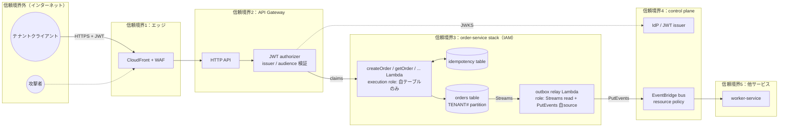
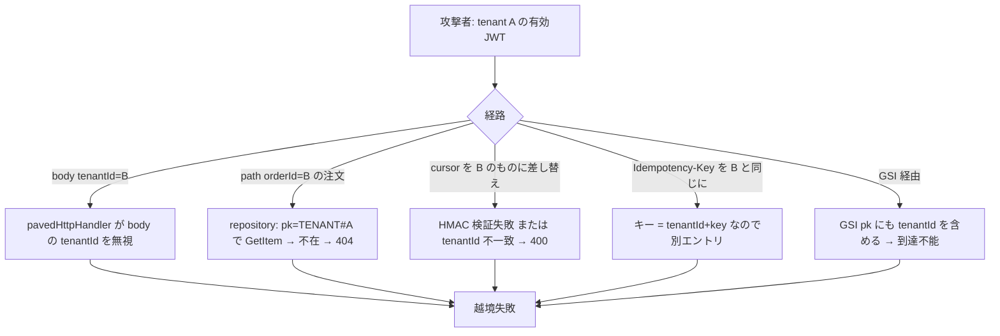

# 脅威モデル：example-order-service

| 項目     | 内容                                                                                                                                                                                                                    |
| -------- | ----------------------------------------------------------------------------------------------------------------------------------------------------------------------------------------------------------------------- |
| 対象     | `apps/example-order-service`（API Gateway HTTP API + JWT authorizer + Lambda + DynamoDB + outbox relay → EventBridge）                                                                                                  |
| 手法     | STRIDE                                                                                                                                                                                                                  |
| 版       | v0.1（2026-10-17）                                                                                                                                                                                                      |
| owner    | team-commerce（`service.yaml` の `ownerTeam`）                                                                                                                                                                          |
| レビュー | セキュリティチーム、四半期conformance reviewで見直し                                                                                                                                                                    |
| 関連     | [指針書13章](../microservice-guidelines.md#13-セキュリティ)、[5章](../microservice-guidelines.md#5-マルチテナンシー)、[6章](../microservice-guidelines.md#6-api設計)、[アーキテクチャ概要](../architecture/overview.md) |

本書は他サービスの脅威モデルのテンプレートを兼ねる。`create-service` が生成する雛形は本書の構成に従う。

---

## 1. システム概要と信頼境界

### 資産

| 資産                                                     | 分類                                       | 所在                           |
| -------------------------------------------------------- | ------------------------------------------ | ------------------------------ |
| 注文データ（テナント別）                                 | `confidential`（担当者氏名・メールを含む） | orders table                   |
| 冪等レスポンス                                           | `confidential`（注文レスポンスを含む）     | idempotency table              |
| JWT claims（`tenant_id`、`tenant_tier`、`sub`、`scope`） | 認可の根拠                                 | authorizer → Lambda event      |
| `order.created.v1` イベント                              | `confidential`                             | EventBridge、SQS、consumer log |
| Lambda execution role credential                         | 権限の根拠                                 | Lambda runtime                 |
| サービスCMK                                              | 暗号化鍵                                   | KMS                            |
| audit log                                                | `restricted`                               | 専用log group → S3 Object Lock |

### 信頼の前提

| 前提                                                                         | 検証                                                               |
| ---------------------------------------------------------------------------- | ------------------------------------------------------------------ |
| IdPが発行するJWTの `tenant_id` claimは正しい（ユーザーが所属するテナント）   | IdP側の責務。issuer / audience / 署名 / 有効期限をauthorizerが検証 |
| authorizerを通過したリクエストのclaimsはLambdaで改ざんされていない           | API GatewayがLambda eventに直接注入。クライアント制御不能          |
| EventBridge busへの `PutEvents` は、resource policyで許可されたprincipalのみ | policy test                                                        |
| `@paas/*` パッケージは信頼できる（supply chain）                             | lockfile、依存脆弱性スキャン、provenance                           |

---

## 2. STRIDE分析

各脅威に、ID、説明、影響、既存の緩和策（対応するConstruct / パッケージ）、残存リスク、検証手段を記す。優先度は 高 / 中 / 低。

### S: Spoofing（なりすまし）

| ID  | 脅威                                                                             | 影響                    | 優先度 | 緩和策                                                                                                                                                                                         | 対応Construct / パッケージ                                                        | 検証                                                    |
| --- | -------------------------------------------------------------------------------- | ----------------------- | ------ | ---------------------------------------------------------------------------------------------------------------------------------------------------------------------------------------------- | --------------------------------------------------------------------------------- | ------------------------------------------------------- |
| S-1 | 偽造JWT（署名なし / 別issuer / 期限切れ）でAPIを呼ぶ                             | 認証回避                | 高     | JWT authorizerが `kid` / 署名（RSA系）/ `iss` / `aud` or `client_id` / `exp` / `nbf` / `iat` / `scope` を検証。いずれか失敗で拒否                                                              | `PavedApiService`（authorizer設定をcontrol planeのSSM paramから）                 | 偽造 / 期限切れJWTで401になるintegration test           |
| S-2 | 他テナントのユーザーになりすまし（有効なJWTだが別テナントの `tenant_id` を主張） | テナント越境            | 高     | `tenant_id` はIdP発行claimのみ。クライアントは変更不能                                                                                                                                         | `pavedHttpHandler`（claimsからのみ `ExecutionContext.tenantId` 生成）             | tenant-isolation test                                   |
| S-3 | authorizerをバイパスしてLambdaを直接invoke                                       | 認証回避                | 中     | Lambda `InvokeFunction` 権限はAPI Gatewayのservice principal（source ARN条件）のみ。Function URLなし                                                                                           | `ObservableFunction`（resource policy）、`PlatformGuardrails`（Function URL禁止） | policy test                                             |
| S-4 | 偽の `order.created.v1` を他principalからbusへ発行                               | 偽注文の履行            | 高     | bus resource policyで `PutEvents` をorder-service stackのrelay roleに限定。`source` 条件                                                                                                       | `EventSubscription` / control plane bus policy                                    | policy test：他roleからの `PutEvents` が `AccessDenied` |
| S-5 | 外部 `X-Amzn-Trace-Id` で任意traceに自リクエストを紐付け                         | trace汚染（監査の混乱） | 低     | HTTP APIはX-Ray segmentを生成せず、trace rootはLambda active tracingが生成する。クライアントのHTTP headerはtrace contextとして使われない。REST APIへ切り替える場合も外部headerを親に結合しない | `pavedHttpHandler`、`ObservableFunction`（active tracing）                        | 外部trace headerが無視されることのunit test             |

### T: Tampering（改ざん）

| ID  | 脅威                                                                    | 影響                 | 優先度 | 緩和策                                                                                                             | 対応Construct / パッケージ                                | 検証                                                                |
| --- | ----------------------------------------------------------------------- | -------------------- | ------ | ------------------------------------------------------------------------------------------------------------------ | --------------------------------------------------------- | ------------------------------------------------------------------- |
| T-1 | request bodyの `tenantId` フィールドで他テナントとして書き込み          | テナント越境書き込み | 高     | bodyの `tenantId` は無視。repository adapterが `ExecutionContext.tenantId` で `pk` を強制                          | `pavedHttpHandler`、`TenantAwareTable` repository adapter | tenant-isolation test：body `tenantId` 改ざんで自テナントに書かれる |
| T-2 | path / query の `orderId` で他テナントの注文を更新                      | テナント越境更新     | 高     | `UpdateItem` の key が `pk=TENANT#{ctx.tenantId}`。他テナントのitemは存在しないため `ConditionalCheckFailed` → 404 | repository adapter、条件式                                | tenant-isolation test                                               |
| T-3 | pagination cursorを改ざんして他テナントの `LastEvaluatedKey` を注入     | テナント越境読み取り | 高     | cursorをHMAC封印、`tenantId` を含めて検証。不一致は400                                                             | `@paas/api-contracts` cursor helper                       | 改ざんcursor / 他テナントcursorで400                                |
| T-4 | `Idempotency-Key` 再利用で異なるpayloadを送り、保存済みレスポンスを得る | 不正な成功応答       | 中     | Powertools Idempotencyの `payloadValidationJmesPath` 検証（`IdempotencyValidationError`）。不一致は409             | Powertools Idempotency preset                             | 同一key・異payloadで409                                             |
| T-5 | outbox itemを直接書き換えて偽イベントを発行させる                       | 偽イベント           | 中     | orders tableへの書き込みはLambda roleのみ。relayはzod schemaでenvelope検証し、`source` を固定値で上書き            | `TenantAwareTable` IAM、`@paas/event-contracts`           | schema不適合outbox itemがrelay DLQへ行く                            |
| T-6 | Streams / SQS経由のイベントpayload改ざん（中間者）                      | 偽イベント処理       | 低     | AWS内部転送はTLS。consumer側はzod検証                                                                              | —                                                         | —                                                                   |
| T-7 | 楽観ロック回避による同時更新の上書き                                    | データ不整合         | 中     | `version` 属性による `ConditionExpression`                                                                         | repository adapter                                        | 並行更新テスト                                                      |
| T-8 | ログインジェクション（改行や偽JSONを含む入力でログを偽装）              | 監査の混乱           | 低     | 構造化JSONログ。入力値はフィールド値としてエスケープされる                                                         | `@paas/observability` Logger                              | unit test                                                           |

### R: Repudiation（否認）

| ID  | 脅威                           | 影響     | 優先度 | 緩和策                                                                                                                                                    | 対応Construct / パッケージ                              | 検証                                  |
| --- | ------------------------------ | -------- | ------ | --------------------------------------------------------------------------------------------------------------------------------------------------------- | ------------------------------------------------------- | ------------------------------------- |
| R-1 | ユーザーが注文作成・更新を否認 | 紛争     | 中     | audit log（`action` / `tenantId` / `subjectId` / `resource` / `outcome` / `requestId` / `correlationId` / `timestamp`）を専用log group → S3 Object Lockへ | `@paas/observability` audit logger、observability stack | audit logに全書き込み操作が記録される |
| R-2 | 開発者がaudit logを改変・削除  | 証跡喪失 | 中     | audit log groupはサービスroleが書き込みのみ。S3 Object Lock（compliance mode）                                                                            | observability stack resource policy                     | policy test                           |
| R-3 | イベントの発行元を否認         | 紛争     | 低     | `EventEnvelope.source` をrelayが固定、`causationId` で起点requestへ遡れる                                                                                 | `@paas/event-contracts`                                 | `correlationId` / `causationId` 検索  |

### I: Information Disclosure（情報漏洩）

| ID   | 脅威                                                                       | 影響                                           | 優先度 | 緩和策                                                                                            | 対応Construct / パッケージ                                   | 検証                                      |
| ---- | -------------------------------------------------------------------------- | ---------------------------------------------- | ------ | ------------------------------------------------------------------------------------------------- | ------------------------------------------------------------ | ----------------------------------------- |
| I-1  | tenant Aのトークンでtenant Bの注文を取得                                   | テナント越境読み取り                           | 高     | `GetItem` / `Query` の `pk` を `ExecutionContext.tenantId` で強制。存在しないため404              | repository adapter                                           | tenant-isolation test                     |
| I-2  | tenant AとBが同じ `Idempotency-Key` を送り、Bの保存済みレスポンスがAへ返る | テナント越境（冪等キャッシュ経由）             | 高     | 冪等キーを `tenantId + Idempotency-Key` に                                                        | Powertools Idempotency preset（`eventKeyJmesPath`）          | tenant-isolation test                     |
| I-3  | 連番 / 推測可能な `orderId` による列挙                                     | 存在推測、越境の足がかり                       | 中     | ULID。さらに `pk` がテナント固定のため他テナントのIDを知っても読めない                            | domain（ID生成）                                             | IDがULID形式であるunit test               |
| I-4  | エラーメッセージにテーブル名・スタックトレース・内部ID                     | 内部構造の漏洩                                 | 中     | 標準エラー形へ変換。`message` は固定文言。詳細はログのみ                                          | `pavedHttpHandler`、`@paas/api-contracts`                    | 500時のレスポンスにスタックトレースがない |
| I-5  | ログにPII（氏名、メール）が平文で出る                                      | PII漏洩（ログ閲覧者へ）                        | 高     | PII redaction、field allowlist                                                                    | `@paas/observability` Logger preset                          | redaction unit test                       |
| I-6  | イベントにPIIを載せ、consumer側ログや archiveに残る                        | PII拡散                                        | 高     | `data` schemaにPIIフィールドを定義しない（registry review）。必要なら参照IDのみ                   | `@paas/event-contracts` registry、schema review              | schema reviewチェックリスト               |
| I-7  | Step Functions / EventBridge archiveに秘密                                 | 秘密漏洩                                       | 中     | 秘密はSecrets Managerのみ。イベント・入力に含めない                                               | lint（環境変数・イベントへの秘密検出）、`PlatformGuardrails` | synth後template検査                       |
| I-8  | DynamoDB / S3 の非暗号化、またはAWS managed keyのみ                        | 鍵管理要件違反                                 | 中     | SSE-KMS（サービスCMK）。silo tenantはtenant CMK                                                   | `TenantAwareTable`、`PlatformGuardrails`                     | policy test                               |
| I-9  | 他サービスのroleがorders tableを読む                                       | データ所有権違反                               | 中     | table policyとIAMでorder-service stack内roleのみ。`PlatformGuardrails` が他stackからのgrantを拒否 | `TenantAwareTable`、`PlatformGuardrails`                     | policy test                               |
| I-10 | CORS `*` によるブラウザ経由の越境読み取り                                  | 認証済みユーザーのデータを悪意あるサイトが読む | 中     | 許可originを明示列挙                                                                              | `PavedApiService`（CORS props必須）、`PlatformGuardrails`    | policy test                               |
| I-11 | `listOrders` の無制限取得で大量データを一括取得                            | 大量漏洩（侵害時の被害拡大）                   | 低     | `limit` 上限100 / 最大1000。cursor方式                                                            | OpenAPI、`pavedHttpHandler` validation                       | `limit=100000` で400                      |

### D: Denial of Service（サービス妨害）

| ID  | 脅威                                                               | 影響                       | 優先度 | 緩和策                                                                                                                                                                                                                    | 対応Construct / パッケージ                                                      | 検証                                  |
| --- | ------------------------------------------------------------------ | -------------------------- | ------ | ------------------------------------------------------------------------------------------------------------------------------------------------------------------------------------------------------------------------- | ------------------------------------------------------------------------------- | ------------------------------------- |
| D-1 | 1テナントの大量リクエストで他テナントのAPIが遅延（noisy neighbor） | SLO違反                    | 高     | HTTP APIはper-client throttleを持たないため、WAF rate-based rule（tenant / tier別、例示値 standard 50 RPS / premium 200 RPS）+ stage / route throttle。必要ならREST API usage planへ（ADR-0005）                          | `PavedApiService`、CloudFront / WAF                                             | tenant skew負荷試験、throttle時に429  |
| D-2 | worker burstがcritical APIの同時実行を奪う                         | API throttle               | 高     | createOrderにreserved concurrency 100。workerは `maxConcurrency` 上限                                                                                                                                                     | `ObservableFunction`（reserved）、`PavedQueueConsumer`                          | burst負荷試験                         |
| D-3 | 巨大request body                                                   | Lambdaメモリ・時間消費     | 中     | HTTP APIのpayload上限10 MB、Lambda同期invocation payload上限6 MBに加え、OpenAPIで `maxLength`、zod validation                                                                                                             | OpenAPI、`pavedHttpHandler`                                                     | 大きいbodyで400 / 413                 |
| D-4 | 同一 `Idempotency-Key` の大量並行送信                              | idempotency table throttle | 中     | in-progress時は即409。on-demand capacity。table throttle alarm                                                                                                                                                            | Powertools Idempotency、`TenantAwareTable` alarm                                | 並行冪等テスト                        |
| D-5 | hot partition（1テナントへの集中書き込み）                         | DynamoDB throttle          | 中     | partition上限は3,000 RCU / 1,000 WCU。on-demand + adaptive capacity。Contributor Insightsでhot key監視。最大テナントの負荷シェア20%（例示値）超でwrite sharding検討                                                       | data-model.md、Workload Profile、`TenantAwareTable`（Contributor Insights有効） | tenant skew試験、throttle alarm       |
| D-6 | 下流（DynamoDB）遅延時にretryが増幅                                | 障害拡大                   | 中     | retryはSDK standard mode（max attempts 3、DynamoDB clientは4、full jitter、retry quota）のみ。adaptive modeはマルチテナントclientに非推奨のため使わない。handler・クライアントは `retryable` に従う。`deadline` で早期504 | `createClientConfig`、`pavedHttpHandler`                                        | resiliency test（dependency timeout） |
| D-7 | outbox relayの停止でイベント滞留                                   | 履行遅延                   | 中     | iterator age alarm、relay DLQ、Streams 24時間保持                                                                                                                                                                         | `ObservableFunction` Streams preset                                             | relay停止 → 再開試験                  |
| D-8 | 期限切れ / 無効JWTの大量送信でauthorizer負荷                       | 認証層のコスト・遅延       | 低     | authorizerはAPI Gateway managed（JWKSキャッシュ）。WAF rate-based rule                                                                                                                                                    | —                                                                               | —                                     |

### E: Elevation of Privilege（権限昇格）

| ID  | 脅威                                                     | 影響               | 優先度 | 緩和策                                                                           | 対応Construct / パッケージ                                        | 検証                               |
| --- | -------------------------------------------------------- | ------------------ | ------ | -------------------------------------------------------------------------------- | ----------------------------------------------------------------- | ---------------------------------- |
| E-1 | `orders:read` scopeのユーザーが `POST /orders` を呼ぶ    | 権限超過           | 高     | `requiredScopes` によるscope認可。不足は403                                      | `pavedHttpHandler`                                                | scope不足で403                     |
| E-2 | Lambda roleの過剰権限（`dynamodb:*` on `*`）による横展開 | 侵害時の被害拡大   | 高     | 関数単位role、最小権限、permissions boundary、wildcard禁止                       | `ObservableFunction`、`PlatformGuardrails`（cdk-nag IAM4 / IAM5） | policy test                        |
| E-3 | 依存パッケージの悪意あるコード（supply chain）           | 任意コード実行     | 中     | lockfile固定、`pnpm audit`、provenance確認、CIでの脆弱性スキャン（高以上で停止） | CI policy stage                                                   | CI                                 |
| E-4 | 開発者端末からの本番deployで未レビューコードを投入       | 任意変更           | 中     | 本番deploy roleはpipeline OIDCのみ。branch protection、CODEOWNERS                | pipeline stack、`.github/`                                        | policy test、branch protection確認 |
| E-5 | テナント管理者がJWT claimsの `scope` を自己付与          | 権限超過           | 中     | scope付与はIdP側のテナント管理機能で制御。本サービスはclaimsを信頼するのみ       | IdP（control plane）                                              | IdP側テスト                        |
| E-6 | cdk-nag suppressionの乱用でガードレール無効化            | 構造的脆弱性の混入 | 低     | suppressionは `PlatformGuardrails` 許可リスト + 理由 + ADR                       | `PlatformGuardrails`                                              | 許可リスト外suppressionでsynth失敗 |

---

## 3. 重点シナリオ

指針書13章が要求する4つの重点領域について、攻撃経路と防御を詳述する。

### 3.1 テナント境界の越境

多層防御：

1. **入口**：`ExecutionContext.tenantId` はauthorizer claimsからのみ。
2. **repository**：`pk` を呼び出し側が指定できないAPI。全操作で `TENANT#${ctx.tenantId}`。
3. **条件式**：更新・削除で `pk` を再確認。
4. **cursor**：HMAC + `tenantId`。
5. **IAM（Phase 2以降、`restricted` データ）**：`dynamodb:LeadingKeys` 条件。

### 3.2 JWT / authorizerの信頼

| 脅威                                       | 防御                                                                                                                |
| ------------------------------------------ | ------------------------------------------------------------------------------------------------------------------- |
| 偽造・期限切れ                             | authorizerの `kid` / 署名 / `exp` / `nbf` / `iat` 検証                                                              |
| 別issuerの正当なJWT                        | `issuer` / `audience` をcontrol planeのSSM paramから固定。`aud` がなければ `client_id` を検証                       |
| claims改ざん（クライアント側）             | 署名検証で検出                                                                                                      |
| authorizerバイパス                         | Lambda resource-based policyで `aws:SourceArn` をAPI Gatewayのexecute-api ARNに限定                                 |
| JWKS取得失敗                               | API Gatewayが公開鍵を最大2時間キャッシュ。cache missは発行元へ取得しに行き遅延が増える。失敗時は拒否（fail closed） |
| 鍵ローテーション                           | 公開鍵が最大2時間キャッシュされるため、新旧両鍵が有効な猶予期間を設ける                                             |
| IDトークンをアクセストークンとして受け入れ | routeに `authorizationScopes` を設定し、scopeのないIDトークンを拒否する（AWS推奨）                                  |
| `tenant_id` claimの誤発行（IdPバグ）       | 本サービスでは検出不能。IdP側のテストとaudit logでの事後検出                                                        |

### 3.3 冪等キーの悪用

| 脅威                                | 防御                                                                                                                                           |
| ----------------------------------- | ---------------------------------------------------------------------------------------------------------------------------------------------- |
| 他テナントの保存済みレスポンス取得  | キー = `tenantId + Idempotency-Key`                                                                                                            |
| 同一key・異payloadでの成功応答取得  | payload hash検証 → 409                                                                                                                         |
| in-progress競合によるDoS            | 即409（`retryable: true`）。table throttle alarm                                                                                               |
| 長期保持による情報蓄積              | `expiresAfterSeconds` 24時間（例示値。Powertools既定は1時間）。DynamoDB TTLで期限後48時間以内に物理削除                                        |
| keyなしの書き込み                   | `idempotent: true` のrouteで `Idempotency-Key` 必須 → 400（Powertools `throwOnNoIdempotencyKey: true`）                                        |
| keyの推測（他ユーザーの再送を妨害） | key空間はクライアント生成UUID。同一テナント内の別ユーザーが同じkeyを使った場合、`subjectId` を含めるかは業務要件で決定（v0.1ではテナント単位） |

### 3.4 イベント改ざん

| 脅威                                      | 防御                                                                                                                                      |
| ----------------------------------------- | ----------------------------------------------------------------------------------------------------------------------------------------- |
| 他principalからの偽イベント発行           | bus resource policy（principal + `source` 条件）                                                                                          |
| outbox item改ざん                         | orders tableへの書き込み権限はLambda roleのみ                                                                                             |
| envelope schema違反                       | relayおよびconsumerでzod検証。不適合はDLQ                                                                                                 |
| `tenantId` 改ざんによる他テナントへの履行 | 発行側が `ExecutionContext` から設定。consumer側はbusの信頼で受け入れるが、業務データ（`orderId`）の取得時に自テナントのkeyでしか読めない |
| replayによる二重履行                      | consumer冪等（`EventEnvelope.id`）                                                                                                        |
| archive replay時のtrace喪失               | `correlationId` で追跡                                                                                                                    |

---

## 4. 残存リスクと受容

| ID   | 残存リスク                                              | 受容理由 / 対応予定                                                                                 | 期限    |
| ---- | ------------------------------------------------------- | --------------------------------------------------------------------------------------------------- | ------- |
| RR-1 | IdPの `tenant_id` 誤発行は本サービスで検出不能          | IdPはcontrol planeの責務。audit logで事後検出可能。IdPのテスト強化を依頼                            | —       |
| RR-2 | repository adapterのバグによる `pk` 強制漏れ            | tenant-isolation testで検出。`restricted` データを扱う場合はPhase 2で `dynamodb:LeadingKeys` を追加 | Phase 2 |
| RR-3 | 同一テナント内の別ユーザーによる `Idempotency-Key` 衝突 | B2B担当者間の衝突確率は低い。業務要件で `subjectId` 追加を検討                                      | 2027-01 |
| RR-4 | supply chain攻撃（lockfile内の侵害済みパッケージ）      | 脆弱性スキャンとprovenance確認。SBOM生成をPhase 3で追加                                             | Phase 3 |

---

## 5. 検証マトリクス

| 脅威ID                                      | テスト                         | 場所                                                           | CI stage             |
| ------------------------------------------- | ------------------------------ | -------------------------------------------------------------- | -------------------- |
| S-1, S-2, T-1, T-2, T-3, I-1, I-2, I-3, E-1 | tenant-isolation test          | `tests/tenant-isolation/order-service.test.ts`                 | integration          |
| S-3, S-4, I-8, I-9, I-10, E-2, E-6          | policy test                    | `tests/policy/order-service.test.ts`                           | policy               |
| T-4, D-4                                    | 冪等テスト                     | `tests/integration/order-service-idempotency.test.ts`          | integration          |
| T-7                                         | 並行更新テスト                 | `apps/example-order-service/test/unit/`                        | unit                 |
| I-4, I-5, T-8                               | エラー形 / redaction unit test | `packages/observability/test/`、`packages/api-contracts/test/` | unit                 |
| D-1, D-2, D-5                               | 負荷試験                       | `tests/performance/`                                           | load smoke / staging |
| D-6, D-7                                    | resiliency test                | `tests/resiliency/`                                            | staging              |
| E-3                                         | 依存脆弱性スキャン             | CI                                                             | policy               |
| E-4                                         | branch protection / OIDC trust | 設定確認                                                       | 四半期review         |

---

## 6. 出典

| 記述                                                            | 出典（指針書References番号）                                 |
| --------------------------------------------------------------- | ------------------------------------------------------------ |
| STRIDE分類                                                      | Microsoft Threat Modeling Tool[107]                          |
| JWT authorizerの検証項目、公開鍵2時間キャッシュ、scope推奨      | HTTP API JWT authorizer[79]                                  |
| HTTP APIのX-Ray / WAF / per-client throttle非対応               | API Gateway HTTP vs REST[77]                                 |
| HTTP API payload 10 MB                                          | HTTP API quotas[142]                                         |
| Lambda同期payload 6 MB                                          | Lambda quotas[42]                                            |
| Lambda resource-based policy `aws:SourceArn`                    | Lambda resource-based policies[81]                           |
| Function URL `NONE` の危険性                                    | Lambda function URL auth[80]                                 |
| `dynamodb:LeadingKeys`、`Scan` 対象外                           | DynamoDB fine-grained access control[67]                     |
| partition上限、Contributor Insights                             | DynamoDB partition key design[66]、Contributor Insights[127] |
| Powertools Idempotency（payload validation、in-progress、期限） | Powertools Idempotency[87]                                   |
| SDK retry（standard / adaptive、DynamoDB 4回）                  | AWS SDK retry behavior[89]                                   |
| reserved concurrencyによる保護                                  | Lambda scaling[39]、best practices[83]                       |
| S3 Object Lock compliance mode                                  | S3 Object Lock[109]                                          |
| WAF managed rule groups                                         | AWS WAF[121]                                                 |
| cdk-nag IAM4 / IAM5                                             | cdk-nag rules[100]                                           |
| permissions boundary                                            | IAM[133]                                                     |
| EventBridge resource policy、順序保証なし                       | AWS Decision Guide[57]、EventBridge（指針書7章）             |
| ULID                                                            | ULID spec[108]                                               |
| 優先度（高 / 中 / 低）、閾値（20%、50 RPS等）                   | テンプレート固有の判断・例示値（出典なし）                   |

## 7. 変更履歴

| 日付       | 変更                                                                                    | 作成者                   |
| ---------- | --------------------------------------------------------------------------------------- | ------------------------ |
| 2026-10-17 | 初版                                                                                    | team-commerce / security |
| 2026-10-17 | 出典節を追加。S-1 / S-5 / T-4 / D-1 / D-3 / D-5 / D-6 をAWS公式文書の記述に合わせて修正 | team-commerce / security |
